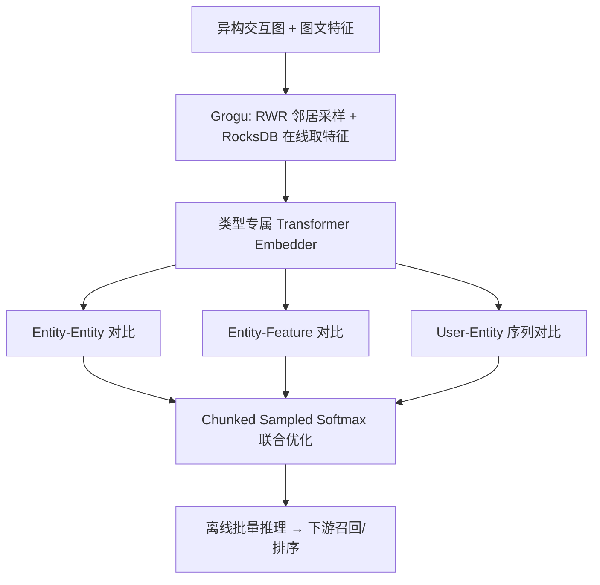
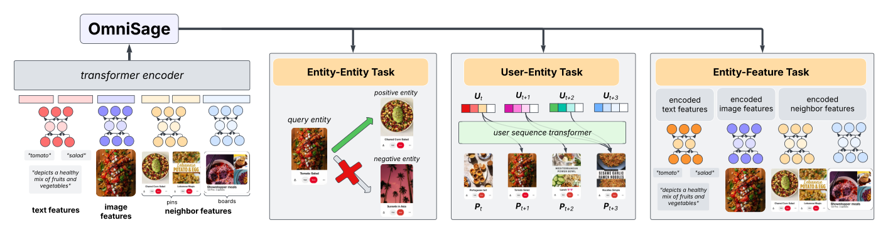

# OmniSage: Large Scale, Multi-Entity Heterogeneous Graph Representation Learning (大规模多实体异构图通用表征学习)

- **会议/期刊**: KDD 2025 (Industry Track)
- **作者与机构**: Anirudhan Badrinath, Alex Yang, Kousik Rajesh, Prabhat Agarwal, Jaewon Yang 等，Pinterest
- **推荐链路定位**: 召回（Pin/Board 表征供给下游检索与排序）
- **研究方向**: 自监督对比学习与交互去噪 / 图神经网络与知识图谱推荐
- **论文原文**: [论文原文链接](https://arxiv.org/abs/2504.17811v3)
- **开源代码**: [开源代码仓库链接](https://github.com/pinterest/atg-research)

## TL;DR (1分钟核心速览)

工业界表征学习长期割裂为三条线：图 GNN 只看拓扑、序列模型只看行为演化、内容模型只看图文，缺乏统一框架。OmniSage 在 Pinterest 5.6B 节点、63.5B 边的异构图上，用 **entity-entity / entity-feature / user-entity 三类对比任务** 把图、内容、序列信号统一进一个 sampled-softmax 目标，并配套 Grogu 图引擎与 chunked softmax 显存优化。离线 recall@10 相对 PinSage 提升 32.1%、相对 PinnerFormer 提升 89.5%；线上五个应用全站 Repin 提升约 2.5%。

## Background & Motivation (背景与核心矛盾)

- **主流范式**: 工业表征学习分三派——GraphSAGE/PinSage 类 GNN 建模实体关系，PinnerFormer 类 Transformer 建模用户行为序列，ViT/文本哈希类模型建模内容；三者各自独立训练、各自服务不同下游。
- **前人局限**: 其一，纯图方法（PinSage、LiGNN）丢弃用户序列与内容信号，冷启动节点与稀疏交互实体表征质量差；其二，纯序列方法（PinnerFormer）不感知实体间拓扑，且无法为 Board 等非序列实体产出表征；LiGNN 虽支持序列但为每个用例定制模型，不产出**通用**表征。
- **核心洞察 (Key Insight)**: 图、序列、内容本质是同一批实体的三种"视图"，可用统一对比学习框架把三者拉进同一嵌入空间——图提供结构正样本、内容提供特征对齐正样本、序列提供时序正样本，三者互为补充而非互斥。
- **本文切入点**: 以异构图为骨架，把三类信号全部转写成 query-positive-negative 三元组的 sampled softmax 任务，用一套 embedder 端到端联合优化，并解决十亿级采样与显存瓶颈。

## Method (核心方法设计)

### 1. 整体框架 (Overall Architecture)

输入为 Pinterest 异构交互图（Pin、Board 两类节点，Pin-Board 与 Pin-Pin 两类边）及节点图文特征。每个节点类型配独立 Transformer embedder：先按 RWR 邻近度对采样邻居排序，邻居特征经 MLP 后与自身特征拼成序列送入 Transformer，取 CLS 输出经 MLP + L2 归一化得实体嵌入。三类对比任务共享该嵌入空间联合训练；Grogu 引擎负责在线邻居采样与特征读取，chunked softmax 负责显存控制；推理侧每日离线批量生成 6B+ 实体表征供下游检索/排序消费。

<figure class="paper-figure" markdown="span">
  <figcaption>图2：OmniSage整体架构示意图。</figcaption>
</figure>

### 2. 关键设计拆解 (Key Designs)

1. **异构 RWR 邻居采样（按类型分配预算）**：均匀采样在十亿级图上既慢又偏。本文把同构图的 top-k 邻近采样推广到异构：对关系子集 $R\subseteq\mathcal{T}_e$诱导子图$\mathcal{H}_R$，按节点类型$t$分别取邻近度前$k_t$个节点，再对多个关系子集取并集$N(u,\mathcal{H})=\bigcup_{i}N(u,\mathcal{H}_{R_i})$，用 forward-push 以误差$\delta=1/B$ 近似 RWR 分数。按类型分配预算保证 Pin-Pin 这类稀疏边不被 Pin-Board 淹没，物理直觉是"关系语义不同，采样配额应解耦"。

2. **三类对比任务统一 sampled softmax**：所有任务共用带采样偏差校正的打分函数 $s(q,v)=\lambda\cdot q^{\top}v-\log Q(v)$，其中$Q(v)\propto P(v|q)$由 count-min sketch 估计，抵消 in-batch 负样本的频次偏置。三类任务分别为：entity-entity（图边 + 分场景 engagement 对，按数据源加权$L_{pair}=\sum_i w_i\,\mathbb{E}\,L$）、entity-feature（节点嵌入对齐自身各特征编码$g_x(u)$，$L_{feat}=\mathbb{E}\frac{1}{|\mathcal{X}_u|}\sum_x L(g_x(u),f_{t_u}(u),f_{t_u}(N))$）、user-entity（Transformer 解码用户序列，同时优化 next-action 与$\Delta$ 窗口内 future-action 两个损失）。直觉：特征对齐保住内容信息、序列对齐注入时序动态，二者弥补纯图任务对冷启与兴趣漂移的盲区。

3. **训练目标与工程效率**：总损失 $\mathcal{L}_\Theta=\lambda_p L_{pair}+\lambda_f L_{feat}+\lambda_s[L_{next}+L_{fut}]$，负采样为随机负 + in-batch 负并做频次校正。显存瓶颈来自$|Q|\times|N|$ 的 logits 外积，本文提出 chunked sampled softmax：detach 嵌入后分块计算损失并累加对 q/p/n 的梯度，最后一次性回传模型参数，等价于梯度检查点，**不增加反向传播次数**却大幅提升可用 batch size。推理为每日离线批量，无在线延迟开销。

## Experimental Setup & Evaluation Protocol (实验设置与评估协议)

- **数据集与预处理**: 工业私有 Pinterest 图，按度 $d$均匀剪枝至$d^{\alpha}$条边（$\alpha=0.86$），低度节点不剪枝：

| 数据集 | #Nodes | #Edges | 稀疏度/密度 | 特征/场景说明 |
| :--- | :---: | :---: | :---: | :--- |
| Pinterest Pin | 3.5B (avg deg 21.7) | Pin-Board 51.4B | 极稀疏 | 图像 ViT + n-gram 文本哈希 |
| Pinterest Board | 2.1B (avg deg 24.3) | Pin-Pin 12.1B | 极稀疏 | Board 聚合特征 |

- **数据划分与防穿越 (Splitting Strategy)**: 各任务构造与训练集不相交的评测集（按用户/实体对隔离）；user-entity 的未来动作正样本取自训练序列结束日 **28 天后**，严格避免时间穿越。
- **排名评测协议 (Ranking Protocol)**: 离线为 `Sampled Ranking`——在大量随机负样本中判断正样本是否进入 recall@10 前 k；线上为多表面 A/B 实验，指标为 Sitewide/Surface Repins 与 Closeups。
- **对比基线与超参设置**: 基线为 PinSage（entity-entity）与 PinnerFormer（user-entity），特征编码器与序列模型架构、训练评测设置完全对齐以保证公平；显著性以线上提升 >0.5% 为阈值。

## Key Experimental Results (实验关键数据)

### 1. 主实验对比 (Main Results)

离线 recall@10（表 2）：

| Method | Entity-Entity | Entity-Feature | User-Entity |
| :--- | :---: | :---: | :---: |
| PinSage | 0.461 | - | - |
| PinnerFormer | - | - | 0.306 |
| **OmniSage** | **0.609** | **0.338** | **0.580** |
| Improv. | +32.1% | - | +89.5% |

线上 A/B（表 7/8，相对 PinSage 基线）：

| 场景 | Sitewide Repins | Surface Repins | Surface Closeups |
| :--- | :---: | :---: | :---: |
| HF Ranking | +0.92% | +1.22% | +0.52% |
| P2P Retrieval | +0.39% | +0.47% | +0.22% |
| P2P Ranking | +0.85% | +1.35% | +1.12% |
| BMI Ranking | +0.67% | +5.91% | +4.02% |
| BMI Retrieval | +0.38% | +3.79% | +4.65% |

### 2. 消融实验 (Ablation Study)

| 配置 | Entity-Entity | Entity-Feature | User-Entity | HF hits@3 (Repin) |
| :--- | :---: | :---: | :---: | :---: |
| No Graph | 0.440 | - | 0.375 | - |
| Pin-Board only | 0.529 | - | 0.564 | - |
| Pin-{Board,Pin} | 0.609 | - | 0.580 | - |
| Entity-Entity only | 0.623 | - | - | neutral |
| Entity-{Entity,Feature} | 0.628 | 0.379 | - | +0.5% |
| 三任务全开 | 0.609 | 0.338 | 0.580 | +2.6% |

### 3. 关键实验发现 (Key Findings)

1. **Pin-Pin 边是图侧最大增量**：仅 Pin-Board 时 entity-entity 为 0.529，加入 Pin-Pin 后升至 0.609（+15.1%），说明"查询 Pin → 相关 Pin"的语义边提供了 Board 归属关系无法覆盖的细粒度相似性。
2. **任务间存在非对称迁移**：单任务 entity-entity 为 0.623，三任务联合后降至 0.609，但 user-entity 从 0.564 升至 0.580、下游 HF hits@3 从 neutral 跃至 +2.6%——序列任务显著受益于图与内容任务，而图任务略有让步，说明联合训练的价值应以下游排序而非单任务 recall 衡量。
3. **随机游走预算鲁棒**：预算从 $B/2$到$4B$，entity-entity 稳定在 0.609–0.612、user-entity 在 0.576–0.580，说明性能不依赖深度邻居扩展，采样成本可压到很低。

## Highlights & Limitations (亮点、对比与审稿批判)

- **与代表作对比 (vs. Prior Work)**: 相比 PinSage 仅用图边 + BCE 边预测，本文换成 sampled softmax 并叠加内容与序列任务；相比 PinnerFormer 只产出用户侧序列表征，本文为 Pin/Board 等实体产出可跨应用复用的通用嵌入；相比 LiGNN 的"每用例定制模型"，本文强调一套表征服务五个应用。
- **可迁移亮点**: ① 按节点类型分配 RWR 采样预算，可直接迁移到任何多关系工业图；② chunked sampled softmax 的"detach—分块累加—单次回传"模式，是超大负样本池训练的通用显存技巧。
- **审稿级局限批判**: 其一，全部实验基于 Pinterest 私有图与线上 A/B，无公开数据集复现，离线 recall 的负样本规模与构造方式未充分披露，横向可比性弱；其二，三任务联合导致单任务指标回退，权重 $\lambda_p,\lambda_f,\lambda_s$ 的敏感性分析与调参成本未展开，且每日离线批量推理意味着表征无法实时反映新交互。

## Rating (四维评分)

- **方法创新性 (Novelty)**: ⭐⭐⭐⭐ （单点算子多为已有组件的组合，但"三视图统一对比 + 异构分类型采样"的框架级整合在工业规模上属首次系统落地）
- **评估协议与实验扎实度 (Protocol & Experiments)**: ⭐⭐⭐⭐ （离线三任务 + 五场景线上 A/B + 图构造/采样预算/任务组合三组消融完整，但缺公开数据集与负样本规模细节）
- **写作与数学规范度 (Clarity & Rigor)**: ⭐⭐⭐⭐ （三类任务损失与采样校正公式定义清晰、符号统一，工程算法伪代码完整，理论分析偏薄）
- **工业落地与复现价值 (Industrial & Practical Value)**: ⭐⭐⭐⭐⭐ （代码已开源，Grogu 引擎与 chunked softmax 直接可用，线上 2.5% 全站 Repin 提升是硬证据）

