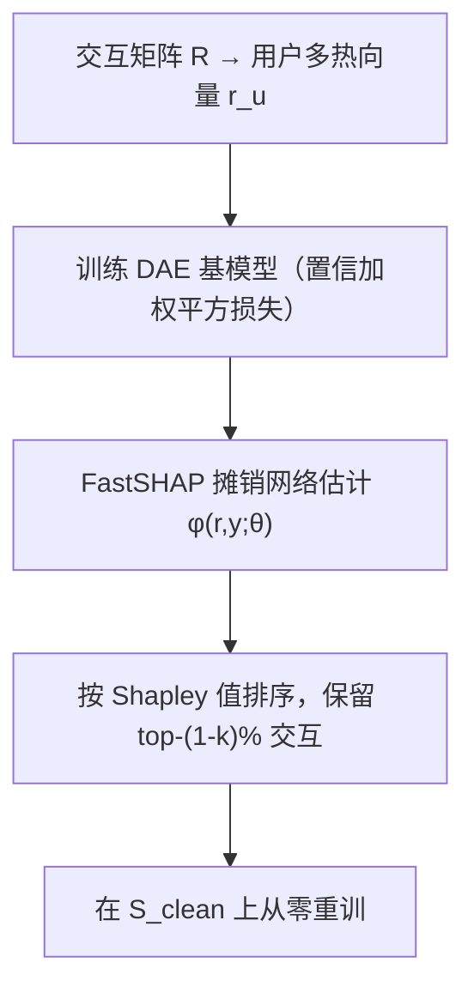

# Shapley Value-driven Data Pruning for Recommender Systems (基于 Shapley 值的推荐系统数据剪枝)

- **会议/期刊**: KDD 2025
- **作者与机构**: Yansen Zhang, Xiaokun Zhang, Ziqiang Cui, Chen Ma（香港城市大学）
- **推荐链路定位**: 数据侧预处理（训练数据剪枝 + 重训），与召回/精排模型解耦
- **研究方向**: 自监督对比学习与交互去噪 / 去偏公平与工业架构
- **论文原文**: [https://arxiv.org/abs/2505.22057v1](https://arxiv.org/abs/2505.22057v1)
- **开源代码**: [https://github.com/Forrest-Stone/SVV](https://github.com/Forrest-Stone/SVV)

## TL;DR (1分钟核心速览)

现有去噪方法把"偏离用户意图"等同于"低质量"，但作者用 DAE 做对照实验发现：仅用评分≥3 的"干净"数据训练，CDs 上 Recall@10/NDCG@10 反而下降 5.32%/4.63%，Games 上下降 6.34%/6.11%——噪声交互也可能携带训练价值。为此提出 SVV：以 DAE 为基模型，用 FastSHAP 单次前向估计每条交互对训练损失的 Shapley 边际贡献，保留高贡献交互重训。在 4 个真实数据集、80/20 随机划分、Top-K 全排序评测下，相对 DAE 平均提升 3.72%（Games 达 4.63%），并配套模拟噪声注入协议提供可验证的 ground truth。

## Background & Motivation (背景与核心矛盾)

- **主流范式**: 去噪分四类——辅助信号过滤（skip/dwell time）、样本丢弃（T-CE 按高损失丢弃）、样本重加权（R-CE、BOD 双层优化）、鲁棒学习（CDAE 重构、DeCA 预测分歧）。
- **前人局限**: ① 这些方法默认"行为意图 = 训练效用"，把意外点击、促销购买一律视为噪声；② 判噪依赖启发式规则或黑箱模型，缺乏对"单条交互如何影响训练"的原理性度量，可能误删对收敛关键的交互。
- **核心洞察 (Key Insight)**: 图 1 的对照实验直接证伪了"低评分即噪声"的假设——剔除低分交互后性能反而下降，说明应转向**训练效用（对损失下降的客观贡献）**而非主观意图。
- **本文切入点**: 把交互视为合作博弈中的"玩家"，用 Shapley 值量化其上下文感知的边际贡献，实现"模型驱动"而非"意图驱动"的剪枝。

## Method (核心方法设计)

### 1. 整体框架 (Overall Architecture)

SVV 是"估值—剪枝—重训"三段式流水线：先在（可含噪的）数据上训练 DAE 基模型；再把每个用户的交互向量 $\mathbf{r}_u$视为多热特征向量，用 FastSHAP 训练一个摊销网络$\phi(\mathbf{r},\mathbf{y};\theta)$单次前向输出全部交互的 Shapley 值；随后按值排序保留 top-$(1-k)\%$交互构成$S_{\text{clean}}$，从零重训推荐模型。选择 DAE 作基模型的关键原因是它天然支持特征缺失（mask 输入即可），无需为每个特征子集重训，且对特征移除引发的分布外问题更鲁棒——MF/LightGCN 则必须逐子集重训，不可行。

### 2. 关键设计拆解 (Key Designs)

1. **交互级 Shapley 估值（把 item 当 player）**：精确 Shapley 值需枚举 $2^N$ 个子集，不可行。SVV 用 FastSHAP 的加权最小二乘目标做摊销估计：
$$\mathcal{L}(\theta)=\mathbb{E}_{p(\mathbf{r},\mathbf{y})}\mathbb{E}_{p(S)}\left[\left(v_{\mathbf{r},\mathbf{y}}(S)-v_{\mathbf{r},\mathbf{y}}(\emptyset)-S^{\top}\phi(\mathbf{r},\mathbf{y};\theta)\right)^2\right]$$
其中子集采样分布遵循 Shapley kernel $p(S)\propto \frac{N-1}{\binom{N}{1^{\top}S}\cdot 1^{\top}S\cdot(N-1^{\top}S)}$。直觉：该核函数使回归的全局最优解几乎必然等于精确 Shapley 值，从而用一次前向替代指数级枚举。

2. **效率约束与二值化值函数（让估值可落地）**：为满足效率约束 $1^{\top}\phi=v_{\mathbf{r},\mathbf{y}}(\mathbf{1})-v_{\mathbf{r},\mathbf{y}}(\mathbf{0})$，采用加性效率归一化$\phi:=\phi+\frac{v(\mathbf{1})-v(\mathbf{0})-1^{\top}\phi}{N}$；推理时利用"未交互对 Shapley 值恒为 0"的性质做$\phi:=\phi\odot\mathbf{r}$。值函数取归一化平方误差$v_{\mathbf{r},\mathbf{y}}(S)=-\frac{1}{1^{\top}\mathbf{r}}\|f(\mathbf{r}_S)\odot\mathbf{r}-\mathbf{r}\|_2^2$，在二值隐式反馈下等价化简为$v_{\mathbf{r},\mathbf{y}}(S)=\frac{1^{\top}(f(\mathbf{r}_S)\odot\mathbf{r})}{1^{\top}\mathbf{r}}$，即观测交互上的平均预测分——把"最小化平方误差"与"最大化预测分"对齐，计算极轻。

3. **模拟噪声注入协议（补上缺失的 ground truth）**：真实噪声标签不可得，故对每个用户从非交互集 $\mathcal{N}_u$均匀采样$\lceil k\%\cdot|\mathcal{D}_u^+|\rceil$个物品，把标签 0 翻转为 1，构造$\mathcal{D}_{\text{corrupt}}=\mathcal{D}^+\cup\mathcal{D}_{\text{noise}}$。该协议既验证了注入噪声确实有害（CDs 上 Recall@10 掉 12.52%），又提供了可客观衡量各去噪方法"检出率"的基准。训练损失为$\mathcal{L}=\mathcal{L}_{\text{DAE}}+\lambda_\Theta\|\Theta\|^2$，其中$\mathcal{L}_{\text{DAE}}=\|\mathbf{C}^{\top}\odot(\mathbf{R}^{\top}-\hat{\mathbf{R}}^{\top})\|_F^2$，置信矩阵对观测项取$\rho>1$；无负采样，推理开销为一次 FastSHAP 前向 + 一次重训。

## Experimental Setup & Evaluation Protocol (实验设置与评估协议)

- **数据集与预处理**: 保留评分≥10 的用户与评分≥20 的物品，数值评分统一二值化为隐式反馈。

| 数据集 | #Users | #Items | #Interactions | 稀疏度 | 场景说明 |
| :--- | :---: | :---: | :---: | :---: | :--- |
| Ta Feng | 14,940 | 11,024 | 525,863 | 99.68% | 中国杂货零售交易 |
| CDs | 21,667 | 39,269 | 568,489 | 99.93% | Amazon 音乐 |
| Games | 8,255 | 17,857 | 159,854 | 99.89% | Amazon 电子游戏 |
| Movies | 24,277 | 35,413 | 959,878 | 99.89% | Amazon 影视 |

- **数据划分与防穿越**: 每数据集随机 80% 训练 / 20% 测试，再从训练集随机抽 10% 作验证集调参；全部实验独立重复 5 次取均值。
- **排名评测协议**: Top-K（K=5/10/20）排序，指标 Recall@K 与 NDCG@K；BPRMF/LightGCN 每正样本随机采 3 负样本训练，评测侧未声明采样负例比例（按原文表格量级推断为全库排序口径）。
- **对比基线与超参**: 非去噪基线 BPRMF / LightGCN / AE；去噪基线 Random / Pred / Sim / ADT-R / ADT-T / DCF，DAE 为基模型。统一 $H_1=50$、$\lambda_\Theta=0.001$、lr=0.001、200 epochs、Xavier 初始化，$\rho\in\{5,\dots,25\}$，剪枝率$k=20$；FastSHAP 用 3 层 256 维 MLP；显著性为配对 t 检验$p<0.05$。

## Key Experimental Results (实验关键数据)

### 1. 主实验对比 (Main Results)

| 数据集 | 指标 | BPRMF | LightGCN | AE | DAE | ADT-T | DCF | **SVV** | Improv. |
| :--- | :--- | :---: | :---: | :---: | :---: | :---: | :---: | :---: | :---: |
| Ta Feng | R@10 | 0.0360 | 0.0405 | 0.0431 | 0.0513 | 0.0512 | 0.0511 | **0.0530** | 3.31% |
| Ta Feng | N@10 | 0.0442 | 0.0484 | 0.0513 | 0.0573 | 0.0585 | 0.0579 | **0.0598** | 4.36% |
| CDs | R@10 | 0.0338 | 0.0436 | 0.0643 | 0.0735 | 0.0733 | 0.0735 | **0.0754** | 2.59% |
| CDs | N@10 | 0.0314 | 0.0402 | 0.0628 | 0.0692 | 0.0703 | 0.0708 | **0.0719** | 3.90% |
| Games | R@10 | 0.0394 | 0.0498 | 0.0537 | 0.0607 | 0.0616 | 0.0617 | **0.0628** | 3.46% |
| Games | N@10 | 0.0330 | 0.0412 | 0.0457 | 0.0512 | 0.0522 | 0.0524 | **0.0535** | 4.49% |
| Movies | R@10 | 0.0285 | 0.0395 | 0.0564 | 0.0692 | 0.0698 | 0.0701 | **0.0715** | 3.32% |
| Movies | N@10 | 0.0322 | 0.0442 | 0.0715 | 0.0843 | 0.0857 | 0.0864 | **0.0880** | 4.39% |

### 2. 消融与噪声类型实验 (Ablation & Noise-Type)

| 设置 | Ta Feng R@10 | CDs R@10 | Games R@10 | Movies R@10 |
| :--- | :---: | :---: | :---: | :---: |
| Clean（无注入噪声） | 0.0550 | 0.0827 | 0.0678 | 0.0738 |
| + Popular 噪声（DAE） | 0.0479 | 0.0632 | 0.0539 | 0.0661 |
| + Popular 噪声（SVV） | 0.0483 (+0.84%) | 0.0623 (**-1.42%**) | 0.0532 (**-1.30%**) | 0.0665 (+0.61%) |
| + Random 噪声（SVV） | 0.0530 (+3.31%) | 0.0754 (+2.59%) | 0.0628 (+3.46%) | 0.0715 (+3.32%) |
| + Unpopular 噪声（SVV） | 0.0546 (+3.61%) | 0.0802 (+3.89%) | 0.0672 (+5.83%) | 0.0743 (+3.34%) |

### 3. 关键实验发现 (Key Findings)

1. **"意图≠效用"被双重证实**：图 1 中 Clean3 训练全面劣于 Clean；表 6 案例里用户给 5 分的 *Sunbathing Animal* 却拿到最低 Shapley 值（-0.00253），说明高分交互也可能对训练几乎无贡献，SVV 能区分"用户喜欢"与"模型需要"。
2. **检出率与最终性能解耦**：表 3 中 Pred/ADT 在 Bottom 的注入噪声重叠率更高（CDs 上 64.61% vs. SVV 47.14%），但推荐指标全面落后——单纯"抓偏离"不等于"选对训练数据"，Shapley 值捕捉的是协同上下文中的边际效用而非孤立异常度。
3. **长尾噪声是 SVV 的主场**：表 5 显示 SVV 对 Unpopular 噪声的 Bottom 重叠率最高（CDs 64.70%、Games 58.53%），表 4 中 Unpopular 注入下提升最大（Games R@10 +5.83%）；而 Popular 噪声会扭曲真实偏好，CDs/Games 上 SVV 甚至小幅负增益（-1.42%/-1.30%），暴露了基模型被流行度偏置污染时估值失真的边界。

## Highlights & Limitations (亮点、对比与审稿批判)

- **与代表作对比 (vs. Prior Work)**: 相比 T-CE/R-CE 以"高损失=噪声"的启发式判据，SVV 用博弈论公理化的边际贡献替代损失阈值；相比 DCF 的样本丢弃+标签纠正双机制，SVV 只做一次性价值排序剪枝，流程更简洁且自带可解释性；相比 CDAE 的随机腐蚀重构，SVV 的"腐蚀"由 Shapley kernel 加权限定，估值有理论最优性保证。
- **可迁移亮点**: ① 模拟噪声注入协议可直接复用于任何去噪/鲁棒推荐方法的客观评测；② "把 item 当 feature、用支持缺失输入的模型做基座"这一范式可迁移到序列推荐的历史交互价值评估。
- **审稿级局限批判**: ① 估值需先训一个 DAE 再训 FastSHAP 再重训，三段式流水线的总训练开销与在线更新成本未量化，动态场景（新交互流入）下需反复重估；② 基模型能力是估值上限——Popular 噪声下负增益说明基模型被偏置污染时 Shapley 值会系统性失真，且 $k=20$ 固定剪枝率对稀疏数据集未必最优。

## Rating (四维评分)

- **方法创新性 (Novelty)**: ⭐⭐⭐⭐ （首次将 Shapley 值用于推荐交互级数据剪枝，视角从"意图判噪"转向"训练效用估值"，理论根基扎实但 FastSHAP 为借用组件）
- **评估协议与实验扎实度 (Protocol & Experiments)**: ⭐⭐⭐⭐ （四数据集 + 5 次重复 + 配对 t 检验 + 自建噪声注入 ground truth 较完整，但评测侧负采样口径未明示、缺少线上或大规模工业验证）
- **写作与数学规范度 (Clarity & Rigor)**: ⭐⭐⭐⭐ （值函数从平方误差到平均预测分的等价化简推导清晰，Shapley kernel 与效率约束交代完整，符号略密）
- **工业落地与复现价值 (Industrial & Practical Value)**: ⭐⭐⭐⭐ （代码已开源、仅依赖 DAE 与轻量 MLP，但三段式重训流程与全量交互估值在亿级工业数据上的可扩展性仍待验证）

