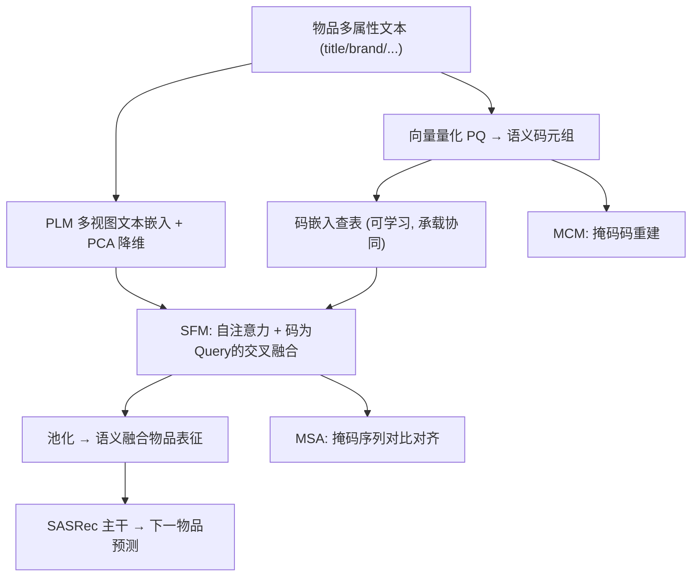
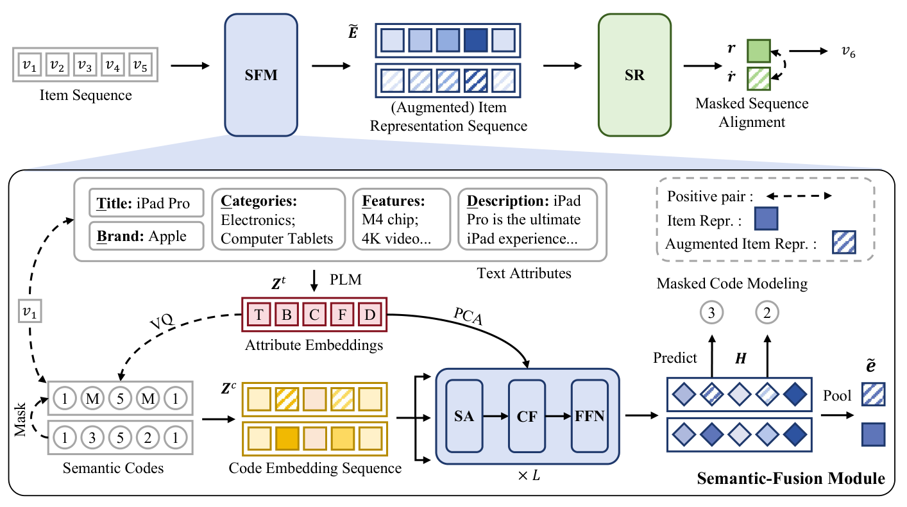

# Bridging Textual-Collaborative Gap through Semantic Codes for Sequential Recommendation (以语义码弥合文本-协同鸿沟的序列推荐)

- **会议/期刊**: KDD 2025 (Research Track)
- **作者与机构**: Enze Liu, Bowen Zheng, Wayne Xin Zhao, Ji-Rong Wen（中国人民大学高瓴人工智能学院 / RUCAIBox）
- **推荐链路定位**: 召回（序列 Next-Item 预测）
- **研究方向**: 序列与会话推荐 / 自监督对比学习与交互去噪
- **论文原文**: [https://arxiv.org/abs/2503.12183v2](https://arxiv.org/abs/2503.12183v2)
- **开源代码**: [https://github.com/RUCAIBox/CCFRec](https://github.com/RUCAIBox/CCFRec)

## TL;DR (1分钟核心速览)

序列推荐中"文本表征"与"ID 协同信号"长期难以平衡：直接拼接/相加会让模型过度依赖文本而丢失协同关系，纯码本方法又损失细粒度文本语义。CCFRec 提出以**多视图文本经向量量化得到的语义码**作为桥梁：码既是可学习的"伪 ID"承载协同信号，又以 Query 身份通过交叉注意力从文本中**按需抽取**信息。配合掩码码建模（MCM）与掩码序列对齐（MSA）两个自监督目标，在 4 个 Amazon 2023 子集、`Leave-One-Out` + `Full-Ranking` 协议下，R@10 相对最强基线最高提升 **20.1%**（Scientific），平均提升 10%+。

## Background & Motivation (背景与核心矛盾)

- **主流范式**: 序列推荐以 SASRec/BERT4Rec 类 Transformer 为主干，用唯一 ID 嵌入建模协同信号；文本增强路线则用 PLM 编码标题/品牌等属性，通过相加、拼接、对比学习或频域卷积与 ID 融合。
- **前人局限**: (1) 文本表征与 ID 嵌入在交互前彼此**孤立**，缺乏信息共享，简单相加/注意力易使模型过度偏向文本、忽视物品间协同关系（UniSRec 的 `ID+T` 变体甚至不如纯文本变体即为例证）；(2) 纯码本路线（VQRec）虽缓解文本过依赖，却造成**文本语义损失**，且码与文本之间无显式对齐机制。
- **核心洞察 (Key Insight)**: 语义码具备双重身份——它像 ID 一样拥有可学习嵌入表、能在序列建模中吸收协同信号；同时每个物品的多码元组天然编码了不同粒度/视角的语义相似性先验，可作为**融合的引导信号**而非最终表征。
- **本文切入点**: 不让码"替代"文本，而让码"指挥"文本——以码为 Query 从文本中抽取相关信息，再用掩码任务强制码-文本互相对齐。

## Method (核心方法设计)

### 1. 整体框架 (Overall Architecture)

物品的 5 个属性（title/brand/categories/features/description）分别经 Sentence-T5 编码为多视图文本嵌入，再各自经乘积量化（PQ）压成 $k=4$个离散码，共$n_c=m\times k$ 个码。码查表得到码嵌入序列，送入语义融合模块（SFM）：先自注意力混合码间关系，再以码为 Query、文本为 Key/Value 做交叉融合，池化后与码嵌入池化结果相加得到物品表征。该表征序列进入 SASRec 式主干做用户偏好建模，并以交叉熵预测下一物品。训练时额外施加 MCM（从文本重建被掩码的码）与 MSA（掩码增强序列与原序列对比对齐）。部署阶段 SFM 可离线预计算，在线推理复杂度与 SASRec 完全一致。

<figure class="paper-figure" markdown="span">
  <figcaption>图1：CCFRec 的整体框架，包含两个关键组件，即语义融合模块（SFM）和序列推荐主干（SR）。SFM 堆叠自注意力（SA）层、交叉融合（CF）层和前馈网络（FFN），以实现语义融合物品表示的有效学习。</figcaption>
</figure>

### 2. 关键设计拆解 (Key Designs)

1. **码引导的语义融合模块（Code-Guided Cross-Fusion）**：痛点在于文本与 ID 融合时缺乏"选择性"——全量文本信息被无差别注入。本文令码嵌入作 Query、文本嵌入作 Key/Value，逐层执行 $\boldsymbol{H}^{l}=\mathrm{FFN}\big(\mathrm{MHA}(\tilde{\boldsymbol{H}}^{l},\boldsymbol{Z}^{t},\boldsymbol{Z}^{t})\big)$，其中$\tilde{\boldsymbol{H}}^{l}=\mathrm{MHA}(\boldsymbol{H}^{l-1},\boldsymbol{H}^{l-1},\boldsymbol{H}^{l-1})$、$\boldsymbol{H}^{0}=\boldsymbol{Z}^{c}$。直觉上，码只"取走"与自身语义相关的文本片段，天然抑制文本过依赖；两序列均无内在顺序，故省略位置编码。最终$\tilde{\boldsymbol{e}}=\mathrm{Pool}(\boldsymbol{H})+\mathrm{Pool}(\boldsymbol{Z}^{c})$ 保留码自身的协同梯度通路。

2. **掩码码建模 MCM（Masked Code Modeling）**：单一推荐损失无法充分训练层级化的 SFM，码嵌入易欠优化。以 BERT 式策略随机掩码 $\rho=0.5$比例的码，要求 SFM 依据属性文本与未掩码码恢复之：$\mathcal{L}_{\mathrm{MCM}}=\frac{1}{|\mathcal{M}_c|}\sum_{x\in\mathcal{M}_c}-\log\frac{\exp(g(\tilde{\boldsymbol{h}}_x,\boldsymbol{z}^c_x)/\tau)}{\sum_{j\in\mathcal{C}}\exp(g(\tilde{\boldsymbol{h}}_x,\boldsymbol{z}^c_j)/\tau)}$。该任务一举两得：既建模**物品内部码间相关性**，又通过"必须读文本才能猜对码"强制文本-码对齐。

3. **掩码序列对齐 MSA 与总损失**：MCM 只优化 SFM，主干仍需增强。将掩码码序列重新过 SFM 得到增强物品表征，再经主干得到增强序列表征 $\tilde{\boldsymbol{r}}$，与原序列表征$\boldsymbol{r}$做对称 InfoNCE：$\mathcal{L}_{\mathrm{MSA}}=\frac{1}{2}\big[\mathrm{InfoNCE}(\tilde{\boldsymbol{r}},\boldsymbol{r},\mathcal{B}_{\boldsymbol{r}})+\mathrm{InfoNCE}(\boldsymbol{r},\tilde{\boldsymbol{r}},\mathcal{B}_{\tilde{\boldsymbol{r}}})\big]$，批内其他序列为负样本。总目标$\mathcal{L}=\mathcal{L}_{\mathrm{CE}}+\alpha\mathcal{L}_{\mathrm{MCM}}+\beta\mathcal{L}_{\mathrm{MSA}}$，$\alpha,\beta\in\{0.2,0.4,0.6,0.8\}$网格搜索。训练复杂度$\mathcal{O}(N^2d+Nd^2+NM^2d+NMKd+NMd^2)$，因$M,K\ll N$ 开销可控；推理免负采样、免 SFM 在线计算。

## Experimental Setup & Evaluation Protocol (实验设置与评估协议)

- **数据集与预处理**: Amazon 2023 四个子集，`5-core` 过滤，序列按时间排序、截断至 20；属性统一截断 512 token。

| 数据集 | #Users | #Items | #Interactions | 稀疏度 | 场景说明 |
| :--- | :---: | :---: | :---: | :---: | :--- |
| Instrument | 57,439 | 24,587 | 511,836 | 99.964% | 乐器，平均序列长 8.91 |
| Scientific | 50,985 | 25,848 | 412,947 | 99.969% | 工业科学品，8.10 |
| Game | 94,762 | 25,612 | 814,586 | 99.966% | 电子游戏，8.60 |
| Baby | 150,777 | 36,013 | 1,241,083 | 99.977% | 母婴，8.23 |

- **数据划分与防穿越**: `Leave-One-Out`——最后一项测试、倒数第二项验证、其余训练。
- **排名评测协议**: 无偏 `Full-Ranking`（全物品库排序），指标 R@5/R@10/N@5/N@10。
- **对比基线与超参**: 三类基线共 13 个（传统 GRU4Rec/BERT4Rec/SASRec/FMLP-Rec；对比学习 S3Rec/DuoRec/MAERec；文本增强 FDSA/UniSRec×2/VQRec/MMSR/TedRec）。统一嵌入维度 $d=128$，SFM 与主干均 2 层 2 头、隐层 512，码本 256、$k=4$，$\tau=0.07$，$\rho=0.5$，Adam + 早停（验证 NDCG@10 十轮不升即停）。

## Key Experimental Results (实验关键数据)

### 1. 主实验对比 (Main Results)

| 方法 | Instrument R@10 | N@10 | Scientific R@10 | N@10 | Game R@10 | N@10 | Baby R@10 | N@10 |
| :--- | :---: | :---: | :---: | :---: | :---: | :---: | :---: | :---: |
| SASRec | 0.0523 | 0.0274 | 0.0412 | 0.0199 | 0.0847 | 0.0438 | 0.0362 | 0.0180 |
| FMLP-Rec | 0.0536 | 0.0282 | 0.0422 | 0.0204 | 0.0857 | 0.0444 | 0.0367 | 0.0190 |
| MAERec | 0.0577 | 0.0310 | 0.0452 | 0.0253 | 0.0936 | 0.0513 | 0.0370 | 0.0193 |
| UniSRec_T | 0.0589 | 0.0312 | 0.0469 | 0.0246 | 0.0925 | 0.0480 | 0.0380 | 0.0198 |
| VQRec | 0.0602 | 0.0298 | 0.0461 | 0.0224 | 0.0926 | 0.0466 | 0.0409 | 0.0214 |
| TedRec | 0.0570 | 0.0313 | 0.0415 | 0.0238 | 0.0956 | 0.0526 | 0.0380 | 0.0208 |
| CCFRec(RQ) | 0.0670 | 0.0351 | 0.0540 | 0.0276 | 0.1023 | 0.0523 | 0.0443 | 0.0232 |
| **CCFRec(PQ)** | **0.0682** | **0.0361** | **0.0555** | **0.0285** | **0.1042** | **0.0536** | **0.0455** | **0.0238** |
| **Improv.** | +13.3% | +15.3% | +18.3% | +12.7% | +9.0% | +1.9% | +11.3% | +11.2% |

### 2. 消融实验 (Ablation Study)

| 变体 | Instrument R@10 | N@10 | Scientific R@10 | N@10 | Baby R@10 | N@10 |
| :--- | :---: | :---: | :---: | :---: | :---: | :---: |
| (0) CCFRec 完整 | **0.0682** | **0.0361** | **0.0555** | **0.0285** | **0.0455** | **0.0238** |
| (1) w/o $\mathcal{L}_{\mathrm{MCM}}$ | 0.0668 | 0.0343 | 0.0548 | 0.0279 | 0.0444 | 0.0230 |
| (2) w/o $\mathcal{L}_{\mathrm{MSA}}$ | 0.0664 | 0.0342 | 0.0548 | 0.0277 | 0.0439 | 0.0229 |
| (3) w/o 文本嵌入输入 | 0.0649 | 0.0343 | 0.0538 | 0.0274 | 0.0444 | 0.0236 |
| (4) 随机码替代语义码 | 0.0641 | 0.0331 | 0.0501 | 0.0250 | 0.0427 | 0.0222 |
| (5) 全局单嵌入替代多视图 | 0.0671 | 0.0352 | 0.0533 | 0.0268 | 0.0438 | 0.0229 |
| (6) w/o 交叉注意力（均值池化） | 0.0640 | 0.0326 | 0.0509 | 0.0246 | 0.0427 | 0.0220 |

### 3. 关键实验发现 (Key Findings)

1. **交叉注意力与语义码质量是两大命门**：去掉交叉融合（变体 6）在 Scientific 上 R@10 从 0.0555 跌至 0.0509（-8.3%），随机码（变体 4）跌至 0.0501，二者跌幅均超过去掉任一自监督损失（约 -1.3%~-3.5%），说明"码引导的选择性抽取"是收益主来源，自监督是放大器而非发动机。
2. **文本码优于协同码，反直觉但可解释**：码类型对比中 Text > Mix > SASRec，SASRec 派生码甚至不如随机码——因为主干本身已能学到协同信号，协同码属冗余信息，而随机码反而起正则作用；这直接印证了"码的价值在于注入文本语义先验"的设计假设。
3. **属性越丰富、码越多越好，且与 ID 正交可叠加**：逐属性累加使 Instrument R@10 从 0.0610（仅 title）单调升至 0.0682；$k$ 从 2 增至 8 时 R@10 由 0.0649 升至 0.0696；冻结主干仅微调新增 ID 嵌入表，四数据集 R@10 再涨 0.7%~3.5%（如 Baby 0.0455→0.0471），证明语义码与唯一 ID 提供互补的协同增量。

## Highlights & Limitations (亮点、对比与审稿批判)

- **与代表作对比 (vs. Prior Work)**: 相较 UniSRec（文本与 ID 相加，交互前信息隔离）与 VQRec（码直接充当物品 ID，文本语义有损），CCFRec 的关键差异是**码不替代文本而是索引文本**，并首次显式建模物品内部码间关系（原文 Table 1 的 "CRM" 维度）；相较 TedRec 的频域序列级融合，本文在物品级做细粒度、可解释的注意力选择。
- **可迁移亮点**: (1) "以离散码为 Query 做交叉注意力"可平移到多模态推荐，用视觉码引导文本/图像特征抽取；(2) 部署时离线预计算 SFM 输出、在线退化为 SASRec 复杂度的做法，是文本增强模型工业落地的通用范式。
- **审稿级局限批判**: (1) 依赖 Sentence-T5 对 5 个属性各编码 512 token，离线预处理与存储成本未量化，且码本需按数据集重建，跨域迁移性未验证；(2) 仅在 Amazon 评论数据上评测，序列截断 20、平均长度仅 8 左右，长序列与强时效场景（新闻/短视频）下的表现存疑；$\alpha,\beta$ 在 Scientific 上相互耦合、最优点漂移，超参敏感度偏高。

## Rating (四维评分)

- **方法创新性 (Novelty)**: ⭐⭐⭐⭐ （"码为桥、码为 Query"的双重身份设计清晰且自洽，MCM 将 MLM 思想迁移到码-文本对齐颇具巧思，但各组件均为已有技术的巧妙重组）
- **评估协议与实验扎实度 (Protocol & Experiments)**: ⭐⭐⭐⭐ （4 数据集 + Full-Ranking + 13 基线 + 6 组消融 + 码类型/码数/属性/超参分析相当完整，惟缺显著性检验与线上验证）
- **写作与数学规范度 (Clarity & Rigor)**: ⭐⭐⭐⭐ （公式简洁、复杂度分析含训练与部署两段，Table 1 的定位对比表值得借鉴；部分符号如 $\tilde{\boldsymbol{H}}$与$\boldsymbol{H}$ 的层级关系需对照公式细读）
- **工业落地与复现价值 (Industrial & Practical Value)**: ⭐⭐⭐⭐⭐ （代码已开源，推理复杂度与 SASRec 等同、支持离线预计算与 ID 增量微调，工程友好度在本类工作中属上乘）

