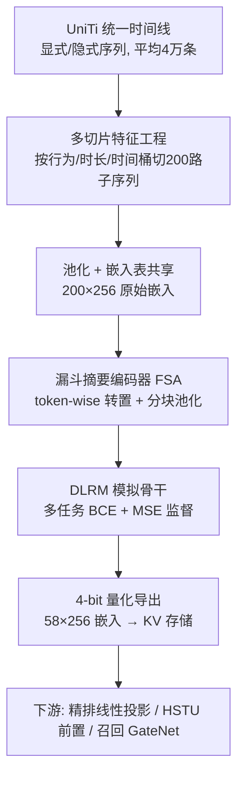

# DV365: Extremely Long User History Modeling at Instagram (Instagram 超长用户历史建模)

- **会议/期刊**: KDD 2025 (Applied Data Science Track)
- **作者与机构**: Wenhan Lyu, Yihang Yang, Ziwei Li 等，Meta Platforms / Instagram
- **推荐链路定位**: 召回 + 精排（上游统一产出嵌入，下游多模型复用）
- **研究方向**: 序列与会话推荐 / 冷启动与长尾推荐
- **论文原文**: [https://arxiv.org/abs/2506.00450v1](https://arxiv.org/abs/2506.00450v1)
- **开源代码**: 暂未开源

## TL;DR (1分钟核心速览)

工业界长序列建模长期受限于 GPU 与特征基础设施成本，HSTU 类注意力编码器只能吃进 $O(10^3)$ 条历史。DV365 放弃端到端扩序列，改为**离线预计算用户嵌入**：用多切片（按行为类型/时长/时间桶切出 200 个子序列并池化）+ 漏斗 Transformer 摘要，把平均 4 万、最长 7 万条交互压成 58×256 的 4-bit 嵌入，经 DLRM 模拟骨干多任务监督训练。在 Instagram Reels 生产模型（基线已含 HSTU）上，精排 NE 平均改善 0.4%+，召回 HR@1 提升 4%~8%，15 个下游模型上线、App 时长 +0.7%。

## Background & Motivation (背景与核心矛盾)

- **主流范式**: 工业界 SOTA 已收敛到注意力序列建模（DIN/SASRec/HSTU），Instagram 线上用 HSTU 编码约 500 条历史；长序列路线则是 SIM/SDIM/TWIN 式「快速检索 + 目标注意力」两阶段端到端框架。
- **前人局限**: ① 注意力编码器序列长度扩展性差，两阶段方案需在训练与服务两侧都引入检索单元，且要求实时特征基础设施能取到超长历史，成本陡增；② 端到端学到的长兴趣只服务单一模型，20+ 个业务面（Reels/Feed/Explore/Stories）无法共享，ROI 无法摊薄。
- **核心洞察 (Key Insight)**: 用户兴趣可拆为**新兴兴趣**与**稳定兴趣**，超长历史的主要增量价值在后者——它变化慢、对新鲜度不敏感，因此完全可以离线低频重算；且离线嵌入把「一次昂贵计算」摊给全部下游模型。
- **本文切入点**: 用离线嵌入 + 多切片摘要替代端到端长序列，把序列长度从 $10^3$直接拉到$7\times10^4$，同时用「24 小时时间缺口」的远距离兴趣预测目标保证嵌入对陈旧度鲁棒。

## Method (核心方法设计)

### 1. 整体框架 (Overall Architecture)

上游基础模型周期性（约每 6 小时）训练并导出用户塔输出，写入 30 亿用户-嵌入对的 KV 存储；下游模型经反量化 + 轻量域适应模块接入。上游由两部分构成：**用户编码器**（多切片特征 → 池化 → 漏斗摘要压缩）与**骨干模拟网络**（DLRM 多任务排序器，把用户塔嵌入与物品特征、其他用户特征拼接后预测多目标），后者仅用于给用户塔提供与生产排序目标对齐的监督信号。训练时强制时间线截断最近 24h，使嵌入只编码长期稳定兴趣。

### 2. 关键设计拆解 (Key Designs)

1. **多切片与摘要（MSS）特征工程**：痛点是不做可学习注意力就无法处理 7 万长度，作者改用规则化切片替代学习式聚合。显式时间线按 action 类型切分，隐式时间线按时长区间与观看比例切分，并对时长偏差做去偏加权打分 $s(E_i)=\ln(\text{dwell}+1)/\ln(\gamma\cdot\text{duration}+1)$，仅保留$s>s_0$的交互；再叠加$\{3d,7d\}$ 时间桶切片，最终选出 200 路特征，非加权特征均值池化、加权特征加权均值池化。直觉：把「学注意力」换成「人工先验分桶 + 池化」，在超长序列上以极低成本保留稳定兴趣的统计结构。

2. **漏斗摘要编码器 FSA（token-wise 压缩）**：200×256 的池化嵌入对下游仍太贵，需压缩到 58×256。关键算子是把张量转置为 $[D,N]$后在 **token 维度**做注意力与池化，而非传统 MLP 的$[1,N\times D]$或 Transformer 的$[N,D]$：
$$\text{EncoderLayer}(U)=\text{Norm}\big(U+\text{FF}(\text{Norm}(U+\text{Att}(U)))\big),\quad U\in\mathbb{R}^{D\times N}$$
块间沿 token 维均值池化（stride 降采样），并并行接一路线性压缩编码器 LCE。直觉：转置后参数在所有嵌入维度上共享，保住单个 token 的语义完整性；token 维池化等价于对「特征路数」做层次化摘要，比维度压缩更不易丢信息。

3. **远距离兴趣预测目标与训练/推理开销**：把时间线统一截断为 $E_{-24h}$，优化
$$\hat{\Phi}=\arg\min_{\Phi}\mathcal{L}_{\text{total}}\big(\Phi(E_{-24h},x,c),\,y\big),\quad \mathcal{L}_{\text{total}}=\sum_k \ell^{(k)}_{\text{binary}}+a\cdot\ell_{\text{reg}}$$
即用 24h 前的历史预测当下行为，人为制造更难的任务，逼迫模型学长期兴趣而非近期热点，从而对离线管道的 2 天延迟不敏感。负采样沿用生产日志曝光样本（无额外负采样设计）；推理侧用户塔完全离线，线上仅需 KV 查表 + 反量化 + 投影，用户塔（FSA + 4-bit 量化）把 200×256 fp32 压成 58×17 长整数，压缩比 50×。

## Experimental Setup & Evaluation Protocol (实验设置与评估协议)

- **数据集与预处理**: Instagram 内部推荐日志。生产训练表历史平均约 1500、上限 2000；DV365 专用离线长历史表平均约 40000、上限 70000（离线追加，避免实时表膨胀）。

| 数据表 | 历史长度均值 | 历史长度上限 | 用途 |
| :--- | :---: | :---: | :--- |
| 生产训练表 | ~1,500 | 2,000 | 训练下游基线/对照模型 |
| 离线长历史表 | ~40,000 | 70,000 | 训练 DV365 基础模型 |

- **数据划分与防穿越 (Splitting Strategy)**: 工业日志按时间滚动训练（recurring training），上游模型比线上在线训练数据滞后约 2 天；离线评估在**完全相同日期区间**上计算 test/control 的相对指标，规避分布漂移。
- **排名评测协议 (Ranking Protocol)**: 精排用 **Relative NE Delta**（归一化熵，分母为背景 CTR 熵，避免 CTR 接近 0/1 时虚高），>0.1% 视为显著且与线上 A/B 一致；召回用 **Hit Rate @1 / @10**（MoL 多任务结构 + 点积相似度）。均为生产日志全量评估，非采样排序。
- **对比基线与超参设置**: 基线为当时线上生产模型——精排 DLRM、召回 MoL，二者均已内置 HSTU 序列编码器（$O(10^3)$历史），属强基线；嵌入维度$D=256$，输出 58 路嵌入；仅报告 Reels（最大流量面）结果，其他面趋势一致。

## Key Experimental Results (实验关键数据)

### 1. 主实验对比 (Main Results)

**精排（Reels，NE 相对变化 %，越负越好）**

| 任务 | 基线(无DV365) | +DV365 线性投影 | Improv. |
| :--- | :---: | :---: | :---: |
| video_complete | -0.564 | **-0.637** | 0.073 |
| skip | -0.447 | **-0.508** | 0.061 |
| follow | -0.282 | **-0.592** | 0.310 |
| liked | -0.455 | **-0.590** | 0.135 |
| comment | -0.574 | **-1.151** | 0.577 |
| watch_time (MSE) | -0.737 | **-0.835** | 0.098 |

**召回（HR，括号内为相对提升）**

| 任务 | 基线 | +DV365 | +DV365 GateNet |
| :--- | :---: | :---: | :---: |
| follow@1 | 0.413 | 0.431 (4.4%) | **0.437 (5.8%)** |
| reshare@1 | 0.316 | **0.341 (7.9%)** | 0.337 (6.6%) |
| profile_visit@1 | 0.374 | 0.398 (6.4%) | **0.402 (7.5%)** |
| watch_time@1 | 0.243 | 0.260 (7.0%) | **0.261 (7.4%)** |
| liked@10 | 0.810 | 0.827 (2.1%) | **0.830 (2.5%)** |

### 2. 消融实验 (Ablation Study)

用户塔压缩方案对比（NE 相对变化 %，越负越好，节选）：

| 方案 | video_complete | skip | comment | watch_time MSE |
| :--- | :---: | :---: | :---: | :---: |
| pass_thru (不压缩, 200路) | -0.593 | -0.480 | -2.132 | -0.830 |
| LCE (线性压缩) | -0.609 | -0.497 | -1.617 | -0.848 |
| MLP$_d$ (维度向) | -0.486 | -0.395 | -1.025 | -0.632 |
| MLP$_t$ (token向) | -0.641 | -0.495 | -1.600 | -0.843 |
| T-L$_t$ (token向Transformer+LCE) | **-0.659** | **-0.519** | **-2.004** | **-0.880** |
| FSA (漏斗+LCE) | -0.650 | -0.525 | -1.927 | -0.865 |

### 3. 关键实验发现 (Key Findings)

1. **token-wise 压缩是决定性因素**：同为 MLP，维度向 MLP$_d$在 comment 上仅 -1.025，token 向 MLP$_t$ 达 -1.600，差距远超编码器架构本身；说明参数沿嵌入维度共享比堆叠网络深度更关键。
2. **FSA 以更少参数逼近最优**：FSA 与 token 向 vanilla Transformer 的 NE 几乎持平（-0.650 vs -0.659），但参数更少、训练 QPS 高 10%，是压缩比与效果的帕累托点；不压缩的 pass_thru 在 comment 上甚至不如 FSA，说明适度压缩反而起正则作用。
3. **骨干一致性带来跨链路迁移**：DLRM 骨干（与精排一致）在下游精排上比 Siamese 骨干多 0.2% NE，而下游召回表现相当——上游模拟网络与目标链路架构对齐，是知识迁移效率的关键；同时仅保留关键任务即可，增加非关键任务与放大模型规模收益极小。

## Highlights & Limitations (亮点、对比与审稿批判)

- **与代表作对比 (vs. Prior Work)**: 相比 SIM/SDIM/TWIN 的两阶段端到端方案，DV365 不在线上做检索单元、不要求实时取超长历史，且一份嵌入服务 15 个模型；相比 Pinnerformer（序列上限 256、昂贵 Transformer 编码器），长度提升两个数量级；相比 LURM 的 bag-of-interest 聚类压缩，避免了聚类系统依赖并给出完整 A/B 与上线证据。
- **可迁移亮点**: ①「24h 时间缺口」构造远距离预测目标，是让离线嵌入对陈旧度鲁棒的通用技巧；② token-wise 转置压缩可直接用于任何需把多路池化特征压成定长嵌入的场景。
- **审稿级局限批判**: ① 全部结论基于 Meta 内部日志与 NE/HR 离线指标，无公开数据集复现，外部可验证性弱；② 多切片特征（200 路、时间桶、去偏超参 $\gamma,s_0,\beta$）依赖大量人工实验调优，迁移到新业务面的调参成本与收益边界未量化；③ 未与两阶段端到端方案做同口径的离线对照，仅以 ROI 论证替代效果对比。

## Rating (四维评分)

- **方法创新性 (Novelty)**: ⭐⭐⭐ （多切片+token-wise 漏斗压缩组合朴素但工程洞察扎实，24h 缺口目标有巧思，理论新意有限）
- **评估协议与实验扎实度 (Protocol & Experiments)**: ⭐⭐⭐⭐ （强基线含 HSTU、15 个模型上线与一年生产验证、NE 与 A/B 一致性论证充分，但缺公开数据与端到端同口径对比）
- **写作与数学规范度 (Clarity & Rigor)**: ⭐⭐⭐⭐ （公式简洁、系统与成本拆解清晰，部分超参与特征选择细节留白）
- **工业落地与复现价值 (Industrial & Practical Value)**: ⭐⭐⭐⭐⭐ （节省约 100MW 特征抽取功耗与 11PB 低延迟存储，压缩比 50×，一年以上生产验证，落地价值极高）

