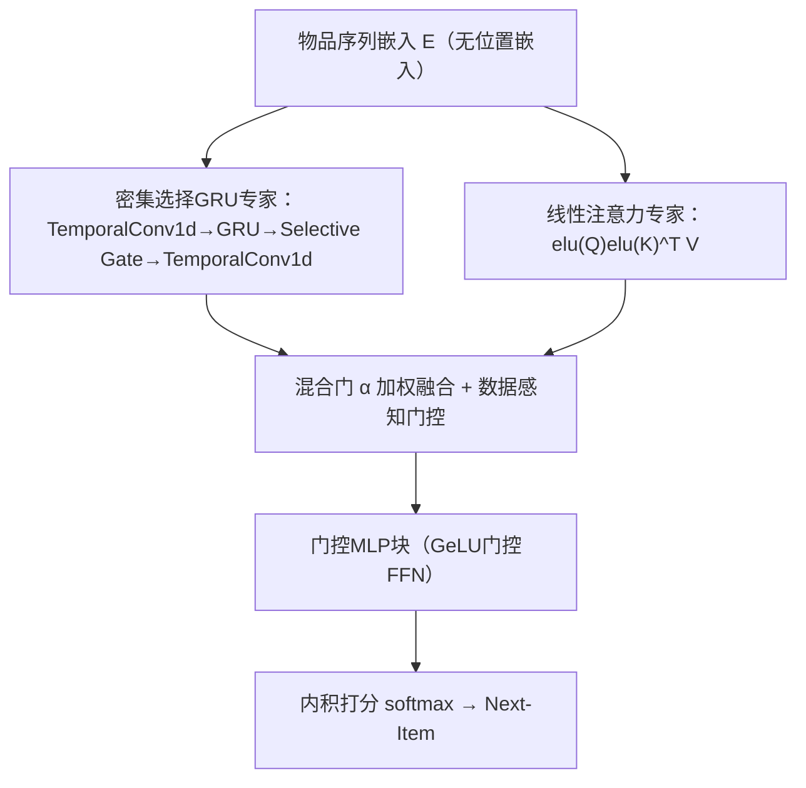
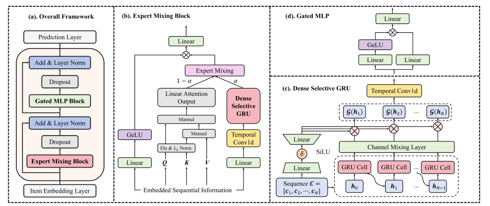

# GLINT-RU: Gated Lightweight Intelligent Recurrent Units for Sequential Recommender Systems (面向序列推荐的门控轻量智能循环单元)

- **会议/期刊**: KDD 2025
- **作者与机构**: Sheng Zhang, Maolin Wang, Wanyu Wang, Jingtong Gao, Xiangyu Zhao, Yu Yang (CityU HK)；Xuetao Wei (SUSTech)；Zitao Liu (Jinan Univ.)；Tong Xu (USTC)
- **推荐链路定位**: 精排（Next-Item 序列打分）
- **研究方向**: 序列与会话推荐 / 高效架构设计
- **论文原文**: [https://arxiv.org/abs/2406.10244v3](https://arxiv.org/abs/2406.10244v3)
- **开源代码**: [https://github.com/szhang-cityu/GLINT-RU](https://github.com/szhang-cityu/GLINT-RU)

## TL;DR (1分钟核心速览)

Transformer 序列推荐精度高但注意力点积开销大、推理慢；线性注意力/MLP/SSM 等高效方案又难以同时编码高质量语义与细粒度位置信息，且往往需堆叠多层。GLINT-RU 用**单层**并行专家混合（密集选择 GRU 专家 + 线性注意力专家）+ 门控 MLP，在 ML-1M/Beauty/Video Games 三数据集、Leave-One-Out 全库排序协议下，NDCG@10 相对最优基线提升 1.69%–2.93%，推理时间降低 16%–20%。

## Background & Motivation (背景与核心矛盾)

- **主流范式**: SASRec/BERT4Rec 类 Transformer 凭多头注意力建模长短期兴趣，是序列推荐精度标杆；LinRec/LightSAN/SMLP4Rec/Mamba4Rec 则从线性注意力、序列混合 MLP、选择性 SSM 三条路线压缩推理成本。
- **前人局限**: ① 线性注意力类仍需**堆叠多层 Transformer** 才能达到高精度，层数抵消了效率收益；② MLP 类序列混合层对长序列呈二次开销且难以刻画细粒度位置依赖；③ SSM 类（Mamba4Rec）擅长长序列（ML-1M），却在短序列（Beauty/Video Games）上明显掉点，且复杂矩阵递推难以高效并行。
- **核心洞察 (Key Insight)**: 传统 GRU 的隐状态可被解析分解为「潜在项表示 $\hat{\boldsymbol{h}}_n$+ 细粒度位置表示$\boldsymbol{p}_n$」，即 GRU 天然自带位置编码能力，无需额外位置嵌入；但其单向递推只看前序、忽略相邻项上下文，且缺乏自适应过滤能力。
- **本文切入点**: 用时间卷积把相邻项信息注入 GRU 输入与输出（密集化），再用门控在专家混合与 FFN 两处做数据自适应过滤，从而以**单层**结构同时拿到语义、位置与依赖三类信息。

## Method (核心方法设计)

### 1. 整体框架 (Overall Architecture)

输入物品序列经嵌入层（**不加位置嵌入**，位置信息由 GRU 隐状态隐式提供）后进入专家混合块：密集选择 GRU 专家负责长短期项级依赖与细粒度位置表示，线性注意力专家负责全局项交互语义，两路**并行**计算后由可学习混合门加权融合，再经数据感知门控筛选；输出送入门控 MLP 块做深度过滤，最终与物品嵌入内积并 softmax 得到下一项打分。全模型仅一层，训练用交叉熵 + Adam。

<figure class="paper-figure" markdown="span">
  <figcaption>图1：(a). 提出的 GLINT-RU 框架。(b). 专家混合块采用并行注意力与 GRU，以有效学习语义特征和细粒度位置信息。(c). 密集选择性 GRU 作为框架核心部分，对隐藏状态进行深度选择与聚合。(d). 门控 MLP 块用于深度过滤前馈网络。</figcaption>
</figure>

### 2. 关键设计拆解 (Key Designs)

1. **密集选择 GRU（Dense Selective GRU）**：痛点在于 GRU 每个隐状态只由前序决定、忽略相邻项。做法是输入端先做时间卷积 $\boldsymbol{C}=\text{TemporalConv1d}(\boldsymbol{X}\boldsymbol{W}_0+\boldsymbol{b}_0)$ 融合邻域，输出端再做一次卷积；中间用选择性门按输入状态筛选隐状态：
$$\boldsymbol{G}(\boldsymbol{H})=\big(\text{SiLU}(\boldsymbol{\delta}_1(\boldsymbol{C}))\boldsymbol{W}^{(1)}_{\Omega}+\boldsymbol{b}^{(1)}_{\Omega}\big)\otimes\Phi(\boldsymbol{H})$$
其中 $\Phi(\boldsymbol{H})=\boldsymbol{H}\boldsymbol{W}_H+\boldsymbol{b}_H$ 为通道交叉层。直觉：两次卷积把每个隐状态的信息感受野从「单向前缀」扩到「多时间步邻域」，门控则按数据环境丢弃无关隐状态，等价于把 GRU 的递推记忆「加密」。
2. **并行专家混合 + 双门控过滤**：单一 GRU 或单一注意力都只能覆盖一类信息。混合门以可训练权重融合两专家 $\boldsymbol{M}=\alpha^{(t)}_1\boldsymbol{A}'(\boldsymbol{Q},\boldsymbol{K},\boldsymbol{V})+\alpha^{(t)}_2\boldsymbol{Y}$，$\alpha^{(t)}_i=\text{softmax}(\alpha^{(t-1)}_i)$；随后数据感知门$\boldsymbol{Z}=\text{GeLU}(\boldsymbol{\delta}_2(\boldsymbol{X}))\otimes\boldsymbol{M}$ 按原始输入批次筛选。并行结构使复杂度保持线性，门控让模型在不同数据条件下自适应偏向时序或语义专家。
3. **训练目标、负采样与推理效率**：采用标准下一项交叉熵（softmax over 全物品），**无显式负采样**；总复杂度 $\mathcal{O}((2k+12)Nd^2)$，其中$k$为卷积核、$N$序列长、$d$ 隐维。单层设计使推理仅需一次前向，无需堆叠注意力的多层串行开销。

## Experimental Setup & Evaluation Protocol (实验设置与评估协议)

- **数据集与预处理**: 三数据集统计如下（未额外声明 5-core 过滤，沿用原论文设定）：

| 数据集 | #Users | #Items | #Interactions | 平均长度/稀疏度 | 场景说明 |
| :--- | :---: | :---: | :---: | :---: | :--- |
| ML-1M | 6,041 | 3,707 | 1,000,209 | 165.60 / 95.53% | 长序列、稠密 |
| Amazon Beauty | 22,364 | 12,102 | 198,502 | 8.88 / 99.93% | 短序列、极稀疏 |
| Amazon Video Games | 24,304 | 10,673 | 231,780 | 9.54 / 99.91% | 短序列、极稀疏 |

- **数据划分与防穿越**: 按用户时间序分组，`Leave-One-Out` 划分——最后一项测试、倒数第二项验证，验证集大小等于用户数。
- **排名评测协议**: 全库未交互物品排序（Full-Ranking），报告 Recall@10 / MRR@10 / NDCG@10；显著性用双侧 t 检验 $p<0.05$。
- **对比基线与超参**: 传统类 GRU4Rec/BERT4Rec/SASRec，高效类 LinRec/LightSANs/SMLP4Rec/Mamba4Rec；Adam，lr=0.001，batch=2048，隐维 $d$=128 (ML-1M) / 64 (Amazon)，最大序列长 200 / 100，dropout 0.2 / 0.5，注意力基线统一 2 层 Transformer。

## Key Experimental Results (实验关键数据)

### 1. 主实验对比 (Main Results)

| 模型 | ML-1M NDCG@10 | ML-1M MRR@10 | Beauty NDCG@10 | Beauty MRR@10 | Games NDCG@10 | Games MRR@10 |
| :--- | :---: | :---: | :---: | :---: | :---: | :---: |
| GRU4Rec | 0.4748 | 0.4055 | 0.2351 | 0.1891 | 0.3660 | 0.2929 |
| BERT4Rec | 0.4776 | 0.4041 | 0.2027 | 0.1584 | 0.2916 | 0.2541 |
| SASRec | 0.4958 | 0.4251 | 0.2798 | 0.2325 | 0.4128 | 0.3404 |
| LinRec | 0.5002 | 0.4316 | 0.2775 | 0.2314 | 0.4073 | 0.3355 |
| LightSANs | 0.5003 | 0.4314 | 0.2840 | 0.2358 | 0.4142 | 0.3415 |
| SMLP4Rec | 0.4558 | 0.3870 | 0.2891 | 0.2408 | 0.4195 | 0.3484 |
| Mamba4Rec | 0.5054 | 0.4368 | 0.2689 | 0.2213 | 0.4123 | 0.3389 |
| **GLINT-RU** | **0.5202** | **0.4517** | **0.2964** | **0.2498** | **0.4266** | **0.3549** |
| Improv. | +2.93% | +3.30% | +2.53% | +3.74% | +1.69% | +1.87% |

效率对比（ML-1M / Beauty / Games）：推理 31ms / 278ms / 247ms（较最优基线降 16.22% / 18.24% / 20.06%），训练 86s / 3.8s / 4.5s（降 17.44% / 15.56% / 19.64%），GPU 显存 8.81G / 2.62G / 2.49G，与 Mamba4Rec（7.72G / 2.32G / 2.28G）同量级。

### 2. 消融实验 (Ablation Study)

| 变体 (ML-1M) | Recall@10 | MRR@10 | NDCG@10 |
| :--- | :---: | :---: | :---: |
| Default (完整) | **0.7379** | **0.4517** | **0.5202** |
| w/o Gated MLP (Light GLINT-RU) | 0.7260 | 0.4369 | 0.5060 |
| w/o Attention | 0.7195 | 0.4312 | 0.5001 |
| w/o GRU | 0.6762 | 0.3913 | 0.4593 |
| w/o Temporal Conv1d | 0.7232 | 0.4322 | 0.5019 |

### 3. 关键实验发现 (Key Findings)

1. **GRU 专家是绝对核心**：移除后 NDCG@10 从 0.5202 跌至 0.4593（-11.7%），跌幅远超移除注意力（-3.9%）与卷积（-3.5%），说明细粒度位置表示与项级依赖是精度主来源，注意力仅作语义补充。
2. **短/长序列互补性被验证**：Mamba4Rec 在长序列 ML-1M 上 NDCG 0.5054 领先，但在 Beauty 仅 0.2689（低于 SASRec 0.2798）；GLINT-RU 在三数据集全部最优，证明并行专家混合对序列长度分布更鲁棒。
3. **轻量版仍超 SOTA**：去掉门控 MLP 的 Light GLINT-RU（NDCG 0.5060）仍高于所有高效基线，且显存降至 7.63G、推理降至 241ms，为资源受限场景提供可调档位；核大小 $k$在 3–11 范围内性能平稳，而 Mamba4Rec 对$k$ 敏感波动明显。

## Highlights & Limitations (亮点、对比与审稿批判)

- **与代表作对比 (vs. Prior Work)**: 相比 SASRec/LinRec 需堆叠 2+ 层 Transformer 才达高精度，GLINT-RU 单层即超越；相比 Mamba4Rec 依赖复杂选择性 SSM 递推、短序列掉点，本文用更易并行的 GRU+卷积+线性注意力组合取得全场景稳定优势；相比 SMLP4Rec 依赖物品特征且长序列开销大，本文纯 ID 输入即可。
- **可迁移亮点**: ① 「GRU 隐状态 = 潜在表示 + 位置表示」的解析分解，可替代显式位置嵌入，直接迁移到其他 RNN/SSM 序列模型；② 输入端+输出端双时间卷积的「密集化」技巧，可低成本增强任意递推结构的邻域感知。
- **审稿级局限批判**: ① 主实验仅报告 @10 单一切断，未给 @20/@50 与冷启动/长尾分桶，全库排序下对稀疏物品的鲁棒性证据不足；② 混合门 $\alpha$ 采用对上一轮参数取 softmax 的递推更新，缺乏收敛性分析，且未报告多随机种子方差；③ 效率对比仅在 batch=2048 的离线设定，未涉及在线流式/低延迟部署实测。

## Rating (四维评分)

- **方法创新性 (Novelty)**: ⭐⭐⭐⭐ （GRU 隐状态位置分解 + 双卷积密集化 + 并行专家门控组合新颖，但各组件均为已有算子重组，理论新意中等）
- **评估协议与实验扎实度 (Protocol & Experiments)**: ⭐⭐⭐⭐ （三数据集覆盖长短序列、Leave-One-Out 全库排序、t 检验与完整消融齐备，缺多切断与分桶分析）
- **写作与数学规范度 (Clarity & Rigor)**: ⭐⭐⭐⭐ （复杂度推导与模块公式清晰，混合门递推定义略欠严谨，符号偶有前后不一致）
- **工业落地与复现价值 (Industrial & Practical Value)**: ⭐⭐⭐⭐⭐ （代码开源、单层结构、推理降 16%–20%、显存与 Mamba 同级，且有 Light 版本适配资源受限场景，落地价值高）

