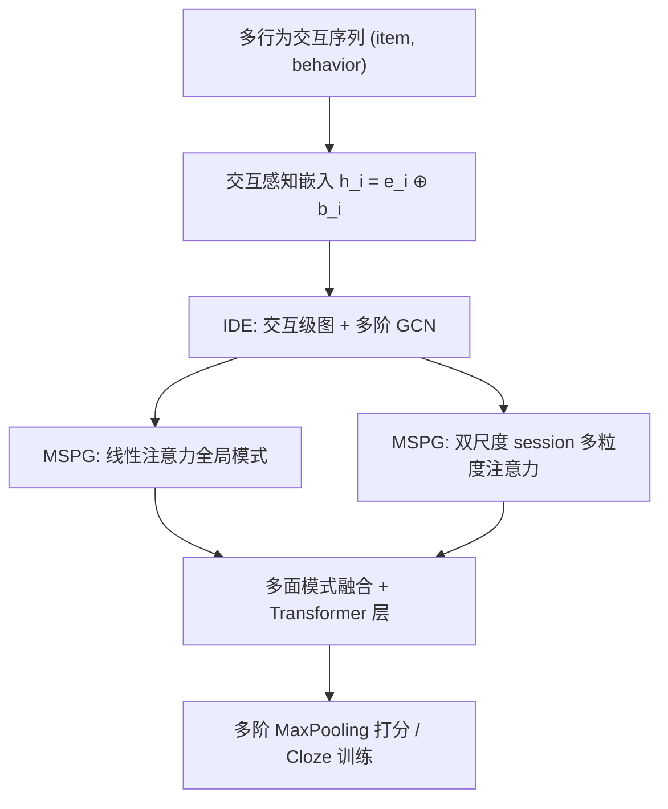

# Multi-Grained Preference Enhanced Transformer for Multi-Behavior Sequential Recommendation (多粒度偏好增强的多行为序列推荐 Transformer)

- **会议/期刊**: KDD 2025
- **作者与机构**: Chuan He, Qiang Li, Xinwei Yao 等（浙江工业大学）；Yongchao Liu, Weiqiang Wang, Xing Fu, Xinyi Fu, Chuntao Hong（蚂蚁集团）
- **推荐链路定位**: 召回（序列化候选生成）
- **研究方向**: 序列与会话推荐 / 图神经网络与知识图谱推荐
- **论文原文**: [论文原文链接](https://arxiv.org/abs/2411.12179v2)
- **开源代码**: [开源代码仓库链接](https://anonymous.4open.science/r/MGPT-DF31)

## TL;DR (1分钟核心速览)

多行为序列推荐（MBSR）中，现有方法只在**行为级**（同类型行为间）或**物品级**（同物品跨行为间）建模依赖，遗漏了"买手机 $\to$ 点耳机"这类**交互级**（跨物品跨行为）依赖；同时用户偏好在不同时间尺度上呈现多粒度结构却未被显式刻画。M-GPT 用可学习交互图 + 多阶图卷积抽取交互级依赖，再用线性注意力 + 多粒度多查询注意力抽取多尺度偏好。在 Taobao/IJCAI/Retailrocket 三数据集、Leave-One-Out 全库排序协议下，HR@5 相对最强基线提升 12.2%/7.3%/2.2%。

## Background & Motivation (背景与核心矛盾)

- **主流范式**: MBSR 主流做法分两支——一支按行为类型切子序列再聚合（DMT、GNNH），一支把行为类型注入序列用 Transformer 编码（MBHT、MB-STR）。
- **前人局限**: ① MB-GCN/MB-GMN/DMT 先按行为聚合再跨行为加权，只能捕捉**行为级依赖**；MB-STR 的多行为多头注意力只在**同物品**的不同行为间建连，只能捕捉**物品级依赖**；两者都无法表达"不同物品、不同行为"之间的转移关联。② MBHT/MB-STR 把序列当作单一粒度处理，忽略了"单次买球鞋看似收藏癖、结合球衣才看出运动兴趣"这种**多粒度偏好**。
- **核心洞察 (Key Insight)**: 交互本身是"物品语义 $\oplus$ 行为语义"的联合体，因此依赖关系应当在**交互节点**上直接建图，而非先降维到行为或物品再建模；同时用户兴趣在时间轴上天然分层（session 级 vs. session 内多步意图）。
- **本文切入点**: 把序列内所有历史交互构造成全连接图，用物品内积与行为内积的联合相似度作邻接权重，一次建模交互级依赖；再用双时间尺度 session 划分 + 多粒度 query 注意力补上偏好粒度。

## Method (核心方法设计)

### 1. 整体框架 (Overall Architecture)

输入为用户多行为交互序列 $S_u=\{\langle v_1,b_1\rangle,\dots,\langle v_{|s_u|},b_{|s_u|}\rangle\}$。先做交互感知嵌入$h_i=e_i\oplus b_i$，送入 IDE（交互级依赖抽取器）：以$h_i$为节点构图、多阶 GCN 传播得到$H^{(0)},\dots,H^{(L)}$。每阶表示注入位置编码后进入 MSPG（多面序列模式生成器）：线性注意力编码全局模式，同时按两种时间尺度$t_1,t_2$ 切 session 并用多粒度多查询注意力抽取局部偏好，三者拼接融合后经 Transformer 层输出。最终对各阶输出做 MaxPooling 打分，Cloze 任务训练。

### 2. 关键设计拆解 (Key Designs)

1. **交互级依赖图与联合邻接权重**：痛点是行为级/物品级建模割裂了物品与行为的耦合。本文令邻接矩阵元素由物品相似度与行为相似度的内积给出：$A_{i,j}=(e_i\odot e_j)\cdot(b_i\odot b_j)$，即先分别算物品对、行为对的逐维相似向量，再内积融合为标量权重，并对$A$施加$L_1$正则。直觉上，只有当"物品相近"与"行为相近"同时成立时权重才高，从而把"买手机$\to$ 点耳机"这类跨类型转移显式编码进图结构，而非依赖注意力隐式学习。

2. **多阶图卷积传播**：单一阶数无法覆盖复杂度不一的行为模式，故迭代 $H^{(l+1)}=\mathrm{LeakyReLU}(\tilde{D}^{-\frac{1}{2}}\tilde{A}\tilde{D}^{-\frac{1}{2}}H^{(l)}W)$，其中$\tilde{D}^{-\frac{1}{2}}=I+D^{-\frac{1}{2}}AD^{-\frac{1}{2}}$ 同时含自环与归一化。各阶输出全部保留送入 MSPG，最终由 MaxPooling 聚合，使模型自适应选择有效阶数（实验显示 Taobao 上 2 阶最优）。

3. **多粒度多查询注意力与训练目标**：将序列按尺度 $t$切 session，在 session 内构造$g$个粒度递增的 query：$Q_m=W_{q_m}\mathrm{Concat}(h_{t-1},\dots,h_{t-m})$，用$L_p$池化融合各粒度注意力权重$\tilde{\alpha}_{j,h}=[\sum_{v}(\alpha_{j,vH+h})^{p}]^{1/p}$，避免单一粒度主导。全局分支用线性注意力把复杂度从$O(N^2d)$降到$O(Nd^2)$。总损失为各阶交叉熵之和加正则：$\mathcal{L}_{all}=\sum_{l}\mathcal{L}_l+\theta_1\|A\|_1+\theta_2\|\Theta\|_2$，采用 Cloze 掩码（仅掩目标行为 purchase，比例$\rho$）训练，**无需负采样**，全库 softmax 计算。

## Experimental Setup & Evaluation Protocol (实验设置与评估协议)

- **数据集与预处理**（沿用 MBHT 的预处理版本）：

| 数据集 | #Users | #Items | #Interactions | 行为类型 | 场景说明 |
| :--- | :---: | :---: | :---: | :---: | :--- |
| Taobao | 147,894 | 99,037 | 7,658,926 | pv/fav/cart/buy | 阿里电商 |
| IJCAI | 423,423 | 874,328 | 36,222,123 | pv/fav/cart/buy | IJCAI 2015 竞赛 |
| Retailrocket | 11,649 | 36,233 | 87,822 | pv/cart/buy | 垂直电商 4 个月 |

- **数据划分与防穿越**: `Leave-One-Out`（末次交互作测试、倒数第二次作验证），与 MBHT 设置一致。
- **排名评测协议**: 全库排序（对全部物品打分取 Top-K），指标 HR@5/10、NDCG@5/10、MRR，报告 5 次均值。
- **对比基线与超参设置**: 基线覆盖通用序列模型（Caser、GRU4Rec、SASRec、BERT4Rec、SR-GNN、GCSAN、HyperRec、SURGE）、多行为模型（MB-GCN、NMTR、MB-GMN、BERT4Rec-MB、NextIP、MB-STR、MBHT、PBAT、MISSL 等）。序列长度 $N=200$，图阶数搜索$\{1,2,3,4\}$，session 尺度$t_1,t_2\in\{[2,10],[2,20],[4,10],[4,20]\}$，粒度$[q_{m1},q_{m2}]\in\{[20,2],[20,4],[10,2],[10,4]\}$，$\theta_1=\theta_2=10^{-5}$，学习率 0.001，batch 64（IJCAI 为 24）。

## Key Experimental Results (实验关键数据)

### 1. 主实验对比 (Main Results)

| Model | Taobao HR@5 | Taobao NDCG@5 | Taobao HR@10 | IJCAI HR@5 | IJCAI NDCG@5 | Retail HR@5 | Retail NDCG@5 |
| :--- | :---: | :---: | :---: | :---: | :---: | :---: | :---: |
| BERT4Rec | 0.197 | 0.154 | 0.252 | 0.286 | 0.209 | 0.759 | 0.622 |
| SURGE | 0.122 | 0.080 | 0.188 | 0.211 | 0.142 | 0.855 | 0.821 |
| MB-GMN | 0.192 | 0.108 | 0.319 | 0.235 | 0.161 | 0.853 | 0.709 |
| NextIP | 0.301 | 0.244 | 0.387 | 0.303 | 0.232 | 0.899 | 0.893 |
| MB-STR | 0.309 | 0.248 | 0.394 | 0.310 | 0.236 | 0.907 | 0.899 |
| MBHT | 0.320 | 0.253 | 0.402 | 0.306 | 0.238 | 0.908 | 0.897 |
| PBAT | 0.329 | 0.262 | 0.410 | 0.308 | 0.235 | 0.907 | 0.901 |
| MISSL | 0.317 | 0.252 | 0.398 | 0.315 | 0.241 | 0.901 | 0.896 |
| **M-GPT** | **0.369** | **0.291** | **0.460** | **0.338** | **0.259** | **0.928** | **0.906** |
| Improv.% | +12.2% | +11.1% | +12.2% | +7.3% | +7.5% | +2.2% | +0.8% |

### 2. 消融实验 (Ablation Study)

| 变体 | Taobao HR@5 | Taobao NDCG@5 | IJCAI HR@5 | IJCAI NDCG@5 |
| :--- | :---: | :---: | :---: | :---: |
| **M-GPT 完整** | **0.369** | **0.291** | **0.338** | **0.259** |
| w/o IDE（退化为纯嵌入） | 0.344 | 0.266 | 0.313 | 0.239 |
| w/o interaction-level（全连接邻接） | 0.347 | 0.266 | 0.318 | 0.239 |
| w/o item-level（仅行为相似度） | 0.353 | 0.272 | 0.325 | 0.244 |
| w/o behavior-level（仅物品相似度） | 0.358 | 0.279 | 0.330 | 0.250 |
| w/o MSPG（普通 Transformer） | 0.316 | 0.252 | 0.312 | 0.237 |
| w/o coarse-grained | 0.327 | 0.261 | 0.307 | 0.240 |
| w/o fine-grained | 0.353 | 0.284 | 0.325 | 0.243 |
| w/o MGMHSA（普通多头注意力） | 0.340 | 0.263 | 0.318 | 0.239 |
| w/o Multi-order（仅二阶） | 0.337 | 0.261 | 0.309 | 0.240 |
| w/o MaxPooling（注意力加权和） | 0.301 | 0.244 | 0.296 | 0.224 |

### 3. 关键实验发现 (Key Findings)

1. **交互级依赖是最大增益来源**：去掉 IDE 使 Taobao HR@5 从 0.369 掉到 0.344（$-6.8\%$），而仅保留物品级或行为级相似度分别只到 0.353/0.358，说明"物品×行为联合"的邻接权重确实比任一单侧信号更有信息量，且全连接邻接（0.347）明显劣于学习到的交互图。
2. **多粒度注意力优于单粒度与普通多头**：去掉 MGMHSA 掉至 0.340，去掉粗粒度/细粒度分别掉至 0.327/0.353，说明两个时间尺度互补——粗粒度提供 session 级意图、细粒度提供 session 内多步意图，缺一不可；而 MaxPooling 换成注意力加权和后跌至 0.301，是消融中最大跌幅，表明多阶表示应"择优"而非"平均"。
3. **阶数收益依数据而异**：Taobao 上 2 阶依赖最优（图 5 打分曲线），而 IJCAI/Retailrocket 各阶差异不显著，说明高阶传播的收益与序列长度、行为丰富度正相关；同时 Retailrocket 上整体提升仅 2.2%，反映在行为类型少（3 类）、交互稀疏（8.8 万条）的场景下多行为建模的边际收益有限。

## Highlights & Limitations (亮点、对比与审稿批判)

- **与代表作对比 (vs. Prior Work)**: 相比 MB-GCN/MB-GMN 的"先按行为聚合再跨行为加权"，M-GPT 直接在交互节点上建图，保留了跨物品跨行为的转移；相比 MB-STR 的同物品多行为注意力，本文的邻接权重同时编码物品与行为双相似度；相比 MBHT 的"超图 + 多尺度 Transformer 并行"，M-GPT 采用图 $\to$ 序列的串行级联，让图卷积输出直接作为序列编码的输入。
- **可迁移亮点**: ① 用"物品相似向量 $\odot$行为相似向量再内积"构造可学习邻接权重，可低成本迁移到任意带类型边的序列图（如点击-收藏-加购的会话图）；② 多粒度 query（对 session 末尾$1..g$ 项做递增拼接）是一种轻量的层次意图建模技巧，可插入任意 Transformer 序列模型。
- **审稿级局限批判**: ① 每个用户序列都要构造 $|s_u|\times|s_u|$的全连接图并做$L$ 阶 GCN，序列长 200 时构图与传播开销不可忽略，论文未给出线上时延对比；② 仅在三个公开数据集上验证，且 Retailrocket 提升仅 2.2%，缺少工业级 A/B 与冷启动/长尾分桶分析；③ 超参（session 尺度、粒度组合、阶数）需按数据集网格搜索，敏感度分析置于附录，实际部署调参成本较高。

## Rating (四维评分)

- **方法创新性 (Novelty)**: ⭐⭐⭐⭐ （交互级依赖图的联合邻接权重设计有新意，但图卷积 + 多尺度注意力的组合整体偏工程拼装）
- **评估协议与实验扎实度 (Protocol & Experiments)**: ⭐⭐⭐⭐ （三数据集 + 18 个基线 + 11 组消融较完整，但缺显著性检验与线上验证）
- **写作与数学规范度 (Clarity & Rigor)**: ⭐⭐⭐ （公式基本清晰，但符号 $H^{(l)}$ 在 IDE 与 MSPG 间复用、部分公式排版有噪声，复杂度分析置于附录）
- **工业落地与复现价值 (Industrial & Practical Value)**: ⭐⭐⭐⭐ （蚂蚁场景背景、代码已匿名开源、线性注意力控制复杂度，但构图开销与超参敏感度是落地障碍）

