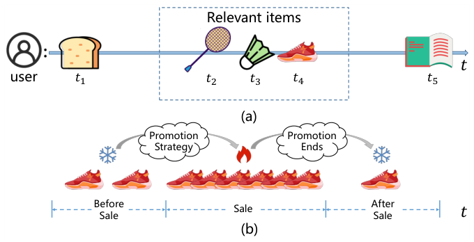
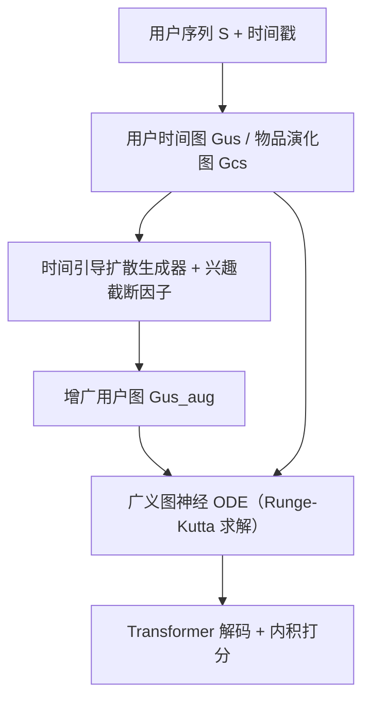

# Time Matters: Enhancing Sequential Recommendations with Time-Guided Graph Neural ODEs (时间至上：以时间引导图神经ODE增强序列推荐)

- **会议/期刊**: KDD 2025
- **作者与机构**: Haoyan Fu, Zhida Qin 等（北京理工大学、上海交通大学、北京航空航天大学、香港中文大学）
- **推荐链路定位**: 召回（序列建模）
- **研究方向**: 序列与会话推荐 / 图神经网络推荐
- **论文原文**: [论文原文链接](https://arxiv.org/abs/2511.18347v1)
- **开源代码**: [开源代码仓库链接](https://github.com/Qin-lab-code/TGODE)

## TL;DR (1分钟核心速览)

现有序列推荐默认用户交互在时间上"等间隔连续"，忽略了两个真实现象：交互间隔高度不规则（Beauty 上近 15% 的延迟交互间隔超过 350 个时间单位），以及物品热度随时间剧烈起伏（超 75% 的物品在 75% 以上的时间集中爆发）。TGODE 构建用户时间图与物品演化图，用时间引导扩散生成器补全稀疏时间枢轴上的用户边，再用广义图神经 ODE 在连续时间上对齐"用户兴趣演化"与"物品分布演化"两条轨迹。在 5 个数据集上以全库排序协议评测，Recall@20 相对最优基线提升 14.9%–25.1%，NDCG@20 提升 17.4%–39.4%。

## Background & Motivation (背景与核心矛盾)

- **主流范式**: 从 GRU4Rec/SASRec 的离散序列编码，到 TisasRec/GNG-ODE/GDERec 的连续时间建模，再到 DiffRec/DreamRec 的扩散式生成，均把交互序列当作"时间上均匀"的观测。
- **前人局限**: 其一，**兴趣不规则**——用户行为在少数时段密集、其余时段近乎空白，长间隔交互与当前购买意图弱相关，但 Transformer 与连续时间模型都不区分"瞬时"与"延迟"交互；其二，**物品分布不均**——促销、季节等外部因素造成物品热度尖峰，用户当下行为可能只是被外部曝光驱动，与个人偏好错位，而纯序列模型无法感知这种全局时间分布。
- **核心洞察 (Key Insight)**: 作者的数据分析（图 2）显示，用户交互在时间轴上呈簇状分布、物品在 250 天切片内高度集中爆发，说明"用户兴趣"与"物品分布"是两条**各自独立演化、但需要在同一时间轴上对齐**的轨迹；单纯复制相似序列做增广会引入严重偏好偏差。
- **本文切入点**: 用两张图分别承载个体偏好与全局物品分布，用扩散模型补全用户图的时间空洞，用图神经 ODE 让两条演化轨迹在连续时间上同步。

<figure class="paper-figure" markdown="span">
  <figcaption>图 1：序列推荐示意图示例，包含（a）不规则的用户兴趣和（b）高度不均衡的物品分布。</figcaption>
</figure>

## Method (核心方法设计)

### 1. 整体框架 (Overall Architecture)

输入为全体用户序列 $\mathcal{S}$，先沿统一时间轴对齐，构建**用户时间图**$\mathcal{G}_{us}$（节点为序列内物品，边带交互时间戳，刻画个体偏好转移）与**物品演化图**$\mathcal{G}_{cs}$（节点为全库物品，边为全体序列在时刻$t$的交互，刻画全局分布）。用户图因仅含单用户行为而时间维度极度稀疏，故先经时间引导扩散生成器补全缺失时间枢轴上的潜在边，得到增广图$\mathcal{G}_{us}^{aug}$；随后$\mathcal{G}_{us}^{aug}$与$\mathcal{G}_{cs}$ 一同送入广义图神经 ODE，在连续时间上求解物品表征的导数，使个体兴趣演化与物品热度演化相互匹配；最终目标时刻的两路表征经 Transformer 解码器融合后与物品向量内积打分。两模块互为输入、交替迭代训练。

### 2. 关键设计拆解 (Key Designs)

1. **时间引导扩散生成器（补全时间稀疏的用户图）**：痛点是用户图在多数时间枢轴上无观测，直接复制相似序列会偏离时间语义。做法是用 VAE 将时刻 $t$的邻接矩阵与 ODE 输出的序列表征压缩为隐变量$\mathbf{z}_0^t=\mathrm{VAE}(\mathbf{A}_{us}^t,\mathbf{h}_s^t)$，再用正余弦多频时间嵌入$\mathbf{c}_t=\mathrm{Concat}(\sin(2\pi\omega_i t+b_i),\cos(2\pi\omega_i t+b_i))$作为反向去噪的条件，即$p_\theta(\mathbf{z}_{k-1}^t\mid\mathbf{z}_k^t,\mathbf{c}_t)$。时间嵌入让同一噪声在不同时刻被还原成"该时刻应有"的交互，而非全局平均偏好。此外对边权重加$\sum_{i,j}|\hat{\mathbf{z}}_0^t|$ 正则，抑制模型把生成节点堆在同一时间戳的"时间过平滑"。

2. **用户兴趣截断因子 + 增广推理（决定"补多少、补在哪"）**：将时间轴切成 $m$个枢轴$t_p$，用$g(t_i^o)=\arg\min_{t_j^p}|t_j^p-t_i^o|$找出未被任何真实交互覆盖的枢轴集合$t_p^{set}$，再按$l_{num}=\max(1,|t^o|/|t_p^{set}|)$决定每个缺失枢轴应生成的边数，取概率最高的 top-$l_{num}$条边并入原图：$\mathcal{G}_{us}^{aug}=\mathcal{G}\cup\bigcup_{j}\mathrm{topK}(\mathcal{G}_{us}^{t_j})$。该因子本质是"按真实交互密度反推缺失密度"，避免对稀疏用户过度生成、对密集用户生成不足。

3. **广义图神经 ODE（对齐两条演化轨迹）**：用带时间位置嵌入 $\Phi(t)$的注意力 GNN 分别编码两图得到$\mathbf{e}_{us},\mathbf{e}_{cs}$，再令导数由两路网络相加：$\frac{d\tilde{\mathbf{e}}^t}{dt}=f_{us}(\mathbf{e}_{us},g(t))+f_{cs}(\mathbf{e}_{cs},g(t))$，其中$f_{us}$在增广图上做归一化邻域传播$\tilde{\mathbf{A}}_{us}^t$（因两图均为有向图，采用$\mathbf{D}_{us}^{-1}\mathbf{A}_{us}$而非对称归一化以抑制梯度爆炸），$f_{cs}$用 MLP 显式建模外部因素对全局分布的影响。用 Runge-Kutta 求解至目标时刻$t_{n+1}$，使"个体兴趣变化率"与"物品热度变化率"在同一微分方程中耦合。训练目标为交叉熵$\mathcal{L}_{rec}$，扩散模块另用 ELBO 式去噪损失$\mathcal{L}_{diff}$，两模块交替优化；推理时取$K=0$（即直接对稀疏数据去噪），无额外采样开销。

## Experimental Setup & Evaluation Protocol (实验设置与评估协议)

- **数据集与预处理**: 5 个公开数据集，Amazon 四域（Beauty/Sports/Toys/Video）+ MovieLens-100k，均按序列推荐惯例过滤（详见附录 A.3）。

| 数据集 | 领域 | 说明 |
| :--- | :---: | :--- |
| Beauty | Amazon | 美妆，序列偏短、时间间隔长尾显著 |
| Sports | Amazon | 户外运动，交互碎片化 |
| Toys | Amazon | 玩具，稀疏度高 |
| Video | Amazon | 视频，序列较长 |
| ML-100k | MovieLens | 电影评分转隐式交互 |

- **数据划分与防穿越 (Splitting Strategy)**: 采用与"目标时刻预测"一致的划分方式（附录 A.3），即给定前 $n$个交互与目标时间$t_{n+1}$预测第$n+1$ 个物品，而非标准 Leave-One-Out 的纯序列切分。
- **排名评测协议 (Ranking Protocol)**: 全库排序（Full-Ranking），指标为 Recall@{5,10,20}、NDCG@{5,10,20}、MRR@{5,10,20}（MRR 见附录 A.5）。
- **对比基线与超参设置**: 12 个基线，覆盖传统（NARM/SRGNN/GRU4Rec）、Transformer（SASRec/SSE-PT/CORE/MAERec）、扩散（DreamRec/DiffRec）、连续时间（TisasRec/GNG-ODE/GDERec）四类。嵌入维度在 {32,64,128,256} 网格搜索，GNN 层数 {1–5}，Transformer 头数 1–3，学习率 1e-1 至 1e-5；训练扩散步 $K=5$，生成步$K=0$。

## Key Experimental Results (实验关键数据)

### 1. 主实验对比 (Main Results)

| 数据集 | 指标 | 最优 Transformer (CORE) | 最优连续时间 (GNG-ODE) | 最优扩散 (DiffRec) | **TGODE** | Improv.% |
| :--- | :---: | :---: | :---: | :---: | :---: | :---: |
| Beauty | R@20 | 0.0900 | 0.0775 | 0.0305 | **0.1077** | +19.67% |
| Beauty | N@20 | 0.0305 | 0.0325 | 0.0117 | **0.0429** | +32.00% |
| Sports | R@20 | 0.0552 | 0.0504 | 0.0259 | **0.0664** | +20.29% |
| Sports | N@20 | 0.0187 | 0.0208 | 0.0104 | **0.0266** | +27.88% |
| Toys | R@20 | 0.0726 | 0.0446 | 0.0182 | **0.0869** | +19.70% |
| Toys | N@20 | 0.0254 | 0.0191 | 0.0067 | **0.0354** | +39.37% |
| Video | R@20 | 0.1238 | 0.1070 | 0.0460 | **0.1423** | +14.94% |
| Video | N@20 | 0.0501 | 0.0446 | 0.0173 | **0.0588** | +17.37% |
| ML-100k | R@20 | 0.0819 | 0.1188 | 0.0228 | **0.1486** | +25.08% |
| ML-100k | N@20 | 0.0312 | 0.0479 | 0.0078 | **0.0586** | +22.34% |

### 2. 消融实验 (Ablation Study)

| 变体 | Beauty R@20 | Beauty N@20 | Sports R@20 | Toys R@20 | Toys N@20 |
| :--- | :---: | :---: | :---: | :---: | :---: |
| TGODE | **0.1077** | **0.0429** | **0.0664** | **0.0869** | **0.0354** |
| base（仅 Transformer） | 0.0594 | 0.0235 | 0.0448 | 0.0189 | 0.0077 |
| w/o Diff | 0.1008 | 0.0393 | 0.0609 | 0.0846 | 0.0339 |
| w/o ODE | 0.0733 | 0.0294 | 0.0527 | 0.0476 | 0.0191 |
| w/o cs（去物品演化图） | 0.1023 | 0.0400 | 0.0557 | 0.0803 | 0.0323 |

### 3. 关键实验发现 (Key Findings)

1. **ODE 是性能主引擎，扩散是精修器**：去掉 ODE 后 Toys R@20 从 0.0869 跌至 0.0476（−45%），Beauty 跌 32%；而去掉扩散仅跌 6.5%（Beauty）与 2.6%（Toys），说明连续时间对齐是主要收益来源，扩散补全在时间稀疏更严重的 Toys 上边际价值更高。
2. **物品演化图不可省，且与数据集的时间集中度正相关**：去掉 $\mathcal{G}_{cs}$ 后 Sports R@20 从 0.0664 降至 0.0557（−16%），Beauty 仅 −5%，印证外部热度因素在 Sports 这类促销驱动的品类中影响更大。
3. **扩散模型单独使用会失效，必须与连续时间表征耦合**：DreamRec/DiffRec 在全部数据集上 R@20 均低于 0.05（Beauty 仅 0.0018/0.0305），远逊于 SASRec；作者归因于长序列下兴趣漂移使纯扩散生成"过时偏好"，而 TGODE 用 ODE 提供的连续时间表征作为扩散条件才使其生效。此外，序列长度分桶实验（图 5）显示 TGODE 在 <10、10–20、>20 三档均优于 SASRec 与 GNG-ODE，短序列靠扩散补全、长序列靠 ODE 对齐，形成互补。

## Highlights & Limitations (亮点、对比与审稿批判)

- **与代表作对比 (vs. Prior Work)**: 相比 GNG-ODE/GDERec 只建模用户侧连续演化，本文额外引入物品演化图并让两路导数相加耦合，解决"外部热度 vs 个人偏好"错位；相比 DiffRec/DreamRec 把扩散当作端到端生成器，本文只把扩散用作图增广器并以时间嵌入为条件，规避了长序列兴趣漂移；相比 MAERec 等图增广方法，本文的增广位置由兴趣截断因子显式决定，而非随机掩码。
- **可迁移亮点**: (1) "按真实交互密度反推缺失密度"的截断因子可直接迁移到任何稀疏时间序列的插值/补全任务；(2) 用 ODE 输出的连续时间表征作为扩散模型的条件输入，这一"连续表征引导离散生成"的耦合范式可复用于轨迹补全与事件序列预测。
- **审稿级局限批判**: (1) 扩散生成器训练需 $K=5$ 步、ODE 需 Runge-Kutta 多步求解，且两模块交替迭代，训练成本显著高于单塔 SASRec，论文未给出训练/推理时延对比；(2) 评测仅覆盖 Amazon 与 ML-100k 的离线全库排序，缺少工业级线上 A/B 与冷启动用户的专项验证，且"目标时刻预测"的划分方式与主流 Leave-One-Out 结果不可直接横比。

## Rating (四维评分)

- **方法创新性 (Novelty)**: ⭐⭐⭐⭐ （将扩散增广与图神经 ODE 以"互为条件、交替迭代"方式耦合，并用截断因子显式定位时间空洞，机制组合新颖且有数据分析支撑）
- **评估协议与实验扎实度 (Protocol & Experiments)**: ⭐⭐⭐⭐ （5 数据集 × 12 基线 × 3 指标较完整，消融与序列长度分桶到位，但缺显著性检验与线上验证）
- **写作与数学规范度 (Clarity & Rigor)**: ⭐⭐⭐ （ODE 与扩散公式推导清晰，但部分符号如 $\tilde{\mathbf{A}}_{us}^t$的下标含义与$K=0$ 推理的理论依据仅引文交代，略欠自洽）
- **工业落地与复现价值 (Industrial & Practical Value)**: ⭐⭐⭐⭐ （代码已开源，增广图可离线预计算，但 ODE 多步求解与迭代训练对在线时延构成实际约束）

