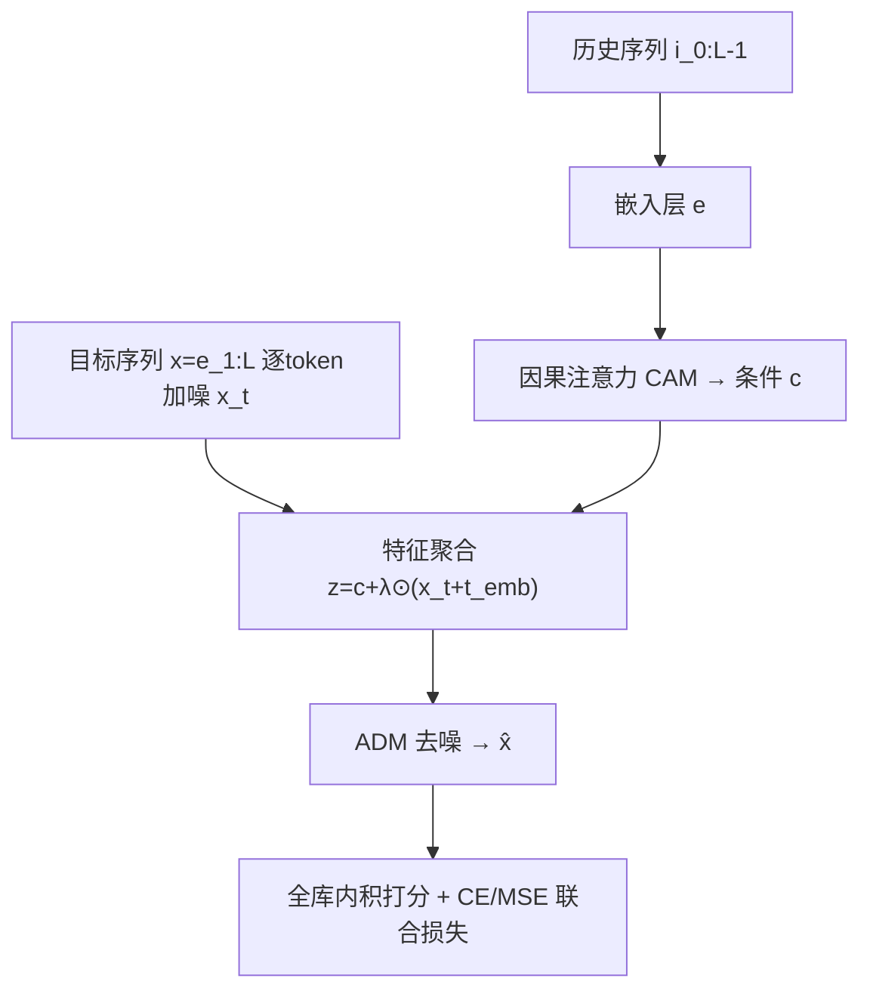
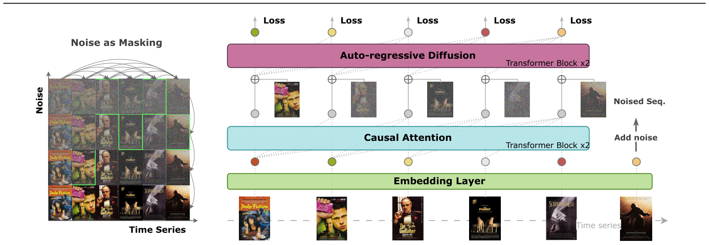

# Unlocking the Power of Diffusion Models in Sequential Recommendation: A Simple and Effective Approach (释放扩散模型在序列推荐中的潜力：一种简单而有效的方法)

- **会议/期刊**: KDD 2025
- **作者与机构**: Jialei Chen, Yuanbo Xu, Yiheng Jiang（吉林大学 MIC Lab）
- **推荐链路定位**: 召回（Next-Item 序列建模）
- **研究方向**: 序列与会话推荐 / 生成式推荐
- **论文原文**: [论文原文链接](https://arxiv.org/abs/2505.19544v1)
- **开源代码**: [开源代码仓库链接](https://github.com/Nemo-1024/ADRec)

## TL;DR (1分钟核心速览)

本文直指扩散式序列推荐（DiffuRec/DreamRec）被长期忽视的**嵌入坍缩**问题：仅对末位物品做去噪、端到端训练随机初始化嵌入，导致物品表征退化为各向同性高斯噪声。作者提出 ADRec，用**逐 token 独立扩散 + 因果注意力去噪 + 三阶段训练**同时建模序列动态与物品分布。在 6 个 Amazon/Yelp/ML-100K 数据集、8:1:1 划分、全库排序协议下，HR@20 平均提升 15.45%、NDCG@20 提升 13.02%，训练时间较 DiffuRec 降低 70.98%。

## Background & Motivation (背景与核心矛盾)

- **主流范式**: Transformer 序列模型（SASRec/BERT4Rec）以自回归或掩码建模捕捉物品转移；扩散模型因具备表征学习能力被引入（DiffuRec、DreamRec、DimeRec），但效果长期不及 SASRec+。
- **前人局限**: ① 仅对末位目标 $e_L$ 做去噪，扩散样本极度稀疏（ML-100K 仅 938 条序列），丢失 per-token teacher forcing；② 端到端训练随机初始化嵌入，去噪损失可被"所有嵌入收敛到同一点"轻易最小化，引发坍缩；③ 序列级统一噪声在推理时污染历史序列，造成训练-推理失配。
- **核心洞察 (Key Insight)**: T-SNE 显示 DiffuRec/DreamRec 的嵌入轮廓与**随机初始化高斯噪声几乎不可区分**，说明模型未学到任何超越初始状态的结构；而 SASRec+ 虽有结构但表征空间狭窄脆弱。
- **本文切入点**: 将扩散从"序列级"下沉到"token 级"，并解耦嵌入优化为"语义预训练 → 对齐 → 联合微调"，从源头阻断坍缩。

## Method (核心方法设计)

### 1. 整体框架 (Overall Architecture)

输入交互序列 $i_{0:L-1}$经嵌入层得$e\in\mathbb{R}^{B\times L\times D}$；因果注意力模块（CAM）提取未加噪的历史上下文$c=\text{CAM}_\phi(e)$作为条件引导；自回归扩散模块（ADM）以两层 Transformer 编码器为去噪器，对**整个一位偏移目标序列**$x=e_{1:L}$逐 token 加噪并重建$\hat{x}=\text{ADM}_\theta(z)$；最终以$\hat{x}$ 与全物品嵌入内积做全库打分。训练分三阶段：嵌入预训练、骨干预热、全参数联合训练；推理时仅对末位 token 去噪。

<figure class="paper-figure" markdown="span">
  <figcaption>图 2：方法概览。左图表明时间序列与扩散过程是两个正交的演化方向，噪声作为软掩码来衡量不确定性。ADRec 对单个物品应用独立的扩散过程，当前目标序列中物品的噪声水平以绿色框突出显示。†</figcaption>
</figure>

### 2. 关键设计拆解 (Key Designs)

1. **逐 Token 独立扩散（Token-independent Diffusion）**：痛点是一步预测只让 1 个物品参与扩散、样本稀疏且丢失 token 间依赖。本文将扩散时间步扩展为矩阵 $t\in\mathbb{R}^{B\times L}$，每个位置独立采样：
$$x^{i}_{t_i}=\sqrt{\bar{\alpha}^{i}_{t_i}}x^{i}_{0}+\sqrt{1-\bar{\alpha}^{i}_{t_i}}\,\epsilon,\quad \epsilon\sim\mathcal{N}(0,I)$$
不同位置 $t_{i_1}\neq t_{i_2}$。直觉上噪声即"软掩码"，即使前序 token 被严重破坏，模型仍须学会从正确条件分布采样，等价于对 ELBO 的加权优化，天然带来鲁棒性与去偏收益，且保留自注意力的并行性（DiffuRec 划分子序列则丧失并行、训练时间膨胀$n$ 倍）。

2. **三阶段训练策略（抗坍缩核心）**：阶段一用 CAM + CE 损失预训练嵌入层（等价 SASRec+），先获得结构化语义空间；阶段二冻结嵌入、对骨干做 5 epoch 预热，使去噪器与嵌入空间对齐，避免早期梯度破坏预训练嵌入；阶段三全参数联合训练，用扩散的表征能力进一步扩张嵌入空间。该解耦直接针对"随机嵌入 + 去噪目标 → 坍缩"的因果链。

3. **联合损失与推理策略**：总损失为
$$\mathcal{L}=\mathcal{L}_{ce}(s,i_{tgt})+\mathcal{L}_{mse}(\hat{x},x),\quad s=\text{Softmax}(\hat{x}\,E^{\top})$$
推荐损失用**全物品 CE、免负采样**；去噪损失用 MSE 预测 $\hat{x}_0$。推理时令$t=[0,\dots,0,T]$，仅末位加噪、历史保持干净，避免序列级扩散的推理失配。训练复杂度与 Transformer 骨干同阶$O(Ld^2+dL^2)$，扩散不引入额外开销；推理为$O(T\times(Ld^2+dL^2))$。

## Experimental Setup & Evaluation Protocol (实验设置与评估协议)

- **数据集与预处理**: 6 个公开数据集，均按 5-core 过滤（每用户/物品至少 5 次交互）：

| 数据集 | 领域 | 过滤方式 | 特征/场景说明 |
| :--- | :---: | :---: | :--- |
| Baby / Beauty / Sports / Toys | Amazon 评论 | 5-core | 稀疏、长尾品类 |
| ML-100K | 电影 | 5-core | 小规模、物品数少（1008） |
| Yelp | 本地生活 | 5-core | 大规模、稠密签到 |

- **数据划分与防穿越 (Splitting Strategy)**: 按**用户比例 8:1:1** 划分训练/验证/测试（非全局时间戳切分，存在轻度未来信息泄漏风险）。
- **排名评测协议 (Ranking Protocol)**: 采用**全库 Full-Ranking**（对全部未交互物品排序），指标 HR@20 与 NDCG@20，报告 5 次独立运行均值。
- **对比基线与超参设置**: 10 个基线覆盖 RNN（GRU4Rec）、Transformer（BERT4Rec、LightSANs、FEARec、SASRec+、EulerFormer）、嵌入增强（CORE）、VAE（SVAE）、扩散（DreamRec、DiffuRec）。嵌入/隐藏维度 $d=128$，最大序列长 50，batch 512，Adam + 余弦退火，扩散步数 32（截断线性噪声表）。

## Key Experimental Results (实验关键数据)

### 1. 主实验对比 (Main Results)

| 数据集 | 指标 | SASRec+ | EulerFormer | DreamRec | DiffuRec | **ADRec** | Improv. |
| :--- | :---: | :---: | :---: | :---: | :---: | :---: | :---: |
| Baby | HR@20 | 5.53 | 5.79 | 0.76 | 5.38 | **7.15** | +23.52% |
| Baby | NDCG@20 | 2.52 | 2.50 | 0.28 | 2.56 | **3.15** | +22.64% |
| Beauty | HR@20 | 15.20 | 14.73 | 0.68 | 13.91 | **16.82** | +10.66% |
| Beauty | NDCG@20 | 7.65 | 7.54 | 0.27 | 7.33 | **8.32** | +8.76% |
| ML-100K | HR@20 | 18.45 | 19.35 | 3.44 | 16.07 | **22.07** | +14.04% |
| ML-100K | NDCG@20 | 7.10 | 7.63 | 1.33 | 6.56 | **9.00** | +17.97% |
| Sports | HR@20 | 6.41 | 6.48 | 0.74 | 6.22 | **8.16** | +26.07% |
| Toys | HR@20 | 10.71 | 10.91 | 0.48 | 9.86 | **12.09** | +10.82% |
| Yelp | HR@20 | 6.69 | 6.44 | 0.77 | 6.73 | **7.24** | +7.60% |

### 2. 消融实验 (Ablation Study)

| 变体 | Baby HR | Beauty HR | ML-100K HR | Sports HR | Toys HR | Yelp HR |
| :--- | :---: | :---: | :---: | :---: | :---: | :---: |
| **ADRec 完整** | **7.15** | **16.82** | **22.07** | **8.16** | **12.09** | **7.24** |
| w/o warm-up | 6.75 | 15.75 | 21.01 | 7.22 | 11.92 | 6.99 |
| w/o pre-train | 4.52 | 13.23 | 14.84 | 5.96 | 9.38 | 7.02 |
| w/o MSE | 4.04 | 12.67 | 13.29 | 5.64 | 8.25 | 5.70 |
| w/o CAM | 7.03 | 16.08 | 18.96 | 8.06 | 12.03 | 4.91 |
| MLP 去噪器 | 6.82 | 16.07 | 20.06 | 7.66 | 11.45 | 6.96 |

### 3. 关键实验发现 (Key Findings)

1. **预训练是抗坍缩的第一功臣**：去掉预训练后 ML-100K HR@20 从 22.07 暴跌至 14.84（−32.8%），甚至低于 SASRec+ 的 18.45，直接验证"随机嵌入 + 去噪目标"必然坍缩的假设；而去掉 MSE 损失同样跌至 13.29，说明去噪损失并非装饰而是表征扩张的必要项。
2. **嵌入空间量化证据**：ADRec 的 Top-5 奇异值方差在 Sports 上达 4333（SASRec+ 仅 68），各向同性分数降至 0.01、到高斯 KL 散度升至 10.37，线性探针 F1 达 46%（SASRec+ 40%、DiffuRec 31%），从谱结构层面证明表征既"更宽"又"更定向"。
3. **效率反超**：尽管三阶段训练，ADRec 训练时间较 DiffuRec 平均降低 70.98%（Baby −79.8%、ML-100K −93.4%），根源是 DiffuRec 划分子序列导致数据膨胀 $n$倍；同时 ADRec 对$\lambda$系数鲁棒（$\lambda$从 1 到 0.001 均超 SASRec+），而 DiffuRec 在$\lambda=0.1$ 时性能下降达 80%。

## Highlights & Limitations (亮点、对比与审稿批判)

- **与代表作对比 (vs. Prior Work)**: 相较 DiffuRec（末位去噪 + 仅 CE + 子序列切分），ADRec 用逐 token 扩散保留并行与 teacher forcing；相较 DreamRec（仅 MSE + MLP 去噪器），ADRec 用因果注意力共享历史-目标注意力并联合 CE；相较 DimeRec（解耦序列模型与 MLP 扩散），ADRec 让去噪器本身具备序列建模能力。三者共同缺失的正是"嵌入预训练"这一环。
- **可迁移亮点**: ① "先预训练嵌入、再冻结对齐、后联合微调"的三阶段范式可迁移到任何以随机嵌入为输入的生成式/扩散式推荐；② 推理时"仅末位加噪、历史置零"的 token 级噪声调度，是消除训练-推理失配的通用技巧。
- **审稿级局限批判**: ① 8:1:1 用户比例划分而非全局时间戳切分，存在未来交互泄漏，全库排序下的绝对数值可能偏乐观；② 推理需 $T=32$步迭代去噪，在线延迟为 SASRec+ 的 32 倍量级，论文仅报告训练时间而未给出推理吞吐/延迟实测，工业落地成本存疑；③ 三阶段引入额外超参（预热 epoch 数、$\lambda$），虽实验显示鲁棒但缺乏理论指导。

## Rating (四维评分)

- **方法创新性 (Novelty)**: ⭐⭐⭐⭐ （逐 token 独立扩散 + 三阶段抗坍缩组合新颖，且有 ELBO 重加权与谱分析双重支撑，但单点算子均较简洁）
- **评估协议与实验扎实度 (Protocol & Experiments)**: ⭐⭐⭐⭐ （6 数据集 + 10 基线 + 5 次运行 + 消融/谱分析/线性探针齐全，扣分在比例划分而非时间切分）
- **写作与数学规范度 (Clarity & Rigor)**: ⭐⭐⭐⭐ （问题诊断—归因—设计的逻辑链清晰，公式规范；但部分推导置于附录、正文符号略密）
- **工业落地与复现价值 (Industrial & Practical Value)**: ⭐⭐⭐⭐ （代码开源、训练效率优于 DiffuRec，但 32 步迭代推理延迟是线上召回的主要障碍）

