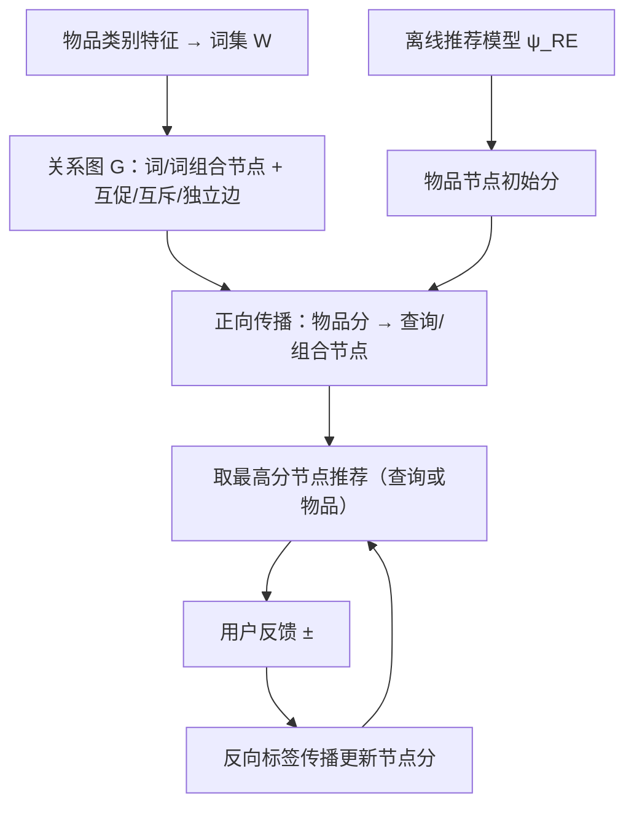
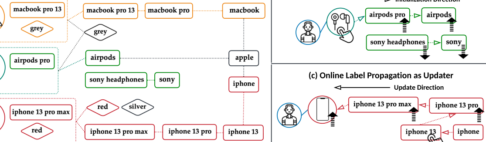

# Why Not Together? A Multiple-Round Recommender System for Queries and Items (为何不联合？面向查询与物品的多轮推荐系统)

- **会议/期刊**: KDD 2025
- **作者与机构**: Jiarui Jin, Xianyu Chen, Weinan Zhang, Yong Yu (上海交通大学); Jun Wang (伦敦大学学院)
- **推荐链路定位**: 重排 / 多轮会话交互（可插拔于任意召回-精排基座之上）
- **研究方向**: 序列与会话推荐 / 对话推荐与智能体仿真
- **论文原文**: [https://arxiv.org/abs/2412.10787v1](https://arxiv.org/abs/2412.10787v1)
- **开源代码**: 暂未开源

## TL;DR (1分钟核心速览)

现有推荐系统只把物品当监督信号，忽略了查询（query）同样刻画用户兴趣，导致反馈稀疏下推荐效率低。本文提出 MAGUS：把查询与物品统一拆解为"类别词组合"，构建含互促/互斥/独立三类边的关系图，用离线推荐模型初始化节点分数、用标签传播在线吸收每轮反馈，从而在每轮同时推荐查询或物品。在 Amazon/Alipay/Tmall 三个数据集、12 种基座模型上，MAGUS 使 SA@3 相对最优会话基线提升约 2–4 个点（如 GRU 基座 Amazon SA@3 从 0.699 升至 0.788），且训练开销几乎不变。

## Background & Motivation (背景与核心矛盾)

- **主流范式**: 搜索/推荐系统以查询+用户画像为输入、以用户点击物品为唯一监督信号（LTR、FM/DeepFM、DIN、GRU 序列模型等）。
- **前人局限**: (i) 仅以物品为监督会丢失查询中显式表达的需求——用户搜"Milk"却对返回物品全负反馈时，纯物品模型会彻底放弃牛奶类目；(ii) 查询与物品反馈都极度稀疏，单轮推荐无法逐步逼近真实意图。
- **核心洞察 (Key Insight)**: 查询是抽象层需求、物品是具体层需求，二者本质都是"类别词组合"（如 item A = Brand A + Milk + Semi Skimmed + 2L + $3，query B = Whole + Milk），因此可通过共享词建立统一打分空间；且查询之间存在强依赖（Milk→Whole Milk 互促、Milk⊣Beef 互斥）。
- **本文切入点**: 用一张词组合关系图把查询与物品映射到同一节点空间，任意离线推荐模型只负责给"物品节点"打初始分，其余节点分数由图传播得到，用户每轮反馈再用反向标签传播即时更新——无需 RL、无需重训。

## Method (核心方法设计)

### 1. 整体框架 (Overall Architecture)

MAGUS 是"离线建图 + 在线传播"的两段式框架。离线阶段：从物品类别特征抽取词集 $\mathcal{W}$，将物品与查询都表示为词或词组合节点，构建关系图$\mathcal{G}=(\mathcal{E},\mathcal{R})$，边分互促$\mathcal{R}^+$、互斥$\mathcal{R}^-$、独立$\mathcal{R}^\perp$三类，边权可预计算并随基座模型更新而刷新。在线阶段：每个会话先用任意离线调优模型$\psi_{\text{RE}}(\cdot)$给物品节点赋初始分，再沿图正向传播到查询/组合节点；每轮取最高分节点（查询或物品）推荐给用户，收到反馈后以反向标签传播更新相关节点分数，进入下一轮，直至命中目标物品或达到$K_{\max}$ 轮。

<figure class="paper-figure" markdown="span">
  <figcaption>图 2：我们的关系图组织单个词及某些词组合的示例（如图 (a) 所示）。为保持清晰，我们未显式绘制表示相互抑制和相互独立的边。在每个用户会话中，MAGUS 与离线调优的推荐方法协作初始化节点分数，其中传播方向从表示物品的节点指向其他节点（如图 (b) 所示）。随后，当用户对推荐提供偏好时，MAGUS 更新相关节点。</figcaption>
</figure>

### 2. 关键设计拆解 (Key Designs)

1. **词组合关系图（统一查询与物品的打分空间）**：痛点是不存在同时度量查询与物品的统一标尺。MAGUS 令 $\mathcal{Q}\subseteq\mathcal{E}$、$\mathcal{V}\subseteq\mathcal{E}$，三类边定义为：一节点是另一节点的组成部分则连$\mathcal{R}^+$；两节点不互相包含但可共存于同一物品则连$\mathcal{R}^-$（如 macbook pro 与 iphone pro 分属不同物品）；其余连$\mathcal{R}^\perp$。这样查询与物品共享词节点，天然可比较，且查询间依赖被显式编码。

2. **正向初始化 + 反向标签传播（在线吸收反馈的核心算子）**：初始化时物品节点取 $\hat{y}_v=\psi_{\text{RE}}(v)$、其余为 0，再沿$\mathcal{R}^+$加、沿$\mathcal{R}^-$ 减地传播：
$$\hat{y}_{v'}\leftarrow \hat{y}_{v'}+w_{v'v''}\cdot\hat{y}_{v''},\ \langle v',v''\rangle\in\overrightarrow{\mathcal{R}}^+;\quad \hat{y}_{v'}\leftarrow \hat{y}_{v'}-w_{v'v''}\cdot\hat{y}_{v''},\ \langle v',v''\rangle\in\overrightarrow{\mathcal{R}}^-$$
收到反馈后，被推荐节点置 $\hat{y}_v=1$（正）或$0$（负），再沿**反向**边$\overleftarrow{\mathcal{R}}^+/\overleftarrow{\mathcal{R}}^-$传播并截断到$[0,1]$。直觉：一次点击不仅确认该节点，还通过"互促"抬升其上位/下位词、通过"互斥"压低竞争类目，等价于在图上做一次廉价的贝叶斯式信念更新，复杂度仅与局部邻域相关，满足在线延迟。

3. **特征传播学习边权（MAGUS+）与训练目标**：默认边权取 0/1（式 3）；MAGUS+ 复用基座模型物品/用户表征，按 $\boldsymbol{e}_v\leftarrow\text{ReLU}\big(\boldsymbol{m}_{v\leftarrow v}+\sum_{v'\in\mathcal{N}^+}\frac{\boldsymbol{m}_{v\leftarrow v'}}{|\mathcal{N}^+|}-\sum_{v''\in\mathcal{N}^-}\frac{\boldsymbol{m}_{v\leftarrow v''}}{|\mathcal{N}^-|}\big)$做一层消息传递，以 log-loss$\mathcal{L}=-\sum_u\sum_{v\in\mathcal{H}^+_u\cup\mathcal{H}^-_u}\big[y_v\log\hat{y}_v+(1-y_v)\log(1-\hat{y}_v)\big]$监督，最终边权取节点表征内积$w_{vv'}=\boldsymbol{e}_v^\top\boldsymbol{e}_{v'}$。该训练完全离线，在线仅需查表。

## Experimental Setup & Evaluation Protocol (实验设置与评估协议)

- **数据集与预处理**: 三个工业电商数据集，按时间步 6:2:2 划分训练/验证/测试，剔除序列长度 <30 或无正反馈物品的序列；每会话随机抽 30 个物品且保证至少含 1 个正反馈物品。

| 数据集 | 领域 | 划分方式 | 会话构造 | 说明 |
| :--- | :---: | :---: | :---: | :--- |
| Amazon | 电商 | 时间 6:2:2 | 30 物品/会话 | 品牌+类目抽词 |
| Alipay | 电商 | 时间 6:2:2 | 30 物品/会话 | 阿里天池 |
| Tmall | 电商 | 时间 6:2:2 | 30 物品/会话 | cat_id/seller_id/brand_id 为关键词 |

- **数据划分与防穿越**: 全局时间戳切分（6:2:2），测试集严格晚于训练集。
- **排名评测协议**: 自建多轮推荐模拟器（用户 agent + 推荐 agent），每轮列表长 $N=3$，上限$K_{\max}$轮。指标为 **RA@$K_{\max}$**（轮级：命中位置$b_k$得$1/\log_2(b_k+1)$，未点击记 0，全轮平均）、**SA@$K_{\max}$**（会话级：$K_{\max}$ 轮内命中目标物品记 1）、**SAC**（单轮基线专用：列表含目标物品记 1）。属模拟器内的全候选排序，非采样负例排序。
- **对比基线与超参**: 12 种基座（MPS、Hybrid、FM、DeepFM、PNN、MMoE、DIN、LSTM、GRU、RGCN、RGAT、GIPA），并对比两类改造：RNN 扩展多轮（X）与对话推荐 CRM/ME/EAR。嵌入维度 $d=64$，batch=1000，L2=$4\times10^{-4}$，dropout=0.5，学习率$10^{-2}\to10^{-5}$；显著性$p<0.001$。

## Key Experimental Results (实验关键数据)

### 1. 主实验对比 (Main Results)

选取代表性基线与 MAGUS 变体（Amazon / Tmall，SA@3 与 SA@5 为核心会话级指标）：

| 方法 | Amazon RA@3 | Amazon SA@3 | Amazon SA@5 | Tmall RA@3 | Tmall SA@3 | Tmall SA@5 |
| :--- | :---: | :---: | :---: | :---: | :---: | :---: |
| FM | 0.773 | 0.672 | 0.757 | 0.832 | 0.745 | 0.824 |
| FM+CRM | 0.787 | 0.675 | 0.760 | 0.880 | 0.771 | 0.852 |
| FM+EAR | 0.795 | 0.695 | 0.769 | 0.878 | 0.765 | 0.850 |
| DeepFM | 0.784 | 0.693 | 0.798 | 0.843 | 0.766 | 0.841 |
| GRU | 0.803 | 0.699 | 0.818 | 0.852 | 0.771 | 0.845 |
| GRU+MAGUS | **0.848** | **0.788** | **0.831** | **0.909** | **0.821** | **0.901** |
| RGAT+MAGUS+ | **0.867** | **0.798** | **0.840** | **0.911** | **0.826** | **0.914** |
| GIPA+MAGUS+ | **0.881** | 0.785 | **0.849** | **0.919** | **0.832** | **0.918** |
| Improv.% (vs 最强会话基线) | +9.7% | +14.2% | +3.8% | +7.9% | +7.9% | +8.6% |

### 2. 消融实验 (Ablation Study)

| 配置 | Amazon SA@3 | Tmall SA@3 | 说明 |
| :--- | :---: | :---: | :--- |
| RGCN（单轮→RNN 多轮） | 0.687 | 0.747 | 仅物品、仅 RNN 扩展 |
| RGCN+MAGUS | 0.775 | 0.810 | 加图传播，0/1 边权 |
| RGCN+MAGUS+ | **0.787** | **0.820** | 加学习边权 |
| RGAT+MAGUS / MAGUS+ | 0.785 / **0.798** | 0.817 / **0.826** | 同上趋势 |
| GIPA+MAGUS / MAGUS+ | 0.798 / 0.785 | 0.824 / **0.832** | 学习边权非单调但整体最优 |
| FM+ME（最大熵查询策略） | 0.688 | 0.754 | 只问不推，会话级差 |

### 3. 关键实验发现 (Key Findings)

1. **查询信息是稀疏反馈下的有效补充监督**：所有 10 个基座接入 MAGUS 后 RA@3/SA@3/SA@5 全面显著提升（$p<0.001$），GRU 基座 Amazon SA@3 从 0.699→0.788（+12.7% 相对），说明"查询当监督"确实缓解了纯物品监督的次优解问题。
2. **图结构比"堆 RNN"更关键**：同为多轮扩展，RNN 版 RGCN 仅 0.687，而 RGCN+MAGUS 达 0.775，增益主要来自标签传播对查询-物品依赖的显式编码，而非跨轮信息流动本身；对话式基线（CRM/ME/EAR）因不建模查询间依赖且依赖 RL 奖励设计，普遍落后 MAGUS 2–4 个点。
3. **轮数比列表长度更值钱**：$K_{\max}$从 2 增至 5 时 RA/SA 单调上升，而$N$ 从 2 增至 5 的增益明显更小——递归地"每轮推 1 个并更新分数"比"一轮推 5 个"更能逼近用户意图；同时训练耗时与基线几乎无差（图构建开销小），推理额外开销仅来自标签传播，MAGUS+ 因多跑一轮特征传播略高。

## Highlights & Limitations (亮点、对比与审稿批判)

- **与代表作对比 (vs. Prior Work)**: 相比 CRM/EAR 等对话推荐（RL 驱动、动作空间小、奖励函数难设计），MAGUS 是**免训练、即插即用**的图传播层，可套在任意模型上；相比 query suggestion 只生成查询，MAGUS 的终极目标是命中物品；相比传统 KG 依赖外部库，其关系图完全由站内交互与物品特征自建、始终可用。
- **可迁移亮点**: (i) "把异构动作（查询/物品/属性）拆成共享词组合节点 + 三类关系边"的统一打分空间构造法，可直接迁移到短视频标签-视频联合推荐、电商类目-商品联合召回；(ii) 用反向标签传播做在线反馈的 O(邻域) 增量更新，是低延迟会话系统的轻量替代方案。
- **审稿级局限批判**: (i) 评测完全依赖自建模拟器，用户 agent 的"是/否"规则与真实模糊偏好存在 gap（作者在附录用 Not Care 选项部分缓解，但性能明显下降），缺线上 A/B；(ii) 关系图质量强依赖人工定义的三类边与关键词抽取，跨域（电影/音乐）需重新设计特征，且 $K_{\max}$、$N$ 等超参对会话长度敏感，MAGUS+ 的学习边权在 GIPA 上甚至出现 SA@3 回退（0.798→0.785），稳定性待验证。

## Rating (四维评分)

- **方法创新性 (Novelty)**: ⭐⭐⭐⭐ （以"词组合关系图 + 双向标签传播"统一查询与物品，思路简洁新颖，但本质是图上的启发式信念更新，理论刻画偏弱）
- **评估协议与实验扎实度 (Protocol & Experiments)**: ⭐⭐⭐ （12 种基座 × 3 数据集覆盖充分、显著性检验到位，但全靠模拟器、无真实用户或线上验证）
- **写作与数学规范度 (Clarity & Rigor)**: ⭐⭐⭐⭐ （三类边与正/反向传播公式定义清晰、复杂度与部署架构有专节讨论，符号略密）
- **工业落地与复现价值 (Industrial & Practical Value)**: ⭐⭐⭐⭐ （即插即用、训练开销近零、给出多关系树并行化部署方案，但代码未开源、建图依赖领域特征工程）

