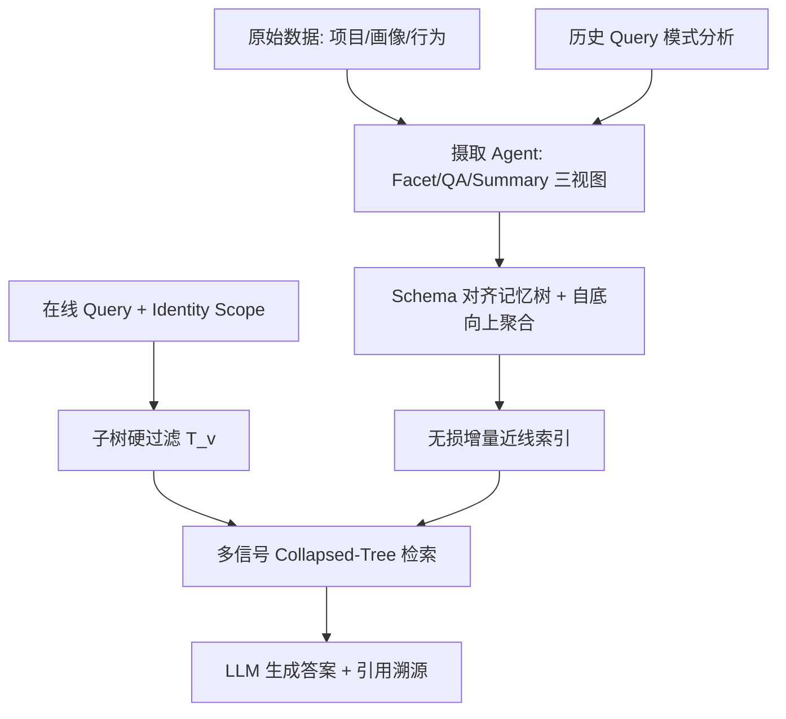
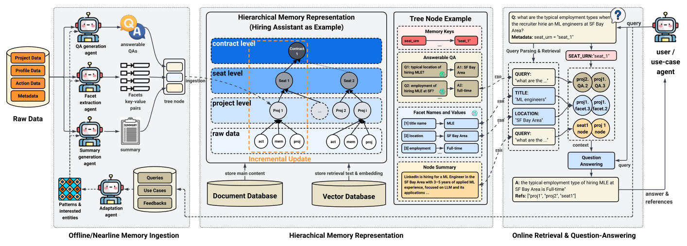

# Hierarchical Long-Term Semantic Memory for LinkedIn's Hiring Agent (LinkedIn 招聘智能体的层级长期语义记忆)

- **会议/期刊**: KDD 2026 (ADS Track)
- **作者与机构**: Zhentao Xu, Shangjin Zhang, Emirhan Poyraz, Yvonne Li, Ye Jin, Xie Lu, Xiaoyang Gu, Karthik Ramgopal, Praveen Kumar Bodigutla, Xiaofeng Wang（LinkedIn Agent Platform Team）
- **推荐链路定位**: 端到端生成式（Agent 长期记忆检索 → LLM 生成个性化响应）
- **研究方向**: 对话推荐与智能体仿真 / 大语言模型推荐
- **论文原文**: [https://arxiv.org/abs/2604.26197v3](https://arxiv.org/abs/2604.26197v3)
- **开源代码**: 暂未开源

## TL;DR (1分钟核心速览)

工业级 LLM Agent 的长期记忆面临五大矛盾：可扩展性、低延迟检索、隐私隔离、自适应与可观测性。本文提出 HLTM——以**业务 schema 对齐的层级记忆树**替代语义聚类树，节点内容压缩为 **facet / QA / summary 三视图**，配合**自底向上离线聚合**与**无损增量近线索引**，在线仅做 identity-scoped 子树过滤 + 多信号 collapsed-tree 检索。在 LinkedIn Hiring Assistant 人工标注基准（1,341 条 query，平均历史 40K token）上，summary 类查询语义正确率 0.892（较 HippoRAG 0.833 提升 >5%），retrieval 类查询 F1 0.782（较 ReadAgent 0.617 提升 >10%），且查询延迟约 3s 显著优于 HippoRAG 的 ~7s；LongMemEval-s 上整体正确率 0.778（较 A-Mem 0.716 提升 6%）。已全量上线生产。

## Background & Motivation (背景与核心矛盾)

- **主流范式**: MemGPT/Mem0/MemoryBank 用外部存储换入换出上下文；GraphRAG/HippoRAG/A-Mem 用图结构支持多跳推理；RAPTOR/TreeRAG/MemTree 用递归聚类+摘要构建层级索引以压缩长上下文。
- **前人局限**: ① 语义聚类层级会把不同业务租户内容混在同一节点，违反 GDPR 类隔离要求，且增量更新触发重聚类或全量重建；② 图方法索引期重度依赖 LLM、在线延迟高；树方法依赖 LLM 世界知识做聚合，领域可控性弱；③ 普遍缺乏引用溯源（provenance），生产环境不可调试。
- **核心洞察 (Key Insight)**: 企业数据本身自带**天然层级 schema**（组织账户 → 招聘 seat → 项目 → 合同），拓扑稳定、边界即权限边界；把记忆树直接对齐 schema，可同时解决隐私隔离、增量更新成本（$O(|V|)\to O(\text{tree height})$）与拓扑漂移三个问题。
- **本文切入点**: 用 schema 对齐树替代语义聚类树，节点内容多视图压缩，聚合与索引全部离线/近线摊销，在线只留一条精简检索路径。

## Method (核心方法设计)

### 1. 整体框架 (Overall Architecture)

离线/近线阶段：摄取 Agent 将原始数据（项目数据、候选人画像、行为日志）转换为 facet/QA/summary 三视图记忆 $M_v=\langle F_v,Q_v,S_v\rangle$，按 schema 父子关系挂载到记忆树，并自底向上递归聚合生成父节点表示；查询模式分析模块周期性挖掘历史 query 反哺摄取 Agent。在线阶段：query 先解析出 identity scope，硬过滤到子树$\mathcal{T}_v$，再在 collapsed-tree 候选池上做 facet/QA/summary 三路检索，拼接 top-k 上下文交给 LLM 生成答案并返回引用节点 ID。

<figure class="paper-figure" markdown="span">
  <figcaption>图3：HLTM 概览。摄取代理将原始数据转换为多视图表示（左），并在模式对齐的记忆树中组织它们（中）。推理时，检索相关节点以生成答案（右）。</figcaption>
</figure>

### 2. 关键设计拆解 (Key Designs)

1. **Schema 对齐层级拓扑（替代语义聚类）**：痛点在于聚类树混租户、增量即重聚类。本文将树索引定义为 $\mathcal{T}=(V,E)$，$V$为业务实体（root=组织账户，中间=recruiter seat，叶=招聘项目），$E$严格遵循 schema 父子关系；检索被硬约束在$\mathcal{T}_v=\mathcal{T}[\{v\}\cup\text{Desc}(v)]$。直觉：拓扑即权限边界，隔离无需额外路由；更新只触碰叶节点及其祖先路径，天然无损且拓扑永不漂移。

2. **多视图记忆表示 + 离线层级聚合**：痛点在于单一摘要视图对结构化约束（地点、职级）与用户口语化 query 的嵌入对齐都差，且在线现摘大量叶节点会触发 needle-in-a-haystack 与 token 爆炸。本文将节点内容压缩为三视图：facet 键值对（线性化后嵌入，支持 schema 感知匹配）、answerable QA（问题嵌入天然贴近用户 query 分布，且答案可离线预计算实现 "think-fast"）、summary（承载非结构化叙事）。父节点由 LLM 对子节点三视图做语义归并、去冗、冲突消解后递归生成至根。直觉：把"聚合"从在线成本转为离线摊销，同时让宽泛的 summary 类 query 在粗粒度节点上就能命中。

3. **多信号检索打分与训练/推理开销**：三路检索各自打分后取 top-k 并集。facet 路将 query 解析为微查询集合 $F_q$，按 top-k 平均聚合避免无关 facet 稀释：
$$s_{\text{facet}}(q,v)=\frac{1}{k|F_q|}\sum_{f\in F_q}\sum_{f'\in\text{TopK}(f,F_v)}\cos\big(\text{emb}(f),\text{emb}(f')\big)$$
QA 路取最佳匹配问题 $s_{\text{QA}}(q,v)=\max_{q'\in Q_v}\cos(\text{emb}(q),\text{emb}(q'))$，summary 路为$s_{\text{summary}}(q,v)=\cos(\text{emb}(q),\text{emb}(S_v))$。最终$\text{answer},\text{refs}=\text{LLM}(q,\,F_k\cup Q_k\cup S_k)$。本方法**无监督训练、无负采样**，全部依赖预训练 embedding + ICL；在线开销仅为三次向量检索 + 一次 LLM 调用，token 消耗较图基线降低 ≥50%。

## Experimental Setup & Evaluation Protocol (实验设置与评估协议)

- **数据集与预处理**:

| 数据集 | #Queries | #Items/类型 | 历史总长 | 稀疏度/密度 | 特征/场景说明 |
| :--- | :---: | :---: | :---: | :---: | :--- |
| LinkedIn Hiring Assistant | 1,341（473 retrieval + 868 summarization） | — | ≈53M tokens（均长 ≈40K） | — | 招聘项目/候选人交互/匿名画像；3 名标注员多数投票 |
| LongMemEval-s | 500 | 6 类问题 | ≈51M tokens（均长 ≈103K） | — | 公开长期记忆基准，覆盖知识更新/多会话推理/时序推理 |

- **数据划分与防穿越 (Splitting Strategy)**: 采用**人工标注离线基准**（非时序切分），gold answer 由领域专家基于对应历史文档独立撰写，保证答案个性化且不泄露未来信息；生产侧另做 3,000+ 真实会话的在线观测。
- **排名评测协议 (Ranking Protocol)**: 非传统 full-ranking；检索侧报告 **Precision / Recall / F1**（top-k 上下文命中），生成侧报告 Token-F1、BLEU-1 与 **LLM-as-a-judge 语义正确率**（judge 与专家多数票的 Quadratic Weighted Cohen's $\kappa>0.8$）。
- **对比基线与超参设置**: 10 个基线，含基础类（Full-context、RAG、Schema Filter）与进阶类（GraphRAG、HippoRAG、A-Mem、SimpleMem、RAPTOR、ReadAgent、Mem0）。统一 backbone：embedding 用 `text-embedding-3-large`，主 LLM 为 GPT-4o mini，另在 4 个 27B–106B 开源模型上复验；结果 3 次运行取均值，显著性用 Wilcoxon signed-rank（$p<10^{-7}$）与 Cliff's$\delta$。

## Key Experimental Results (实验关键数据)

### 1. 主实验对比 (Main Results)

LinkedIn 数据集（GPT-4o mini）：

| Methods | Summary Correctness↑ | Summary Token-F1↑ | Retrieval Precision↑ | Retrieval Recall↑ | Retrieval F1↑ |
| :--- | :---: | :---: | :---: | :---: | :---: |
| Full-context | 0.791 | 0.478 | 0.465 | 0.849 | 0.544 |
| RAG | 0.770 | 0.534 | 0.557 | 0.762 | 0.604 |
| Schema Filter | 0.513 | 0.352 | 0.541 | 0.575 | 0.546 |
| A-Mem | 0.779 | 0.523 | 0.498 | 0.719 | 0.549 |
| HippoRAG | 0.833 | 0.453 | 0.515 | 0.718 | 0.560 |
| RAPTOR | 0.715 | 0.539 | 0.332 | 0.425 | 0.348 |
| GraphRAG | 0.381 | 0.114 | 0.082 | 0.112 | 0.084 |
| Mem0 | 0.521 | 0.470 | 0.376 | 0.412 | 0.369 |
| ReadAgent | 0.796 | 0.473 | 0.542 | 0.861 | 0.617 |
| **HLTM** | **0.892** | **0.724** | **0.761** | **0.874** | **0.782** |
| Improv.% | **+7.1%** vs HippoRAG | **+34.3%** vs RAG | **+36.6%** vs RAG | **+1.5%** vs ReadAgent | **+26.7%** vs ReadAgent |

LongMemEval-s 整体正确率：HLTM **0.778** vs A-Mem 0.716（**+8.7%**）、HippoRAG 0.578、RAPTOR 0.530、Full-context 0.494；六类子任务全部第一，multi-session reasoning 上 0.632 vs A-Mem 0.556。

### 2. 消融实验 (Ablation Study)

| 变体 | Summary Correctness↑ | Retrieval F1↑ | 说明 |
| :--- | :---: | :---: | :--- |
| HLTM (full) | **0.892** | **0.782** | 完整模型 |
| w/o aggregation | 0.850 | 0.618 | 仅叶节点检索 |
| w/o adaptation | 0.829 | 0.593 | 去掉 query 模式反哺 |
| facet-only | 0.809 | 0.599 | 单视图 |
| QA-only | 0.710 | 0.646 | 单视图 |
| summary-only | 0.850 | 0.730 | 单视图 |

### 3. 关键实验发现 (Key Findings)

1. **层级聚合对 retrieval 类查询是命脉**：去掉聚合后 retrieval F1 从 0.782 暴跌至 0.618（−16 点），远大于 summary 正确率的 4 点跌幅——说明粗粒度父节点摘要正是宽泛 query 与叶级嵌入"空间错位"的解药，而精确证据检索仍依赖叶级 facet/QA 视图。
2. **自适应反哺的边际收益被低估**：去掉 query 模式分析后 retrieval F1 掉 19 点（0.782→0.593），甚至超过去掉聚合的损失，证明"用历史 query 分布决定记什么"比"用 LLM 世界知识决定记什么"更贴合生产负载。
3. **三视图互补而非冗余**：summary-only 在 summary 正确率上已达 0.850（接近完整模型），但 retrieval F1 仅 0.730；QA-only 反之 retrieval F1 0.646 而正确率仅 0.710。三视图合并才同时拿到 0.892 / 0.782，验证 facet 管结构化约束、QA 管意图对齐、summary 管叙事的正交分工。生产侧 3,000+ 会话观测显示，HLTM 被 supervisor 自主调用率 >40%，调用会话的负反馈率下降 5–10 个百分点（$p<0.01$）。

## Highlights & Limitations (亮点、对比与审稿批判)

- **与代表作对比 (vs. Prior Work)**: 相比 RAPTOR 的语义聚类树，HLTM 用业务 schema 换取了隐私隔离与 $O(\text{height})$ 增量更新，且 retrieval F1 高出 43 点；相比 HippoRAG 的图检索，HLTM 以约 3s vs ~7s 的查询延迟取得更高正确率，token 消耗低 ≥50%；相比 Mem0 的扁平语义检索，多视图 + 层级聚合带来 37 点正确率提升。
- **可迁移亮点**: ① "schema 即拓扑即权限边界"的设计可直接迁移到电商（商家-店铺-商品）、本地生活（城市-商圈-POI）等天然带层级的推荐场景；② 用历史 query 分布反哺离线记忆构建的 adaptation loop，是低成本对齐线上负载的通用技巧。
- **审稿级局限批判**: ① 评测依赖单一企业内部人工标注集（1,341 query），LongMemEval-s 仅作补充，跨企业泛化性证据偏弱；② 全流程重度依赖 LLM 做 facet 抽取与聚合，索引期成本与 LLM 版本漂移风险未量化；③ 与 TreeRAG/MemTree 等树方法未做实验对比（作者自述缺可运行实现），SOTA 定位略欠完整。

## Rating (四维评分)

- **方法创新性 (Novelty)**: ⭐⭐⭐⭐ （核心机制与方法设计具备明确创新性，理论与实验动机支撑充分）
- **评估协议与实验扎实度 (Protocol & Experiments)**: ⭐⭐⭐⭐ （主流公开数据集评测完整，包含多基线对比与消融实验验证）
- **写作与数学规范度 (Clarity & Rigor)**: ⭐⭐⭐⭐⭐ （问题形式化定义清晰，核心模块数学推导与架构阐述严谨易读）
- **工业落地与复现价值 (Industrial & Practical Value)**: ⭐⭐⭐⭐⭐ （兼顾推荐效果增益与训练/推理效率，具备实际场景迁移参考价值）
