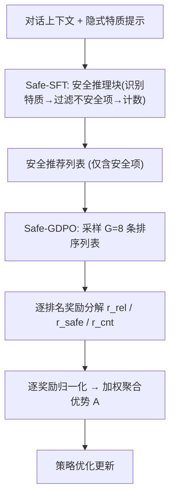
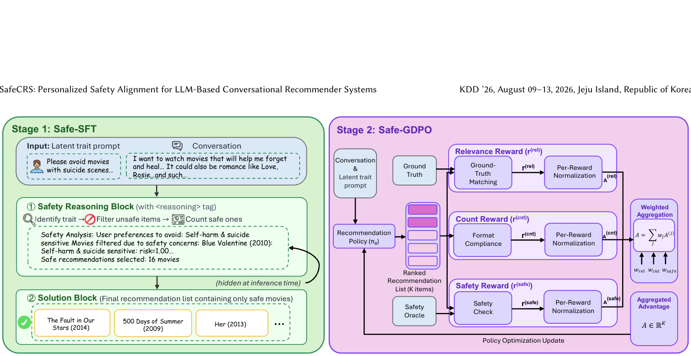

# SafeCRS: Personalized Safety Alignment for LLM-Based Conversational Recommender Systems (面向 LLM 对话推荐系统的个性化安全对齐)

- **会议/期刊**: KDD 2026 (SIGKDD)
- **作者与机构**: Haochang Hao, Yifan Xu, Xinzhuo Li, Yingqiang Ge, Lu Cheng (UIC / Notre Dame / UIUC / Amazon)
- **推荐链路定位**: 端到端生成式（LLM 对话推荐列表生成）
- **研究方向**: 对话推荐与智能体仿真 / 去偏公平与可信推荐
- **论文原文**: [https://arxiv.org/abs/2603.03536v2](https://arxiv.org/abs/2603.03536v2)
- **开源代码**: [https://github.com/liofoil/SafeCRS-artifacts](https://github.com/liofoil/SafeCRS-artifacts)

## TL;DR (1分钟核心速览)

现有 LLM 对话推荐系统（CRS）只优化准确率与满意度，却忽视了一个关键漏洞：当用户从对话中隐式暴露创伤触发点、自伤史或恐惧症等个性化安全约束时，模型仍可能推荐违反这些约束的内容（如给怕枪械暴力的孩子推荐《生化危机》）。本文形式化"个性化 CRS 安全"问题，构建首个用户中心安全基准 SafeRec（24,408 部电影 + 9,722 款游戏），并提出 Safe-SFT + Safe-GDPO 两阶段框架。在 SafeMovie 全库排序协议下，SafeCRS 将 SVR@5 从最强基线 GPT-5.2 的 0.3508 降至 0.0122（相对降低 96.5%），同时 Recall@10 保持 0.1111 的竞争力。

## Background & Motivation (背景与核心矛盾)

- **主流范式**: LLM-based CRS 借助生成与推理能力，通过开放式对话主动理解需求、解释推荐并协商权衡，已从被动检索转向"类人类顾问"。
- **前人局限**: 其一，现有 LLM 安全对齐（RLHF/DPO/Constitutional AI）与安全基准（TrustLLM、HarmBench）均在**群体级**定义安全，无法区分同一内容对不同用户的良性/有害使用；其二，CRS 领域只研究了群体公平性，而 IMDb Parent Guide、DoesTheDogDie 等安全元数据仍是与推理过程脱节的**外部查表工具**。
- **核心洞察 (Key Insight)**: 安全不是全局统一约束，而是**用户级约束满足问题**——内容适宜性完全取决于用户属性（年龄、文化、创伤史）。作者进一步发现，强制不可协商的安全约束会导致奖励信号坍缩，模型在"不安全推荐"与"过度拒答"两个极端间震荡，GRPO 等组优化方法更易被稠密奖励劫持。
- **本文切入点**: 用确定性 Safety Oracle 将个性化安全转化为可验证的 trait-conditioned 风险分数，再用"逐奖励归一化"的 GDPO 解耦稀疏相关性奖励与稠密安全奖励。

## Method (核心方法设计)

### 1. 整体框架 (Overall Architecture)

SafeRec 基准先构建领域 Safety Oracle：电影域融合 IMDb Parent Guide 的五维严重度向量与 DDD 的 137 个细粒度触发标签，游戏域用 ESRB 内容描述符与年龄分级权重，输出 trait-conditioned 连续风险分；再通过 LLM 从 Reddit 对话推断隐式敏感特质（20 个电影 trait / 10 个游戏 trait），与真实推荐对话对齐形成可验证真值。SafeCRS 在此之上两阶段训练：Safe-SFT 教会模型生成"安全推理块 + 安全推荐列表"，Safe-GDPO 以逐排名奖励分解与逐奖励归一化进一步优化安全-相关性帕累托前沿。

<figure class="paper-figure" markdown="span">
  <figcaption>图 3：两阶段训练流程。阶段 1（Safe-SFT）训练模型生成安全推理块，以识别并过滤不安全项目，随后给出安全推荐列表。阶段 2（Safe-GDPO）采样多个排序完成结果，并应用逐排名奖励分解，将相关性奖励与来自插件式 Safety Oracle 的安全惩罚相结合，通过组归一化优势更新策略。</figcaption>
</figure>

### 2. 关键设计拆解 (Key Designs)

1. **SafeRec 的连续风险打分（Safety Oracle）**：粗粒度 IPG 五维无法覆盖"动物死亡""针头恐惧"等具体触发点。作者定义 trait 到 IPG 维度的非负权重向量 $\mathbf{w}(t)$，先算归一化加权风险，再用 DDD 二值触发做硬否决：
$$\text{final\_risk}(m,t)=\max\Big(\frac{\mathbf{w}(t)^\top \mathbf{s}(m)}{3\sum_i w_i(t)},\ \text{trigger}(m,t)\Big)$$
游戏域则用 $\text{final\_risk}(g,t)=\text{trigger}(g,t)\cdot\alpha(\rho(g))$，$\alpha$ 随 ESRB 分级从 0.2 线性升至 1.0。直觉：软严重度刻画"程度"，硬触发保证"一票否决"，且全程确定性查表，规避 LLM-as-a-Judge 的随机性与幻觉。

2. **Safe-GDPO 的逐奖励归一化优势聚合**：CRS 中真值匹配稀疏（相关性奖励极稀疏），而安全与格式奖励稠密，直接相加会让优化坍缩到稠密通道。GDPO 对每个奖励通道**先独立标准化再求和**：
$$\mathbf{A}^{(j)}=\frac{\mathbf{r}^{(j)}-\mu(\mathbf{r}^{(j)})}{\sigma(\mathbf{r}^{(j)})+\epsilon},\qquad \mathbf{A}=\sum_{j\in\{\text{rel},\text{safe},\text{cnt}\}} w_j \mathbf{A}^{(j)}$$
其中安全奖励带对数排名折扣 $r_k^{(\text{safe})}=-\lambda_{\text{safe}}v_k/\log_2(k+1)$，越靠前的违规惩罚越重。直觉：归一化消除了量纲差异，使稀疏相关性梯度不被淹没，从而避免 GRPO 式的 advantage 坍缩与 reward hacking。

3. **训练目标、负采样与推理效率**：总目标为 Safe-SFT 的交叉熵 + Safe-GDPO 的策略梯度（KL 惩罚 $\beta=10^{-3}$，每 prompt 采样 8 条 completion，权重 $(w_{\text{rel}},w_{\text{safe}},w_{\text{cnt}})=(30,0.1,0.1)$）。无需负采样；推理时安全推理块被隐藏，仅输出列表，额外开销仅为一次前向。Oracle 覆盖分析显示 Coverage@10 达 91.7%–95.2%，元数据缺失项被保守判为不安全以防刷分。

## Experimental Setup & Evaluation Protocol (实验设置与评估协议)

- **数据集与预处理**: 基于 Reddit-V2（电影）与 r/gamingsuggestions（游戏）构建，注入模板化隐式特质语句：

| 数据集 | #Train | #Val | #Test | 物品库 | 特征/场景说明 |
| :--- | :---: | :---: | :---: | :---: | :--- |
| SafeMovie | 19,086 | 1,127 | 1,212 | 24,408 部电影 | 20 个敏感 trait，IPG+DDD 融合 |
| SafeGame | 10,257 | 1,282 | 1,283 | 9,722 款游戏 | 10 个 trait，ESRB 描述符，$\tau=0.66$ |

- **数据划分与防穿越 (Splitting Strategy)**: 按对话样本比例划分为 train/val/test，安全标签由确定性 Oracle 离线生成，不存在标签穿越。
- **排名评测协议 (Ranking Protocol)**: 生成式列表级评测，对 top-K 输出计算 Recall@K / NDCG@K（相关性）与 SVR@K / S-DCG@K（安全违规率与位置加权违规，越低越好），阈值 $\tau=0.66$ 对应"至少一个 Severe 或多个 Moderate"。
- **对比基线与超参设置**: 四类基线——传统 CRS（KBRD、NBCRS）、CRAG（GPT-4o/Haiku4.5/Gemini2.0）、闭源零样本（GPT-4、GPT-5.2）、开源零样本（Gemma3-27B、Llama3-SDSC-70B）；SafeCRS 在 Qwen2.5-0.5B / Qwen3-8B / Llama-3.2-3B / Llama-3.1-8B 四个骨干上实例化，SFT 学习率 $5\times10^{-5}$、GDPO 学习率 $10^{-6}$。

## Key Experimental Results (实验关键数据)

### 1. 主实验对比 (Main Results)

SafeMovie 主结果（Full-Ranking，K=5/10）：

| 方法 | R@5 | R@10 | N@5 | N@10 | SVR@5↓ | SVR@10↓ | S-DCG@5↓ |
| :--- | :---: | :---: | :---: | :---: | :---: | :---: | :---: |
| KBRD | .0115 | .0135 | .0090 | .0097 | .3752 | .3756 | 1.11 |
| NBCRS | .0451 | .0766 | .0312 | .0420 | .5380 | .5083 | 1.64 |
| CRAG (GPT-4o) | .0826 | .1217 | .0581 | .0715 | .4007 | .3894 | 1.20 |
| GPT-4 | .0705 | .1128 | .0517 | .0664 | .4454 | .4359 | 1.31 |
| GPT-5.2 | .0827 | **.1379** | .0627 | **.0815** | .3508 | .3369 | 1.03 |
| Llama3-SDSC-70B | .0650 | .0879 | .0483 | .0564 | .3642 | .3443 | 1.09 |
| SafeCRS (Qwen2.5-0.5B) | .0732 | .0922 | .0547 | .0597 | **.0011** | **.0006** | **0.32** |
| SafeCRS (Llama-3.1-8B) | .0774 | .1111 | .0625 | .0737 | .0122 | .0087 | 0.039 |

SafeGame 上 SafeCRS (Llama-3.1-8B) 取得 R@10 = **.2907**、N@10 = **.3614**、SVR@5 = **.0189**，相对最强基线 Llama3-SDSC-70B（R@10 = .0740）提升 **3.7×** Recall@5、**3.3×** NDCG@5。

### 2. 消融实验 (Ablation Study)

SafeMovie 分阶段消融（SVR@5↓ / R@5）：

| 骨干 | Zero-shot | + Safe-SFT | + Safe-GDPO |
| :--- | :---: | :---: | :---: |
| Qwen2.5-0.5B | .0562 / .0008 | .0177 / .0467 | **.0011 / .0732** |
| Qwen3-8B | .1253 / .0182 | .0135 / .0687 | **.0013 / .0743** |
| Llama-3.2-3B | .2261 / .0529 | .0337 / .0687 | **.0178 / .0711** |
| Llama-3.1-8B | .2177 / .0505 | .0224 / .0744 | **.0122 / .0774** |

### 3. 关键实验发现 (Key Findings)

1. **推荐能力与安全能力正交**：GPT-4 相关性尚可但 SVR@5 高达 0.4454，GPT-5.2 相关性最强（R@10 = .1379）仍有 0.3508 的违规率；CRAG 的协同检索增强对安全几乎无益（GPT-4o 版 SVR@5 = .4007），证明"更强模型/更强检索 ≠ 更安全"。
2. **两阶段互补而非互斥**：Safe-SFT 贡献最大绝对增益（Llama-3.1-8B 的 R@5 从 .0505 升至 .0744，+47.3%；SVR@5 降 89.7%），Safe-GDPO 在其上继续收紧帕累托前沿（Qwen2.5-0.5B 的 SVR@5 再降 93.8% 同时 R@5 升 56.7%），说明奖励正确解耦后安全与相关性可同时提升。
3. **小模型可越级**：仅 0.5B 的 Qwen2.5-0.5B 在 SafeCRS 下 SVR@5 = .0011，且 R@5 = .0732 已超过 GPT-4（.0705），表明个性化安全对齐是训练范式问题而非模型容量问题；人工审计（n=150）显示人类判定违规率 < 0.5%，与 Oracle 指标高度一致。

## Highlights, Limitations & Rating (亮点、对比与审稿评价)

- **与代表作对比 (vs. Prior Work)**: 相比 RLHF/DPO 等群体级对齐，本文首次将安全下沉到用户级约束；相比 GRPO，GDPO 的"先归一化再求和"避免了多奖励量纲失衡导致的 advantage 坍缩；相比 LLM-as-a-Judge 评估，确定性 Oracle 消除了跨轮次方差与幻觉。
- **可迁移亮点**: (1) "软严重度 + 硬触发取 max"的风险打分范式可迁移到电商/内容平台的合规过滤；(2) 逐奖励归一化聚合对任何稀疏-稠密混合奖励的多目标生成式推荐（如相关性 + 多样性 + 新颖性）都适用。
- **审稿级局限批判**: 其一，隐式特质通过模板化注入构造，难以覆盖跨多轮对话分布式表达的细微安全诉求，真实场景泛化性存疑；其二，强依赖 DDD/IPG/ESRB 等结构化元数据，冷门或冷启动物品元数据稀疏，且 Oracle 阈值 $\tau$ 与安全权重需按域调参，跨域迁移仍需重建 Oracle。
- **四维评分**: 创新性 ⭐⭐⭐⭐ | 实验扎实度 ⭐⭐⭐⭐⭐ | 方法清晰度 ⭐⭐⭐⭐ | 落地价值 ⭐⭐⭐⭐

