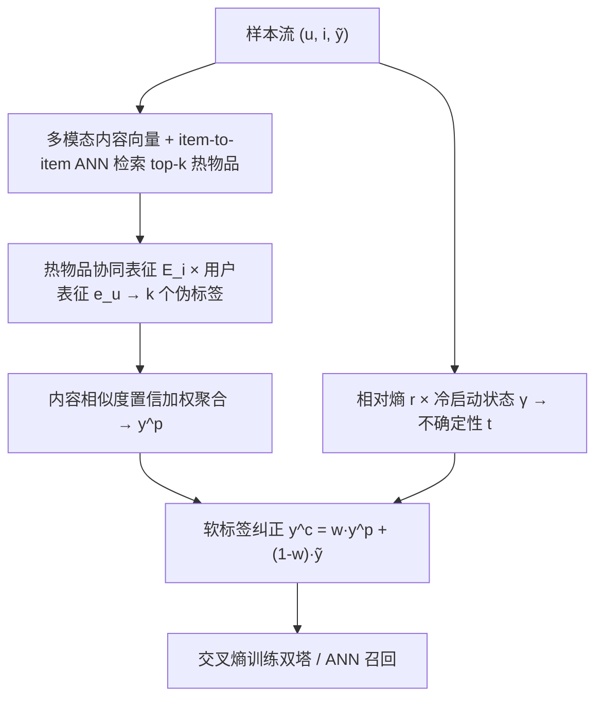
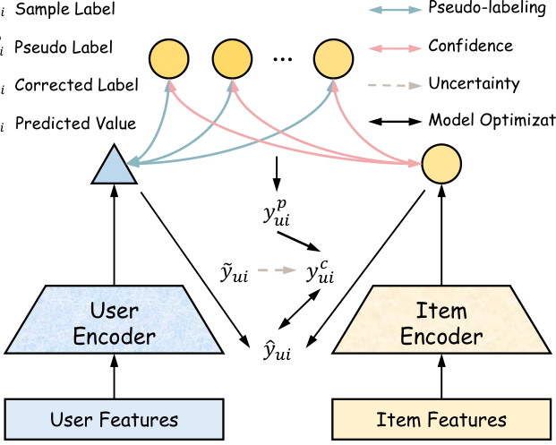

# Denoising Implicit Feedback for Cold-start Recommendation (面向冷启动推荐的隐式反馈去噪)

- **会议/期刊**: KDD 2026 (ADS Track)
- **作者与机构**: Gaode Chen, Shicheng Wang, Shikun Li (HKBU), Rui Huang, Ruina Sun, Yinjie Jiang, Jun Zhang 等 — 快手科技 / 香港浸会大学 / 中科院信工所 / 北大 / 南大
- **推荐链路定位**: 召回（双塔 + ANN，方法本身 model-agnostic）
- **研究方向**: 冷启动与长尾推荐 / 自监督与交互去噪
- **论文原文**: [https://arxiv.org/abs/2606.19658v1](https://arxiv.org/abs/2606.19658v1)
- **开源代码**: [https://github.com/HKUDS/MMSSL](https://github.com/HKUDS/MMSSL)（数据集仓库）

## TL;DR (1分钟核心速览)

本文指出一个被忽视的事实：**冷启动物品比热物品更容易产生噪声隐式反馈**（快手实测：clickbait 高分档冷视频占比高出 37.7%；尾部三位冷视频占比高出 28.3%）。而现有"高 loss 即噪声"的去噪范式在冷启动下彻底失效——冷物品天然 loss 大、预测分低、梯度大。DIF 提出：用**内容相似热物品的协同表征**为用户-冷物品样本生成 k 个伪标签，按内容相似度做置信加权聚合，再用**相对熵 × 冷启动状态**估计样本不确定性，自适应地把伪标签混入原标签做软标签纠正。在 Amazon-Sports/Baby、TikTok 三数据集上以 NeuMF/LightGCN/SimGCL 三种骨干验证，冷物品 Recall@20 最高提升约 89%（NeuMF-Sports 0.00244→0.00461），并在快手十亿用户级 A/B 中有效观看 +2.33%、完播 +2.69%。

## Background & Motivation (背景与核心矛盾)

- **主流范式**: 隐式反馈去噪分两支——样本选择（丢弃高 loss 样本）与样本重加权（降低高 loss 样本权重），二者均以 loss 值、预测分、梯度等**模型自身信号**作为噪声判据。
- **前人局限**: ①冷物品表征未充分训练，天然呈现大 loss / 低预测分 / 大梯度，与"噪声样本"的启发式特征完全混淆，判据失效；②冷物品正反馈本就稀少，样本选择会进一步丢弃宝贵的正信号，加剧马太效应；③这些方法难以嵌入工业流式训练管线。
- **核心洞察 (Key Insight)**: 用户对**内容**的兴趣是稳定的，因此"用户是否会对某冷物品感兴趣"可由内容相似的热物品交互来推断；热物品的协同表征已被充分训练，是可靠的信息源。
- **本文切入点**: 把去噪从"基于模型信号的样本筛选"转为"基于内容近邻的标签纠正"，且纠正强度由样本级不确定性自适应控制。

## Method (核心方法设计)

### 1. 整体框架 (Overall Architecture)

对样本流中每个 $(u,i,\tilde y_{ui})$：先经多模态推理服务取冷物品 $i$ 的内容向量，向 item-to-item ANN 服务检索 top-$k$ 内容相似热物品及其相似度 $S_i$；再由 Embedding 服务实时取这些热物品的协同表征 $E_i$，与用户兴趣表征 $e_u$ 内积得到 $k$ 个伪标签；置信加权聚合为单一伪标签 $y^p_{ui}$；同时用相对熵与冷启动状态估计样本不确定性 $t_{ui}$，换算权重 $w$ 后将 $y^p_{ui}$ 与原标签 $\tilde y_{ui}$ 混合为软标签 $y^c_{ui}$，最后以交叉熵训练双塔。全流程在近线流式系统中增量更新。

<figure class="paper-figure" markdown="span">
  <figcaption>图 1：我们提出的 DIF 与双塔模型集成的概览。</figcaption>
</figure>

### 2. 关键设计拆解 (Key Designs)

1. **内容近邻伪标签生成 (Pseudo-labeling via Content-Similar Warm Items)**：痛点是用冷物品自身预测做伪标签不可信。改为取 top-$k$ 内容相似热物品的协同表征与用户表征内积，保持与样本标签同构（同为内积打分）：
$$\big[y^p_{ui,1},\dots,y^p_{ui,k}\big]=e_u\cdot\big[e^1_i,e^2_i,\dots,e^k_i\big]$$
直觉：热物品表征已被充分训练，其与用户的交互倾向可迁移到内容同质的冷物品上。作者进一步用 kNN 非参回归理论证明：只要热物品池 $N_{warm}$ 足够大，伪标签误差上界为 $\mathcal{O}\big(L(k/N_{warm})^{\alpha/d}\big)+\mathcal{O}(\sigma'_u/\sqrt{k})$，**无需强相似性假设**即可逼近真标签。

2. **置信加权聚合 (Confidence Modeling)**：不同相似度应体现不同引导强度，故以 softmax 温度加权替代均值池化：
$$c^j_i=\frac{\exp(s^j_i/\tau)}{\sum_{z=1}^{k}\exp(s^z_i/\tau)},\quad y^p_{ui}=\sum_{j=1}^{k}c^j_i\,y^p_{ui,j}$$
线上观测相似度普遍 >0.9，$\tau=0.3$ 用于放大区分度。

3. **不确定性估计与软标签纠正 (Uncertainty-Guided Correction)**：纠正过度会污染热物品训练。以相对熵 $r_{ui}=-\tilde y\log\hat y-(1-\tilde y)\log(1-\hat y)$ 度量预测失配，以冷启动状态 $\gamma_i=e^{-\alpha g_i}$（$g_i$ 为交互数）度量冷物品先验噪声倾向，二者相乘得 $t_{ui}=r_{ui}\gamma_i$，再归一化为 $w=t/(t+1)$，最终 $y^c_{ui}=w\,y^p_{ui}+(1-w)\tilde y_{ui}$。理论侧 Theorem 2.2 证明 MSE 最优权重恰为 $w^*=\lambda/(\lambda+1)$（$\lambda$ 为噪声比），与式 (7) 形式一致，$t_{ui}$ 即该噪声比的有效估计量。**训练目标**为交叉熵 $\mathcal{L}=-\sum y^c\log\hat y+(1-y^c)\log(1-\hat y)$；负采样沿用双塔 in-batch 范式，无额外负采样开销；推理时仅用户塔实时前向 + ANN 检索，伪标签仅在训练期生效，**在线零额外延迟**。

## Experimental Setup & Evaluation Protocol (实验设置与评估协议)

- **数据集与预处理**（多模态特征：视觉 V / 声学 A / 文本 T）：

| 数据集 | #Users | #Items | #Interactions | 稀疏度 | 特征说明 |
| :--- | :---: | :---: | :---: | :---: | :--- |
| Amazon-Sports | 35,598 | 18,357 | 256,308 | 99.961% | V 4096-d + T 1024-d (Sentence-BERT) |
| Amazon-Baby | 19,445 | 7,050 | 139,110 | 99.899% | V 4096-d + T 1024-d |
| TikTok | 9,319 | 6,710 | 59,541 | 99.904% | V/A 128-d + T 768-d |

- **数据划分与防穿越**: 按每用户交互 **8:1:1 比例随机划分** train/valid/test；冷/热物品按各数据集交互数**第 20 百分位**切分（非时间切分，存在轻度穿越风险）。
- **排名评测协议**: 报告 Precision@20 / Recall@20 / NDCG@20，测试集全体用户平均；未明确声明 Full-Ranking，从指标量级（Recall@20 ~1e-3）推断为**采样候选排序**。
- **对比基线与超参**: 三类 model-agnostic 去噪/冷启动基线 DECL、RINCE、MWUF + Normal 训练，分别嫁接 NeuMF / LightGCN / SimGCL 三种骨干；$d=64$，Adam，batch=1024，lr=1e-3，$k=5$，$\tau=0.3$。

## Key Experimental Results (实验关键数据)

### 1. 主实验对比 (Main Results)

以 LightGCN 与 SimGCL 骨干的 Recall@20 / NDCG@20 为代表（完整表含 NeuMF 与 Warm/Overall 分桶）：

| 骨干 | 方法 | Sports R@20 | Sports N@20 | Baby R@20 | Baby N@20 | TikTok R@20 | TikTok N@20 |
| :--- | :--- | :---: | :---: | :---: | :---: | :---: | :---: |
| LightGCN (Cold) | Normal | 0.00191 | 0.00192 | 0.00143 | 0.00122 | 0.00106 | 0.00026 |
| | RINCE | 0.00266 | 0.00294 | 0.00258 | 0.00248 | 0.00415 | 0.00125 |
| | DECL | 0.00277 | 0.00306 | 0.00179 | 0.00168 | 0.00231 | 0.00065 |
| | MWUF | 0.00253 | 0.00222 | 0.00186 | 0.00161 | 0.00155 | 0.00050 |
| | **DIF** | **0.00325** | **0.00341** | **0.00303** | **0.00261** | **0.00518** | **0.00117** |
| SimGCL (Cold) | Normal | 0.00218 | 0.00210 | 0.00180 | 0.00184 | 0.00155 | 0.00040 |
| | RINCE | 0.00293 | 0.00312 | 0.00285 | 0.00289 | 0.00466 | 0.00101 |
| | DECL | 0.00317 | 0.00361 | 0.00219 | 0.00184 | 0.00259 | 0.00072 |
| | MWUF | 0.00319 | 0.00270 | 0.00236 | 0.00227 | 0.00207 | 0.00060 |
| | **DIF** | **0.00347** | **0.00379** | **0.00350** | **0.00356** | **0.00570** | **0.00154** |
| SimGCL (Overall) | RINCE | 0.06266 | 0.02837 | 0.07165 | 0.03178 | 0.08483 | 0.03583 |
| | DECL | 0.06862 | 0.03156 | 0.04751 | 0.02007 | 0.06819 | 0.03208 |
| | **DIF** | **0.07287** | **0.03392** | **0.07767** | **0.03405** | **0.09005** | **0.03993** |

冷物品上 DIF 相对最强基线提升：Sports R@20 +17.3%（vs DECL）、Baby +17.4%（vs RINCE）、TikTok +24.8%（vs RINCE）；NeuMF-Sports 冷物品 R@20 相对 Normal 提升 **+88.9%**。

### 2. 消融实验 (Ablation Study)

LightGCN 骨干，Recall@20：

| 数据集 | 变体 | Cold | Warm | Overall |
| :--- | :--- | :---: | :---: | :---: |
| TikTok | w/o CM（均值聚合） | 0.00311 | 0.10857 | 0.07537 |
| | w/o RE（去相对熵） | 0.00152 | 0.12214 | 0.08385 |
| | w/o CS（去冷启动状态） | 0.00104 | 0.10619 | 0.07308 |
| | **DIF** | **0.00518** | **0.12667** | **0.08842** |
| Sports | w/o CM | 0.00293 | 0.09804 | 0.06259 |
| | w/o RE | 0.00278 | 0.09685 | 0.06182 |
| | w/o CS | 0.00264 | 0.09318 | 0.05954 |
| | **DIF** | **0.00325** | **0.10862** | **0.06934** |

### 3. 关键实验发现 (Key Findings)

1. **冷启动状态 $\gamma_i$ 是最大贡献项**：去掉 CS 后 TikTok 冷物品 R@20 从 0.00518 崩至 0.00104（−80%），甚至低于 Normal 训练，说明"按交互数门控纠正强度"是防止冷物品被过度纠正/热物品被污染的核心闸门。
2. **相对熵主要保护冷物品而非热物品**：w/o RE 使冷物品降至 0.00152（−71%），但热物品反而升至 0.12214——因为热物品表征已收敛、高相对熵样本稀少，去掉 RE 相当于对热物品少做干预，印证了 $t_{ui}=r_{ui}\gamma_i$ 的乘积设计天然实现"冷物品强纠正、热物品弱扰动"。
3. **置信建模增益最小但方向一致**：w/o CM 仅使冷物品从 0.00518 降至 0.00311，作者归因于现有多模态表征质量已高、检索到的热邻居相似度普遍 >0.9，softmax 加权的边际收益有限——这也提示该模块在内容表征较弱场景下价值会更大。
4. **噪声鲁棒性**：在 20%–80% 随机噪声注入下，DIF 在 Amazon-Baby/Sports × NeuMF/LightGCN 四组设置中全程领先 DECL/RINCE/MWUF，且噪声比越高优势越明显（图 3）。
5. **线上 A/B（快手，2025.01.12–01.16，亿级用户）**：有效观看 +2.327%、观看时长 +2.921%、长播 +2.688%、点赞 +2.921%、评论 +2.435%、关注 +2.790%、分享 +0.876%，仅短播 −2.030%（长播上升、短播下降，符合"去 clickbait 噪声"的预期方向）。

## Highlights, Limitations & Rating (亮点、对比与审稿评价)

- **与代表作对比 (vs. Prior Work)**: DECL/RINCE 依赖模型自身 loss/预测分做样本筛选或对比鲁棒损失，在冷物品上判据与噪声特征混淆；MWUF 用元网络在热特征空间生成冷物品初始表征，但只解决初始化、不处理标签噪声。DIF 的本质差异是**把信息源从"模型对冷物品的预测"换成"模型对内容近邻热物品的预测"**，并用不确定性控制纠正幅度，同时给出可落地的流式工程方案。
- **可迁移亮点**: ①"用近邻已收敛表征为未收敛样本生成伪标签"可迁移到新用户冷启动、跨域新场景冷启；②$t=r\cdot\gamma$ 的"失配度 × 成熟度"乘积式不确定性门控，可直接复用到任何需要"只对欠训练样本做激进干预"的场景（如蒸馏、自训练）。
- **审稿级局限批判**: ①冷/热划分按交互数第 20 百分位而非时间切分，且 8:1:1 随机划分存在未来交互泄漏，冷启动评估的严格性弱于 Leave-One-Out 或全局时间戳切分；②伪标签质量强依赖多模态内容表征与 item-to-item ANN 服务的覆盖率，论文未报告相似度分布下界与检索失败率，也未给出 $k$、$\tau$、$\alpha$ 的敏感性曲线；③TikTok 冷物品 NDCG 未达最优（0.00117 vs RINCE 0.00125），作者自承方法偏召回优化而非排序。
- **四维评分**: 创新性 ⭐⭐⭐⭐ | 实验扎实度 ⭐⭐⭐⭐⭐ | 方法清晰度 ⭐⭐⭐⭐⭐ | 落地价值 ⭐⭐⭐⭐⭐

