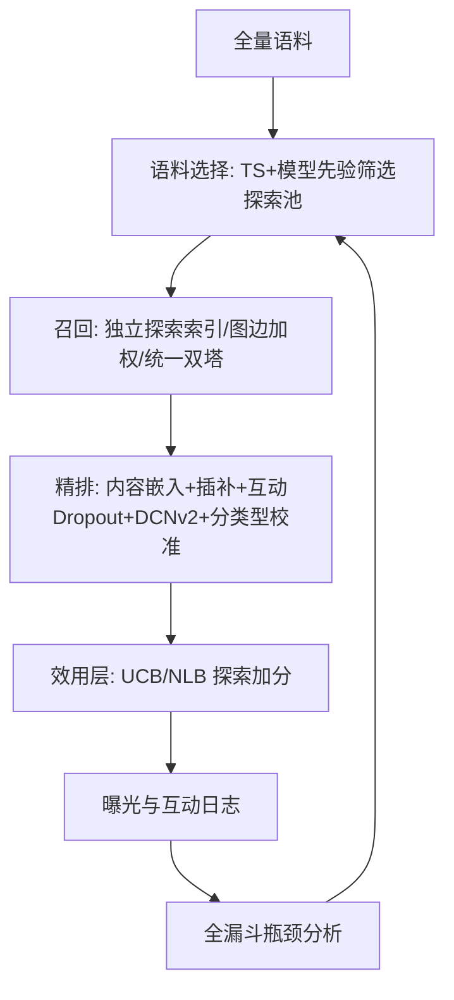
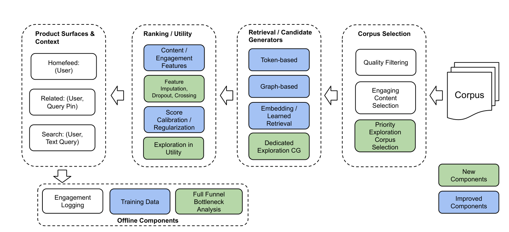

# PinEqualizer: Full Funnel Content Exploration and Debiasing System at Pinterest (Pinterest 全漏斗内容探索与去偏系统)

- **会议/期刊**: KDD 2026 (Applied Data Science Track)
- **作者与机构**: Olafur Gudmundsson, Bo Zhao, Huayi Liao 等 18 人，Pinterest, Inc.
- **推荐链路定位**: 语料选择 → 召回 → 精排 → 效用层（全漏斗端到端）
- **研究方向**: 冷启动与长尾推荐 / 去偏、公平与工业架构
- **论文原文**: [https://arxiv.org/abs/2607.22518v1](https://arxiv.org/abs/2607.22518v1)
- **开源代码**: 暂未开源

## TL;DR (1分钟核心速览)

针对 Pinterest 上大量新内容脱离 pin-board 图、被历史互动特征系统性低估的冷启动困境，本文提出覆盖语料选择、召回、精排、效用层全漏斗的 PinEqualizer 系统：核心主张是"去偏优先于显式探索"——通过内容侧特征补全、互动特征 dropout、分内容类型校准等手段让新老内容在同一模型内公平竞争，再叠加轻量 UCB 兜底。配套提出"新鲜内容留出 + 毕业语料 + 未充分探索内容互动量"三层度量框架，兼顾长期真值与短期 A/B 速度。线上两年部署带来新鲜内容曝光 +350%、北美整体成功会话 +24%、成功内容提供方数量 +99%。

## Background & Motivation (背景与核心矛盾)

- **主流范式**: 工业界冷启动主要靠内容侧匹配（PinSage/ItemSage 图嵌入、图随机游走召回）与显式探索（UCB / Thompson Sampling）两条腿走路。
- **前人局限**: ① 内容获取方式演化后，大量新内容（尤其商家批量上传的商品目录）与用户共建的 pin-board 图弱连接，图嵌入与图召回对其天然失效，形成"富者愈富"的马太效应；② 纯探索方案（如 Neural Thompson Sampling）需付出可观的短期互动代价，且未解决模型本身对新内容系统性低估的根因。
- **核心洞察 (Key Insight)**: 作者通过全漏斗日志分析发现，瓶颈未必在召回——在 Related Pins 场景下新内容召回率已与老内容相当，但绝大多数在精排被压到 top-k 之外；而在 Search 场景瓶颈确实在召回。**不同场景瓶颈位置不同，必须逐阶段诊断**。同时，模型对历史互动特征的过度依赖是偏差的根源，去偏可让模型对所有内容预测更准，从而**减少对显式探索的依赖**。
- **本文切入点**: 不做单点算法，而是"全漏斗去偏 + 分场景瓶颈诊断 + 三层度量"的系统性工程解法。

## Method (核心方法设计)

### 1. 整体框架 (Overall Architecture)

系统沿 Pinterest 三级漏斗逐层改造：**语料选择**层新建探索语料池，用 Thompson Sampling 结合模型先验筛选高潜力新内容；**召回**层为探索语料建独立倒排索引与 ANN 索引，图召回改为对未探索 Pin 边加权，并训练统一双塔（而非独立冷启动塔）以省基建；**精排**层通过内容侧嵌入、特征插补、互动特征 dropout、DCNv2 显式交叉、分内容类型校准来消除偏差；**效用层**叠加基于实时曝光的 UCB 或 Neural Linear UCB 做兜底探索，Search 场景额外用相关性对探索项加权。离线侧配套全漏斗瓶颈分析（输入可得率 vs 输出存活率）指导优先级排序。

<figure class="paper-figure" markdown="span">
  <figcaption>图2：系统图：全漏斗内容探索与去偏</figcaption>
</figure>

### 2. 关键设计拆解 (Key Designs)

1. **语料选择的先验融合后验（Model-based Prior）**：纯 Thompson Sampling 冷启动初期方差极大、浪费流量。本文将 ML 模型预测的互动率 $\alpha$ 作为 Beta 先验均值，与经验观测融合为后验估计 $\hat{r}=\frac{\alpha N+e}{N+n}$（$e$ 为正向互动数、$n$ 为曝光数、$N$ 控制先验强度），按 $\hat{r}$ 取 top-$K$ 入池；内容"毕业"（累计互动达阈值 $X$）或置信上界低于阈值 $Z$ 即退役。直觉：用站外/内容信号把新内容的探索起点从"零知识"抬到"有信息先验"，同等流量下更快收敛。

2. **互动特征个体级 Dropout + 显式特征交叉**：精排模型过度依赖物品历史互动计数，导致新内容被低估。本文对**每个**物品互动特征独立 dropout（优于整体 uniform dropout），迫使模型转向内容与上下文特征；再用 DCNv2 将内容年龄、内容特征、互动特征显式交叉，使模型能**动态**地"新内容多看内容、老内容多看历史"。特征重要性分析证实 dropout 后互动特征权重下降、内容特征权重上升。配套：缺失嵌入按各维度经验分布独立采样插补（而非填默认值），并对校准模型引入内容类型类别信号做分群校准。

3. **效用层探索与训练目标**：启发式 UCB 用实时曝光数代理不确定性，$\text{UCB}_i=\alpha\sqrt{1+\beta\cdot\text{impressions}_i}$；Neural Linear UCB 取末层隐表示 $\phi(x)$，$\hat{y}_i=\phi(x_i)^\top\theta+\alpha\sqrt{\phi(x_i)^\top\Sigma\phi(x_i)}$，其中 $\Sigma=H^{-1}$、$H=\sum_i\phi(x_i)\phi(x_i)^\top+\lambda I$，并引入 $\alpha=\sqrt{N/N_o}\,\alpha_o$ 稳定不同批次下的探索强度。Search 场景用 $\text{UCB}'_i=\text{relevance}_i^{\gamma}\cdot\text{UCB}_i$ 抑制低相关内容的探索红利。训练侧无特殊负采样设计（工业双塔沿用常规采样），推理开销主要在 ANN 检索与 UCB 打分，均为轻量级。

## Experimental Setup & Evaluation Protocol (实验设置与评估协议)

- **数据集与场景**: 无公开数据集，全部为 Pinterest 线上流量。覆盖 Homefeed、Related Pins、Search 三大场景（占全站内容曝光 92%），系统自 2024 年起迭代部署。

| 场景 | 输入上下文 | 主要瓶颈（诊断结论） | 关键改造 |
| :--- | :--- | :--- | :--- |
| Homefeed | 仅用户信息 | 精排 | 全漏斗通用改造 |
| Related Pins | 用户 + 查询 Pin | 精排（召回已达标） | 查询塔去偏、晚期融合 |
| Search | 用户 + 文本查询 | 召回（语料相关性充足） | 相关性加权 UCB、相关性权重提升 |

- **数据划分与防穿越**: 采用**长期新鲜内容留出实验**——处理组仅保留实验开始前创建的内容，对照组保留新内容但按内容 ID 哈希随机移除等量内容，以消除候选池规模差异，观测互动差即为新语料的增量价值。
- **排名评测协议**: 线上 A/B（用户分段）+ 场景级长期 holdout，报告相对提升（Relative Lift），所有实验设整体互动的严格护栏（guardrail）。
- **对比基线**: 生产系统原版本（各组件逐一上线对比）；探索机制内部对比启发式 UCB vs. Neural Linear UCB。无离线公开基线对比。

## Key Experimental Results (实验关键数据)

### 1. 主实验对比 (Main Results)

全站级长期 holdout 结果（2025 vs 2024 同比）：

| 指标 | 相对提升 |
| :--- | :---: |
| 整体成功会话（北美） | **+24%** |
| 整体成功会话（国际） | **+49%** |
| 购物会话（北美） | **+63%** |
| 购物会话（国际） | **+29%** |
| 毕业语料规模（28 天内毕业） | **+41%** |
| 未充分探索内容互动量（Homefeed） | **+37%** |
| 未充分探索内容互动量（Search） | **+13%** |
| 未充分探索内容互动量（Related） | **+27%** |
| 成功内容提供方数量 | **+99%** |

### 2. 消融实验 (Ablation Study)

Related Pins 场景组件级 A/B 汇总（自 2024 年各次上线增益聚合）：

| 组件 | 全部新内容互动提升 | 未充分探索内容互动提升 |
| :--- | :---: | :---: |
| 探索语料池（语料+召回） | +7.75% | **+16.92%** |
| 图召回边加权 | +3.91% | +3.71% |
| 特征改进-召回侧 | +2.48% | +3.97% |
| 特征改进-精排侧 | +5.57% | **+18.52%** |
| 模型架构-召回侧 | +5.95% | +5.52% |
| 模型架构-精排侧 | +8.63% | +6.57% |
| UCB 启发式（曝光数） | +2.95% | +3.12% |
| Neural Linear UCB（增量） | **+5.83%** | **+5.32%** |

### 3. 关键实验发现 (Key Findings)

1. **去偏的收益显著大于显式探索**：精排侧特征改进对未充分探索内容的提升达 +18.52%，是 UCB 启发式（+3.12%）的近 6 倍，直接验证了"先修模型偏差、再谈探索加分"的核心论点。
2. **购物场景对冷启动最敏感**：北美购物会话 +63%，是整体会话增益（+24%）的 2.6 倍，国际场景为 8.3 倍差距——说明商家批量上传的商品目录因脱离 pin-board 图，冷启动问题最尖锐，也最受益于内容侧特征与去偏。
3. **探索的短期成本被长期留存覆盖**：新鲜内容留出实验（图 1b）显示探索带来的短期互动损失在长期留存收益面前可忽略；同时成功内容提供方数量 +99%，证明系统实质缓解了"富者愈富"，改善了内容生态健康度。

## Highlights, Limitations & Rating (亮点、对比与审稿评价)

- **与代表作对比 (vs. Prior Work)**: 相比 [17] 的 Neural Thompson Sampling 纯探索路线，本文主张去偏替代探索、并以三层度量框架替代其 user-corpus co-diverted 设计（后者在多语料、多场景下分段成本过高且无法测用户级指标）；相比 [19] 训练独立冷启动双塔，本文用统一双塔 + 去偏特征在保持效果的同时大幅降低基建与维护成本。
- **可迁移亮点**: ① "互动特征个体级 dropout + 内容年龄显式交叉"是极低成本、可直接移植到任意精排模型的去偏 trick；② "输入可得率 vs 输出存活率"的全漏斗瓶颈诊断法，可帮助团队判断该投召回还是投精排，避免盲目优化。
- **审稿级局限批判**: ① 全部结论基于 Pinterest 单平台线上流量，无公开数据集与离线复现实验，外部有效性存疑；② 各组件增益为多次上线结果的简单聚合而非严格消融，组件间交互效应未解耦；③ 三层度量中"未充分探索内容互动量"仍存在内容级泄漏（被低估而非高估），且毕业阈值 $X$、$Z$ 依赖经验设定，超参敏感性未讨论。
- **四维评分**: 创新性 ⭐⭐⭐⭐ | 实验扎实度 ⭐⭐⭐⭐ | 方法清晰度 ⭐⭐⭐⭐ | 落地价值 ⭐⭐⭐⭐⭐

