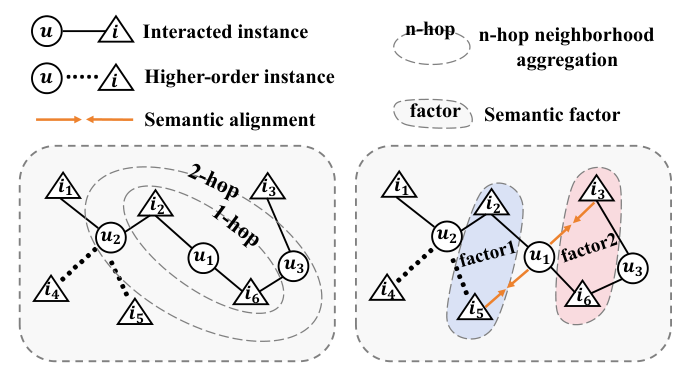
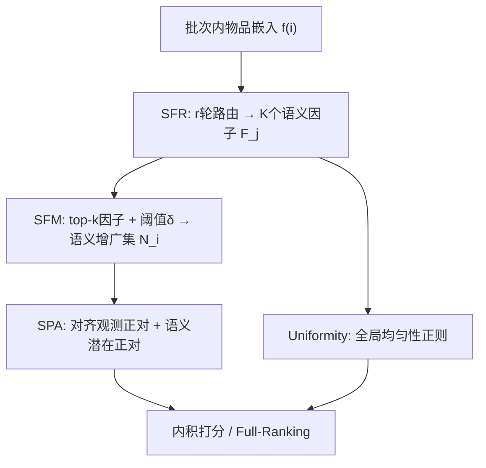

# Beyond Instance-Level Alignment and Uniformity: Semantic Factor Learning for Collaborative Filtering (超越实例级对齐与均匀性：面向协同过滤的语义因子学习)

- **会议/期刊**: KDD 2026
- **作者与机构**: Yajie Yu, Chenzhong Bin, Zhoubo Xu, Zhixin Zeng, Tongxin Xu, Cihan Xiao, Jiafeng Wu（桂林电子科技大学；约翰霍普金斯大学）
- **推荐链路定位**: 召回（表示学习层）
- **研究方向**: 协同过滤与双塔召回 / 自监督对比学习与交互去噪
- **论文原文**: [https://arxiv.org/abs/2605.31414v1](https://arxiv.org/abs/2605.31414v1)
- **开源代码**: [https://github.com/MysticRealm/SaFeAU](https://github.com/MysticRealm/SaFeAU)

## TL;DR (1分钟核心速览)

现有 CF 方法（BPR/InfoNCE/GCN/DirectAU）均属**实例级学习范式**：把海量未交互实例一律当负样本推开，其中大量"假阴性"（用户其实会喜欢的物品）被误伤；GCN 又靠多跳邻域聚合捕捉高阶信号，代价是 $O(2|E|Ld)$ 计算与过平滑。SaFeAU 提出**语义因子路由（SFR）**在批次内把物品嵌入解耦为 $K$ 个全局语义因子，再用**语义因子匹配（SFM）**把共享因子的未交互物品识别为潜在正对，最后用**语义正对对齐（SPA）**在纯 MF 骨架上完成对齐+均匀性优化。四个稀疏数据集 Full-Ranking 协议下，NDCG@20 相对最强基线提升 2.61%–6.24%，且无需图构建与邻域传播。

## Background & Motivation (背景与核心矛盾)

- **主流范式**: 隐式反馈 CF 分两支——MF 系（BPR-MF、LightCCF、LightGODE）与 GCN 系（LightGCN、GraphAU、SimGCF），二者共享"对齐观测正对、推开未交互对"的实例级目标；DirectAU 进一步用 alignment + uniformity 绕开负采样。
- **前人局限**: ① 假阴性问题——未交互物品中大量是潜在正例，无差别推开直接损害泛化，且数据越稀疏越严重；② GCN 的邻域聚合引入无关节点噪声（图1(a) 中 $u_1$ 经多跳被无关节点污染），同时高阶邻居 $i_4,i_5$ 反而无法与 $u_1$ 建立有效连接，且过平滑使训练/测试正对距离差（Gap）拉大（SimGCF 的 Gap 达 0.1175）。
- **核心洞察 (Key Insight)**: 物品的多面属性（品牌、材质、外观）可由**全局共享的语义因子**刻画；若两个物品共享语义因子，则它们对同一用户构成"语义一致"的潜在正对——这等价于在语义空间完成高阶连接，而无需图传播（图1(b)：$u_1$ 仅交互 $i_2,i_6$，却可经 factor1/factor2 对齐到 $i_3,i_5$）。
- **本文切入点**: 用批次内迭代路由学出解耦语义因子，以因子匹配替代邻域聚合来扩充监督信号，把 AU 原则从"实例级"升级为"语义级"。

<figure class="paper-figure" markdown="span">
  <figcaption>图1：(a) 基于GCN的对齐与(b) 同一交互图上语义正对对齐的比较。</figcaption>
</figure>

## Method (核心方法设计)

### 1. 整体框架 (Overall Architecture)

输入仅为用户/物品 ID 嵌入表（无图、无特征）。每个训练批次内，SFR 对当前批次物品嵌入做 $r$ 轮路由，输出 $K$ 个归一化语义因子；SFM 依据物品的因子分配权重取 top-$k$ 因子，按共享因子数 $\geq \delta$ 判定语义相关，为每个已交互物品 $i$ 生成语义增广集 $\mathcal{N}_i$；SPA 将用户同时拉向观测正物品与 $\mathcal{N}_i$ 中的潜在正物品，并叠加全局均匀性正则。训练完成后仅用内积打分，推理阶段零额外开销。

### 2. 关键设计拆解 (Key Designs)

1. **语义因子路由 SFR（批次内解耦，替代图传播）**：痛点是不想付 GCN 的 $O(2|E|Ld)$ 与过平滑代价，却要拿到高阶语义。做法是借鉴胶囊网络动态路由，在批次 $\mathcal{I}_b$ 内维护路由 logits $b_{ij}$，每轮先 softmax 得分配权重、加权聚合成因子并归一化、再用因子-物品一致性回写 logits：
$$w_{ij}=\frac{\exp b_{ij}}{\sum_{k}\exp b_{ik}},\quad F_j=\frac{\sum_{i\in\mathcal{I}_b} w_{ij}\tilde f(i)}{\|\sum_{i\in\mathcal{I}_b} w_{ij}\tilde f(i)\|},\quad b_{ij}\leftarrow b_{ij}+F_j^\top \tilde f(i)$$
因子与物品同处 $\mathbb{R}^d$，无需变换矩阵；批次内计算使显存与算力只随 $B$ 线性增长，且因子随批次分布自适应刷新。

2. **语义因子匹配 SFM（假阴性识别）**：痛点是如何在稀疏监督下判定"未交互≠不喜欢"。对物品 $i$ 取分配权重 top-$k$ 的因子索引集 $\mathcal{K}_i$，定义语义增广集
$$\mathcal{N}_i=\{i'\in\mathcal{I}_b\setminus\{i\}\mid |\mathcal{K}_i\cap\mathcal{K}_{i'}|\geq\delta\}$$
阈值 $\delta$ 控制语义相关强度：$\delta$ 过高覆盖不足，过低则把真阴性误判为正例。直觉上，共享多个高层因子意味着属性层面同源，比随机扩正更可信（表6 直接验证：$\delta=2$ 时 HR@10 达 0.0305，而随机扩正仅 0.000018）。

3. **语义正对对齐 SPA 与总损失**：在 DirectAU 的 $\mathcal{L}_{align}$、$\mathcal{L}_{uniform}$ 之外新增
$$\mathcal{L}_{semantic\_align}=\mathbb{E}_{(u,i)\sim p_{pos}}\Big[\tfrac{1}{|\mathcal{N}_i|}\sum_{i'\in\mathcal{N}_i}\|\tilde f(u)-\tilde f(i')\|^2\Big],\quad \mathcal{L}=\mathcal{L}_{align}+\gamma_1\mathcal{L}_{uniform}+\gamma_2\mathcal{L}_{semantic\_align}$$
**免负采样**：均匀性项对全体用户/物品嵌入施加高斯势正则，天然规避 BPR/InfoNCE 的随机负采样方差；总复杂度 $O(Bd+rKBd+2B^2d)$，$r,K$ 均为小常数，不含 $|E|$ 项。

## Experimental Setup & Evaluation Protocol (实验设置与评估协议)

- **数据集与预处理**: 四个真实稀疏数据集，去重并保留交互数 $\geq 5$ 的用户与物品（`5-core`）：

| 数据集 | #Users | #Items | #Interactions | 密度 | 场景说明 |
| :--- | :---: | :---: | :---: | :---: | :--- |
| Gowalla | 64.1k | 164.5k | 2018.4k | 0.019% | LBS 签到，极稀疏 |
| Toys-and-Games | 19.4k | 11.9k | 167.5k | 0.072% | Amazon 玩具品类 |
| Beauty | 22.4k | 12.1k | 198.5k | 0.073% | Amazon 美妆品类 |
| Yelp2018 | 31.7k | 38.0k | 1561.4k | 0.130% | 本地商户点评 |

- **数据划分与防穿越**: 每个用户交互随机按 **80%/10%/10% 比例划分** 训练/验证/测试（非时间切分，属随机留出）。
- **排名评测协议**: 采用无偏 **Full-Ranking（对全部未交互物品排序）**，指标 Recall@{10,20} 与 NDCG@{10,20}；5 个随机种子取均值，$t$-test $p<0.05$ 显著性检验。
- **对比基线与超参**: GCN 系 LightGCN / GraphAU / FourierKAN-GCF / SimGCF，MF 系 BPR-MF / DirectAU / LightGODE / LightCCF；统一 RecBole 实现，$d=64$，lr $=1e^{-3}$，batch 256（Beauty）/1024（其余），Adam，最多 300 epoch、NDCG@20 早停 patience 10；$\gamma_1\in\{0.1,0.5,2,7,10\}$，$\gamma_2\in\{0.001,0.01,0.1,10\}$，$K\in\{1,2,4,7\}$，$k\in\{1,2,3,4\}$，$r\in\{1,\dots,8\}$。

## Key Experimental Results (实验关键数据)

### 1. 主实验对比 (Main Results)

| 数据集 | 指标 | LightGCN | GraphAU | SimGCF | BPR-MF | DirectAU | LightGODE | LightCCF | **SaFeAU** | Improv. |
| :--- | :--- | :---: | :---: | :---: | :---: | :---: | :---: | :---: | :---: | :---: |
| Gowalla | R@20 | 0.1223 | 0.1416 | 0.1379 | 0.0701 | 0.1313 | 0.1428 | 0.1384 | **0.1505** | 5.39% |
| Gowalla | N@20 | 0.0681 | 0.0801 | 0.0783 | 0.0401 | 0.0742 | 0.0803 | 0.0786 | **0.0844** | 5.11% |
| Toys | R@20 | 0.1129 | 0.1323 | 0.1289 | 0.1126 | 0.1325 | 0.1338 | 0.1301 | **0.1405** | 5.01% |
| Toys | N@20 | 0.0551 | 0.0619 | 0.0636 | 0.0522 | 0.0632 | 0.0639 | 0.0641 | **0.0681** | 6.24% |
| Beauty | R@20 | 0.1227 | 0.1427 | 0.1429 | 0.1161 | 0.1390 | 0.1451 | 0.1362 | **0.1509** | 3.93% |
| Beauty | N@20 | 0.0563 | 0.0673 | 0.0675 | 0.0526 | 0.0665 | 0.0681 | 0.0674 | **0.0715** | 4.70% |
| Yelp2018 | R@20 | 0.0814 | 0.1063 | 0.1082 | 0.0639 | 0.1069 | 0.1076 | 0.1099 | **0.1144** | 4.09% |
| Yelp2018 | N@20 | 0.0505 | 0.0671 | 0.0686 | 0.0387 | 0.0672 | 0.0676 | 0.0691 | **0.0713** | 2.61% |

（R@10/N@10 趋势一致，SaFeAU 全部最优，提升 1.28%–5.78%。）

### 2. 消融实验 (Ablation Study)

| 变体 / 设置 | Gowalla R@20 | Gowalla N@20 | Toys R@20 | Beauty R@20 | Yelp R@20 | Yelp N@20 |
| :--- | :---: | :---: | :---: | :---: | :---: | :---: |
| None-SFM（无潜在正对） | 0.1315 | 0.0746 | 0.1322 | 0.1394 | 0.1062 | 0.0669 |
| Random-SFM（随机扩正） | 0.1478 | 0.0828 | 0.1381 | 0.1295↓ | 0.1044↓ | 0.0649↓ |
| Strict-SFM（$\delta=k$） | 0.1501 | 0.0842 | 0.1386 | 0.1495 | 0.1132 | 0.0706 |
| **SFM（$\delta=2$）** | **0.1505** | **0.0844** | **0.1405** | **0.1509** | **0.1144** | **0.0713** |

**插件兼容性**（SFR+SFM 接入现有模型，R@20 相对提升）：DirectAU +14.62%（Gowalla）/ +6.04%（Toys）/ +7.02%（Yelp）；BPR-MF +65.91% / +0.27% / +21.75%；LightGCN +7.69% / +0.53% / +7.74%；LightCCF +2.75% / +0.38% / +2.91%。

### 3. 关键实验发现 (Key Findings)

1. **稀疏度决定收益上限，也决定"扩正"是否安全**：Gowalla（密度 0.019%）上 SaFeAU 相对 LightGODE 提升 N@20 达 5.11%，而 Yelp2018（0.130%）仅 2.61%；更关键的是 Random-SFM 在 Gowalla/Toys 上竟超过所有基线（0.1478 vs 0.1428），却在 Beauty/Yelp 上低于 None-SFM（0.1295 vs 0.1394）——说明稀疏场景假阴性遍地，稠密场景盲目扩正会引入真阴性噪声，这正是 SFM 语义筛选的必要性所在。
2. **语义匹配质量可被直接度量，且对阈值不敏感**：把 SFM 选出的潜在正对拿去测试集验证，$\delta=2$ 时 Gowalla HR@10 = 0.0305、Beauty = 0.0495，而 Random-SFM 仅 0.000018 / 0.00085，相差三个数量级；$\delta\in\{1,2,3\}$ 内性能波动很小，$\delta=2$ 稳定最优，无需精细调参。
3. **泛化性体现在训练-测试正对距离 Gap 的收窄**：SaFeAU 的 Gap 为 Gowalla 0.0314、Toys 0.0178，显著低于 BPR-MF（0.0384/0.0439）、DirectAU（0.0570/0.0402）与 SimGCF（0.1175/0.0860）；SimGCF 训练距离虽低（0.7161）但测试距离飙至 0.8336，正是过平滑导致嵌入塌缩、泛化失效的直接证据。超参上 $\gamma_1$ 影响大于 $\gamma_2$（稀疏数据靠均匀性撑起语义空间覆盖），$K=4$、$k=3$、$r=4$ 后性能饱和。

## Highlights, Limitations & Rating (亮点、对比与审稿评价)

- **与代表作对比 (vs. Prior Work)**: 与 **DirectAU** 的本质区别是把对齐对象从"观测正对"扩展到"语义潜在正对"，且用因子匹配而非图传播获取高阶信号；与 **LightGCN/GraphAU** 相比彻底去掉邻接矩阵归一化与消息传递，复杂度不含 $|E|$ 项，规避过平滑；与 **LightCCF** 相比虽同用 AU 框架，但 LightCCF 的 InfoNCE 邻域对齐仍需负采样与图结构，SaFeAU 则免负采样、免图。
- **可迁移亮点**: ① 批次内"路由-聚合-一致性回写"的轻量因子解耦可直接插到任意双塔召回模型做物品侧语义聚类；② 用"共享因子数 $\geq\delta$"做假阴性软筛，比固定阈值相似度更鲁棒，可迁移到对比学习去噪与跨域对齐。
- **审稿级局限批判**: ① 语义因子完全由 ID 嵌入在批次内涌现，缺乏内容/知识侧约束，因子的可解释性与跨批次稳定性未做验证，且批次构成会直接影响因子质量；② 数据划分采用随机留出而非全局时间切分，存在未来交互泄漏风险，且未报告训练时长/显存等效率实测数字，"高效"仅停留在复杂度分析层面。
- **四维评分**: 创新性 ⭐⭐⭐⭐ | 实验扎实度 ⭐⭐⭐⭐ | 方法清晰度 ⭐⭐⭐⭐⭐ | 落地价值 ⭐⭐⭐⭐

