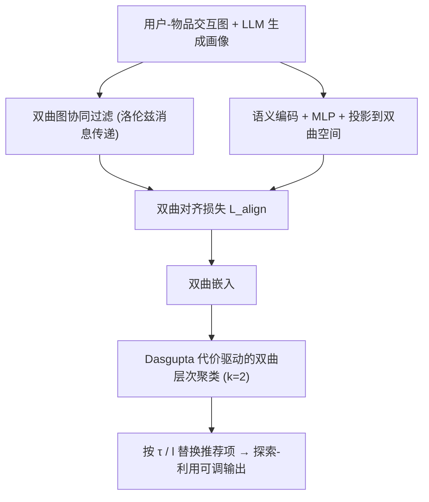
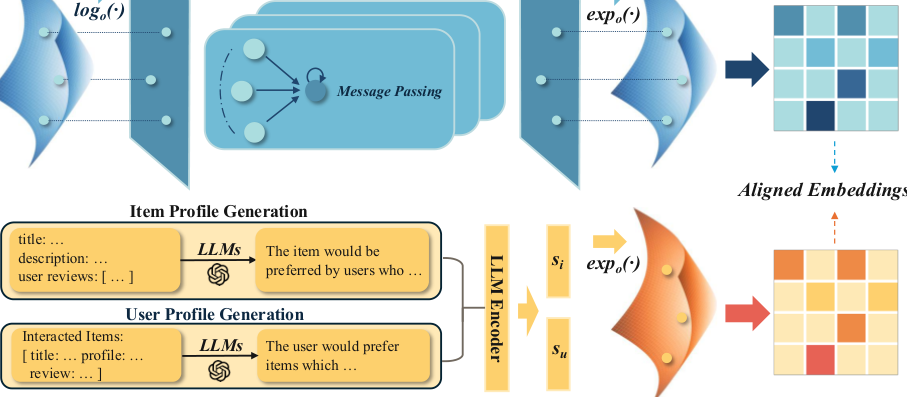

# Breaking Information Cocoons: A Hyperbolic Framework for Balancing Exploration and Exploitation in Recommender Systems (打破信息茧房：平衡推荐系统探索与利用的双曲框架)

- **会议/期刊**: KDD 2026
- **作者与机构**: Qiyao Ma (UC Davis), Menglin Yang (HKUST-GZ), Mingxuan Ju / Tong Zhao / Neil Shah (Snap Inc.), Rex Ying (Yale)
- **推荐链路定位**: 召回（图协同过滤表征 + 层次结构重采样）
- **研究方向**: 协同过滤与双塔召回 / 冷启动与长尾推荐
- **论文原文**: [https://arxiv.org/abs/2411.13865v4](https://arxiv.org/abs/2411.13865v4)
- **开源代码**: [https://github.com/Martin-qyma/HERec](https://github.com/Martin-qyma/HERec)

## TL;DR (1分钟核心速览)

针对信息茧房下"效用-多样性"难以兼得、且用户无法自主调节探索程度的核心痛点，HERec 在洛伦兹双曲空间中同时做两件事：(1) 用双曲对齐损失把 LLM 生成的用户/物品画像语义嵌入与协同嵌入拉近，并给出梯度分析证明双曲对齐天然按节点范数自适应调节更新强度；(2) 用 Dasgupta 代价驱动的无超参双曲层次聚类构建偏好树，通过温度 $\tau$与层号$l$ 两个旋钮让用户自行替换部分推荐为祖先簇采样。在 Amazon-Books / Yelp / Google-Reviews 三数据集 Full-Ranking 协议下，Recall@20 相对最优双曲基线 HICF 提升 3.6%–5.5%，Div@20 提升 5.5%–11.4%，且尾部物品（T80）Recall@20 提升高达 14.42%。

## Background & Motivation (背景与核心矛盾)

- **主流范式**: 图协同过滤（LightGCN/LightGCL/SimGCL）在欧氏空间做消息传递，靠对比学习或数据增广提升鲁棒性；双曲推荐（HGCF/HICF）则利用负曲率空间的指数体积增长来刻画幂律与层次结构。
- **前人局限**: 其一，欧氏模型无法表达用户-物品网络的潜在层次与幂律分布，梯度恒为 1，缺乏对层次位置的感知；其二，现有双曲模型只吃纯协同信号，对 LLM 文本画像的语义一无所知，且 LLM 编码器输出在欧氏空间，与双曲协同嵌入存在几何错配，导致协同噪声无法被语义纠偏。
- **核心矛盾之二**: 双曲模型虽能建模层次，却没有任何"有原则的机制"去调节探索（广度）与利用（深度），只能被动地按相似度推荐，反而加剧茧房。
- **核心洞察 (Key Insight)**: 双曲空间中靠近原点的节点范数小、远离原点范数大，恰好对应"抽象/热门"与"细粒度/小众"两类语义；若把语义对齐放在双曲空间做，梯度幅值 $\|\nabla_{\mathbf{x}} d_{\mathbb{H}}\| \approx \|\hat{\mathbf{x}}-\hat{\mathbf{y}}\|/(\|\mathbf{x}\|(1-\cos\theta))$ 会随范数自适应缩放，天然保护局部结构、修正全局层次——这是欧氏对齐（梯度恒为 1）做不到的。
- **本文切入点**: 用"双曲语义对齐 + 无超参层次聚类"两板斧，把探索-利用权衡从模型内部的隐式行为，变成用户可显式拨动的两个参数。

## Method (核心方法设计)

### 1. 整体框架 (Overall Architecture)

HERec 分三阶段闭环：(i) 双曲图协同过滤——用户/物品嵌入在高斯初始化后经指数映射落到洛伦兹流形，消息传递在切空间完成、逐层求和后再映射回双曲空间，用双曲距离的倒数作为打分；(ii) 双曲对齐——LLM（GPT-3.5-turbo）依据交互历史生成用户/物品画像，经 text-embedding-ada-002 编码、MLP 调维后投影到双曲空间，与协同嵌入做双曲距离对齐；(iii) 层次结构——对学到的双曲嵌入自底向上做 $k=2$的双曲 k-means 聚类，生成伪簇节点构成偏好树，推理时按用户设定的$\tau$与$l$ 把部分推荐替换为祖先簇采样项。

<figure class="paper-figure" markdown="span">
  <figcaption>图2：HERec的整体架构。(i) 双曲图协同过滤：使用双曲GNN编码协同信息；(ii) 双曲对齐：在双曲空间中对齐语义与协同信息；(iii) 层次表示结构：从双曲嵌入构建层次结构。</figcaption>
</figure>

### 2. 关键设计拆解 (Key Designs)

1. **双曲语义-协同对齐（Hyperbolic Alignment）**：痛点在于 LLM 语义在欧氏、协同在双曲，直接拼接会几何错配。做法是把语义嵌入 $\mathbf{s}_i$投影到同一洛伦兹流形，最小化$\ell_{align}(i)=d_{\mathbb{H}}^2(\mathbf{h}_i,\mathbf{s}_i)$。其有效性由 Proposition 1 支撑：$\|\nabla_{\mathbf{x}}d_{\mathbb{H}}(\mathbf{x},\mathbf{y})\|\approx\|\hat{\mathbf{x}}-\hat{\mathbf{y}}\|/(\|\mathbf{x}\|(1-\cos\theta))$，即大范数（细粒度偏好）节点获得小步长以精修局部，小范数（抽象偏好）节点获得大步长以重构全局层次——这正是欧氏对齐$\|\nabla d_{\mathbb{E}}\|=1$ 所缺失的层次保真能力。

2. **无超参双曲层次聚类（Dasgupta 代价驱动）**：常规层次聚类需预设簇数或层数。本文借 Dasgupta 代价"把边切割尽量压到树底"的最优性结论，推出最优树应为二叉树，从而固定层间比例 $k=2$、层数$L=\log_2|X|$，无需任何人工超参。每层在双曲空间做 k-means（质心用双曲均值$m_{\mathbb{H}}$更新），簇质心作为上一层输入点，自底向上递归。聚类复杂度$O(N^2/2 + i\log N)$，检索$O(k\log N)$、替换仅$O(k)$。

3. **训练目标、负采样与推理效率**：总损失为双曲边际排序损失加对齐项，$\mathcal{L}=\sum \ell_m(u,i,j)+\lambda\sum_i \ell_{align}(i)$，其中$\ell_m=\max(d_{\mathbb{H}}^2(\mathbf{h}_u,\mathbf{h}_i)-d_{\mathbb{H}}^2(\mathbf{h}_u,\mathbf{h}_j)+m,0)$。负采样采用 HINS（优先采样正样本附近的候选）配合 HAML 动态边际$m^{H}_{ui}=\mathrm{sigmoid}(\delta)$，$\delta$ 由三点双曲距离与范数比构成，原点附近给更大边际。嵌入用 RSGD 优化、MLP 用 Adam；LLM 仅在离线生成画像时调用一次，在线推理不重复调用大模型，单 epoch 训练在标准数据集上 <5 秒。

## Experimental Setup & Evaluation Protocol (实验设置与评估协议)

- **数据集与预处理**: 三个公开数据集，均按 20%/80% 交互量切分头/尾物品（H20/T80），尾部用户占比约 53%–55%，印证幂律分布假设：

| 数据集 | #Users | #Items | #Interactions | 密度 | 特征/场景说明 |
| :--- | :---: | :---: | :---: | :---: | :--- |
| Amazon-books | 11,000 | 9,332 | 120,464 | 1.17e-3 | 图书购买，H20=45.2% |
| Yelp | 11,091 | 11,010 | 166,620 | 1.36e-3 | 餐厅点评，H20=47.0% |
| Google-reviews | 22,582 | 16,557 | 411,840 | 1.10e-3 | 地图商户点评，H20=46.8% |
| Amazon-Books (Large) | 116,455 | 387,492 | 1,442,011 | 3.20e-5 | 大规模扩展验证 |
| Amazon-CDs (Large) | 61,938 | 88,590 | 779,575 | 1.42e-4 | 大规模扩展验证 |

- **数据划分与防穿越 (Splitting Strategy)**: 采用固定训练/测试划分（沿用 HGCF/HICF 设定），测试集物品在训练期不可见；头尾划分严格依据训练集交互计数，避免信息泄漏。
- **排名评测协议 (Ranking Protocol)**: 无偏 `Full-Ranking`（全库未交互物品排序），报告 Recall@{10,20}、NDCG@{10,20} 及 Div@10/20、Shannon Entropy H、EPC 三类多样性指标；多样性距离在同一表征空间内计算以保证跨模型可比。
- **对比基线与超参设置**: 欧氏基线 LightGCN / TAG-CF / LightGCL / SimGCL / HCCF，双曲基线 HGCF / HICF；嵌入维度 $d=50$，batch=1024，负样本数$\{10,20,50\}$，对齐权重$\{10^{-3},10^{-2},10^{-1}\}$ 网格搜索，10 次独立运行报告标准差（R@20 方差约 0.001），并以 Recall@10 早停（patience=10）。

## Key Experimental Results (实验关键数据)

### 1. 主实验对比 (Main Results)

Amazon-books 与 Yelp 核心结果（Full-Ranking，@20）：

| 模型 | Amz R@20 | Amz N@20 | Amz Div@20 | Amz H@20 | Yelp R@20 | Yelp N@20 | Yelp Div@20 | Yelp H@20 |
| :--- | :---: | :---: | :---: | :---: | :---: | :---: | :---: | :---: |
| LightGCN | 0.1428 | 0.0884 | 0.4504 | 10.485 | 0.1135 | 0.0717 | 0.2277 | 9.181 |
| LightGCL | 0.1515 | 0.0991 | 0.4974 | 11.941 | 0.1141 | 0.0739 | 0.3064 | 11.823 |
| SimGCL | 0.1478 | 0.0918 | 0.4802 | 10.915 | 0.1184 | 0.0748 | 0.3460 | 10.508 |
| HCCF | 0.1488 | 0.0962 | 0.5433 | 12.137 | 0.1097 | 0.0701 | 0.3535 | 12.311 |
| HGCF | 0.1511 | 0.0921 | 0.5041 | 11.732 | 0.1099 | 0.0665 | 0.3289 | 12.103 |
| HICF | 0.1599 | 0.1022 | 0.5261 | 12.129 | 0.1169 | 0.0737 | 0.3721 | 12.147 |
| **HERec** | **0.1682** | **0.1069** | **0.5754** | **12.254** | **0.1224** | **0.0762** | **0.3961** | **12.329** |
| Improv.% (vs 最优基线) | +5.19% | +4.60% | +5.91% | +1.03% | +3.38% | +1.87% | +6.45% | +1.50% |

Google-Reviews 上 HERec 同样取得 R@20=0.1598、N@20=0.0992、Div@20=0.3543、H@20=12.769，全面领先；大规模数据集（Amazon-Books Large / Amazon-CDs Large）上 R@20 分别达 0.0598 / 0.0712，仍优于 HICF 的 0.0565 / 0.0683。值得注意的是，HERec 是唯一在效用与多样性上同时登顶的模型——HICF 效用第二但多样性不及 HCCF，HCCF 多样性好但效用落后。

### 2. 消融实验 (Ablation Study)

| 变体 | 效用表现 | 说明 |
| :--- | :---: | :--- |
| w/o M & S（仅 BPR） | 最差 | 双曲边际排序与语义对齐双双移除 |
| w/o M（去边际排序） | 下降 | 失去 HAML/HINS 的几何感知推拉 |
| w/o S（去语义对齐） | 下降 | 协同噪声无法被语义纠偏 |
| **HERec 完整模型** | **最优** | 两模块互补，缺一不可 |

### 3. 关键实验发现 (Key Findings)

1. **语义对齐的收益集中在长尾**：与无对齐的双曲基线相比，HERec 在头部 H20 上 Recall@20 仅提升 0.36%–3.59%，但在尾部 T80 上提升 8.58%（Amazon）、13.33%（Yelp）、14.42%（Google），说明 LLM 画像对交互稀疏物品的补位作用远大于热门物品，是缓解冷启动的直接证据。
2. **欧氏加特征也救不了多样性**：给 LightGCN/LightGCL/SimGCL/HCCF 补上同样的语义特征后（Table 3），效用普遍上升但多样性提升不稳定，HERec 仍在 Div@20（0.5754 vs 0.5163）与 H@20 上全面领先，反向验证了 Proposition 1 中"双曲对齐梯度随范数自适应"的不可替代性。
3. **层次层号是效用-多样性的连续旋钮**：固定 $\tau=0.5$时，层号$l$增大则效用升、多样性降，$l$ 减小则相反；同时逐层平均范数单调增大（图 4），与"原点=抽象/热门、边界=细粒度/小众"的双曲几何直觉吻合，证明聚类树确实学到了可解释的偏好粒度。

## Highlights & Limitations (亮点、对比与审稿批判)

- **与代表作对比 (vs. Prior Work)**: 相比 HGCF/HICF 这类纯协同双曲模型，HERec 首次把 LLM 语义以"双曲对齐损失"而非"欧氏拼接"的方式注入，并用梯度分析给出理论依据；相比 LightGCL/SimGCL 等对比学习路线，它不靠增广造正样本，而是靠几何先验 + 层次结构同时拿下效用与多样性；相比 RL 类探索方法，它把探索权交给用户而非策略网络，工程上更可控。
- **可迁移亮点**: (1) "把任意欧氏辅助信号（文本/图像/知识图谱）投影到双曲空间做距离对齐"可复用到多模态推荐与 KG 增强推荐；(2) Dasgupta 代价推出 $k=2$ 的无超参层次聚类，可直接用于物品品类树构建与召回分层索引。
- **审稿级局限批判**: 其一，层次聚类需预计算 $O(N^2/2)$的成对距离，虽在十万级用户上可接受，但千万级工业场景需近似最近邻或采样近似，论文未给出该规模的实测；其二，探索-利用的$\tau$、$l$ 由用户手动设定，缺乏个性化自动推荐机制，且多样性指标（Div/H/EPC）均为离线代理指标，缺少线上 A/B 对留存与茧房缓解的因果验证。

## Rating (四维评分)

- **方法创新性 (Novelty)**: ⭐⭐⭐⭐ （双曲对齐 + 梯度自适应分析 + Dasgupta 无超参层次聚类三件套组合新颖，理论支撑扎实但单点技术均有前作影子）
- **评估协议与实验扎实度 (Protocol & Experiments)**: ⭐⭐⭐⭐ （三数据集 Full-Ranking + 头尾分桶 + 大规模扩展 + 10 次运行方差报告齐全，唯缺线上验证与显著性检验细节）
- **写作与数学规范度 (Clarity & Rigor)**: ⭐⭐⭐⭐ （Proposition 1 证明含误差界分析，洛伦兹公式规范；但部分符号（如 $\delta$ 中范数比）解释略简）
- **工业落地与复现价值 (Industrial & Practical Value)**: ⭐⭐⭐⭐ （代码开源、LLM 仅离线调用、单 epoch <5 秒，层次树可解释可调；$O(N^2)$ 构图是规模化主要瓶颈）

