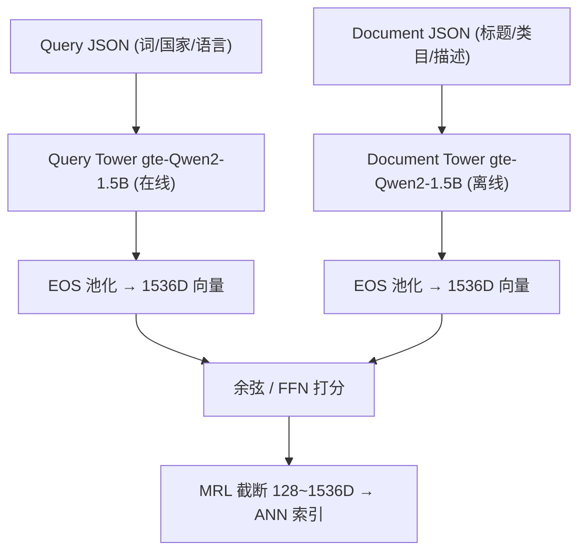
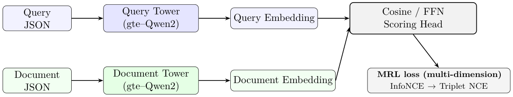

# Scaling Multilingual Semantic Search in Uber Eats Delivery (Uber Eats 配送多语言语义搜索的规模化实践)

- **会议/期刊**: KDD 2026 (计划投稿)
- **作者与机构**: Bo Ling, Zheng Liu, Haoyang Chen, Divya Nagar, Luting Yang, Mehul Parsana (Uber Technologies Inc.)
- **推荐链路定位**: 召回 (第一阶段稠密检索)
- **研究方向**: 协同过滤与双塔召回 / 大语言模型推荐
- **论文原文**: [https://arxiv.org/abs/2603.06586v3](https://arxiv.org/abs/2603.06586v3)
- **开源代码**: 暂未开源

## TL;DR (1分钟核心速览)

Uber Eats 搜索历史上按垂类（店铺/菜品/杂货）各自维护 BERT 小模型或纯关键词检索，运维碎片化且泛化差。本文用 gte-Qwen2-1.5B 构建**权重不共享的双塔**，以数亿条点击/加购隐式反馈做 InfoNCE 域适应，再用 LLM 标注的难正负样本做 Triplet-NCE 精调，并叠加 MRL 实现单模型多维度服务。在六市场三垂类的离线 kNN 全库召回协议下，Store R@20 相对 Legacy Mini-LM 提升 **88%**、R@200 提升 31%，线上 Intentful CVR +0.44%、零结果率下降 69.1%。

## Background & Motivation (背景与核心矛盾)

- **主流范式**: 电商搜索召回已从词法匹配转向双塔稠密检索，文档塔离线预计算 + ANN 在线检索是低延迟标配；LLM 作为嵌入骨干（Gemini Embedding、NV-Embed、GTE）在 MMTEB 上全面超越 BERT 级小模型。
- **前人局限**: 其一，按垂类分裂建模导致索引与模型运维成本线性膨胀，且跨垂类意图（"pan" 既可能是锅具也可能是面包）无法共享语义；其二，纯点击隐式反馈噪声大，单阶段 InfoNCE 的决策边界在商业高价值难例上不够锐利。
- **核心洞察 (Key Insight)**: 作者发现 gte-Qwen2 在预训练阶段见过大量结构化数据，因此把 query/document 都序列化为 **JSON 字段串**（而非纯文本拼接），模型可借字段名（`store_name`、`cuisine_type`）隐式识别垂类，从而用**一个模型 + 一套索引**覆盖三垂类；同时 EOS token 池化天然承担了全局语义摘要的角色。
- **本文切入点**: 用"大骨干 + 结构化输入 + 两阶段难例精调 + MRL 弹性维度"四件套，把碎片化垂类系统收敛为统一多语言召回服务。

## Method (核心方法设计)

### 1. 整体框架 (Overall Architecture)

Query 侧在线编码、Document 侧离线预计算，两塔权重**不共享**（更大容量、各自适配 query 短文本与 document 长结构化描述）。输入统一为 JSON blob（query 含搜索词/国家/语言，截断 128 token；document 含标题/类目/描述/人气摘要，截断 1024 token），经 gte-Qwen2-1.5B 编码后取 EOS 池化向量，默认余弦打分，可选 FFN 非线性头做微重排。训练分两阶段：先用数亿隐式反馈跑 InfoNCE 域适应，再用 LLM oracle 标注的难正负样本跑 Triplet-NCE 锐化边界；MRL 损失在所有嵌套维度上求和，使前缀子向量独立可用。仅微调最后三层以抑制灾难性遗忘。

<figure class="paper-figure" markdown="span">
  <figcaption>图1：双塔 gte-Qwen2 架构：查询塔与文档塔生成嵌入，由余弦或 FFN 头打分；训练使用 InfoNCE、Triplet NCE 和 MRL。</figcaption>
</figure>

### 2. 关键设计拆解 (Key Designs)

1. **JSON 结构化输入 + EOS 池化（统一多垂类的关键）**：痛点是把店铺/菜品/杂货塞进同一模型时，纯文本拼接会让模型混淆实体类型。本文让每个垂类用不同字段名的 JSON schema，模型靠字段名做类型感知；池化上对比 last-token 与 average，EOS 池化 H@1 达 0.181，是 last-token（0.030）的 6 倍——因为 EOS 在预训练中就是被学习过的"摘要位"，能对全前缀做注意力汇聚，而 last-token 被 JSON 尾部标点锚定、average 被分隔符稀释。

2. **两阶段损失：InfoNCE 域适应 + Triplet-NCE 难例精调**：第一阶段用批内负样本，温度 $\tau=0.07$、micro batch 512：

$$\mathcal{L}_{\text{InfoNCE}}=-\frac{1}{N}\sum_{i=1}^{N}\log\frac{\exp(s_{ii}/\tau)}{\sum_{j=1}^{N}\exp(s_{ij}/\tau)}$$

第二阶段针对 LLM oracle 挖掘并人工抽检、再用 CTR/CVR 过滤的难正负样本，令 $z_{qd}=\text{sim}(q,d)/\tau$：

$$\mathcal{L}_{\text{Triplet-NCE}}=\mathbb{E}_{(q,d^+)\sim\mathcal{P}}\left[\log\left(1+\exp(-z_{qd^+})\right)\right]+\mathbb{E}_{(q,d^-)\sim\mathcal{N}}\left[\log\left(1+\exp(z_{qd^-})\right)\right]$$

直觉是：InfoNCE 的 softmax 分母被海量易负样本主导，难例的梯度被稀释；Triplet-NCE 对每个难正/难负单独施加 logistic 惩罚，等价于在决策边界附近做局部放大，因此只需 1–4% 的增量召回就能换来商业高价值 query 的显著改善。

3. **MRL 多维度服务与训练目标**：单一 1536D 向量暴露 $\{128,256,512,768,1024,1280,1536\}$ 嵌套前缀，总损失为各维度基础损失之和：

$$\mathcal{L}_{\text{MRL}}=\sum_{m\in\mathcal{M}}c^{(m)}\mathcal{L}_{\star}\left(E^{(m)}(q),E^{(m)}(d)\right)$$

其中 $E^{(m)}(\cdot)$为截断前$m$维、$c^{(m)}=1$。这迫使最关键信息被压进最早维度，从而在 256D 截断时 R@200 仅从 0.678 掉到 0.676，索引存储降至 16%、成本降至 23%。训练负采样为批内负（第一阶段）+ 挖掘难负（第二阶段），无需额外负采样器；推理侧 query 编码在线、document 全量离线，双周全量重建 + 日常增量。

## Experimental Setup & Evaluation Protocol (实验设置与评估协议)

- **数据集与预处理**: 训练数据取自 2023-12 至 2025-03 的 Uber Eats 搜索日志，约数亿正样本对；按语言（英/非英）与垂类（店铺/菜品/杂货）做受控降采样再平衡。三垂类正样本定义分别为：Global Search 的 (query, store) 点击、In-Store Search 的 (query, dish) 点击、杂货的 (query, item) 加购（ATC，高意图强相关代理）。

| 数据源 | 正样本定义 | 垂类 | 说明 |
| :--- | :--- | :---: | :--- |
| Global Search | (query, store) 点击 | 店铺 | 六市场（JPN/CAN/GBR/FRA/MEX/TWN/US） |
| ISS-OFD | (query, dish) 点击 | 菜品 | 店内搜索 |
| ISS-GR | (query, item) 加购 | 杂货零售 | ATC 作为高意图信号 |

- **数据划分与防穿越 (Splitting Strategy)**: 采用**黄金评测集 + 全局时间窗切分**（训练日志截止 2025-03，评测集独立构建），非 Leave-One-Out；线上部分用随机对照 A/B。
- **排名评测协议 (Ranking Protocol)**: 离线为**受限全库 kNN 排序**——对每条 (query, 地理位置) 动态构造该 hex/city 内可配送的全部候选（店铺/菜品/条目），做精确 kNN 后报 Recall@20/200（并验证 R@200 与 R@500/2k 趋势一致）；线上以 Intentful CVR 与 Search CoPSU 为主指标。
- **对比基线与超参设置**: 基线含 Legacy 微调 Mini-LM（0.12B, 384D）、vanilla gte-Qwen2-1.5B/7B、Qwen3-Embedding-8B；骨干 gte-Qwen2-1.5B（1536D），Adam，学习率 $5\times10^{-5}$ 无 warmup，仅调最后三层，bf16 + DeepSpeed ZeRO-3，8×H100 上 24–48 小时完成一轮。

## Key Experimental Results (实验关键数据)

### 1. 主实验对比 (Main Results)

英文市场三垂类平均 Recall（表 1）：

| 模型变体 | 训练策略 | Store R@200 | Store R@20 | Dish R@200 | Dish R@20 | GR R@200 | GR R@20 |
| :--- | :--- | :---: | :---: | :---: | :---: | :---: | :---: |
| 微调 Mini-LM (Legacy) | 单阶段 | 0.521 | 0.162 | 0.372 | 0.129 | 0.891 | 0.561 |
| Qwen-1.5B (Vanilla) | 不微调 | 0.452 | 0.208 | 0.353 | 0.141 | 0.572 | 0.352 |
| Qwen-1.5B FT | 仅 InfoNCE | 0.658 | 0.283 | 0.423 | 0.171 | 0.899 | 0.558 |
| **Qwen-1.5B FT** | **InfoNCE + Triplet NCE** | **0.678** | **0.304** | **0.462** | **0.182** | **0.942** | **0.579** |
| 相对 Legacy 提升 | — | +31% | +88% | +24% | +38% | +6% | +4% |
| 相对 Vanilla 提升 | — | +51% | +42% | +31% | +28% | +65% | +66% |

跨市场 Store R@200（表 3）：JPN 0.329→**0.559**、CAN 0.512→**0.669**、GBR 0.531→**0.681**、FRA 0.479→**0.633**、MEX 0.518→**0.724**、TWN 0.380→**0.624**，历史基线最低的 JPN/TWN 相对增益最大。

### 2. 消融实验 (Ablation Study)

| 消融维度 | 配置 | 关键指标 | 数值 |
| :--- | :--- | :--- | :---: |
| 骨干容量 | Mini-LM / Vanilla 1.5B / Vanilla 7B / **FT 1.5B** | H@1 | 0.072 / 0.181 / 0.208 / **0.351** |
| 输入格式 | Plain text vs **JSON** | H@1 / H@10 | 0.158 / 0.448 vs **0.181 / 0.492** |
| 池化 | Last-token / Average / **EOS** | H@1 | 0.030 / 0.021 / **0.181** |
| 维度策略 | MRL-256 vs FC-256 | EN R@200 | 0.676 vs 0.676（持平但运维更简） |
| 损失 | InfoNCE B=64 vs SigLIP B=128 | R@200 | 0.639 vs **0.666** |
| 打分头 | 余弦 vs **FFN 微重排** | USA R@200 | 0.678 vs **0.690** (+1.77%) |
| 效率 | 1536D FP32 / 256D FP32 / **256D INT8** | Avg R@200 | 0.678 / 0.676 / 0.668 |

### 3. 关键实验发现 (Key Findings)

1. **域适应是最大增益来源，而非骨干规模**：Vanilla 1.5B 的 H@1（0.181）已超微调 Mini-LM（0.072），但微调后 1.5B 跳到 0.351（相对自身 +94%），且 Vanilla 1.5B 已接近 Vanilla 7B（0.208），说明"大骨干 + 深度域适应"的性价比远高于单纯堆参数。
2. **两阶段难例精调的增量小而稳定，且是商业价值的来源**：从单阶段到两阶段，三垂类 Recall 一致提升 1–4%，但正是这 1–4% 对应线上 Intentful CVR +0.44% 与 CoPSU +0.54%，验证了 LLM 标注难例管线在决策边界处的杠杆效应。
3. **量化在线上不损召回、离线略损**：256D INT8 离线 R@200 从 0.676 降到 0.668，但经检索后过滤与 hydration 阶段后 A/B 无可测差异，反而 CVR 提升（+0.44%）高于 FP32 变体（+0.29%），检索延迟持平（Δ0 ms），使 256D INT8 成为默认生产配置；端到端延迟 +18% 全部来自下游排序处理更大候选集。

## Highlights & Limitations (亮点、对比与审稿批判)

- **与代表作对比 (vs. Prior Work)**: 相比按垂类分裂的 BERT 双塔（如各垂类独立 Mini-LM），本文用 JSON schema 实现"单模型类型感知"，省去多套索引与模型；相比 NV-Embed/GTE 的通用嵌入配方，本文的增量在于**工业级两阶段难例管线 + MRL 弹性维度 + 量化上线验证**的完整闭环，而非新的对比学习理论。
- **可迁移亮点**: ① 用 JSON 字段名替代显式 type embedding 做多垂类统一，几乎零成本；② MRL 损失在所有嵌套维度求和，使低维前缀可直接服务低延迟面，避免维护多套定维模型。
- **审稿级局限批判**: ① 缺少与 SigLIP 的完整线上对比（仅离线且作者自认因工程惯性选了 InfoNCE），两阶段损失的理论最优性未论证；② 离线评测为受限地理候选集而非严格全库，且无公开数据集与代码，跨垂类批内假阴性问题作者亦承认未解；③ FFN 打分头仅带来 1–2% 增益却需额外延迟预算，收益/成本比偏弱。

## Rating (四维评分)

- **方法创新性 (Novelty)**: ⭐⭐⭐ （JSON 类型感知与 MRL 均为已有技术的巧妙组合，两阶段难例管线是工程增量而非理论突破）
- **评估协议与实验扎实度 (Protocol & Experiments)**: ⭐⭐⭐⭐ （六市场三垂类 + 离线 kNN + 线上 A/B 双层验证，消融覆盖骨干/输入/池化/损失/维度/打分头，但缺公开数据与显著性细节）
- **写作与数学规范度 (Clarity & Rigor)**: ⭐⭐⭐⭐ （公式简洁、工程细节丰富，但部分表格为"illustrative"、线上数字缺置信区间）
- **工业落地与复现价值 (Industrial & Practical Value)**: ⭐⭐⭐⭐⭐ （完整覆盖数据管线、分布式训练、ANN 索引、量化与蓝绿发布，MRL+INT8 的成本收益数据对工业界极具参考价值）

