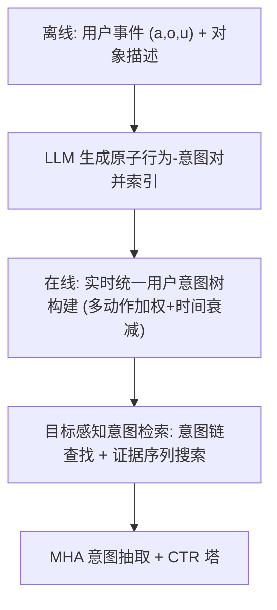
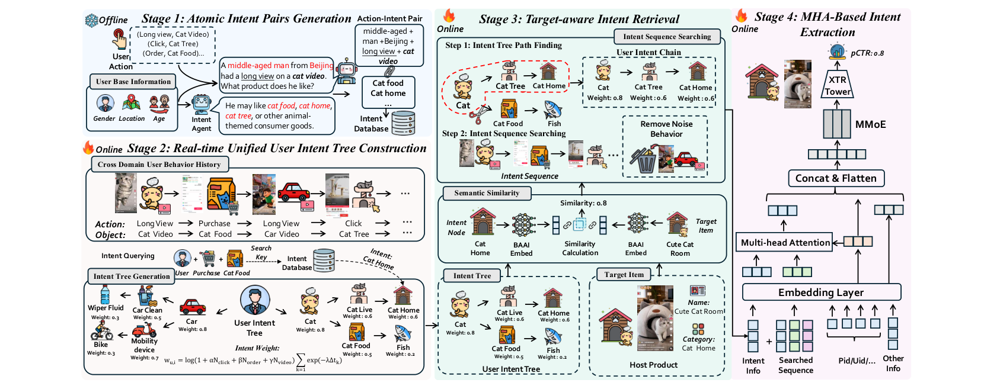

# Atomic Intent Reasoning: Bringing LLM Semantics to Industrial Cross-Domain Recommendations (原子意图推理：将 LLM 语义引入工业级跨域推荐)

- **会议/期刊**: KDD 2026 (V.2)
- **作者与机构**: Zhuohang Jiang, Yuxin Chen, Shijie Wang, Haohao Qu, Jindong Zhou, Wenqi Fan, Qing Li, Dongxu Liang, Jun Wang（香港理工大学 & 快手科技）
- **推荐链路定位**: 精排（CTR 预估与 refined ranking）
- **研究方向**: 跨域与多场景推荐 / 大语言模型推荐
- **论文原文**: [https://arxiv.org/abs/2606.10357v1](https://arxiv.org/abs/2606.10357v1)
- **开源代码**: 暂未开源（仅公开所用基座模型 [Qwen3-4B](https://huggingface.co/Qwen/Qwen3-4B) 与 [BAAI/bge-m3](https://huggingface.co/BAAI/bge-m3)）

## TL;DR (1分钟核心速览)

内容到电商的跨域推荐面临两大工业痛点：跨域语义鸿沟与超长噪声行为序列，而 LLM 虽能弥合语义却因秒级推理延迟无法上线。AIR 将 LLM 推理整体迁移至离线，把每个用户事件蒸馏为「原子行为-意图对」并缓存为意图知识库；在线仅通过轻量检索动态组装统一意图树、做目标感知意图链抽取，再用 MHA 融合。在 Amazon Movie-Book / Food-Kitchen 的 Leave-One-Out + 999 负采样协议下全面 SOTA（Movie HR@10 相对提升 41.31%），线上 A/B 测试 GMV +3.446%、GPM +3.662%，推理延迟从约 8s 降至 20.134ms（约 400× 加速）。

## Background & Motivation (背景与核心矛盾)

- **主流范式**: 现有 CDR 依赖 ID 级协同迁移（共享 Embedding、GNN 跨域连边）捕捉共现相关性；LLM4CDR 则用 LLM 生成伪交互或统一物品表征。
- **前人局限**: 其一，ID 级方法缺乏语义 grounding，难以从内容侧行为推断细粒度购买意图；其二，LLM 方案要么在线推理延迟不可接受（秒级 vs 毫秒级预算），要么周期性离线更新用户画像无法捕捉快速演化的兴趣。
- **核心洞察 (Key Insight)**: 复杂多行为序列背后的潜在意图，可由单行为「原子意图」的组合近似——因此 LLM 的序列级语义推理可被离线原子化 + 在线检索组合所等价替代。
- **本文切入点**: 用「离线 LLM 原子意图生成 + 在线意图树检索组合」解耦语义推理与实时服务，同时以目标感知检索从海量噪声历史中压缩出高证据意图链。

## Method (核心方法设计)

### 1. 整体框架 (Overall Architecture)

AIR 是离线-在线解耦的四阶段流水线：离线阶段用 LLM 将用户事件 $(a,o,u)$（动作、对象、用户画像）连同对象描述转化为分层意图路径，写入高并发意图知识库；在线阶段先以轻量聚合把用户近期行为的意图路径合并为带权统一意图树，再以候选物品为 query 在树上做目标感知检索，得到紧凑的「用户意图链」，最后经多头注意力把意图链与常规用户/物品特征融合送入 CTR 塔。全流程在线仅做检索、并行聚合与树组合，不触发任何 LLM 前向。

<figure class="paper-figure" markdown="span">
  <figcaption>图2：我们提出的AIR（原子意图推理）通过四阶段流水线解决跨域推荐问题：（1）原子意图对生成；（2）实时统一用户意图树构建；（3）目标感知意图检索；（4）基于MHA的意图抽取。</figcaption>
</figure>

### 2. 关键设计拆解 (Key Designs)

1. **原子意图对生成与意图树加权（离线语义 grounding + 在线结构化）**：痛点是在线 LLM 推理昂贵且原始序列噪声大。LLM 对每个事件输出分层意图路径 $P(e)=\{p_1,\dots,p_m\},\ p=[c_1\to c_2\to\cdots\to c_k]$，按动作类型分桶缓存$P_a=\bigcup_{e:a_e=a}P(e)$；在线聚合时节点权重融合多动作计数与时间衰减：
$$w_u=\log\!\big(1+N(u)\big)\sum_{k=1}^{n_u}\exp(-\lambda\Delta t_k),\quad N(u)=\alpha N_{\text{click}}+\beta N_{\text{order}}+\gamma N_{\text{view}}$$
对数项压制重尾频次、衰减项强化短期意图，使异构动作以差异化重要性进入同一棵树。

2. **目标感知意图检索（从长噪声历史中压缩高证据子序列）**：直接用全量历史既昂贵又引入语义干扰。先以 $\cos(e_u,e_v)$在意图树上取 Top-$M$节点$U_v=\text{Top-}M_{u\in\mathcal{T}}\,s(u,v)$，回溯祖先得到分层意图链，再以联合打分$score(u;v)=s(u,v)\cdot g(w_u)$（$g(w)=\log(1+w)$）保留高相关链并去重；随后对链上每个节点检索支撑行为实例，并按语义相似度、时间陈旧度与证据预算三重规则去噪，得到有界长度的意图 token 序列。

3. **MHA 意图抽取与训练/推理开销**：以目标物品嵌入为 query 对意图链做目标条件化摘要 $z_v=\text{MHA}(q_v,X,X)$，不同头分别捕捉粗粒度类目对齐、细粒度偏好与异构证据来源；$z_v$ 与常规特征拼接后进入 MMoE/CTR 塔。训练沿用 CTR 日志监督（无额外对比/负采样目标），推理侧仅检索 + 注意力，延迟 20.134ms。

## Experimental Setup & Evaluation Protocol (实验设置与评估协议)

- **数据集与预处理**:

| 数据集 | #Users | #Items | 平均序列长 | 过滤/说明 |
| :--- | :---: | :---: | :---: | :--- |
| Movie-Book (Movie) | 9,485 | 12,875 | 9.01 | 交互数 <10 过滤；需有文本元数据 |
| Movie-Book (Book) | 52,908 | 93,860 | — | 同上 |
| Food-Kitchen (Food) | 10,822 | 8,661 | 8.22 | 交互数 <5 过滤 |
| Food-Kitchen (Kitchen) | 41,670 | 27,637 | — | 同上 |
| Industrial (快手) | 4 亿+ | 十亿级 | 数千 | 短视频+直播图文电商，十亿至千亿记录 |

- **数据划分与防穿越**: 按时间窗切分子序列（Movie-Book 一个月、Food-Kitchen 一年），跨域子序列每域至少 2 个物品、单域至少 5 个；再按 80%/10%/10% 划分且强制时间序，验证/测试子序列必晚于同用户训练子序列，杜绝泄漏；子序列末物品为 ground-truth。
- **排名评测协议**: `Leave-One-Out` + 每测试实例从域内物品池随机采 999 负样本与正样本共同排序（Sampled Ranking，正负比 1:999），指标 HR@10 / NDCG@10。
- **对比基线与超参**: 6 个单域序列模型（FPMC、Caser、GRU4Rec、SRGNN、FEARec、SASRec）+ 5 个 CDSR 模型（TPUF、$\pi$-Net、C2DSR、MGCL、LLMCDSR）；意图生成用 Qwen3-4B，意图-电商标签映射用 BAAI/bge-m3。

## Key Experimental Results (实验关键数据)

### 1. 主实验对比 (Main Results)

| Method | Movie NDCG@10 | Movie HR@10 | Book NDCG@10 | Book HR@10 | Food NDCG@10 | Food HR@10 | Kitchen NDCG@10 | Kitchen HR@10 |
| :--- | :---: | :---: | :---: | :---: | :---: | :---: | :---: | :---: |
| SASRec | 0.032 | 0.065 | 0.102 | 0.189 | 0.213 | 0.400 | 0.249 | 0.450 |
| GRU4Rec | 0.034 | 0.070 | 0.068 | 0.126 | 0.118 | 0.232 | 0.130 | 0.247 |
| $\pi$-Net | 0.039 | 0.077 | 0.044 | 0.089 | 0.032 | 0.063 | 0.036 | 0.078 |
| C2DSR | 0.035 | 0.064 | 0.014 | 0.031 | 0.069 | 0.131 | 0.023 | 0.046 |
| MGCL | 0.047 | 0.097 | 0.036 | 0.071 | 0.041 | 0.085 | 0.041 | 0.082 |
| LLMCDSR | 0.055 | 0.107 | 0.117 | 0.214 | 0.221 | 0.433 | 0.252 | 0.439 |
| **AIR** | **0.072** | **0.151** | **0.127** | **0.215** | **0.263** | **0.437** | **0.285** | **0.452** |
| Improv. (vs best) | +30.9% | +41.31% | +8.5% | +0.65% | +19.0% | +0.78% | +13.1% | +3.07% |

### 2. 消融实验 (Ablation Study)

| 变体 | Food NDCG@10 | Food HR@10 | Kitchen NDCG@10 | Kitchen HR@10 |
| :--- | :---: | :---: | :---: | :---: |
| AIR (full) | **0.2630** | **0.4367** | **0.2850** | **0.4521** |
| w/o MHA | 0.2626 | 0.4200 | 0.2457 | 0.3705 |
| w/o Intent Retrieval | 0.1637 | 0.3200 | 0.1950 | 0.3564 |
| w/o Intent Tree | 0.1735 | 0.3633 | 0.1892 | 0.3469 |
| w/o Intent Tree + Retrieval | 0.1590 | 0.2900 | 0.1031 | 0.1821 |

### 3. 关键实验发现 (Key Findings)

1. **意图树与意图检索是强耦合的不可替代组件**：单独移除二者分别造成 HR@10 下降 17–27%，但同时移除则性能崩塌（Kitchen NDCG@10 从 0.2850 跌至 0.1031，降幅 64%），说明检索负责跨域知识迁移、意图树负责分层组织，二者协同而非简单叠加。
2. **MHA 是"锦上添花"而非"雪中送炭"**：移除 MHA 在 Food 上几乎无损（NDCG 0.2630→0.2626），但在 Kitchen 上 HR@10 掉 18%，表明目标条件化注意力在长序列、强噪声域中才真正发挥压缩去噪价值。
3. **线上收益随用户活跃度呈 U 形分布**：低活跃用户 GMV +4.32%（原子意图缓解冷启动稀疏），高/超高活跃用户 +8.04%/+7.21%（目标感知压缩有效抑制超长历史噪声），中活跃用户仅 +2.46%，印证方法的两端互补性；同时 HHI 在 Level 3 下降 5.99%，类目多样性显著改善。

## Highlights & Limitations (亮点、对比与审稿批判)

- **与代表作对比 (vs. Prior Work)**: 相比 LLMCDSR 用 LLM 生成伪交互做数据增广，AIR 把 LLM 输出结构化为可检索的意图知识库，避免伪标签噪声且天然支持在线；相比 P5/TokenRec 等生成式推荐需在线解码，AIR 以检索替代生成，延迟低 400×；相比 C2DSR/MGCL 的对比学习跨域对齐，AIR 引入显式语义层级而非仅共现信号。
- **可迁移亮点**: ①「离线 LLM 原子化 + 在线检索组合」范式可平移到任意需要 LLM 语义但受延迟约束的召回/精排场景；② 多动作加权 + 时间衰减的树节点权重公式简洁，可直接复用于多行为序列建模。
- **审稿级局限批判**: ① 主实验采用 1:999 采样排序而非 Full-Ranking，且 Movie-Book 上 Book 域提升仅 0.65%，SOTA 优势在部分域并不稳健；② 离线意图知识库依赖 Qwen3-4B 全量重刷，用户兴趣漂移时缓存时效性与更新成本未量化；③ 意图树构建与检索的超参（$\alpha,\beta,\gamma,\lambda,M$、证据预算）敏感度分析缺失。

## Rating (四维评分)

- **方法创新性 (Novelty)**: ⭐⭐⭐⭐ （原子意图组合近似序列推理的洞察新颖，离线-在线解耦范式对工业 LLM4Rec 有范式意义，但单模块技术均为成熟组件组合）
- **评估协议与实验扎实度 (Protocol & Experiments)**: ⭐⭐⭐⭐ （三数据集 + 十一个基线 + 消融 + 延迟 + HHI + 分活跃度分析完整，但采样排序协议与部分域微弱提升削弱说服力）
- **写作与数学规范度 (Clarity & Rigor)**: ⭐⭐⭐⭐ （四阶段流水线叙述清晰、公式简洁，但意图链打分函数 $g(\cdot)$ 与去噪规则偏启发式，缺乏理论分析）
- **工业落地与复现价值 (Industrial & Practical Value)**: ⭐⭐⭐⭐⭐ （快手 4 亿用户真实 A/B 验证 GMV +3.446%、延迟 20ms，工业价值极高；可惜核心代码未开源，复现需自建意图知识库）
