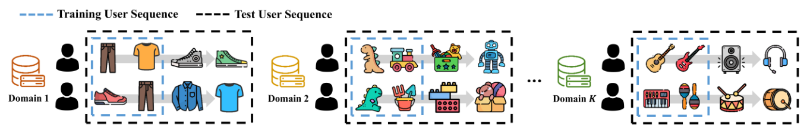
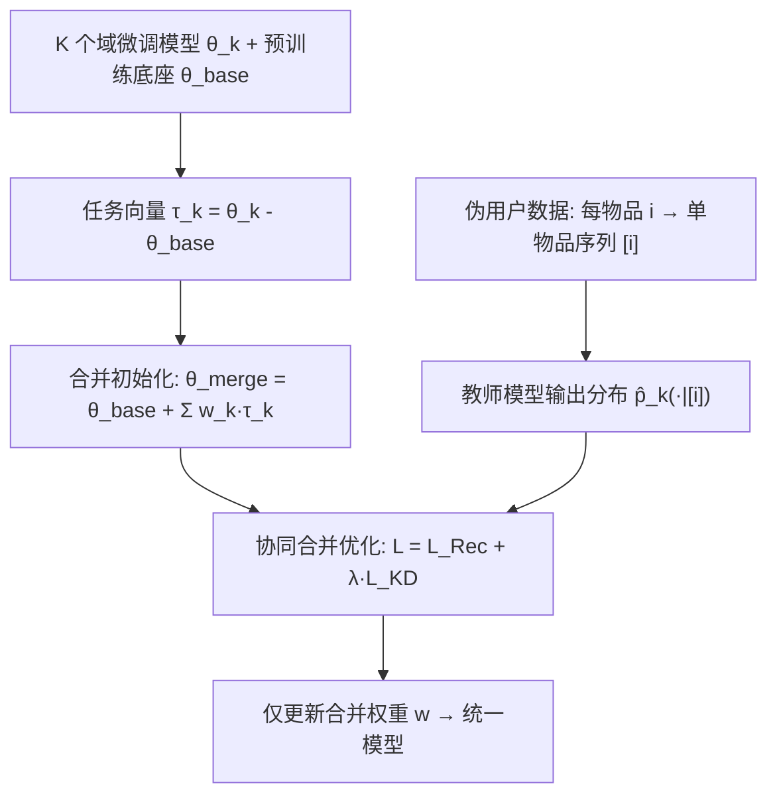
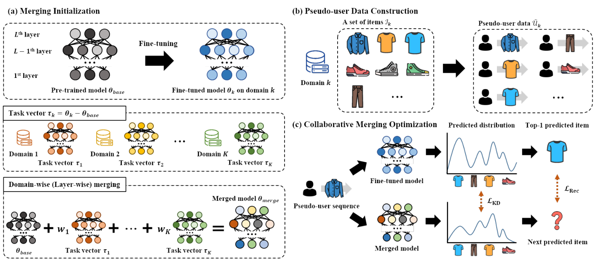

# MergeRec: Model Merging for Data-Isolated Cross-Domain Sequential Recommendation (数据隔离跨域序列推荐的模型合并)

- **会议/期刊**: KDD 2026
- **作者与机构**: Hyunsoo Kim, Jaewan Moon, Seongmin Park, Jongwuk Lee (Sungkyunkwan University)
- **推荐链路定位**: 端到端生成式（文本化序列推荐模型的多域参数融合）
- **研究方向**: 跨域与多场景推荐 / 序列推荐
- **论文原文**: [论文原文链接](https://arxiv.org/abs/2601.01753v1)
- **开源代码**: [开源代码仓库链接](https://github.com/DIALLab-SKKU/MergeRec)

## TL;DR (1分钟核心速览)

现有跨域序列推荐（CDSR）依赖跨域重叠用户/物品或共享原始交互数据，在隐私与组织边界下不可行。本文提出 **data-isolated CDSR** 新设定：各域仅能访问自身微调模型参数，原始日志不可共享。MergeRec 用任务向量做免训练合并初始化，以「每物品即一条单物品序列」构造伪用户数据，再用推荐损失 + 蒸馏损失联合学习域级/层级的合并权重。在 8 个 Amazon 域、4 个文本序列骨干上，归一化 Recall@10 较 Joint Learning 与 AdaMerging 平均提升 8.72% / 17.21%。

## Background & Motivation (背景与核心矛盾)

- **主流范式**: CDSR 通过多域联合训练或从富数据域向稀疏域迁移知识（C2DSR、MAN、DTCDR、CGRec 等），近期隐私保护 CDR 引入联邦学习与差分隐私。
- **前人局限**: ① **重叠依赖**——知识迁移几乎都要求跨域共享用户或物品，但作者实测 8 个 Amazon 域仅共享 16 个用户、0 个物品；② **数据隔离**——真实场景中用户日志受隐私/组织边界限制不可跨域共享，而隐私保护 CDR 仍需在训练期跨域交换参数或梯度；③ **可扩展性差**——联合训练开销随域数增长，多数工作仅限 2–3 个域。
- **核心洞察 (Key Insight)**: 模型合并只需模型参数、不需原始数据，天然满足隐私与可扩展性；但直接套用 CV/NLP 的合并方法存在两个致命障碍——(a) 无测试数据可做 test-time 权重自适应；(b) 序列推荐中测试序列是训练序列的**超集**（图 1），用测试序列调权重必然泄露训练信息，违反合并范式「不得使用训练数据」的前提。
- **本文切入点**: 放弃真实数据，用「物品即伪用户」探针激发各域教师模型中的协同过滤信号，以推荐导向的联合目标学习合并权重。

<figure class="paper-figure" markdown="span">
  <figcaption>图1：多领域序列推荐中训练与测试用户序列的示意图。每个测试用户序列（黑框）包含所有先前交互，包括来自训练期的交互（蓝框），突出表明在真实场景中测试数据是训练数据的超集。</figcaption>
</figure>

## Method (核心方法设计)

### 1. 整体框架 (Overall Architecture)

给定 $K$个域各自微调的文本序列推荐模型$\{\theta_k\}$与共享预训练底座$\theta_{base}$，MergeRec 分三步闭环：(a) **合并初始化**——计算任务向量$\tau_k=\theta_k-\theta_{base}$，按域级或层级权重线性叠加得到初始统一模型；(b) **伪用户构造**——把每个域内每个物品$i$单独视为一条序列$[i]$，作为探针输入各域教师模型，得到条件分布$\hat p_k(\cdot|[i])$；(c) **协同合并优化**——仅优化合并权重$w$（域级$K$个或层级$K\times L$ 个），联合最小化蒸馏损失与推荐损失，最终输出单一通用推荐模型。

<figure class="paper-figure" markdown="span">
  <figcaption>图2：MergeRec的概览，包含三个主要组件。(a) 合并初始化整合为一个包含多领域知识的统一模型。(b) 伪用户数据构造创建单项目序列。(c) 协同合并优化联合优化推荐损失L𝑅𝑒𝑐和蒸馏损失L𝐾𝐷。</figcaption>
</figure>

### 2. 关键设计拆解 (Key Designs)

1. **层级/域级任务向量合并（Merging Initialization）**：单一域标量无法抑制层间抽象差异带来的域间干扰 $\to$为每域每层分配独立权重，$\theta_{merge}=\{\theta^l_{base}+\sum_{k}w^l_k\cdot\tau^l_k\}_{l=1}^{L}$。直觉：浅层共享通用文本表征、深层承载域特有 CF 模式，分层加权可细粒度控制知识注入强度。

2. **伪用户数据构造（Pseudo-user Construction）**：数据隔离下无任何样本可学权重 $\to$令$\tilde{\mathcal{U}}_k=\{[i]\mid i\in\mathcal{I}_k\}$，把单物品序列喂入教师模型$f_{\theta_k}$，其输出分布即刻画物品$i$ 的局部共现结构。直觉：CF 知识已固化在参数中，单物品探针足以「唤醒」它，等价于模拟跨域冷启动用户，且完全不触碰真实日志。

3. **推荐 + 蒸馏联合目标（Collaborative Merging Optimization）**：AdaMerging 仅最小化预测熵，只放大 top-1 置信度，无法刻画用户多意图（图 3 显示其交叉熵不降）$\to$ 引入
$$\mathcal{L}=\mathcal{L}_{Rec}+\lambda\cdot\mathcal{L}_{KD},\quad \mathcal{L}_{KD}=\sum_{k}\sum_{u\in\tilde{\mathcal{U}}_k}\mathrm{KL}(\hat p_{merge,u}\,\|\,\hat p_{k,u})$$
其中 $\mathcal{L}_{Rec}$以教师模型对伪用户的 top-1 预测$\tilde i^+$作硬伪标签、域内负采样构造 BPR 式交叉熵。蒸馏传软分布（多意图 CF 信号），推荐损失保排序判别力。**训练仅更新$K$或$K\times L$ 个标量权重**，底座与任务向量冻结，推理零额外开销。

## Experimental Setup & Evaluation Protocol (实验设置与评估协议)

- **数据集与预处理**: Amazon 8 域（Arts, Beauty, Instruments, Office, Pantry, Scientific, Sports, Toys），沿用 `5-core` 过滤。

| 数据集 | #Users | #Items | #Interactions | 稀疏度/密度 | 特征/场景说明 |
| :--- | :---: | :---: | :---: | :---: | :--- |
| 8 域 Amazon | 各域独立统计（附录 A） | 各域独立 | 5-core 过滤后 | 高度稀疏 | 文本属性（标题/品牌/类目）驱动，域间用户/物品几乎零重叠 |

- **数据划分与防穿越 (Splitting Strategy)**: `Leave-One-Out`——每用户最后 1 次交互作测试、倒数第 2 次作验证、其余训练；训练数据仅用于微调与 Joint Learning，合并阶段不可见。
- **排名评测协议 (Ranking Protocol)**: 域内全物品排序，报告 Recall@10 与 NDCG@10；主表采用**相对微调模型的归一化 R@10**（微调=100%），并给出未归一化结果于附录 C。
- **对比基线与超参设置**: Zero-shot、Fine-tuning、Joint Learning、Weight Averaging、Task Arithmetic、TIES、AdaMerging（域级/层级，为公平起见改用同一伪用户数据做无监督熵最小化）；骨干为 RecFormer-base/large 与 BLaIR-base/large；温度 $T=1$，$\lambda$做敏感性扫描；显著性用单尾 t 检验$p<0.02$。

## Key Experimental Results (实验关键数据)

### 1. 主实验对比 (Main Results)

归一化 Recall@10（%，微调=100），节选 4 骨干平均列与代表性域：

| Backbone | Method | Avg. | Arts | Beauty | Sci. | Toys |
| :--- | :--- | :---: | :---: | :---: | :---: | :---: |
| RecFormer-base | Joint Learning | 80.17 | 77.37 | 79.53 | 79.96 | 92.94 |
| | Task Arithmetic | 88.95 | 91.52 | 81.45 | 98.90 | 82.34 |
| | TIES | 91.08 | 93.29 | 85.60 | 97.68 | 86.25 |
| | AdaMerging (Layer) | 67.36 | 67.17 | 32.92 | 84.54 | 84.93 |
| | **MergeRec (Domain)** | **92.33\*** | **96.14\*** | 83.69 | **100.73\*** | **93.35\*** |
| | **MergeRec (Layer)** | 92.08\* | 95.45\* | **84.85** | **101.44\*** | 92.14 |
| RecFormer-large | TIES | 89.96 | 93.00 | 85.74 | 94.10 | 80.79 |
| | **MergeRec (Domain)** | **92.99\*** | **95.19\*** | **90.08\*** | 97.41 | **96.64\*** |
| BLaIR-large | TIES | 90.90 | 93.78 | 91.09 | 98.36 | 75.35 |
| | **MergeRec (Layer)** | **93.70\*** | **98.73\*** | **95.40\*** | **105.18\*** | 85.63 |

平均增益：vs. Joint Learning **+8.72%**，vs. AdaMerging **+17.21%**，vs. Task Arithmetic **+9.90%**，vs. TIES **+3.04%**（均为 R@10 相对提升）。

### 2. 消融实验 (Ablation Study)

原文未设显式组件消融表，以下以「目标函数替换 / 权重粒度 / 数据构造」三类对照归纳（RecFormer-base，归一化 R@10）：

| 变体 | Avg. | 说明 |
| :--- | :---: | :--- |
| 仅 $\mathcal{L}_{KD}$（≈AdaMerging 思路） | 67.36–78.91 | 熵/置信度导向，排序能力崩塌 |
| $\mathcal{L}_{Rec}+\mathcal{L}_{KD}$（完整 MergeRec） | **92.08–92.33** | 软分布 + 硬伪标签互补 |
| Domain-wise vs. Layer-wise | 92.33 vs. 92.08 | 域级略优，层级在 BLaIR-large 反超（93.70） |
| 伪用户=单物品序列 | 92.33 | 更长上下文留作未来工作 |

### 3. 关键实验发现 (Key Findings)

1. **熵最小化在推荐中系统性失效**：AdaMerging 层级版在 Beauty 上仅 32.92%（微调=100），且图 3 显示其预测熵下降但交叉熵不降——说明只放大 top-1 置信度无法承载多意图 CF 信号；MergeRec 两者同步下降。
2. **域数越多优势越大**：图 4 中 Task Arithmetic/TIES 在 4–5 域时尚可竞争，随域数增至 8 明显退化，而 MergeRec 单调上升，验证任务向量冲突随域数累积、而推荐导向目标可有效消解。
3. **稀疏域与长尾物品受益最大**：Scientific 域上 MergeRec 较微调提升 1.44%（RecFormer-base 域级）至 5.18%（BLaIR-large 层级）；图 5(b) 中最冷门物品组（1–10）增益最显著；数据稀缺实验（目标域仅 1%/5%/10% 用户）中 MergeRec 平均 R@10 达 0.1089/0.1128/0.1120，全面优于微调与 AdaMerging；未见域（Inst./Office/Sci.）上较 Task Arithmetic 最高 +3.92%。

## Highlights & Limitations (亮点、对比与审稿批判)

- **与代表作对比 (vs. Prior Work)**: 与 C2DSR/MAN/DTCDR 等 CDSR 的本质区别是**彻底放弃跨域数据与重叠实体假设**，只交换参数；与 FedGCDR 等隐私保护 CDR 的区别是训练期完全无跨域协调、无梯度/参数交换；与 AdaMerging 的区别是把「无监督熵最小化」替换为「教师软分布蒸馏 + 伪标签推荐」的推荐感知目标。
- **可迁移亮点**: ① 「物品即伪用户」的单物品探针可迁移到任何缺乏原始数据、仅有模型权重的联邦/多租户合并场景；② 用教师 top-1 作硬伪标签 + KL 软分布的双监督组合，是低成本补齐「排序判别力」的通用配方。
- **审稿级局限批判**: ① 伪用户仅用单物品序列，丢失序列上下文，长序列用户（图 5a 中 20+）增益有限；② 合并权重数量随域数线性增长，且需预先固定底座与任务向量，底座不同（跨架构）时无法合并；③ 评估仅限 Amazon 文本序列推荐与归一化指标，缺少工业级在线 A/B 与延迟实测。

## Rating (四维评分)

- **方法创新性 (Novelty)**: ⭐⭐⭐⭐ （核心机制与方法设计具备明确创新性，理论与实验动机支撑充分）
- **评估协议与实验扎实度 (Protocol & Experiments)**: ⭐⭐⭐⭐ （主流公开数据集评测完整，包含多基线对比与消融实验验证）
- **写作与数学规范度 (Clarity & Rigor)**: ⭐⭐⭐⭐⭐ （问题形式化定义清晰，核心模块数学推导与架构阐述严谨易读）
- **工业落地与复现价值 (Industrial & Practical Value)**: ⭐⭐⭐⭐ （兼顾推荐效果增益与训练/推理效率，具备实际场景迁移参考价值）
