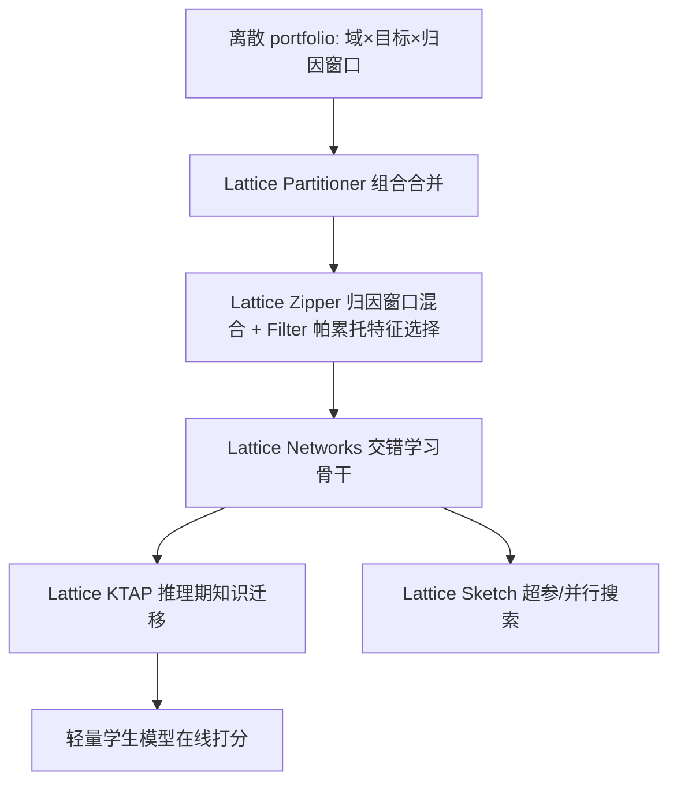
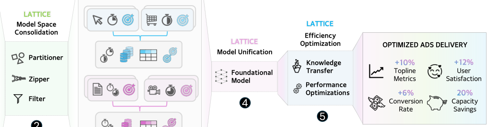

# Meta Lattice: Model Space Redesign for Cost-Effective Industry-Scale Ads Recommendations (面向高性价比工业级广告推荐的模型空间重构)

- **会议/期刊**: KDD 2026
- **作者与机构**: Liang Luo, Yuxin Chen, Zhengyu Zhang 等（Meta AI 广告推荐团队）
- **推荐链路定位**: 精排（含训练/推理全链路系统优化）
- **研究方向**: 跨域与多场景推荐 / 多任务学习与列表级重排
- **论文原文**: [https://arxiv.org/abs/2512.09200v2](https://arxiv.org/abs/2512.09200v2)
- **开源代码**: 暂未开源

## TL;DR (1分钟核心速览)

工业广告推荐面临三大矛盾：数千个 domain-objective 组合（portfolio）各自独立建模导致算力不可扩展、数据碎片化阻碍跨域知识共享、线上延迟约束压制模型复杂度。本文提出 Lattice，把 MDMO 从"改模型结构"扩展到"重构模型空间"：用 Partitioner 合并组合、Zipper 混合归因窗口、Filter 做帕累托特征选择、Lattice Networks 交错学习异构输入、KTAP 做推理期知识迁移。在 Kuaishou 公开集与 Meta 内部 100B 级数据上，相对 10 个 SOTA 基线 BCE 损失最多改善 1.14%，线上 Topline +10%、用户满意度 +11.5%、CVR +6%、容量节省 20%。

## Background & Motivation (背景与核心矛盾)

- **主流范式**: 现代推荐系统按 domain-objective 对（portfolio）独立部署模型，MDMO 研究（MMoE、PEPNet、M3oE、M2M）在"单模型内"做多门控/元单元/个性化嵌入，假设数据干净且格式同质。
- **前人局限**: ① 规模化定律要求放大模型，但为每个 portfolio 单独放大算力不可承受，只能优化少数关键组合；② 每个 portfolio 独立数据集形成人为知识壁垒，稀疏域数据饥饿；③ 线上延迟硬约束使单一大模型无法直接上线。
- **核心洞察 (Key Insight)**: 真正的瓶颈不在模型结构本身，而在**模型空间的组织方式**——组合数量、数据格式、归因窗口、特征集合都是可被"设计"的变量；合并后单次调用可同时服务多个 portfolio，且合并模型可蒸馏为轻量学生模型。
- **本文切入点**: 以"组合合并 + 数据统一 + 架构统一 + 推理期蒸馏 + 系统优化"五件套协同重构模型空间，而非孤立地改网络层。

## Method (核心方法设计)

### 1. 整体框架 (Overall Architecture)

Lattice 从离散的 domain-objective 组合出发：Lattice Partitioner 依据 ID 空间重叠度、反馈时效特性（新鲜稠密 vs 延迟稀疏）、隐私合规与资源预算，将组合划分为若干推荐组，每组仅需一个模型；Lattice Zipper 把不同归因窗口的数据集合并为单一数据集并按哈希路由到各自预测头；Lattice Filter 在合并后的万级特征池中按帕累托前沿迭代选出约 2K 特征；Lattice Networks 以"预处理器—骨干—任务塔"三段式交错处理序列与非序列输入；训练完成后经 Lattice KTAP 将大教师模型的骨干嵌入异步预计算并作为学生模型输入特征，实现推理期持续知识迁移；Lattice Sketch 在缩放定律引导下联合搜索超参与并行策略。

<figure class="paper-figure" markdown="span">
  <figcaption>图 1：Lattice 概览：1○ 即使在 MDMO 框架下，当前模型空间仍然分散，数据集异构、归因窗口各异，模型与目标彼此孤立。2○- 3○ Lattice 通过整合异构格式、归因窗口的数据集，并在帕累托前沿上选择特征，形成一小组整合后的组合，从而重构模型空间，提升跨领域的知识共享并降低服务成本。4○ 基础 Lattice 网络采用基于 MDMO 的统一模型架构，以消费多种数据格式并生成预测</figcaption>
</figure>

### 2. 关键设计拆解 (Key Designs)

1. **Lattice Zipper（归因窗口混合）**：广告转化延迟从分钟到数天不等，短窗口数据新鲜但漏转化、长窗口完整但陈旧，传统做法是训练 $K$个模型或多次训练，成本$K$ 倍且同一曝光标签冲突引发不稳定。Zipper 对每条曝光按确定性哈希（user ID, ad ID, timestamp）依可调分布（通常均匀）随机分配到一个归因窗口，并为每个窗口设独立预测头，训练时按分配路由；服务时只用最长窗口的"oracle 头"。直觉是共享骨干同时吸收不同新鲜度-正确性权衡点的信号，短窗口为骨干提供新鲜梯度、长窗口提供完整监督。

2. **Lattice Filter（帕累托最优特征选择）**：合并后特征池达万级而预算仅数千，加权损失式选择会让强势任务主导、牺牲弱势 portfolio。Filter 先用置换重要性得到每个特征在 $N$个任务上的重要性向量$\mathbf{F}_i=(f_{i,1},\dots,f_{i,N})$，定义偏序$\mathbf{F}_i\preccurlyeq\mathbf{F}_k \iff f_{i,j}\le f_{k,j},\forall j$，每轮取当前帕累托前沿特征入池，前沿数超预算时在前沿内随机补足，迭代至$T$ 个。由于特征已按重要性预排序，关键特征必在早期前沿出现，随机补足不引入偏差，从而保证所有 portfolio 不被系统性惩罚。

3. **Lattice Networks 与训练目标**：预处理器将类别/稠密/序列特征统一投影到维度 $d$（序列经注意力事件模型输出$(B,|F_s|\times K,d)$），骨干交错执行 Transformer 块（RoPE 编码序列）与 DHEN/Wukong 融合块$O'_{cd}=\mathrm{DWFB}([O'_s;O_{cd}])$，ECS 提供 DenseNet 式跨层残差；域冲突用参数解绑（untied FFN）缓解，低精度友好改造包括去偏置骨干层与 SwishRMSNorm$X_{out}=\mathrm{RMSNorm}(X_{in})\odot\mathrm{Sigmoid}(\mathrm{RMSNorm}(X_{in}))$。总损失在主目标外加入跨域相关性损失$\mathcal{L}_{corr}(X,Y)=1-\frac{\mathrm{Cov}(X,Y)}{\sigma_X\sigma_Y}$ 对齐各域标签分布，配合 MetaBalance 平衡梯度；负采样沿用各域原始曝光日志（隐式负样本），无额外难负采样设计。推理侧 KTAP 以约 1:100 的教师:学生 GPU 比预计算骨干嵌入（TTL 数小时），学生同时接收教师嵌入特征与软标签，实现双通道蒸馏。

## Experimental Setup & Evaluation Protocol (实验设置与评估协议)

- **数据集与预处理**: 公开集 Kuaishou（KuaiVideo，MDMO 三任务 like/follow/click）；内部工业集 1–3K 特征、100B 样本级（非序列）与 50B 样本级（混合序列）两套。

| 数据集 | #Users | #Items | #Interactions | 稀疏度/密度 | 特征/场景说明 |
| :--- | :---: | :---: | :---: | :---: | :--- |
| KuaiVideo | 未披露 | 未披露 | 未披露 | 未披露 | 公开 MDMO 基准，3 任务 |
| 内部-非序列 | 未披露 | 未披露 | 100B 样本 | 未披露 | 1 CTR + 2 CVR，30–40 GFLOPs/样本 |
| 内部-混合序列 | 未披露 | 未披露 | 50B 样本 | 未披露 | O(10) 目标：CTR/CONV/QLT |

- **数据划分与防穿越 (Splitting Strategy)**: 公开集按 KuaiVideo 标准划分；内部集采用按日增量训练（daily incremental），Zipper 实验跨一个月逐日评估，属时间切分防穿越。
- **排名评测协议 (Ranking Protocol)**: 报告 AUC 与 BCE 损失（非全库排序指标），内部集报告相对 BCE 改善百分比（0.01% 即显著）；吞吐以 QPS 计。
- **对比基线与超参设置**: 10 个 SOTA 基线 AFN+、AutoInt+、DLRM、DCNv2、FinalMLP、MaskNet、xDeepFM、BST、APG、Wukong；Lattice Sketch 搜索空间达 4 万亿配置、预算 1200 步；教师:学生复杂度 2.7 vs 0.42 GFLOPs。

## Key Experimental Results (实验关键数据)

### 1. 主实验对比 (Main Results)

KuaiVideo 三任务（AUC / Loss，节选核心列）：

| 模型 | Click AUC | Follow AUC | Like AUC | AVG AUC | AVG Loss | MFLOPs |
| :--- | :---: | :---: | :---: | :---: | :---: | :---: |
| AFN+ | 0.7172 | 0.7703 | 0.8466 | 0.7780 | 0.1604 | 10.96 |
| DCNv2 | 0.7225 | 0.7954 | 0.8804 | 0.7995 | 0.1586 | 9.159 |
| BST | 0.7217 | 0.7664 | 0.8707 | 0.7863 | 0.1581 | 326.1 |
| Wukong | 0.7251 | 0.7947 | 0.8842 | 0.8014 | 0.1603 | 22.62 |
| Lattice (Expert) | **0.7281** | **0.7997** | 0.8793 | **0.8024** | **0.1580** | 25.54 |
| Lattice (Sketch) | 0.7249 | 0.7984 | **0.8861** | 0.8031 | 0.1584 | **1.575** |

内部混合序列集相对 Wukong 的 BCE 改善：CTR T1/T2 为 0.27%/0.36%，CONV T1/T2 为 0.38%/0.39%，QLT T1–T4 为 0.48%–0.68%，LG 1.0%、PE 1.14%。非序列集相对 AFN 最高改善 1.14%。

### 2. 消融实验 (Ablation Study)

| 配置 | 关键指标 | 说明 |
| :--- | :---: | :--- |
| 仅数据合并（双 surface） | A −0.15% / B +0.36% | 典型跨域干扰，A 受损 |
| 数据合并 + 辅助相关性损失 | A +0.13% / B +0.46% | 转为双赢，FLOPs 省 1.5× |
| 软标签蒸馏 | +0.12% | 传统 KD |
| KTAP（命中率 0.6） | +0.24% | 典型线上缓存命中 |
| KTAP（命中率 1.0） | +0.43% | 上界 |
| 线上 Topline 归因 | Partitioner 36% / Zipper 11% / Filter 13% / Networks 23% / KTAP 17% | 五组件均有贡献 |

### 3. 关键实验发现 (Key Findings)

1. **组合合并本身是双刃剑**：仅合并数据使 Domain A 损失回退 0.15%，加入跨域相关性损失后反超基线 0.13%，证明"合并 + 监督对齐"必须成对出现，否则 MDMO 的负迁移会吞掉共享收益。
2. **推理期蒸馏显著优于纯软标签蒸馏**：KTAP 在 0.6 命中率下即取得 0.24% 改善，是软标签蒸馏（0.12%）的 2 倍，说明教师骨干嵌入作为输入特征携带的信息量远超 logits 监督。
3. **Sketch 以 17× 更少 FLOPs 逼近专家调参**：自动搜索模型在 8 项指标中 4 项最优、AVG AUC 0.8031 反超专家版 0.8024，而算力仅 1.575 MFLOPs（专家版 25.54），验证缩放定律引导搜索空间缩减的有效性。

## Highlights & Limitations (亮点、对比与审稿批判)

- **与代表作对比 (vs. Prior Work)**: 相比 MMoE/PEPNet/M3oE 只在单模型内做门控或嵌入个性化，Lattice 把"组合划分、数据合并、特征选择"提升为一等公民；相比 Wukong 只做稠密缩放，Lattice 同时解决数据碎片与部署延迟；相比传统 KD 仅训练期传知识，KTAP 把蒸馏延伸到推理期。
- **可迁移亮点**: ① 归因窗口哈希混合 + 多头路由的思路可迁移到任何延迟反馈场景（CVR、LTV）；② 帕累托前沿迭代特征选择对多目标精排的特征预算分配是即插即用工具。
- **审稿级局限批判**: ① 核心收益均来自 Meta 内部数据与业务约束，Partitioner 的划分策略含大量人工规则与业务先验，外部复现性弱且无开源代码；② 评估以 AUC/BCE 为主，缺少全库排序或在线长期留存指标，KTAP 的 TTL 陈旧性对快速漂移兴趣的影响未做敏感性分析。

## Rating (四维评分)

- **方法创新性 (Novelty)**: ⭐⭐⭐⭐ （"模型空间重构"视角新颖，五组件协同设计完整，但单点技术多为已有思想的工程化组合）
- **评估协议与实验扎实度 (Protocol & Experiments)**: ⭐⭐⭐⭐ （公开集 + 两套百亿级工业集 + 逐日增量评估 + 线上归因消融，扎实但缺排序类指标与开源复现）
- **写作与数学规范度 (Clarity & Rigor)**: ⭐⭐⭐⭐ （系统论文条理清晰、公式克制，但部分组件仅给直觉描述、缺复杂度与收敛性分析）
- **工业落地与复现价值 (Industrial & Practical Value)**: ⭐⭐⭐⭐⭐ （线上 Topline +10%、容量省 20% 的完整落地证据链，对工业界模型治理极具参考价值，唯代码未开源）

