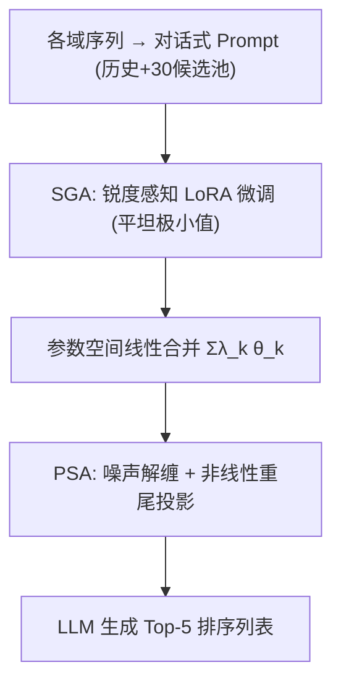

# Sharpness-aware Model Merging with Salience Recovery for LLM-based Cross-Domain Sequential Recommendation (锐度感知与显著性恢复的 LLM 跨域序列推荐模型合并)

- **会议/期刊**: KDD 2026 (Proceedings of the 32nd ACM SIGKDD)
- **作者与机构**: Huwei Ji, Jiajie Su, Yuyuan Li, Xiaohua Feng, Chaochao Chen（浙江大学、杭州电子科技大学）
- **推荐链路定位**: 端到端生成式（LLM 指令微调 + 参数空间模型合并）
- **研究方向**: 跨域与多场景推荐 / 大语言模型推荐
- **论文原文**: [https://arxiv.org/abs/2607.25366v1](https://arxiv.org/abs/2607.25366v1)
- **开源代码**: [https://github.com/muyiahhh/SharpRec](https://github.com/muyiahhh/SharpRec)

## TL;DR (1分钟核心速览)

LLM-based CDSR 中，模型合并（直接线性加权各域 LoRA）虽灵活可扩展，但存在两大瓶颈：异质域合并引发**参数几何冲突**（负迁移，调权重也救不回），多域叠加引发**统计同质化**（线性平均像均值滤波，抹平显著权重，3–4 个源域后性能饱和）。SharpRec 用**锐度感知几何对齐（SGA）**把各域专家拉入连通的平坦极小值盆地，再用**偏好显著性激活（PSA）**做非线性重参数化重建重尾分布。在 Amazon 2023 的 6 组双域任务上，候选池 30 项采样排序协议下 NDCG@5 相对最强基线 LLM4CDSR 提升约 20–38 个百分点，多域扩展到 7 个源域仍持续上升（+51.4%/+55.7%）。

## Background & Motivation (背景与核心矛盾)

- **主流范式**: 混合用户场景下，LLM-based CDSR 通过为每域独立微调 LoRA 适配器，再在参数空间线性加权合并（X-Cross 层级别融合、WeaveRec 线性权重平均），避免表征对齐与全量重训。
- **前人局限**: ① 异质域（如 Sport–Toy）合并后性能反低于单域基线，且对合并权重 $\lambda$ 做穷举网格搜索仍无法翻盘；② 源域数增至 3–4 个后收益迅速进入平台期，继续加域几乎无增益。
- **核心洞察 (Key Insight)**: 作者可视化参数行向量余弦相似度发现，兼容域（Book–Movie）近似零均值高斯（近正交、可共存），而冲突域（Sport–Toy）右偏均值 0.265，几何纠缠导致线性叠加时严重碰撞；同时 $\Delta W$密度图显示$N=1\to7$ 时分布从重尾塌缩为窄高斯，线性聚合充当均值滤波器，抹掉了编码域特异知识的高幅值离群参数。
- **本文切入点**: 干扰误差可分解为「域散度 × 损失锐度」之积，域散度是数据固有属性，而锐度是可控几何量——于是从**优化几何（平坦化）**与**分布重塑（重尾化）**两端同时破局。

## Method (核心方法设计)

### 1. 整体框架 (Overall Architecture)

框架分三阶段：先对每个域 $D_k$用 LoRA 独立指令微调（骨干冻结），但训练目标替换为 SGA 的锐度感知 min-max 形式，使各域适配器收敛到几何连通的平坦盆地；随后按系数$\lambda_k$线性合并得到$\theta_{merge}=\sum_k\lambda_k\theta_k$；最后对合并参数施加 PSA：注入小高斯噪声做随机解缠、再经非线性投影重建重尾分布，得到最终推理参数。整个流程无需联合重训，新增域只需增量微调一个 LoRA 再合并。

### 2. 关键设计拆解 (Key Designs)

1. **SGA 锐度感知几何对齐**：痛点是把合并扰动 $\Delta\theta$视为最坏情况球内扰动$\|\epsilon\|_2\le\rho$，将「合并抗干扰 + 域内精度」目标改写为$\min_{\theta_k}\max_{\|\epsilon\|_2\le\rho}\mathcal{L}(\Phi,\theta_k+\epsilon;D_k)$，并用尺度自适应的$\hat{\epsilon}=\rho\,\frac{\theta_k^2\nabla_{\theta_k}\mathcal{L}}{\|\nabla_{\theta_k}\mathcal{L}\|}$近似内层最大化。直觉：在扰动点算梯度更新，等价于惩罚损失曲率，把专家推入平坦盆地，使线性插值路径不穿越高损失壁垒。理论支撑为$|\delta|\le\frac{1}{2}\lambda(1-\lambda)(\sigma(\theta_A)+\sigma(\theta_B))\|\theta_A-\theta_B\|_2+\mathcal{O}(\epsilon)$，即干扰上界正比于 Hessian 谱范数（锐度）× 域散度，锐度可优化而散度不可。

2. **PSA 偏好显著性激活**：痛点是线性平均把重尾压成窄高斯。先做 $\tilde{\theta}=\theta_{merge}-G,\;G\sim\mathcal{N}(0,\sigma_g^2 I)$把参数推离高密度均值区，再做逐元素投影$\theta_{PSA}=\mathrm{sign}(\tilde{\theta})\cdot|\tilde{\theta}|^{\gamma}\cdot(1+\alpha e^{-\beta|\tilde{\theta}|})$，其中$0<\gamma<1$控制尾部厚度。直觉：$|\tilde\theta|^\gamma$对大幅值离群点压缩远小于小幅值噪声，等效放大尾部密度、抑制近零噪声，恢复被均值滤波侵蚀的域特异神经元。理论支撑为覆盖积分$\mathcal{C}(\mathcal{F})=\int|\det J_\Phi(w)|p_w(w)dw$，重尾分布把概率质量移向 Jacobian 行列式更大的尾部区，故$\mathcal{C}_2>\mathcal{C}_1$。

3. **训练目标、负采样与推理效率**：总损失即各域 SGA 目标之和，无额外对比/负采样项；候选打分采用 30 项候选池（1 真值 + 10 全局共现硬负例 + 19 随机）的生成式列表排序。推理时每域仅需一个 rank-$r$ LoRA 与一次前向生成，合并为纯参数算术，无额外在线开销；但每域独立微调仍需 2 epoch × Llama-2-7B 级算力。

## Experimental Setup & Evaluation Protocol (实验设置与评估协议)

- **数据集与预处理**: Amazon Review 2023，7 域（Sport/Clothing/Movie/Book/Food/Kitchen/Toy），`5-core` 过滤，item 用 title 文本表示，序列截断 6–20。

| 数据集 | #Users | #Items | #Interactions | 稀疏度 | 重叠用户/比例 |
| :--- | :---: | :---: | :---: | :---: | :--- |
| Book | 31,271 | 23,133 | 343,514 | 99.95% | 13,182 / 42.15% |
| Movie | 31,544 | 25,861 | 471,520 | 99.94% | 13,182 / 41.79% |
| Kitchen | 22,127 | 9,758 | 149,019 | 99.93% | 10,015 / 45.26% |
| Food | 22,150 | 11,009 | 190,274 | 99.92% | 10,015 / 45.21% |
| Sport | 10,177 | 6,605 | 115,388 | 99.82% | 2,171 / 21.33% |
| Toy | 12,104 | 8,940 | 128,046 | 99.88% | 2,171 / 17.94% |

- **数据划分与防穿越**: `Leave-One-Out` 协议，序列按 8:1:1 切分训练/验证/测试，验证与测试序列的最后一项为预测目标、前缀为历史上下文。
- **排名评测协议**: `Sampled Ranking`，每目标对 30 项候选池排序（1 真值 + 10 硬负例 + 19 随机），指标 HR@{3,5}、NDCG@{3,5}、MRR，5 次重复取均值±标准差。
- **对比基线与超参设置**: 四类基线——SDSR（GRU4Rec、SASRec）、传统 CDSR（$\pi$-Net、C2DSR、SyNCRec）、LLM-based（URLLM、LLM4CDSR、LLMCDSR）、模型合并（Data-Merge、X-Cross、WeaveRec）；骨干 Llama-2-7B，batch 8，lr$2\times10^{-4}$，2 epoch；SharpRec 取$\rho=0.01$、$\gamma=0.98$、$\sigma_g=10^{-4}$、$\alpha=0.1$、$\beta=10$。

## Key Experimental Results (实验关键数据)

### 1. 主实验对比 (Main Results)

以最具代表性的 Sport→Toy 与 Book→Movie 为例（NDCG@5 / HR@5，%）：

| 方法 | Book→Movie NDCG@5 | Book→Movie HR@5 | Sport→Toy NDCG@5 | Sport→Toy HR@5 |
| :--- | :---: | :---: | :---: | :---: |
| SASRec | 26.42 | 43.57 | 24.45 | 40.71 |
| SyNCRec | 28.84 | 39.22 | 25.41 | 39.00 |
| LLM4CDSR | 57.72 | 71.60 | 55.44 | 73.40 |
| LLMCDSR | 29.88 | 49.18 | 34.91 | 50.88 |
| X-Cross | 44.38 | 50.35 | 55.63 | 61.50 |
| WeaveRec | 40.77 | 46.71 | 53.55 | 59.95 |
| Data-Merge | 41.69 | 47.91 | 51.25 | 57.86 |
| **SharpRec** | **79.93** | **82.46** | **75.34** | **78.78** |
| Improv.% (vs 最强基线) | +38.5% | +15.2% | +35.4% | +7.3% |

其余四组任务（Movie→Book、Kitchen↔Food、Toy→Sport）SharpRec 同样全指标第一，NDCG@5 分别为 72.98 / 55.19 / 44.82 / 66.05，相对次优基线提升 9.3%–22.6%。

### 2. 消融实验 (Ablation Study)

| 变体 | Sport→Toy NDCG@5 | Sport→Toy HR@5 | 6 源域→Sport NDCG@5 | 6 源域→Sport HR@5 |
| :--- | :---: | :---: | :---: | :---: |
| SharpRec 全量 | **0.6605** | **0.7166** | **0.6900** | **0.7638** |
| w/o SGA | 0.4817 | 0.5632 | 0.4673 | 0.5500 |
| w/o PSA | 0.6290 | 0.6889 | 0.6485 | 0.7219 |

### 3. 关键实验发现 (Key Findings)

1. **SGA 是地基、PSA 是天花板**：去掉 SGA 在双域即暴跌 17.9 个点（0.6605→0.4817），说明几何冲突是首要矛盾；而 PSA 在双域仅降 3.2 点，但在 6 源域场景降幅扩大到 4.2 点（0.6900→0.6485），印证其价值随域数增长而放大，正是抗饱和的关键。
2. **可扩展性被真正打破**：源域从 1 增至 7 时，WeaveRec 在 3–4 域后进入饱和区，SharpRec 在 Food/Sport 任务上持续上升，7 域时 NDCG@5 相对 WeaveRec 分别高出 51.4% 与 55.7%，与「线性平均=均值滤波」的诊断一致。
3. **对重叠率与单域基线双重鲁棒**：重叠用户比例从 80% 降至 20% 时 C2DSR 明显下滑，SharpRec 全程保持领先；同时相对各域单域模型（如 Toy-only NDCG@5 0.6222 → 0.6605）均有稳定增益，证明合并没有引入负迁移而是净蒸馏了互补信号。

## Highlights & Limitations (亮点、对比与审稿批判)

- **与代表作对比 (vs. Prior Work)**: 与 X-Cross/WeaveRec 的本质区别在于——它们只做参数空间的线性算术，本文首次指出线性合并的**几何前提（平坦性）**与**统计后果（高斯化）**，并分别用优化端与分布端两个算子对症下药；与 LLM4CDSR 等表征对齐路线相比，本文完全绕开语义-协同强制映射带来的信息畸变。
- **可迁移亮点**: ① 「锐度 × 域散度」干扰上界可作为任意多任务/多场景 LoRA 合并前的兼容性诊断指标；② PSA 的 $|\tilde\theta|^\gamma$ 幂次重尾投影是极轻量的后处理，可直接套用到任何线性模型汤（model soup）场景。
- **审稿级局限批判**: ① 评测采用 30 项采样候选池而非 Full-Ranking，LLM 生成式打分的全库排序成本与真实可用性未验证，指标绝对值偏高；② 每域仍需独立 7B 级 LoRA 微调，域数增长时训练总算力线性膨胀，且 $\rho,\gamma,\sigma_g$ 三个超参虽给出敏感区间但缺乏自适应设定机制。

## Rating (四维评分)

- **方法创新性 (Novelty)**: ⭐⭐⭐⭐ （从几何平坦性与分布重尾性双视角重构模型合并，配 Hessian 上界与覆盖积分两条定理，问题诊断比方法本身更亮眼）
- **评估协议与实验扎实度 (Protocol & Experiments)**: ⭐⭐⭐ （6 组双域 + 多域扩展 + 重叠率 + 超参敏感性覆盖全面，但 30 项采样排序弱于全库排序，且缺少线上或全库对比）
- **写作与数学规范度 (Clarity & Rigor)**: ⭐⭐⭐⭐ （瓶颈—诊断—算子的叙事链条清晰，公式与附录证明完整，符号统一）
- **工业落地与复现价值 (Industrial & Practical Value)**: ⭐⭐⭐⭐ （合并为纯参数算术、推理零额外开销、代码已开源，但多域独立微调的算力门槛限制中小团队落地）
