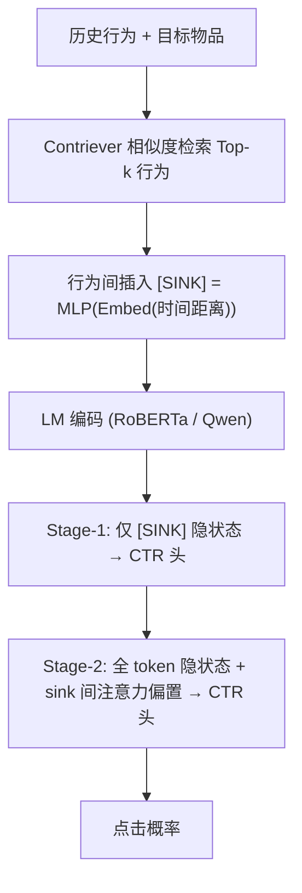

# CTR-Sink: Attention Sink for Language Models in Click-Through Rate Prediction (面向点击率预估的语言模型注意力汇聚点)

- **会议/期刊**: KDD 2026 (32nd ACM SIGKDD)
- **作者与机构**: Zixuan Li, Binzong Geng, Jing Xiong, Yong He, Yuxuan Hu, Jian Chen, Dingwei Chen, Xiyu Chang, Ngai Wong, Liang Zhang, Linjian Mo, Chengming Li, Chuan Yuan, Zhenan Sun（中科院自动化所 NLPR、蚂蚁集团、港大、港城大、中山大学、深圳北理莫斯科大学）
- **推荐链路定位**: 精排（CTR 预估）
- **研究方向**: CTR/CVR 预估与特征交叉 / 大语言模型推荐 (LLM4Rec)
- **论文原文**: [https://arxiv.org/abs/2508.03668v4](https://arxiv.org/abs/2508.03668v4)
- **开源代码**: [https://github.com/UGUESS-lzx/CTR-SINK](https://github.com/UGUESS-lzx/CTR-SINK)

## TL;DR (1分钟核心速览)

文本化用户行为序列由离散动作加语义空分隔符拼接而成，与 LM 预训练时的连贯自然语言存在结构性错配，导致 **语义碎片化**：注意力弥散在无关 token 上，无法聚焦行为边界与行为间关联。本文提出 CTR-Sink，在相邻行为间插入融合时间距离信号的 `[SINK]` 锚点 token，并配合两阶段训练（先仅用 sink 预测、再全序列微调）与 sink 间注意力偏置增强。在工业数据集与 MovieLens、KuaiRec 上，RoBERTa 主干 AUC 分别提升 0.46%/0.36%/0.59%，Qwen 主干提升 0.34%/0.26%/0.42%，且与 CoLLM、FLIP-PLM 等 ID 对齐方法正交可叠加。

## Background & Motivation (背景与核心矛盾)

- **主流范式**: 将用户历史行为序列转写为文本 prompt，送入 LM（RoBERTa 类编码器或 Qwen 类解码器）抽取稠密表征，再接 CTR 头做二分类；代表工作有 TALLRec、BAHE、CTRL、CoLLM、FLIP-PLM。
- **前人局限**: 其一，这些工作默认 LM 能自动理解行为序列语义，但行为序列只有逗号等语义空分隔符、无主谓宾与因果结构，注意力被最后一个 token 吸走、其余位置弥散（图 1）；其二，CoLLM/FLIP 一类方法专注 ID 与协同信号注入，未触及注意力分布本身的结构性缺陷，序列变长后收益饱和。
- **核心洞察 (Key Insight)**: 自然语言因语义连贯天然存在"汇聚点"（关键名词、逻辑连接词），LM 在预训练中学会了经由 sink 聚合信息；而行为序列缺乏此类显式 sink，与预训练注意力模式冲突。作者用 `[CLS]` 做初步验证：仅插入通用锚点即可带来 0.08%–0.12% AUC 提升，证明"植入 sink 可缓解碎片化"，但通用 token 不含推荐域信号、对解码器适配差。
- **本文切入点**: 把 sink 从"通用语义锚点"升级为"携带推荐外部信号的行为级锚点"，并用训练策略与注意力算子显式强化 sink 的聚合与互联。

## Method (核心方法设计)

### 1. 整体框架 (Overall Architecture)

沿用 SIM 式两段结构：先用冻结的 Contriever 表征做目标物品与历史行为的余弦相似度检索，取 Top-$k$ 行为构成序列；随后在每两个相邻行为之间插入一个 `[SINK]` token，其嵌入由该行为与目标行为的时间距离经 MLP 映射得到。序列送入 LM 后，第一阶段仅取 `[SINK]` 位置的隐状态过 CTR 头，强制注意力向 sink 汇聚；第二阶段改用全部 token 隐状态做最终预测，同时在每层注意力计算中叠加一个仅在 sink 位置非零的偏置矩阵，强化 sink 间依赖。推理时仅需一次前向，额外 token 使序列长度增加不足 10%。

<figure class="paper-figure" markdown="span">
  ![图2：CTR-Sink的直观示意图。具体而言，(I)序列构建展示了将\[SINK\] token插入用户行为序列；(II)注意力调控展示了sink特定机制如何增强行为间关联建模；(III)模型训练展示了两阶段训练：先增强sink注意力，再优化整体预测。](../../../../assets/papers/2508.03668v4/figure_2.png)<figcaption>图2：CTR-Sink的直观示意图。具体而言，(I)序列构建展示了将[SINK] token插入用户行为序列；(II)注意力调控展示了sink特定机制如何增强行为间关联建模；(III)模型训练展示了两阶段训练：先增强sink注意力，再优化整体预测。</figcaption>
</figure>

### 2. 关键设计拆解 (Key Designs)

1. **信息增强的行为级 Sink Token**：通用 `[CLS]` 不含推荐域信号，无法区分不同行为边界的重要性。本文将 sink 构造为 $\mathbf{s}_i = \mathrm{MLP}(\mathrm{Embed}(r_i - r'))$，其中$r_i - r'$为第$i$个行为与目标行为的时间距离，输入序列改写为$x_{\text{text}} = \text{prompt} + b_{r_1} + [\text{SINK}_1] + b_{r_2} + \cdots + b_{r_k}$。直觉是"近期行为对当前偏好影响更大"这一推荐域共识被编码进锚点，使不同 sink 获得可区分的表征，从而让注意力在行为边界处形成差异化汇聚，而非均匀分摊。

2. **两阶段训练策略**：解码器（Qwen）预训练时从未见过 `[CLS]` 类 sink，且存在"首 token 注意力偏置"，直接插入 `[SINK]` 在 MovieLens 上仅提升 0.04%。本文先以 $\mathcal{L}_1 = \frac{1}{|\mathcal{D}|}\sum l(Y, f(\mathrm{LM}([\text{SINK}]\text{ tokens})))$仅用 sink 隐状态做预测，逼迫模型把判别信息压缩进 sink；再以$\mathcal{L}_2 = \frac{1}{|\mathcal{D}|}\sum l(Y, f(\mathrm{LM}(\text{All tokens})))$ 用全序列微调并保留该注意力模式。物理直觉：先"教会模型看哪里"，再"让它看全貌"，避免全序列训练时 sink 被淹没。

3. **Sink 间注意力增强与训练开销**：仅聚焦边界不足以刻画"看了 A 常看 B"的行为关联。本文对 sink 集合 $\mathcal{L}$用独立自注意力算出$k\times k$偏置$\mathrm{Attn}_{\text{bias}} = \mathbf{Q}'_{\text{bias}}\mathbf{K}'_{\text{bias}}^\top/\sqrt{d_{\text{bias}}}$，按位置散射回$n\times n$后与原注意力相加：$\mathrm{Attn}_{\text{final}} = \mathrm{softmax}(\mathrm{Attn}_{\text{raw}} + \mathrm{Attn}_{\text{bias}})$。由于$k \ll n$，额外开销可忽略；总损失即上述两阶段交叉熵，负样本来自真实曝光未点击（无额外负采样），Contriever 冻结不引入标签泄漏。

## Experimental Setup & Evaluation Protocol (实验设置与评估协议)

- **数据集与预处理**: 工业数据集约 1 亿曝光、70 万用户、20 万物品，点击率 33.44%；KuaiRec 过滤无文本描述样本，完播率 >100% 为正；MovieLens 保留至少 20 条记录的用户、近十年数据，评分 >3 为正类。

| 数据集 | #Users | #Items | #Interactions | 稀疏度/密度 | 特征/场景说明 |
| :--- | :---: | :---: | :---: | :---: | :--- |
| Industry | ~700K | ~200K | ~100M 曝光 | 点击率 33.44% | 中文，真实工业日志 |
| MovieLens | 过滤后用户 | 电影 | 近十年记录 | 二分类阈值 3 | 英文，评分转点击 |
| KuaiRec | 短视频用户 | 短视频 | 完播率定义标签 | 过滤无文本样本 | 中文，短视频场景 |

- **数据划分与防穿越 (Splitting Strategy)**: 三个数据集均按**日期**以 8:1:1 切分训练/验证/测试，属全局时间戳切分，杜绝未来行为泄漏。
- **排名评测协议 (Ranking Protocol)**: 采用 AUC 作为指标，在真实曝光样本上做二分类评估（非全库排序、非负采样排序）；作者明确 0.1% 的 AUC 增量在 CTR 场景即视为非平凡提升。
- **对比基线与超参设置**: ID 类基线 DeepFM、DIN、AutoInt、DCN-V2；LM 类基线 CoLLM、FLIP-PLM、LM-CTR，并分别在 RoBERTa 与 Qwen2-0.5B 上实现。RoBERTa 用 batch 64、lr 1e-4；Qwen 用 batch 16、lr 1e-5；sink 嵌入维度 128（RoBERTa）/256（Qwen），dropout 0.1，8×A100；显著性检验 $p < 0.005$。

## Key Experimental Results (实验关键数据)

### 1. 主实验对比 (Main Results)

| 主干 | 方法 | Industry | MovieLens | KuaiRec |
| :--- | :--- | :---: | :---: | :---: |
| ID 类 | DeepFM | 0.7678 | 0.7803 | 0.8072 |
| ID 类 | DIN | 0.7712 | 0.7785 | 0.8086 |
| ID 类 | AutoInt | 0.7735 | 0.7812 | 0.8064 |
| ID 类 | DCN-V2 | 0.7719 | 0.7806 | 0.8065 |
| RoBERTa | CoLLM | 0.7695 | 0.7795 | 0.8097 |
| RoBERTa | CoLLM w/ CTR-Sink | 0.7787★ | 0.7829★ | 0.8155★ |
| RoBERTa | FLIP-PLM | 0.7792 | 0.7820 | 0.8137 |
| RoBERTa | FLIP-PLM w/ CTR-Sink | **0.7823**★ | **0.7852**★ | **0.8195**★ |
| RoBERTa | LM-CTR | 0.7764 | 0.7808 | 0.8133 |
| RoBERTa | LM-CTR w/ CTR-Sink | 0.7810★ | 0.7844★ | 0.8192★ |
| Qwen | CoLLM | 0.7888 | 0.8165 | 0.8092 |
| Qwen | CoLLM w/ CTR-Sink | 0.7924★ | 0.8195★ | 0.8125★ |
| Qwen | LM-CTR | 0.7885 | 0.8177 | 0.8156 |
| Qwen | LM-CTR w/ CTR-Sink | **0.7919**★ | **0.8203**★ | **0.8198**★ |

相对 LM-CTR 的提升：RoBERTa 主干 +0.46%/+0.36%/+0.59%，Qwen 主干 +0.34%/+0.26%/+0.42%（Industry/MovieLens/KuaiRec）。

### 2. 消融实验 (Ablation Study)

| 配置 | Industry | MovieLens | KuaiRec |
| :--- | :---: | :---: | :---: |
| Original (LM-CTR) | 0.7764 | 0.7808 | 0.8133 |
| w/ [SINK]（仅插入） | 0.7784 | 0.7836 | 0.8175 |
| w/ [SINK] + 两阶段训练 | 0.7791 | 0.7840 | 0.8181 |
| w/ [SINK] + 两阶段 + sink 间注意力 | **0.7810** | **0.7844** | **0.8192** |
| 随机 [SINK]（时间信号置乱） | 0.7768 | 0.7813 | 0.8136 |
| 语义相似度作外部信号 | 0.7764 | 0.7790 | 0.8169 |
| 双倍 epoch（无两阶段） | 0.7782 | 0.7837 | 0.8176 |

### 3. 关键实验发现 (Key Findings)

1. **增益来自注意力引导而非训练时长**：双倍 epoch 在工业集仅 0.7782，低于两阶段训练的 0.7791；Qwen 上两阶段（0.8193）比双倍 epoch（0.8185）高 0.08%，说明收益源于"先只看 sink"的显式引导，而非更多迭代。
2. **外部信号必须"有信息"**：随机 `[SINK]` 在 MovieLens 反而下降 0.03%，而时间距离信号带来 +0.28%；语义相似度信号次之（KuaiRec +0.49%），证明推荐域信号的可区分性才是 sink 生效的前提，且信号类型可替换。
3. **长序列优势更明显**：MovieLens 上原模型从 40 到 50 个行为仅涨 0.02%（0.7814→0.7816）出现饱和，CTR-Sink 在 50 行为处取得最大增益 +0.28%（0.7844），说明 sink 锚定有效抑制了长序列下的注意力弥散。

## Highlights & Limitations (亮点、对比与审稿批判)

- **与代表作对比 (vs. Prior Work)**: 与 CoLLM、FLIP-PLM 的本质区别在于，后者在"输入表征层"注入 ID/协同信息，本文在"注意力分布层"做结构干预，因此二者可叠加（FLIP-PLM + CTR-Sink 取得全表最优 0.7823/0.7852/0.8195）；与 StreamingLLM 等 NLP 侧 attention sink 工作相比，本文首次把 sink 从"位置先验"改造为"携带推荐信号的语义锚点"，并解决了 sink 间互联问题。
- **可迁移亮点**: 其一，"插入带外部信号的锚点 token + 两阶段先锚后全"是一套与主干无关的轻量插件，可直接移植到生成式推荐、多模态序列建模；其二，用 $k\times k$小矩阵散射成$n\times n$ 偏置的做法，为在长序列上做稀疏结构化注意力提供了低成本范式。
- **审稿级局限批判**: 其一，外部信号仅系统验证了时间距离与语义相似度，频率、重要性等多信号仅在附录简述，信号选择缺乏理论指导，且时间距离在无时间戳场景不可用；其二，实验仅在 AUC 单一指标、单目标二分类设定下评估，未报告推理延迟、显存与线上 A/B 的 GAUC/业务指标，工业落地证据偏弱；此外 `[SINK]` 使序列增长近 10%，超长序列下的效率优化被作者留作未来工作。

## Rating (四维评分)

- **方法创新性 (Novelty)**: ⭐⭐⭐⭐ （首次将 attention sink 理论引入 CTR 行为序列建模，把通用锚点升级为带推荐信号的 sink 并补上 sink 间互联，视角新颖但算子本身较简洁）
- **评估协议与实验扎实度 (Protocol & Experiments)**: ⭐⭐⭐⭐ （工业 + 两个开源、编码器/解码器双主干、$p<0.005$ 显著性、消融覆盖信号类型/序列长度/epoch 混淆因子，惟缺线上 A/B 与多目标指标）
- **写作与数学规范度 (Clarity & Rigor)**: ⭐⭐⭐⭐ （从 `[CLS]` 预实验到三个递进问题的推导链条清晰，公式简洁；但 sink 间偏置的散射实现与复杂度分析着墨较少）
- **工业落地与复现价值 (Industrial & Practical Value)**: ⭐⭐⭐⭐ （代码已开源、序列仅增 <10%、与现有 ID 对齐方法正交可插拔，工程友好；超长序列效率与信号可得性仍需打磨）

