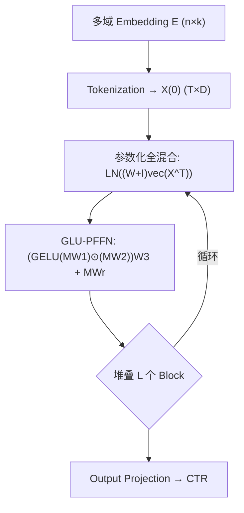
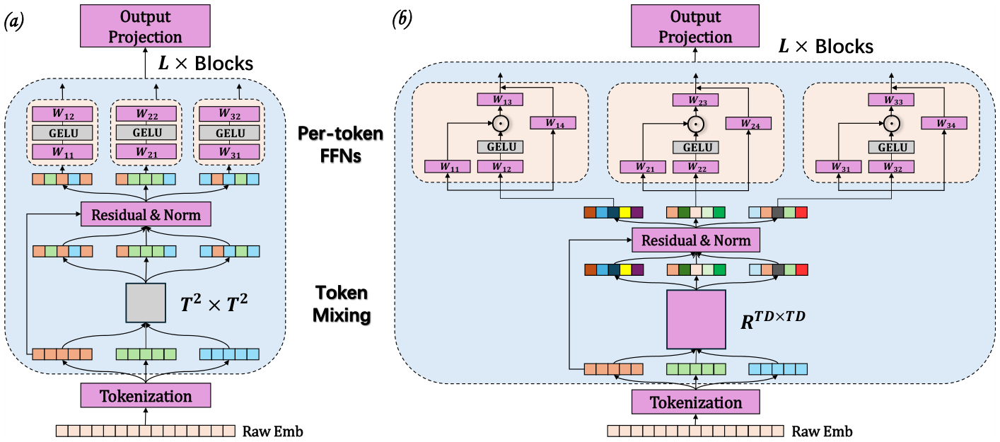

# Expand More, Shrink Less: Shaping Effective-Rank Dynamics for Dense Scaling in Recommendation (多扩张、少收缩：为稠密扩展塑造有效秩动态)

- **会议/期刊**: KDD 2026 (Research Track, Feb Cycle)
- **作者与机构**: Guoming Li, Menglin Yang (HKUST-GZ); Shangyu Zhang, Junwei Pan 等 (腾讯)
- **推荐链路定位**: 精排 (CTR 预估)
- **研究方向**: CTR预估与特征交叉 / 表征塌缩与稠密扩展
- **论文原文**: [arXiv:2605.23191v1](https://arxiv.org/abs/2605.23191v1)
- **开源代码**: [RankElastor](https://github.com/vasile-paskardlgm/RankElastor)

## TL;DR (1分钟核心速览)

RankMixer 通过 token mixing 与 P-FFN 交替堆叠实现可扩展推荐，但作者用有效秩 (effective rank) 诊断发现其秩演化呈**阻尼振荡轨迹**：mixing 仅带来有界扩张、P-FFN 持续收缩，深层仍塌缩。本文提出 RankElastor，用**参数化全混合**（去掉 Kronecker 块约束）与 **GLU 门控 P-FFN**（乘性交互抬秩）实现"多扩张少收缩"，并给出可证明的谱鲁棒性。在 Criteo/Avazu 工业级数据上 AUC 较最强基线提升超 0.001，且扩展律更优。

## Background & Motivation (背景与核心矛盾)

- **主流范式**: 以 RankMixer 为代表的 token-transformation 架构，将多域 embedding 统一为 token 矩阵，交替执行 block-transpose token mixing 与 per-token FFN，实现稠密参数扩展。
- **前人局限**: (1) 现有塌缩分析只覆盖 DCNv2/xDeepFM 等传统"embedding-interaction"模型，RankMixer 从未被从 embedding collapse 视角审视；(2) 即便 RankMixer 秩略高于传统模型，其增益有界，Avazu 上 P-FFN 的收缩主导全层，塌缩重新出现。
- **核心洞察 (Key Insight)**: 逐层有效秩可视化显示 RankMixer 呈锯齿状阻尼振荡（mixing 抬秩、FFN 压秩），而传统模型单调衰减。定理 2.1 证明 block-transpose 混合的秩增益被 $2(k+\mu)$ 上界锁死；定理 2.2 证明标准 FFN 在低秩输入下概率性收缩 $\text{erank}(F(X))\le\alpha\,\text{erank}(X)$。
- **本文切入点**: 诊断出"扩张有界 + 收缩主导"是架构内生缺陷，据此提出 **Expand More, Shrink Less** 的设计原则。

## Method (核心方法设计)

### 1. 整体框架 (Overall Architecture)

输入多域 embedding 经 tokenization 投影为 $X^{(0)}\in\mathbb{R}^{T\times D}$，随后堆叠 $L$ 个 RankElastor block：每个 block 先做**参数化全混合**（在展平的 $TD$ 维坐标上做稠密可学习混合 + 残差 + LayerNorm），再送入 **GLU 改进的 P-FFN**（GELU 门控分支与线性分支 Hadamard 相乘后压缩），最后经输出投影得到 CTR logits。训练用标准 BCE 损失端到端优化，无额外负采样（CTR 二分类范式）。

<figure class="paper-figure" markdown="span">
  <figcaption>图 3：(a) RankMixer 与 (b) RankElastor 的架构概览。紫色模块表示可训练组件，灰色模块表示非参数组件。两个模型的关键差异在于 token-mixing 与 P-FFN。</figcaption>
</figure>

### 2. 关键设计拆解 (Key Designs)

1. **参数化全混合 (Parameterized Full Mixing)**：RankMixer 的 block-transpose 等价于 $\text{vec}(M^\top)=\text{LN}((P\otimes I)\text{vec}(X^\top)+\text{vec}(X^\top))$，其中 $P$ 为交换矩阵、网格尺度 $d=D/T$。痛点：Kronecker 约束 $(W\otimes I_{d^*})$ 使 $d^*>1$ 时可实现的线性变换严格弱于 $d^*=1$（定理 3.1），秩扩张被锁死。本文令 $d=1$ 并引入可学习稠密矩阵：
$$\text{vec}(M^\top)=\text{LN}\big((W+I)\text{vec}(X^\top)\big),\quad W\in\mathbb{R}^{TD\times TD}$$
去掉 Kronecker 约束后，模型可表达细粒度、高秩的坐标交互，从统计上提升谱鲁棒性。

2. **GLU 改进 P-FFN**：原 P-FFN 为 $\phi(XA)B$ 两层 GELU，定理 2.2 表明其在低秩输入下会概率性压秩。本文改为门控形式：
$$Z_t=\big(\text{GELU}(M_tW_1)\odot(M_tW_2)\big)W_3+M_tW_r$$
乘性项引入 degree-2 交互，定理 3.2 证明当隐宽 $m\ge Ck\log D$ 时 $\text{rank}(\phi(XA)\odot(XC))\ge\min(D,k(k+1)/2)$ 且 $\text{erank}(G(X))\ge\text{erank}(X)+\delta$，即从"压秩"翻转为"抬秩"。

3. **训练目标与复杂度**：损失为 BCE $\mathcal{L}=-\frac{1}{N}\sum[y\log\hat y+(1-y)\log(1-\hat y)]$，无负采样。代价：全混合 $O(T^2D^2)$ 计算与参数（RankMixer 为 $O(TD)$ 且零参数），GLU-PFFN 为 $O(T(3rD^2+D^2))$、参数 $(3r+1)D^2$（常数倍增长）。实测仅增 10%–15% 单 epoch 时间，显存持平。

## Experimental Setup & Evaluation Protocol (实验设置与评估协议)

- **数据集与预处理**:

| 数据集 | #Train | #Valid | #Test | #Fields | 说明 |
| :--- | :---: | :---: | :---: | :---: | :--- |
| Criteo | 33.0M | 8.3M | 4.6M | 39 | 工业级 CTR 基准 |
| Avazu | 32.3M | 4.0M | 4.0M | 24 | 移动广告点击 |

- **数据划分与防穿越**: 沿用 FuxiCTR 官方 pipeline 的固定 train/valid/test 划分（非 LOO），验证集早停。
- **排名评测协议**: CTR 二分类点估计，报告 **AUC 与 LogLoss**（非 Full-Ranking 列表指标）；另用有效秩 $\text{erank}(X)=\|X\|_F^2/\|X\|_2^2$ 度量塌缩。
- **对比基线与超参**: MLP / xDeepFM / DCNv2 / AutoInt / RankMixer；embedding 维度 Criteo=20、Avazu=16，$(T,D)=(15,26)$ 与 $(16,24)$，GLU 扩展比 $r=3$，batch 4096/10000，10 次随机初始化取均值。

## Key Experimental Results (实验关键数据)

### 1. 主实验对比 (Main Results)

| Model | Criteo AUC↑ | Criteo LogLoss↓ | Avazu AUC↑ | Avazu LogLoss↓ |
| :--- | :---: | :---: | :---: | :---: |
| MLP | 0.81307 | 0.43927 | 0.79226 | 0.37247 |
| xDeepFM | 0.81334 | 0.43849 | 0.79242 | 0.37236 |
| DCNv2 | 0.81365 | 0.43816 | 0.79258 | 0.37227 |
| AutoInt | 0.81331 | 0.43853 | 0.79072 | 0.37430 |
| RankMixer | 0.81375 | 0.43799 | 0.79270 | 0.37218 |
| **RankElastor** | **0.81482** | **0.43730** | **0.79323** | **0.37196** |
| Improv.% (vs RankMixer) | +0.13% | −0.16% | +0.07% | −0.06% |

行为序列泛化（KuaiVideo/TaobaoAd）：RankElastor gAUC 0.6731/0.5778、AUC 0.7514/0.6522，全面超 RankMixer (0.6691/0.5763, 0.7482/0.6508)。

### 2. 消融实验 (Ablation Study)

| 配置 | Criteo AUC | Avazu AUC |
| :--- | :---: | :---: |
| **RankElastor (完整)** | **0.81482** | **0.79323** |
| w/o Full Mixing (退回块转置) | 0.81413 | 0.79289 |
| GLU-PFFN → GELU-PFFN | 0.81349 | 0.79288 |
| GLU-PFFN → ReLU-PFFN | 0.81326 | 0.79241 |
| RankMixer + GLU-PFFN (仅换 FFN) | 0.81393 | 0.79286 |
| RankMixer + ReLU-PFFN | 0.81284 | 0.79227 |

### 3. 关键实验发现 (Key Findings)

1. **两模块存在协同依赖**：单独给 RankMixer 换 GLU-PFFN 仅得 0.81393（+0.00018），远小于完整 RankElastor 的 0.81482；说明 GLU 的抬秩收益需以全混合提供的表达力为前提，验证了定理 3.1/3.2 的互补性。
2. **塌缩缓解可量化**：Avazu 上 RankMixer 末层有效秩被 P-FFN 压回甚至低于原始 embedding，而 RankElastor 全层保持稳定增长（图 6b），逐样本秩分布位移显著更大（图 5 vs 图 1），直接对应 AUC 从 0.79270 到 0.79323 的提升。
3. **扩展律更优**：宽度/深度/联合三档 scaling 中，RankElastor 的 AUC 随参数倍数单调上升且斜率高于 RankMixer，联合扩展增益最大，说明其"多扩张"设计真正兑现了稠密参数化的红利，而非单纯堆参数。

## Highlights, Limitations & Rating (亮点、对比与审稿评价)

- **与代表作对比 (vs. Prior Work)**: 相较 RankMixer（非参数块转置 + GELU-FFN，秩增益有界），本文用可学习全混合打破 Kronecker 约束、用门控乘性交互翻转 FFN 的压秩方向；相较 DCNv2/xDeepFM 的单调秩衰减，本文首次给出 token-transformation 架构的谱动力学理论刻画。
- **可迁移亮点**: (1) 用逐层有效秩作为"扩展是否有效"的诊断探针，可低成本移植到任何深层推荐架构的调参；(2) GLU 门控替换 FFN 是几乎零风险的抬秩 trick，可先单独试用于现有精排模型。
- **审稿级局限批判**: (1) 全混合引入 $O(T^2D^2)$ 参数，当 token 数 $T$ 增大时参数与显存压力陡增，论文仅在小 $T$（15/16）验证；(2) 理论分析强依赖 Frobenius 正交与 sub-Gaussian 假设，且仅在 Criteo/Avazu 两个公开集验证，缺线上 A/B 与真实超大规模场景证据。
- **四维评分**: 创新性 ⭐⭐⭐⭐ | 实验扎实度 ⭐⭐⭐⭐ | 方法清晰度 ⭐⭐⭐⭐⭐ | 落地价值 ⭐⭐⭐⭐

