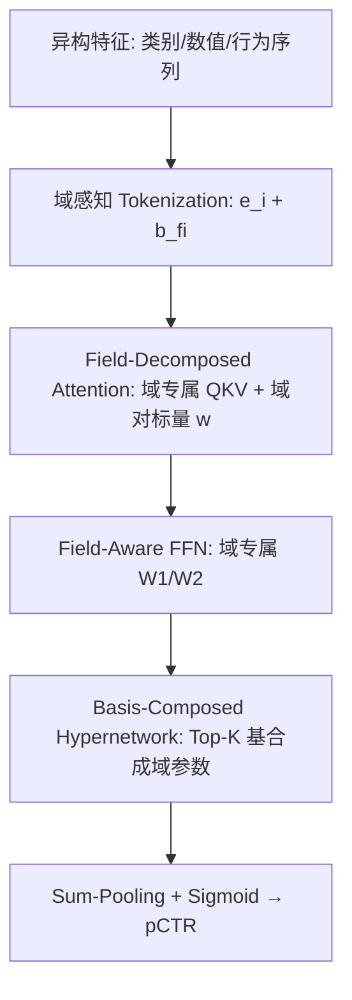
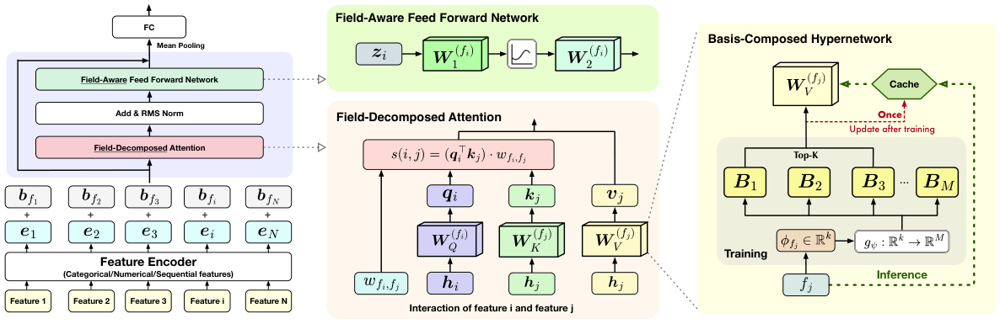

# From Scaling to Structured Expressivity: Rethinking Transformers for CTR Prediction (从规模扩张到结构化表达力：重新思考 CTR 预估中的 Transformer)

- **会议/期刊**: KDD 2026
- **作者与机构**: Bencheng Yan, Yuejie Lei, Zhiyuan Zeng, Zheye Deng 等（前四位共同一作），阿里巴巴集团
- **推荐链路定位**: 精排（CTR 预估）
- **研究方向**: CTR/CVR 预估与特征交叉 / 工业级全链路架构
- **论文原文**: [https://arxiv.org/abs/2511.12081v2](https://arxiv.org/abs/2511.12081v2)
- **开源代码**: 暂未开源

## TL;DR (1分钟核心速览)

CTR 模型堆参数收益迅速饱和，与 LLM 的可预测缩放形成鲜明反差。本文指出根因是**结构错配**：标准 Transformer 假设序列组合语义，而 CTR 数据是无序异构域的**组合式推理**。作者提出 Field-Aware Transformer（FAT），用域专属投影 + 域对交互标量重构注意力与 FFN，把参数复杂度从词表规模 $n$转移到域数$F$（$n \gg F$），再用基组合超网络进一步压缩参数。基于 Rademacher 复杂度的泛化界解释了幂律缩放现象。在 Taobao 与 MovieLens-20M 上，FAT-XL 相对 DeepCTR 取得最高 **+4.38% AUC**，线上 A/B 取得 **+2.33% CTR、+0.66% RPM**。

## Background & Motivation (背景与核心矛盾)

- **主流范式**: 将 CTR 特征 token 化后直接移植标准 Transformer（HiFormer、Wukong、HSTU、RankMixer），或改造成生成式范式，靠扩大宽度/深度提升容量。
- **前人局限**: 其一，标准自注意力对所有 token 使用全局共享投影，无视异构域的语义角色差异，在极端稀疏下放大噪声、扭曲梯度；其二，域感知先验（如 FFM 的域对隐向量）长期被限制在浅层输入层，无法与深层可扩展架构结合，导致"结构化先验"与"深度容量"二选一。
- **核心洞察 (Key Insight)**: 语言语义是**序列组合式**（同质 token、顺序严格、注意力由句法驱动）；CTR 语义是**组合式且域依赖**（"年轻用户×奢侈品牌"、"移动设备×晚间时段"），顺序任意，真正重要的是域间交互拓扑。因此直接照搬注意力是"架构模仿"而非"架构对齐"。
- **本文切入点**: 把域感知先验下沉到 Transformer 每一层的算子内部，并用超网络解决由此带来的参数爆炸，使表达力随**交互结构**而非原始参数量增长。

## Method (核心方法设计)

### 1. 整体框架 (Overall Architecture)

输入侧先用类型专属编码器（类别查表、数值离散化、行为序列 DIN 池化）得到 token，并以**域感知偏置** $\boldsymbol{h}_i=\boldsymbol{e}_i+\boldsymbol{b}_{f_i}$替代位置编码，保证置换不变性同时注入语义角色。随后堆叠$L$ 层 Field-Aware Block，每层由 Field-Decomposed Attention（跨域交互）与 Field-Aware FFN（域内分布适配）构成，均带残差与 LayerNorm。所有域专属投影矩阵不直接存储，而由 Basis-Composed Hypernetwork 从共享基中稀疏合成；训练时动态生成，推理前离线物化并缓存，实现零推理开销。最后 sum-pooling 聚合域表示，经 sigmoid 输出 CTR。

<figure class="paper-figure" markdown="span">
  <figcaption>图1：Field-Aware Transformer（FAT）的架构。</figcaption>
</figure>

### 2. 关键设计拆解 (Key Designs)

1. **Field-Decomposed Attention（把域对全秩矩阵分解为"内容对齐 + 路由调制"）**：若为每个域对 $(f_i,f_j)$分配独立投影，参数为$O(F^2d^2)$，工业上$F\sim10^3$、$d\sim128$时从 1 亿膨胀到 10 万亿，不可行。本文将其分解为两部分：域专属 QKV 投影负责**内容对齐**（$O(Fd^2)$），轻量标量$w_{f_i,f_j}$负责**域对交互调制**（$O(F^2)$）：

$$s(i,j)=\left(\boldsymbol{q}_i^{\top}\boldsymbol{k}_j\right)\cdot w_{f_i,f_j},\quad \boldsymbol{q}_i=\boldsymbol{h}_i\boldsymbol{W}^{(f_i)}_{Q},\ \boldsymbol{k}_j=\boldsymbol{h}_j\boldsymbol{W}^{(f_j)}_{K}$$

直觉上，$w$充当门控：放大"广告类目→用户行为"这类高价值通路，抑制"广告类目→设备类型"的噪声耦合；且$w_{f_i,f_j}\neq w_{f_j,f_i}$天然刻画方向性。参数复杂度从$O(F^2d^2)$降至$O(Fd^2+F^2)$，典型场景降幅超 99%（150B → 0.5B）。

2. **Field-Aware FFN（域内分布适配）**：标准 FFN 对所有 token 施加统一变换，抹平了异构域的统计差异。本文令变换以域为条件：$\text{FAT-FFN}(\boldsymbol{z}_i)=\text{SiLU}(\boldsymbol{z}_i\boldsymbol{W}^{(f_i)}_1)\boldsymbol{W}^{(f_i)}_2$。消融显示该模块与跨域交互同等重要——**域内**分布建模与**域间**交互建模缺一不可。

3. **Basis-Composed Hypernetwork（解耦容量与域基数）**：为每类参数 $\Phi\in\{Q,K,V,1,2\}$维护$M$个共享基$\mathcal{B}_\Phi$，用轻量 MLP 路由$g_\psi$将域元嵌入$\phi_f$映射为选择签名，取 Top-$K$ 后 softmax 得系数，合成域专属矩阵：

$$\boldsymbol{W}^{(f)}_\Phi=\sum_{m\in\pi_f}\alpha^{(f)}_m\boldsymbol{B}_{m,\Phi}$$

存储复杂度降为 $O(Md^2+Fk)$。更关键的是**可持续特征演化**：新增特征域只需初始化一个轻量元嵌入$\phi_f$，无需分配全秩矩阵，实现"热启动"。

4. **训练目标、负采样与推理效率**：采用标准 pointwise 二元交叉熵 $\mathcal{L}=-\frac{1}{|\mathcal{D}|}\sum (y\log\hat{y}+(1-y)\log(1-\hat{y}))$，无特殊负采样设计（CTR 场景为曝光日志天然负例）。推理侧所有$\boldsymbol{W}^{(f)}_\Phi$ 训练后离线物化缓存，线上零动态生成开销；配合硬件对齐优化，FLOPs 增至 5 倍而 P99 延迟仅从 45ms 升至 48ms（MFU 由 5% 升至 34%）。

## Experimental Setup & Evaluation Protocol (实验设置与评估协议)

- **数据集与预处理**:

| 数据集 | #Users | #Items | #Interactions | 稀疏度/密度 | 特征/场景说明 |
| :--- | :---: | :---: | :---: | :---: | :--- |
| Taobao | 未披露 | 未披露 | >14B 曝光 | 极高稀疏 | 淘宝 sponsored search，两周日志，工业级 |
| MovieLens-20M | 138K | 27K | 20M 评分 | 较稠密 | 评分 ≥3 二值化为点击，社区可复现拓扑 |

- **数据划分与防穿越 (Splitting Strategy)**: 原文未明确披露切分细节（Taobao 为两周曝光日志，MovieLens 为二值化评分），按 CTR 常规应为时间切分，但论文正文未给出显式说明，属评估透明度短板。
- **排名评测协议 (Ranking Protocol)**: 采用 AUC 作为主指标（pointwise 二分类排序质量），未使用 Full-Ranking 或 Sampled Ranking 的召回式协议。
- **对比基线与超参设置**: 采用**双尺度评估协议**——传统交互模型（FFM、DeepFM、AutoInt、DCNv2、DeepCTR）在 ~50M 参数下经贝叶斯搜索调参，对应 FAT-Small；缩放型架构（HiFormer、Wukong、HSTU、RankMixer）统一缩放至 ~0.5B，对应 FAT-Large，另设 FAT-XL（1.5B）观察缩放趋势。嵌入维度 $d\in\{8,16,32,64\}$，8 头注意力，$M=64$基、Top-$K=3$，128 卡同步数据并行，batch size 2048/卡。

## Key Experimental Results (实验关键数据)

### 1. 主实验对比 (Main Results)

| 类型 | 方法 | #Params | Taobao AUC (%) | Δ (%) | MovieLens AUC (%) | Δ (%) |
| :--- | :--- | :---: | :---: | :---: | :---: | :---: |
| Baseline | DeepCTR | 40M | 77.62 | - | 80.12 | - |
| 传统 | DeepCTR-Large | 0.48B | 77.64 | +0.02 | 80.16 | +0.04 |
| 传统 | DCNv2 | 47M | 77.68 | +0.06 | 80.53 | +0.41 |
| 缩放型 | Wukong | 0.54B | 77.73 | +0.11 | 81.02 | +0.90 |
| 缩放型 | HSTU | 0.54B | 77.72 | +0.10 | 81.22 | +1.10 |
| 缩放型 | HiFormer | 0.58B | 77.79 | +0.17 | 80.82 | +0.70 |
| 缩放型 | RankMixer | 0.51B | 77.85 | +0.23 | 81.62 | +1.50 |
| Ours | FAT-Small | 52M | 77.78 | +0.16 | 80.94 | +0.82 |
| Ours | **FAT-Large** | 0.54B | **78.09** | **+0.47** | **83.84** | **+3.72** |
| Ours | **FAT-XL** | 1.5B | **78.20** | **+0.58** | **84.50** | **+4.38** |

### 2. 消融实验 (Ablation Study)

| 变体 | ΔAUC (%) | 说明 |
| :--- | :---: | :--- |
| FAT-Large（完整） | +0.47 | 最优 |
| w/o Field-Aware Biases ($\boldsymbol{b}_{f_i}=0$) | +0.41 | 静态语义先验，基础性作用 |
| w/o Interaction Modulation ($w_{f_i,f_j}=1$) | +0.35 | 路由门控缺失，降 0.12 |
| w/o Field-Aware Content Alignment（全局 QKV） | +0.32 | **最关键组件**，降 0.15 |
| w/o Field-Aware FFN（全局 $W_{1,2}$） | +0.35 | 域内分布建模同样重要 |
| w/o Hypernetwork（独立矩阵） | +0.46 | 性能持平但参数 **5 倍** |
| w/o Field-Decomposed Attention（全域对矩阵） | N/A | **OOM**，超 150B 参数 |

### 3. 关键实验发现 (Key Findings)

1. **传统架构已饱和，FAT 赢在归纳偏置而非容量**：DeepCTR 从 40M 扩到 0.48B 仅 +0.02%，而同等 ~50M 下 FAT-Small 即 +0.16%；在统一 0.5B 容量下 FAT-Large 仍领先 RankMixer 0.24 个点，证明增益来自结构对齐而非参数膨胀。
2. **稠密拓扑上优势被放大**：MovieLens-20M 上 FAT-Large 达 +3.72%，远高于 Taobao 的 +0.47%，说明显式建模"用户-物品"这类高价值语义连接时，全局注意力会稀释信号，而域对调制能精准保留。
3. **幂律缩放得到实证**：从 50M 到 1.5B 三个数量级内 ΔAUC 单调上升且无饱和，拟合为 $\Delta\text{AUC}=1.16\times10^{-4}\cdot N_{\text{params}}^{0.405}$，与基于 Rademacher 复杂度的泛化界（复杂度依赖$O(Fd^2+F^2)$而非词表$n$）相互印证；同时$w_{f_i,f_j}$ 热力图呈块状稀疏且强不对称（item→recent_clicks 为 0.97，反向仅 0.23），自发学出"物品主动检索用户意图"的因果结构。

## Highlights & Limitations (亮点、对比与审稿批判)

- **与代表作对比 (vs. Prior Work)**: 相比 FFM/FwFM 等浅层域感知模型，FAT 把域先验贯穿到每一层注意力与 FFN，实现深度组合；相比 HiFormer/Wukong/HSTU/RankMixer 等"架构模仿"路线，FAT 的核心差异是**重构算子本身**（域分解注意力 + 域对门控），而非仅换 tokenizer 或堆层数，因而获得可预测缩放而非饱和。
- **可迁移亮点**: 其一，"全秩域对矩阵 → 域专属投影 × 轻量标量门控"的分解技巧可迁移到任何需要成对关系建模的场景（如多场景、跨域推荐）；其二，超网络离线物化 + 缓存实现"训练动态、推理静态"，是解决超网络落地延迟的通用工程范式。
- **审稿级局限批判**: 其一，理论仅给出**单层** FAT 的泛化界，多层堆叠的复杂度累积未严格推导，幂律公式亦为经验拟合（指数 0.405 缺乏理论预测）；其二，数据划分与负采样协议披露不足，MovieLens 二值化点击的评估与真实 CTR 分布存在偏差，且线上 A/B 仅报告相对提升、未给出置信区间与实验时长。

## Rating (四维评分)

- **方法创新性 (Novelty)**: ⭐⭐⭐⭐ （域分解注意力 + 基组合超网络的组合颇具巧思，且有 Rademacher 泛化界支撑，但单层理论覆盖有限）
- **评估协议与实验扎实度 (Protocol & Experiments)**: ⭐⭐⭐⭐ （双尺度协议设计公平、消融完整、含线上 A/B，但切分与负采样细节披露不足）
- **写作与数学规范度 (Clarity & Rigor)**: ⭐⭐⭐⭐ （动机—算子—理论的叙事闭环清晰，公式紧凑；幂律为经验拟合稍显薄弱）
- **工业落地与复现价值 (Industrial & Practical Value)**: ⭐⭐⭐⭐⭐ （线上 +2.33% CTR/+0.66% RPM、P99 仅 +3ms、支持热启动特征演化，工业价值极高；可惜暂未开源）

