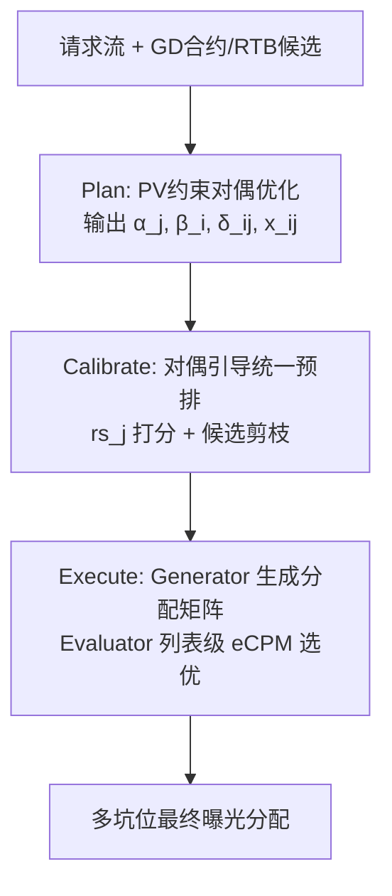
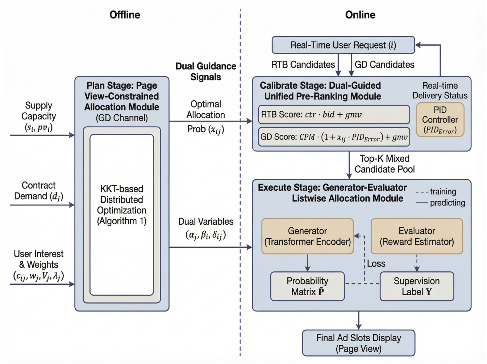

# HMAF: A Hierarchical Multi-Slot GD-RTB Allocation Framework (分层多坑位 GD-RTB 分配框架)

- **会议/期刊**: KDD 2026 (Applied Data Science Track)
- **作者与机构**: Tianxing Bu, Linyou Cai, Shengri Xue, Tan Qu, Qianlong Xie, Xingxing Wang (美团)；Zhaoqi Zhang, Siqiang Luo, Gao Cong (南洋理工大学)；Miao Xie (中国农业大学)
- **推荐链路定位**: 重排（多坑位列表级分配）+ 离线约束规划
- **研究方向**: CTR/CVR 预估与特征交叉 / 多任务学习与列表级重排
- **论文原文**: [https://arxiv.org/abs/2606.09896v1](https://arxiv.org/abs/2606.09896v1)
- **开源代码**: 暂未开源

## TL;DR (1分钟核心速览)

混合广告市场中 GD（保量合约）与 RTB 竞价共享流量，现有方法要么将二者解耦优化、要么依赖启发式优先级规则，在**多坑位 + Page View 曝光约束**下无法兼顾短期 eCPM 收益与长期合约交付。HMAF 提出 Plan–Calibrate–Execute 三层范式：离线求解 PV 约束对偶问题得到影子价格，在线将其注入统一打分与 Transformer 生成-评估列表级重排。在美团 32 天、1.23 亿曝光工业数据上，Group AUC 0.8984、Utility Rate 0.9812 全面领先 LIBRA 等基线；两月线上 A/B 交付率 +3.72%、总收入 +1.59%（p<0.05）。

## Background & Motivation (背景与核心矛盾)

- **主流范式**: GD 分配早期以约束优化做离线供需平衡（SHALE），后续引入 PID 反馈控制调价/调采样率；GD-RTB 联合方向以 CONFLUX（请求级原始-对偶 + 级联蒸馏）与 LIBRA（合约感知信号 + 对抗奖励引导）为代表。
- **前人局限**: ① CONFLUX 面向**单坑位**设计，无法刻画同页多坑位间的跨槽交互与页面级协调；② LIBRA 虽有统一分配，但决策过程**缺乏将离线约束信号动态注入在线排序**的显式机制，且启发式优先级（CF）以牺牲 RTB 收益换取交付。
- **核心洞察 (Key Insight)**: 多坑位分配本质是带 PV 约束的多维背包问题（作者给出 MKP 多项式归约证明其 NP-hard），但**对偶变量恰好把"合约需求紧度、请求容量稀缺、坑位曝光上限"三类全局约束压缩为紧凑控制信号**，可作为在线模型的"全局视野"先验。
- **本文切入点**: 用 Plan（离线对偶）→ Calibrate（对偶引导预排）→ Execute（生成-评估列表重排）把不可解的组合优化降解为可在线毫秒级执行的神经决策。

## Method (核心方法设计)

### 1. 整体框架 (Overall Architecture)

HMAF 位于 GD 与 RTB 两条并行链路的汇合处，构建统一竞争舞台。**Plan 阶段**将 GD 履约建模为带 Page View 约束的凸优化问题，用分布式投影梯度迭代对偶变量 $\alpha_j,\beta_i,\delta_{ij}$，得到闭式分配概率 $x_{ij}$；**Calibrate 阶段**把对偶信号以 $x_{ij}\cdot \text{PIDError}$ 调制项注入 GD 打分，与 RTB 的 $ctr\cdot CPC+gmv$ 同台粗排，剪枝候选空间；**Execute 阶段**用 Transformer 生成候选-坑位分配矩阵，Evaluator 在生成列表与扰动列表集合中按列表级 eCPM 选出最优 $S^\star$ 作为监督标签，联合交叉熵与 eCPM 回归损失训练。

<figure class="paper-figure" markdown="span">
  <figcaption>图2：HMAF 概览。</figcaption>
</figure>

### 2. 关键设计拆解 (Key Designs)

1. **PV 约束对偶分配（Plan）**：痛点是对偶约束只到合约/请求级，无法限制同页多坑位的过度曝光。本文新增坑位级约束 $s_i x_{ij}\le pv_i$，由 KKT 条件导出闭式分配
$$x_{ij}=\max\Big\{0,\ \theta_j\Big(1+\tfrac{w_j+\lambda_j c_{ij}-\alpha_j-\beta_i-\delta_{ij}}{V_j}\Big)\Big\}$$
其中 $\alpha_j$ 为合约需求影子价、$\beta_i$ 为请求容量价、$\delta_{ij}$ 为坑位曝光价。直觉：三类对偶变量把"全局资源稀缺"编码为逐请求可查的标量，在线侧无需重解优化即可感知约束紧度。

2. **对偶引导统一预排（Calibrate）**：GD 打分改为 $rs_j = CPM_j\cdot(1+x_{ij}\cdot \text{PIDError})+gmv_j$，其中 $\text{PIDError}$ 由实时交付率 $dr_j(t)=N_j(t)/B_j(t)$ 相对目标 $dr^*$ 的偏差给出，并以 $\mu_0$ 保底防止开关抖动。与全局统一施压的传统 PID 不同，$x_{ij}$ 提供**上下文级置信度**，使调控压力按请求-合约匹配度差异化分配。

3. **生成-评估列表重排与训练目标（Execute）**：Generator 用 Transformer 编码候选-坑位交互，输出 $\hat p_{ij}=\text{softmax}(x_j^\top p_i)$ 并采样列表；Evaluator 在 $\{S_g,S_1,\dots,S_l\}$ 中选 $S^\star=\arg\max R(S_k)$ 转为二值标签矩阵 $Y$。总损失
$$\mathcal{L}=\psi_1\cdot\big(-\textstyle\sum_{i,j}Y_{ij}\log\hat p_{ij}\big)-\psi_2\cdot\sum_{(i,j)\in\mathcal{O}}(\hat e_{ij}-e_{ij})$$
第二项直接惩罚预测 eCPM 与线上结算值的**带符号偏差**，纠正系统性高/低估。训练无需人工负采样，监督来自 Evaluator 的奖励引导伪标签；在线预排 <5ms/广告、GE 推理 <50ms/页面。

## Experimental Setup & Evaluation Protocol (实验设置与评估协议)

- **数据集与预处理**: 美团生产日志，2026-01-01 至 2026-02-01 连续 32 天：

| 数据集 | #Users | #Items(Ads) | #Interactions | 稀疏度/密度 | 特征/场景说明 |
| :--- | :---: | :---: | :---: | :---: | :--- |
| Meituan Ads | 未披露 | 193,797 | 123,546,485 | GD 占 9.73%，其余 RTB | 多坑位 O2O 内容流，含 PV 约束 |

- **数据划分与防穿越 (Splitting Strategy)**: 前 31 天训练、最后 1 天测试的**全局时间戳切分**，保证评估落在未见流量分布上。
- **排名评测协议 (Ranking Protocol)**: 工业日志回放式评估，指标为 Group AUC（会话内排序）、加权 Delivery Rate、GD Quality（点击履约率）、归一化 RTB eCPM 与 Utility Rate（对 Evaluator 理论最优归一）；非标准全库排序，属业务指标驱动的离线回放。
- **对比基线与超参设置**: 基线含 GD 侧 CF/PID/AUAF 与 GD-RTB 侧 CONFLUX/LIBRA，多坑位适配采用逐坑位贪心分解；Embedding 维度 8、batch 512、lr 3e-4、LazyAdam、$dr^*=0.9$、$\mu_0=0.1$、$\psi_1=1,\psi_2=-0.2$；指标为 10 次独立运行均值±标准差并做显著性检验。

## Key Experimental Results (实验关键数据)

### 1. 主实验对比 (Main Results)

| Type | Model | GA | DR | GQ | RE | UR |
| :--- | :--- | :---: | :---: | :---: | :---: | :---: |
| GD | CF | 0.7203 | **0.9680** | 0.8351 | 0.7333 | 0.8273 |
| GD | PID | 0.7839 | 0.9273 | 0.8604 | 0.7734 | 0.9379 |
| GD | AUAF | 0.8026 | 0.9408 | 0.8948 | 0.8023 | 0.8953 |
| GD-RTB | CONFLUX | 0.8274 | 0.9493 | 0.9264 | 0.8673 | 0.9308 |
| GD-RTB | LIBRA | 0.8538 | 0.9554 | 0.9450 | 0.9132 | 0.9513 |
| GD-RTB | **HMAF** | **0.8984** | 0.9638 | **0.9751** | **1.0000** | **0.9812** |
| — | Improv. vs LIBRA | +5.22% | +0.88% | +3.19% | +9.50% | +3.14% |

### 2. 消融实验 (Ablation Study)

| Model | GA | DR | GQ | RE | UR |
| :--- | :---: | :---: | :---: | :---: | :---: |
| w/o PV | 0.8419 | 0.9458 | 0.9503 | 0.9496 | 0.9647 |
| w/o PR | 0.7943 | 0.9647 | 0.9604 | 0.9672 | 0.9810 |
| w/o GE | 0.8294 | 0.9583 | 0.9382 | 0.9252 | 0.9458 |
| HMAF | **0.8984** | 0.9638 | **0.9751** | **1.0000** | **0.9812** |

### 3. 关键实验发现 (Key Findings)

1. **PV 模块是排序精度的主引擎**：移除后 GA 从 0.8984 跌至 0.8419（-6.3%）、UR 跌至 0.9647，说明坑位级对偶信号缺失会使模型退化为逐槽独立决策，跨槽协调能力瓦解。
2. **GE 模块是收益-交付平衡的关键**：w/o GE 时 RE 从 1.0000 降至 0.9252、GQ 降至 0.9382，证明列表级生成-评估对"把 GD 挤到非优质坑位、释放高价库存给 RTB"的帕累托改进不可替代。
3. **PR 是效率换精度的划算交易**：w/o PR 的 DR/UR 反而略高（0.9647/0.9810），但端到端优化时间从约 2 天压缩到 15 分钟，以边际性能损失换取可规模化部署，是工业落地的必要折衷。

## Highlights, Limitations & Rating (亮点、对比与审稿评价)

- **与代表作对比 (vs. Prior Work)**: CONFLUX 做请求级单坑位原始-对偶 + 级联蒸馏，缺跨槽建模；LIBRA 用对抗奖励引导统一分配，但离线约束与在线决策仍是松耦合；HMAF 的本质差异是把**坑位级 PV 约束的对偶解直接作为在线特征**，并用生成-评估把无标签列表排序转为奖励引导监督。
- **可迁移亮点**: ① "离线对偶影子价 → 在线模型全局状态特征"的注入范式可迁移到任何带预算/配额约束的排序场景（如预算约束推荐、库存约束电商）；② Evaluator 用扰动列表构造伪标签 + 带符号 eCPM 偏差惩罚，可复用于缺乏 ground-truth 排序的列表级重排任务。
- **审稿级局限批判**: ① 评估完全依赖单一平台日志回放与业务指标，缺少公开数据集与标准全库排序协议，GA 之外的指标难以跨系统复现；② 对偶变量依赖每日重规划与 $[City]\times[Category]$ 冷启动均值初始化，新合约密集期或流量突变下的鲁棒性未量化；③ 超参 $dr^*,\mu_0,\psi_1,\psi_2$ 敏感度分析显示存在明显最优窄区间，调参成本高。
- **四维评分**: 创新性 ⭐⭐⭐⭐ | 实验扎实度 ⭐⭐⭐⭐ | 方法清晰度 ⭐⭐⭐⭐ | 落地价值 ⭐⭐⭐⭐⭐

