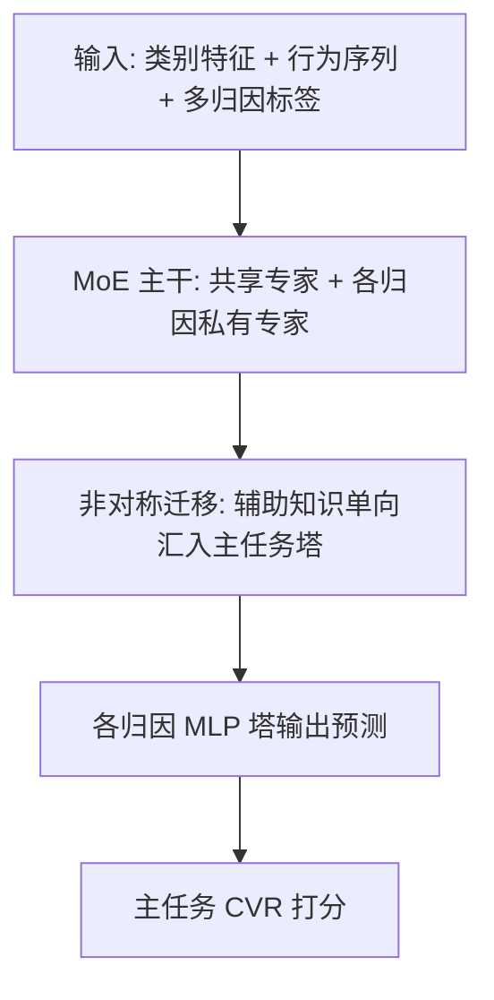

# MAC: A Conversion Rate Prediction Benchmark Featuring Labels Under Multiple Attribution Mechanisms (多归因机制转化率预测基准MAC)

- **会议/期刊**: KDD 2026
- **作者与机构**: Jinqi Wu, Sishuo Chen, Zhangming Chan, Chaoyou Fu 等（南京大学、阿里巴巴淘天集团）
- **推荐链路定位**: 精排（CVR 预估）
- **研究方向**: CTR/CVR 预估与特征交叉 / 多任务学习
- **论文原文**: [https://arxiv.org/abs/2603.02184v2](https://arxiv.org/abs/2603.02184v2)
- **开源代码**: [https://github.com/alimama-tech/PyMAL](https://github.com/alimama-tech/PyMAL)

## TL;DR (1分钟核心速览)

现有公开 CVR 数据集（Criteo/Ali-CCP/Taobao）的转化标签均只由**单一归因机制**生成，导致多归因学习（MAL）这一新范式无法被系统研究。本文发布首个含四种归因机制（Last-Click/First-Click/Linear/DDA）标签的公开基准 **MAC**（79M 点击、0.8M 用户）与开源库 **PyMAL**，并基于系统性实验提炼出三条设计洞见，进而提出 **MoAE**（MoE 主干 + 主任务优先非对称迁移）。在 MAC 全库排序协议下，MoAE 在四种目标归因设置下均超越 SOTA NATAL，GAUC 最高提升 **0.39pt**（Linear 设置）。

## Background & Motivation (背景与核心矛盾)

- **主流范式**: 工业与学术界的 CVR 模型几乎全部在**单归因假设**下训练——转化标签由某一固定归因规则（如 Last-Click）分配，模型只能学到触点价值的片面视角。
- **前人局限**: ① 所有公开 CVR 数据集仅提供单归因标签，MAL 研究被数据瓶颈卡死，NATAL 等方法的增益只能在工业内数据上验证；② 现有 MTL 模型（MMoE/PLE）虽能共享多任务知识，但缺乏"主任务优先"的知识利用机制，而 NATAL 虽主任务优先却丢弃了 MoE 结构，辅助任务性能反而不如 PLE。
- **核心洞察 (Key Insight)**: 作者通过对比实验发现，**MoE 结构（PLE/HoME）能同时提升主任务与辅助任务指标，NATAL 的非对称迁移只提升主任务**——两者优势互补，一个成功的 MAL 模型应同时满足"充分学习多归因知识"与"以主任务为中心充分利用该知识"两条原则。
- **本文切入点**: 先建基准与工具库暴露问题，再从结构设计原则出发，把 MoE 与非对称迁移拼装为 MoAE。

## Method (核心方法设计)

### 1. 整体框架 (Overall Architecture)

MoAE 的输入为点击样本的类别特征（用户/物品/上下文 ID）、行为序列特征（含视觉相似度分数）与多归因标签。底层采用 MoE 主干：一个共享专家学习公共转化模式，每个归因机制分配一个私有专家学习其独有模式，由门控网络动态组合；顶层为**主任务优先的非对称特征迁移模块**，将辅助归因塔的知识单向聚合进主任务预测器，各归因机制再经独立 MLP 塔输出预测。训练时主任务损失与辅助任务损失加权联合优化，推理时仅需主任务塔输出 CVR 分数。

### 2. 关键设计拆解 (Key Designs)

1. **MoE 主干（充分学习多归因知识）**：痛点在于 Shared-Bottom 的共享底层易产生梯度冲突、无法区分归因特异性模式。MoAE 借鉴 PLE 引入共享专家与归因私有专家，门控加权组合：
   $$\mathbf{h} = \sum_{i} g_i(\mathbf{x}) \cdot E_i(\mathbf{x}), \quad g(\mathbf{x}) = \text{Softmax}(W_g \mathbf{x})$$
   直觉：共享专家吸收跨归因的公共转化信号，私有专家隔离各机制的独特监督，从而在提升主任务的同时不牺牲辅助任务。

2. **主任务优先的非对称知识迁移**：痛点在于对称共享会让辅助任务的噪声（尤其 First-Click 的高噪声标签）反向污染主任务。MoAE 仅允许辅助塔特征**单向**汇入主任务预测器（借鉴 NATAL 的 AKA 思想），主任务塔不向辅助塔回传特征。直觉：知识流动方向与业务目标一致——辅助归因只是"养料"，主归因才是"果实"。

3. **训练目标与辅助目标选择**：总损失为主任务 BCE 加辅助任务 BCE 加权和：
   $$\mathcal{L} = \mathcal{L}_{\text{primary}} + \lambda \sum_k \mathcal{L}_{\text{aux}}^{(k)}$$
   其中 $\lambda \in \{0.1,0.2,0.3,0.4\}$ 网格搜索；辅助目标组合通过贪心前向搜索确定，并可选加入笛卡尔积辅助任务（CAT）。推理开销与常规多塔 MTL 相当，仅主任务塔参与线上打分。

## Experimental Setup & Evaluation Protocol (实验设置与评估协议)

- **数据集与预处理**: MAC 采样自淘宝广告系统连续 21 天真实日志，按用户活跃度分层采样（高活用户高采样率），严格匿名化。

| 数据集 | #Clicks | #Items | #Users | 行为序列 | 多模态 | 多归因标签 |
| :--- | :---: | :---: | :---: | :---: | :---: | :---: |
| Criteo | 3.6M | 15.9M | 5.0K | ✗ | ✗ | ✗ |
| Ali-CCP | 3.4M | 4.3M | 0.4M | ✗ | ✗ | ✗ |
| Taobao | 100M | 4.0M | 1.0M | ✗ | ✗ | ✗ |
| **MAC** | **79M** | **15.1M** | **0.8M** | ✓ | ✓ | ✓ |

  四种归因机制的正样本比例差异显著：Last-Click 1.6%、First-Click 1.8%、DDA 4.3%、Linear 5.3%，天然构成不同难度的标签分布。

- **数据划分与防穿越 (Splitting Strategy)**: **全局时间戳切分**——最后一天数据作测试集，此前数据训练；验证集取训练期倒数第二天（用第 T-1 天模型测第 T 天）。
- **排名评测协议 (Ranking Protocol)**: 采用 **Full-Ranking 全库排序**（非采样排序），报告主任务的 AUC 与 GAUC（按用户分组加权 AUC，更贴近线上表现）。
- **对比基线与超参设置**: 基线分三类——单归因 BASE；MTL 类 Shared-Bottom/MMoE/PLE/HoME；MAL 专用 SOTA NATAL。Adam 优化器训练 1 epoch，batch size 4096，学习率在 $\{0.1x, x, 10x \mid x \in \{0.003, 0.0035, 0.004\}\}$ 中搜索，$\lambda$ 在 $\{0.1,0.2,0.3,0.4\}$ 中搜索。

## Key Experimental Results (实验关键数据)

### 1. 主实验对比 (Main Results)

四种目标归因机制下的 CVR 排序性能（GAUC 为主指标，加粗为最优）：

| 目标归因 | Last-Click AUC | Last-Click GAUC | First-Click GAUC | DDA GAUC | Linear GAUC |
| :--- | :---: | :---: | :---: | :---: | :---: |
| BASE | 0.8494 | 0.7424 | 0.6969 | 0.7470 | 0.7602 |
| Shared-Bottom | 0.8628 | 0.7571 | 0.6979 | 0.7575 | 0.7631 |
| MMoE | 0.8642 | 0.7571 | 0.6977 | 0.7555 | 0.7634 |
| PLE | 0.8645 | 0.7583 | 0.6986 | 0.7574 | 0.7638 |
| HoME | 0.8661 | 0.7594 | 0.6985 | 0.7589 | 0.7643 |
| NATAL | 0.8671 | 0.7613 | 0.6990 | 0.7617 | 0.7643 |
| **MoAE (ours)** | **0.8694** | **0.7636** | **0.7003** | **0.7644** | **0.7682** |
| Δ vs BASE | +2.00pt | +2.12pt | +0.34pt | +1.74pt | +0.80pt |
| Δ vs NATAL | +0.23pt | +0.23pt | +0.13pt | +0.27pt | **+0.39pt** |

### 2. 消融实验 (Ablation Study)

以 Last-Click 为目标归因，验证多归因标签（mal）与参数规模解耦：

| 模型变体 | AUC | GAUC | 说明 |
| :--- | :---: | :---: | :--- |
| BASE | 0.8494 | 0.7424 | 单归因基线 |
| PLE | 0.8645 | 0.7583 | 完整 MAL |
| PLE w/o mal | 0.8494 | 0.7424 | 辅助损失置零，参数不变 |
| NATAL | 0.8671 | 0.7613 | 完整 MAL |
| NATAL w/o mal | 0.8527 | 0.7437 | 辅助损失置零 |
| **MoAE** | **0.8694** | **0.7636** | 完整 MAL |
| MoAE w/o mal | 0.8521 | 0.7429 | 辅助损失置零 |

辅助目标组合消融（Last-Click 为目标）：无辅助 0.7429 → 仅 First-Click 0.7572 → 仅 Linear 0.7583 → 三辅助 0.7612 → 三辅助+CAT **0.7636**（GAUC 单调递增）。

### 3. 关键实验发现 (Key Findings)

1. **MAL 增益来自多归因监督信号而非参数规模**：将辅助损失置零后，所有 MAL 模型（含 MoAE）的 GAUC 几乎回落到 BASE 水平（MoAE w/o mal 仅 0.7429 vs. BASE 0.7424），证明 +2.12pt 的提升源于多归因知识而非额外参数。
2. **增益随转化路径复杂度单调放大**：按"Linear 正样本数 / Last-Click 正样本数"划分用户路径复杂度，Last-Click/DDA/Linear 三种设置下 ΔAUC 均随路径变长而上升（Last-Click 下 ≥7 触点组 ΔAUC 约为 1 触点组的数倍），说明多触点用户才是 MAL 的核心受益群体。
3. **辅助目标选择是任务相关的，First-Click 设置下"加任务反而掉点"**：First-Click 为目标时，仅 Last-Click 辅助有效（GAUC 0.6971→0.7003），而 DDA（0.6932）、Linear（0.6886）及三辅助组合（0.6898）均低于无辅助基线——因 First-Click 标签本身噪声大（与转化时间间隔长、混淆因素多），需选择时间上最接近转化、信号差异最大的 Last-Click 作为互补视角。

## Highlights, Limitations & Rating (亮点、对比与审稿评价)

- **与代表作对比 (vs. Prior Work)**: 与 NATAL 的本质区别在于——NATAL 用非对称迁移换取主任务优先但丢弃 MoE，辅助任务 GAUC 落后 PLE/HoME；MoAE 首次将 MoE 主干与非对称迁移**串联**，同时拿下主任务与辅助任务双料最优（Last-Click 下辅助 GAUC 0.6877/0.7637/0.7668 全面领先）。与 MMoE/PLE 的区别在于知识利用方向被显式约束为主任务单向汇聚。
- **可迁移亮点**: ① "辅助损失置零"这一解耦实验设计，可低成本验证任何多任务增益究竟来自信息还是参数；② 按转化路径复杂度分桶分析增益来源，可直接迁移到多触点归因与长决策链路场景的模型诊断。
- **审稿级局限批判**: ① 数据仅来自淘宝单一平台、21 天窗口，跨平台/跨品类的泛化性未验证，且 DDA 标签依赖 CausalMTA 模型，存在标签生成器偏差；② MoAE 相对 NATAL 的增益幅度较小（0.13–0.39pt），且 GCS/PCGrad 等 ATL 技巧在强模型上反而掉点（MoAE+GCS GAUC -0.32pt），说明架构红利可能已接近该数据上的天花板，方法新颖度偏"组合式创新"。
- **四维评分**: 创新性 ⭐⭐⭐ | 实验扎实度 ⭐⭐⭐⭐⭐ | 方法清晰度 ⭐⭐⭐⭐⭐ | 落地价值 ⭐⭐⭐⭐

