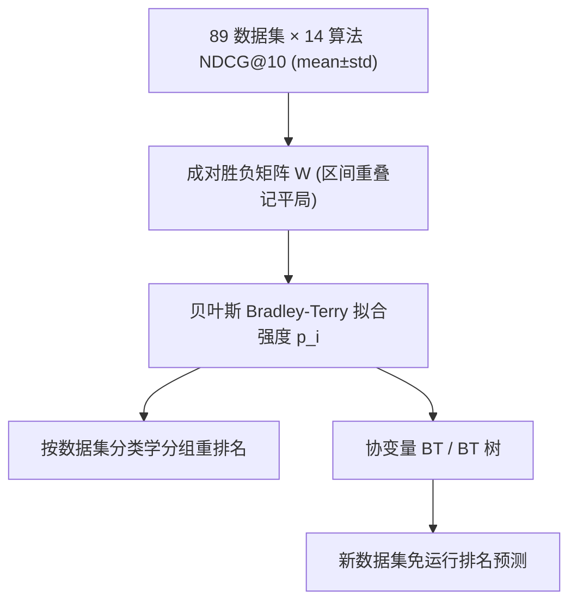

# Bradley-Terry Rankings for Recommender Systems Across Dataset Taxonomies (跨数据集分类学的推荐系统 Bradley-Terry 排名)

- **会议/期刊**: KDD 2026
- **作者与机构**: Ekaterina Grishina, Stepan Kuznetsov, Askar Tsyganov 等（HSE University 为主）
- **推荐链路定位**: 评测基准 / 算法选型（非单一链路阶段，服务于召回—精排全链路的 baseline 选择）
- **研究方向**: 去偏公平与工业架构 / 多任务学习与列表级重排（排序聚合）
- **论文原文**: [https://arxiv.org/abs/2606.07492v1](https://arxiv.org/abs/2606.07492v1)
- **开源代码**: [https://github.com/fallnlove/btl_recsys](https://github.com/fallnlove/btl_recsys)

## TL;DR (1分钟核心速览)

推荐算法选型长期依赖"跨数据集指标均值/求和"聚合，但该做法对缺失结果极不稳定、且忽略对手强弱，易给出误导性排名。本文把 14 个推荐算法在 89 个 5-core 数据集上的 NDCG@10 结果转化为成对胜负表，用 Bradley-Terry（BT）及其协变量/树扩展做概率排序，并提出"传递三元组比例"衡量排名一致性。在全局时间戳切分 + 10 seed 平均协议下，BT 的传递三元组比例达 0.631（Mean 仅 0.613），缺失比较比例升至 80% 时 BT 排名几乎不变而 Mean/Sum 急剧崩塌；协变量 BT 在留出数据集上 top-1 命中 0.28（Mean 仅 0.02）。

## Background & Motivation (背景与核心矛盾)

- **主流范式**: 学术界与工业界普遍用"多数据集指标均值/求和"或频繁主义显著性检验来横向比较推荐算法，并据此选 baseline。
- **前人局限**: 其一，均值聚合把每个数据集上的一次胜负视为等权，忽略"击败的是强模型还是弱模型"，导致 BPR 在 Sum 排名中比 BT 低 4 位、EASEr 在非序列集上被高估 3 位；其二，当部分算法在某些数据集上结果缺失（算力受限常见）时，Kendall's $\tau$ 必须先剔除该算法再算相关，无法刻画排名对缺失数据的鲁棒性。
- **核心洞察 (Key Insight)**: 算法比较本质是一个"锦标赛"——同一算法在序列/非序列、稠密/稀疏数据上的相对强弱差异巨大（SASRec 在序列集排第 1，在非序列集跌至第 10），因此排名应是数据集条件的概率量，而非单一标量均值。
- **本文切入点**: 将 BT 概率排序引入 RecSys 基准评测，用成对胜负建模对手强弱，并用协变量 BT / BT 树实现"不跑模型即可预测新数据集上的算法排名"。

## Method (核心方法设计)

### 1. 整体框架 (Overall Architecture)

流程为：先在 89 个数据集上跑 14 个算法得到 NDCG@10 的 $\text{mean}\pm\text{std}$区间；将"算法$i$在数据集$d$上指标高于$j$"记为一胜，累计成胜负矩阵$W$（区间重叠则双方各加 0.5 记为平局）；用贝叶斯 BT 拟合各算法强度$p_i$ 并给出置信区间；再按数据集统计特征（密度、用户-物品比、平均交互数、序列性）分组重拟合，得到分类学排名；最后用协变量 BT 与 BT 树把数据集特征作为协变量，预测留出数据集上的排名。

### 2. 关键设计拆解 (Key Designs)

1. **贝叶斯 BT 胜负建模（把"赢谁"计入强度）**：痛点在于均值聚合无法区分击败强/弱对手。BT 令 $\Pr(i\succ j)=\frac{p_i}{p_i+p_j}$，等价于$\Pr(i\succ j)=\sigma(\beta_i-\beta_j)$，其中$\beta_i=\ln p_i$；贝叶斯版本设$W_{ij}\sim\text{Binomial}\left(N_{ij},\frac{e^{\beta_i}}{e^{\beta_i}+e^{\beta_j}}\right)$，$\beta_i\sim\text{Normal}(0,\bar{\sigma})$，用 Metropolis-Hastings 采样得到$\beta_i$ 后验均值与置信区间。直觉：一个算法击败 SASRec 所获得的"信誉"远高于击败 Random，这正是均值聚合丢失的信息。

2. **传递三元组比例（缺失数据下的排名一致性度量）**：Kendall's $\tau$在缺失时必须剔除算法、无法衡量鲁棒性。作者定义三元组$i_{d1}\succ i_{d2}\succ i_{d3}$在数据集$d$ 上传递当且仅当三者两两胜负一致，指标为
$$\text{Triplet ratio}=\frac{1}{\binom{n}{3}\cdot D-\text{missing}}\sum_{d=1}^{D}\sum_{i_{d1}\neq i_{d2}\neq i_{d3}}\mathbb{I}\{i_{d1}\succ i_{d2}\succ i_{d3}\}.$$
分母随缺失比较数自适应缩减，因此可直接比较不同缺失率下的排名质量；平局用 $\succeq$ 处理。

3. **协变量 BT 与 BT 树（免运行预测新数据集排名）**：标准 BT 只能给全局排名。协变量 BT 令 $\Pr(i\succ j\mid x)=\sigma(\beta_{i0}-\beta_{j0}+\langle x,\beta_i\rangle-\langle x,\beta_j\rangle)$，$x$为对数归一化的数据集统计量，并加融合正则$L(\mathcal{B})=\lambda_0\sum_{i<j}\sqrt{(\beta_{i0}-\beta_{j0})^2+\varepsilon}+\lambda_1\sum_{k=1}^{d}\sum_{i<j}\sqrt{(\beta_{ik}-\beta_{jk})^2+\varepsilon}$抑制过拟合到全局排名，用 L-BFGS-B 在$\sum_i\beta_{ij}=0$子空间优化。BT 树则递归按协变量切分数据集，叶节点给出该子群内的独立排名，预测时仅需沿树遍历、零算力开销。训练目标即上述带罚对数似然$\ell(\mathcal{B})-L(\mathcal{B})$ 最大化；无负采样概念（比较对象是算法而非物品），推理成本为一次树遍历或一次线性打分。

## Experimental Setup & Evaluation Protocol (实验设置与评估协议)

- **数据集与预处理**: 主体来自 APS benchmark，补充少量额外数据集，统一 `5-core` 过滤，共 89 个数据集；按密度、用户-物品比、平均每用户交互数、序列性（基于 2-gram 统计）四维分组，对比时取每维最高/最低的 top-20 数据集。

| 数据集集合 | #Users | #Items | #Interactions | 稀疏度/密度 | 特征/场景说明 |
| :--- | :---: | :---: | :---: | :---: | :--- |
| APS + 补充（89 个） | 各数据集差异极大（见原文 Table 10） | 同左 | 同左 | 覆盖稠密至极端稀疏 | 含序列/非序列、长/短历史、大/小用户-物品比 |

- **数据划分与防穿越 (Splitting Strategy)**: 全局时间戳切分（GTS），按全局时间戳 90/5/5 划分训练/验证/测试；无时间戳数据集随机赋时间戳以适配协议。验证用 last-item 策略，测试用 random-item 目标。
- **排名评测协议 (Ranking Protocol)**: 指标为 NDCG@10，10 个随机种子取平均得到 $\text{mean}\pm\text{std}$区间用于判定平局；排名质量用传递三元组比例与 Kendall's$\tau$ 双重度量。
- **对比基线与超参设置**: 14 个算法覆盖非个性化（Random、PopRandom）、邻域（User-KNN、Item-KNN、Seq-KNN）、矩阵分解/线性（ALS、BPR、SGD MF、PureSVD、EASEr）、图模型（LightGCN、UltraGCN）、序列模型（SASRec、GASATF）。超参用 Optuna TPE 调优，统一搜索空间、200 trials（20 startup），以验证集 NDCG@10 为目标；调优后合并训练+验证重训再测。

## Key Experimental Results (实验关键数据)

### 1. 主实验对比 (Main Results)

排名质量（NDCG@10，全数据集，含平局处理）：

| 方法 | 传递三元组比例 ↑ | Kendall's $\tau$ ↑ | 说明 |
| :--- | :---: | :---: | :--- |
| Mean 聚合 | 0.613 | 0.542 | 常规均值排名 |
| Sum 聚合 | 0.613 | 0.541 | 常规求和排名 |
| **BT（本文）** | **0.631** | **0.564** | 全数据集最优 |
| Plackett-Luce | 0.631 | 0.558 | 列表级扩展，与 BT 接近 |

在长历史子集上 BT 传递比例 0.588（Mean 0.556），稀疏子集 0.624（Mean 0.615），均领先。全局 BT 排名前五为 Seq-KNN、LightGCN、SASRec、GASATF、EASEr；而 Sum 把 BPR 排到第 10（BT 第 6），Mean 把 EASEr 排到第 1（BT 第 5）。

留出数据集排名预测（Train 79 / Holdout 10）：

| 模型 | top-1 hits ↑ | top-3 hits ↑ | top-2 overlap ↑ | top-5 overlap ↑ |
| :--- | :---: | :---: | :---: | :---: |
| Mean | 0.02 | 0.16 | 0.62 | 3.32 |
| BT | 0.24 | 0.78 | 0.86 | 3.32 |
| **Cov. BT** | **0.28** | **0.78** | **0.96** | 3.28 |
| BT tree | 0.26 | 0.64 | 0.86 | 2.88 |

### 2. 消融实验 (Ablation Study)

| 配置 | 传递三元组比例 | Kendall's $\tau$ | 结论 |
| :--- | :---: | :---: | :--- |
| BT w/o ties | 0.510 | 0.567 | 基线 |
| BT w/ ties | **0.631** | 0.564 | 平局处理显著提升一致性 |
| 缺失 80% 比较：Mean/Sum | 急剧下降 | — | 聚合方法脆弱 |
| 缺失 80% 比较：BT/PL | 近乎不变 | — | 鲁棒 |
| 时间戳打乱后 BT 权重 | 明显下降 | — | 序列优势被正确抹除 |
| Cov. BT（Train 59/Holdout 30） | top-1 0.24 | — | 数据变少时仍优于 BT 的 0.15 |

### 3. 关键实验发现 (Key Findings)

1. **排名强烈依赖数据集分类学**：SASRec/GASATF 在序列集排第 1/2，在非序列集跌至第 10/11；ALS 在非序列集从第 11 升至第 2；LightGCN 在短历史集登顶而 GASATF 跌至第 5——不存在"通吃"算法，选 baseline 必须看数据特征。
2. **BT 对缺失数据近乎免疫**：缺失比较比例从 0 升到 80% 时，Mean/Sum 的传递三元组比例快速下滑，BT/PL 几乎持平；这直接支撑了"算力受限时只跑部分算法-数据集组合"的工程实践。
3. **协变量模型在数据稀缺时优势放大**：Holdout 从 10 增至 30（训练集从 79 减至 59）时，BT 的 top-1 命中从 0.24 掉到 0.15，而 Cov. BT 仅从 0.28 降到 0.24；但若目标只是"挑出强 baseline"，全局 BT 的 top-5 overlap 3.32 已与 Cov. BT 的 3.28 持平，说明简单 BT 足够实用。

## Highlights & Limitations (亮点、对比与审稿批判)

- **与代表作对比 (vs. Prior Work)**: 相比传统均值/求和聚合与频繁主义检验，BT 显式建模对手强弱并给出置信区间；相比 AutoML 领域的 BT-tree 应用，本文首次把 BT 及其协变量扩展系统迁移到 RecSys 基准，并新增传递三元组这一缺失鲁棒性度量；相比 Plackett-Luce，BT 在长历史数据上更稳定（PL 会把 SASRec 从第 4 挪到第 6）。
- **可迁移亮点**: ①"传递三元组比例"可直接用于任何排行榜/评测榜单的一致性审计；②协变量 BT 的融合正则（对强度差与协变量效应差同时施加 group-lasso 式惩罚）可迁移到多场景模型选型与 AutoML 场景。
- **审稿级局限批判**: ①平局仅用"区间重叠加 0.5"的启发式处理，未引入显式 tie 参数或强度差幅度建模，对指标方差估计敏感；②协变量仅用数据集统计量，未纳入算法侧特征（如参数量、训练成本），且 89 个数据集中序列/非序列分布不均，BT 树在非序列分支的叶节点样本量偏小，预测方差可能被低估。

## Rating (四维评分)

- **方法创新性 (Novelty)**: ⭐⭐⭐ （BT 本身是经典模型，创新在于迁移到 RecSys 基准 + 传递三元组度量 + 协变量/树扩展的组合，理论深度有限但问题切中要害）
- **评估协议与实验扎实度 (Protocol & Experiments)**: ⭐⭐⭐⭐⭐ （14 算法×89 数据集、GTS 切分、10 seed 平均、Optuna 统一调参、缺失率与时间戳打乱双重压力测试，规模与严谨度在评测类工作中属上乘）
- **写作与数学规范度 (Clarity & Rigor)**: ⭐⭐⭐⭐ （BT/PL/协变量 BT 的公式与优化流程交代清楚，但部分符号（如 $N_{ij}$与$W_{ij}$ 的关系）散落多处，附录依赖较重）
- **工业落地与复现价值 (Industrial & Practical Value)**: ⭐⭐⭐⭐⭐ （开源 14 算法实现 + 89 数据集预处理 + 完整聚合分析框架，且"缺失数据下排名稳定"直接对应工业界算力受限的选型场景，落地价值高）

