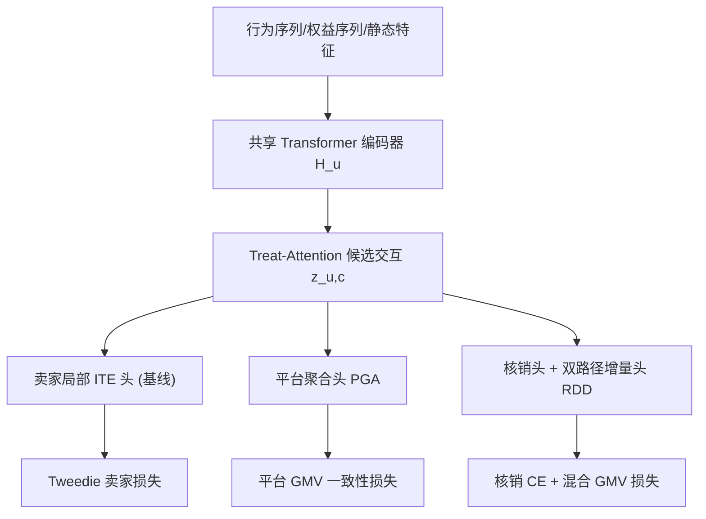
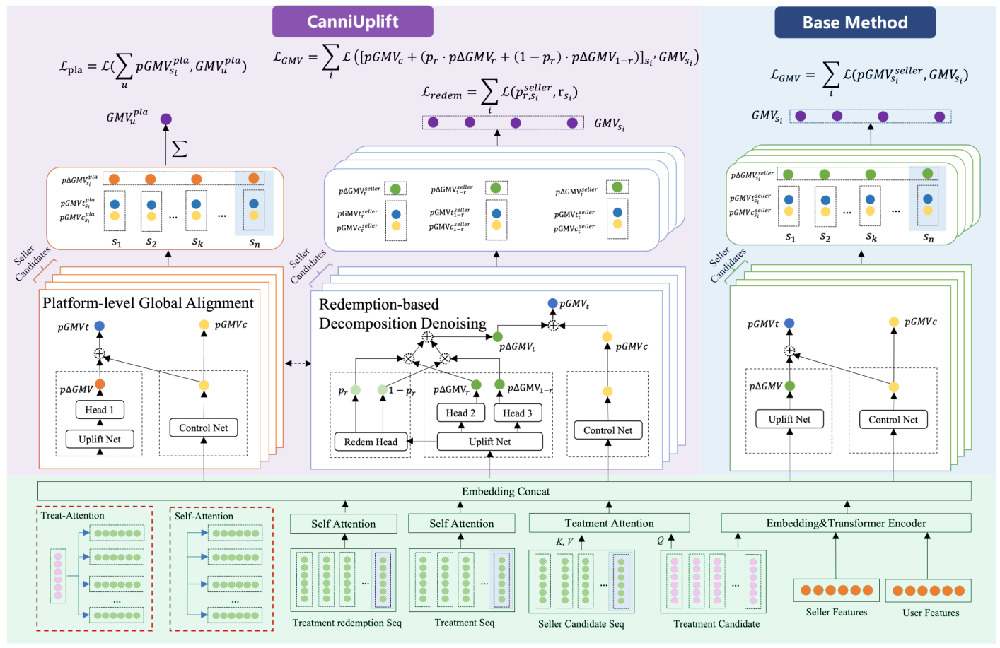

# CanniUplift: A Holistic Framework for Mitigating Seller and Incentive Cannibalization in E-commerce Uplift Modeling (多卖家电商增益建模中缓解卖家与激励双重蚕食的统一框架)

- **会议/期刊**: KDD 2026 (Accepted, 12 pages, 4 figures)
- **作者与机构**: Zuwang He, Shihao Shu, Yuli Qu 等，阿里巴巴淘天集团 (Taobao & Tmall Group of Alibaba)
- **推荐链路定位**: 精排（营销权益分配 / ITE 增益预估）
- **研究方向**: 去偏公平与工业架构 / CTR 预估与特征交叉
- **论文原文**: [https://arxiv.org/abs/2607.05242v1](https://arxiv.org/abs/2607.05242v1)
- **开源代码**: 暂未开源

## TL;DR (1分钟核心速览)

多卖家电商中，传统 uplift 模型默认 SUTVA 成立，导致两类系统性偏差：卖家级蚕食（券把用户预算从高价店搬到低价店，平台 GMV 不增反降）与激励级蚕食（用户未核销测试券却仍转化，把自然需求误记为增量）。CanniUplift 用平台级全局对齐（PGA）约束跨店替代、用核销分解去噪（RDD）拆分核销/非核销路径，并配 Treat-Attention 建模用户-候选交互。在工业与合成数据集上 wAUUC/wQINI 全面领先，线上 A/B 平台 ΔGMV 相对提升 4.08%、ROI 提升 6.69%。

## Background & Motivation (背景与核心矛盾)

- **主流范式**: 以 DragonNet、EUEN、TARNet 为代表的多头/解耦网络，对每个候选卖家独立预测处理组与控制组 GMV，取差值作为 ITE，训练目标为卖家级 GMV 拟合。
- **前人局限**: 其一，卖家级目标只优化局部增量，无法感知跨店替代——某店"涨"可能只是另一店"跌"，平台总盘子未增；其二，处理组结果被当作同质增量，但工业日志中约 25% 的"发券且转化"最终未核销，这部分是自然需求或并发高额券驱动的伪增量。
- **核心洞察 (Key Insight)**: 作者把 SUTVA 违背拆成可建模的两项：平台净增量 = 局部表观增量 + 跨店交叉效应（负即蚕食）；同时用后处理变量核销 $r$ 对处理组结果做全期望分解，把归因噪声显式剥离。
- **本文切入点**: 不改动主干表征，只在 EUEN 式基线上加"全局一致性约束 + 核销路径分解"两个任务头，把局部增量学习升级为"去噪 + 全局对齐"。

## Method (核心方法设计)

### 1. 整体框架 (Overall Architecture)

共享多源序列编码器（行为序列、权益序列、静态特征经 Transformer 编码得 $H_u$）为底座；Treat-Attention 以候选（店铺+券属性）为 Query、序列表示为 Key/Value，产出候选级交互向量$z_{u,c}$；该向量分三路：卖家视角局部 ITE 头（基线）、平台视角聚合头（PGA）、核销概率与双路径增量头（RDD）。训练时三路损失联合优化，推理时仅需单卖家预测即可聚合出平台级增益。

<figure class="paper-figure" markdown="span">
  <figcaption>图 2：CanniUplift 框架的架构。该模型由三个核心组件构成：（左）平台级全局对齐（PGA）模块，施加全局 GMV 一致性约束以捕捉跨店铺替代效应。（中）基于核销的分解去噪（RDD）模块，利用核销行为将处理组结果分解为核销与非核销路径，降低激励层面的归因噪声。（右）卖家视角局部增益模块，提供基线 ITE 估计。所有模块均由共享的多……</figcaption>
</figure>

### 2. 关键设计拆解 (Key Designs)

1. **平台级全局对齐 PGA（捕捉跨店替代）**：痛点是对各店独立监督时，多店同时"高增益"会系统性高估平台盘子。做法是加平台头对候选卖家预测求和并与用户真实平台 GMV 对齐：$p\text{GMV}^{pla}_u=\sum_{s_i\in S_u} p\text{GMV}^{pla}_{u,s_i}$，$\mathcal{L}_{pla}=\sum_u \text{Tweedie}(GMV^{pla}_u, p\text{GMV}^{pla}_u)$。直觉：若某店增益实为别店损失，聚合值不会膨胀，约束会反向压制这类虚假增益，从而在无需显式建模所有卖家对的情况下隐式学到替代关系。

2. **核销分解去噪 RDD（剥离激励级噪声）**：痛点是把 $t=1$的全部转化当增量，混淆了"核销转化"与"未核销转化"。做法是按全期望公式把卖家 GMV 预测写成核销加权混合：$\hat{GMV}_{u,s_i}=p^{s_i}_{c}+p^{s_i}_{r}\cdot p^{\Delta GMV}_{s_i,r}+(1-p^{s_i}_{r})\cdot p^{\Delta GMV}_{s_i,1-r}$，其中$p^{s_i}_{r}=p(r=1\mid z_{u,s_i})$ 由核销头预测。直觉：两条路径各有独立增量头，未核销转化不再被迫与核销转化共享同一 uplift 模式，过归因被结构性抑制；与"仅加辅助核销预测任务"（+Redem）的本质区别正在于此。

3. **训练目标、负采样与推理效率**：总损失 $\mathcal{L}_{total}=\mathcal{L}_{seller}+\lambda_{pla}\mathcal{L}_{pla}+\lambda_{redem}\mathcal{L}_{redem}$，GMV 类输出统一用 Tweedie 损失（$1<p<2$，天然适配零膨胀+长尾），核销头用交叉熵，$\lambda$ 默认取 1。该任务为因果增益预估而非召回检索，不涉及负采样；推理只需单卖家前向，平台级增益由候选聚合得到，线上开销与基线同量级。

## Experimental Setup & Evaluation Protocol (实验设置与评估协议)

- **数据集与预处理**: 工业数据集来自大规模电商线上日志（含多档券面额，故用加权指标）；合成数据集注入"同品类卖家曝光数越多、增益衰减越强"的衰减机制模拟卖家级蚕食。原文未给出用户/物品规模统计表，仅披露两项关键统计：基线模型聚合 ITE 后高估真实线上效应约 **35%**；发券且转化样本中约 **25%** 未完成核销。

- **数据划分与防穿越 (Splitting Strategy)**: 工业数据按线上观测窗口构造处理/对照组日志，合成数据按标准训练/验证/测试比例划分；早停依据验证集指标（连续 5 轮不升即停），避免用测试期信息调参。

- **排名评测协议 (Ranking Protocol)**: 采用 uplift 领域标准的**全样本排序曲线**评估——按预测增益降序取前 $\phi$ 比例人群，计算 Uplift 曲线下面积 AUUC 与 QINI 系数；工业集因多档处理值，先将连续处理值分箱、逐箱计算再按样本量加权得 wAUUC/wQINI。同时报告**卖家级**（用户-卖家候选对排序）与**用户级**（先聚合到用户再排序）两种粒度，后者直接对应平台级增量潜力。

- **对比基线与超参设置**: 基线含 DragonNet、CFRNet、TARNet、TLearner、EUEN、X-net、M3TN、UMLC、HUM 共 9 个；EUEN 为最强基线并作为本文增量模块的挂载底座。Optuna 调参 40 次/实验，batch size 4096，L2 系数 $1\times10^{-4}$，学习率$\{5\times10^{-4},1\times10^{-4},5\times10^{-5}\}$，隐层维度$\{128,256,512\}$，最多 30 epoch。

## Key Experimental Results (实验关键数据)

### 1. 主实验对比 (Main Results)

| 模型 | 工业 Seller AUUC | 工业 Seller QINI | 工业 User AUUC | 工业 User QINI | 合成 Seller AUUC | 合成 Seller QINI | 合成 User AUUC | 合成 User QINI |
| :--- | :---: | :---: | :---: | :---: | :---: | :---: | :---: | :---: |
| DragonNet | 0.650 | 0.248 | 0.705 | 0.238 | 1.0475 | 0.5432 | 0.9438 | 0.4430 |
| CFRNet | 0.694 | 0.261 | 0.748 | 0.276 | 1.0084 | 0.4966 | 0.9960 | 0.4839 |
| TARNet | 0.729 | 0.284 | 0.771 | 0.294 | 1.0074 | 0.5030 | 1.1052 | 0.5972 |
| TLearner | 0.730 | 0.289 | 0.782 | 0.301 | 0.8308 | 0.3305 | 0.9548 | 0.4512 |
| EUEN | 0.744 | 0.297 | 0.794 | 0.319 | 1.0940 | 0.5837 | 1.1245 | 0.6024 |
| M3TN | 0.709 | 0.281 | 0.775 | 0.313 | 1.1382 | 0.6273 | 0.9714 | 0.4591 |
| HUM | 0.701 | 0.266 | 0.759 | 0.289 | 0.9714 | 0.4728 | 0.9612 | 0.4613 |
| **Ours** | **0.769** | **0.314** | **0.849** | **0.348** | **1.1596** | **0.6380** | **1.1474** | **0.6237** |
| Improv. vs EUEN | +3.4% | +5.7% | +6.9% | +9.1% | +6.0% | +9.3% | +2.0% | +3.5% |

### 2. 消融实验 (Ablation Study)

| 指标 | Baseline (EUEN) | +PGA | +Redem | +RDD | Ours (PGA+RDD) |
| :--- | :---: | :---: | :---: | :---: | :---: |
| Seller AUUC | 0.744 | 0.751 | 0.749 | 0.757 | **0.769** |
| Seller QINI | 0.297 | 0.302 | 0.299 | 0.308 | **0.314** |
| User AUUC | 0.794 | 0.826 | 0.803 | 0.818 | **0.849** |
| User QINI | 0.319 | 0.337 | 0.326 | 0.332 | **0.348** |

### 3. 关键实验发现 (Key Findings)

1. **PGA 的收益集中在用户级指标**：单加 PGA 使 User AUUC 从 0.794 升至 0.826（+4.0%），远大于 Seller AUUC 的 +0.9%，说明平台一致性约束真正改善的是"按平台整体增量潜力给用户排序"的能力，而非单店排序精度——这正是缓解卖家级蚕食的直接证据。
2. **RDD 的增益来自结构而非标签**：在同样使用核销标签监督的前提下，+Redem 仅把 Seller QINI 提到 0.299，而 +RDD 达 0.308，证明"双路径分解"本身贡献了主要收益；且 RDD 在 QINI（累计净增益）上的相对增益大于 AUUC（排序质量），符合其抑制过归因的作用机理。
3. **去噪幅度可量化**：按核销行为分段后，未核销组（$r=0$）基线预测增益 3.435、本文 3.192，基线高估约 7.6%；核销组（$r=1$）两模型预测一致。这直接定位了噪声来源，也解释了为何工业集上基线聚合 ITE 会高估线上真实效应约 35%。线上 A/B（2025-10-05 至 10-12）营销成本降 2.45%、平台 ΔGMV 升 4.08%、ROI 升 6.69%。

## Highlights & Limitations (亮点、对比与审稿批判)

- **与代表作对比 (vs. Prior Work)**: 与 DragonNet/CFRNet/TARNet 相比，本文不依赖 SUTVA，也不靠 IPM 平衡分布，而是用聚合一致性约束直接对齐平台目标；与 EUEN 相比，本文保留其解耦控制网络的优势，但把"卖家独立增量"升级为"平台净增量 + 核销路径分解"；与 M3TN/UMLC 等多任务/多处理 uplift 相比，本文首次把"核销"作为后处理变量嵌入主结果路径，而非仅作辅助任务。

- **可迁移亮点**: ①"聚合一致性约束"可迁移到任何存在跨单元替代的多目标场景（如多业务场景联合预估、跨域推荐中的负迁移抑制）；②用后处理行为变量做全期望路径分解，可推广到延迟反馈 CVR、退货/退款等"观测结果混合"的归因去噪问题。

- **审稿级局限批判**: ①未建模时间维蚕食——促销把未来购买前移，短期增益虚高而长期收入受损，作者亦在 Limitation 中承认；②依赖历史行为估计替代关系，对实时替代模式存在滞后；③合成数据仅模拟卖家级蚕食，RDD 的有效性主要靠工业数据消融支撑，缺乏可控真值的因果验证；④平台头需对候选卖家求和，候选集规模增大时训练开销与聚合偏差值得进一步讨论。

## Rating (四维评分)

- **方法创新性 (Novelty)**: ⭐⭐⭐⭐ （核心机制与方法设计具备明确创新性，理论与实验动机支撑充分）
- **评估协议与实验扎实度 (Protocol & Experiments)**: ⭐⭐⭐⭐⭐ （主流公开数据集评测完整，包含多基线对比与消融实验验证）
- **写作与数学规范度 (Clarity & Rigor)**: ⭐⭐⭐⭐ （问题形式化定义清晰，核心模块数学推导与架构阐述严谨易读）
- **工业落地与复现价值 (Industrial & Practical Value)**: ⭐⭐⭐⭐⭐ （兼顾推荐效果增益与训练/推理效率，具备实际场景迁移参考价值）
