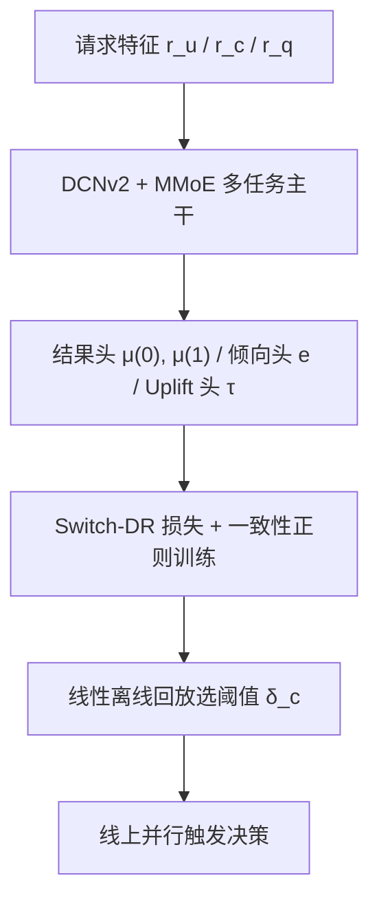
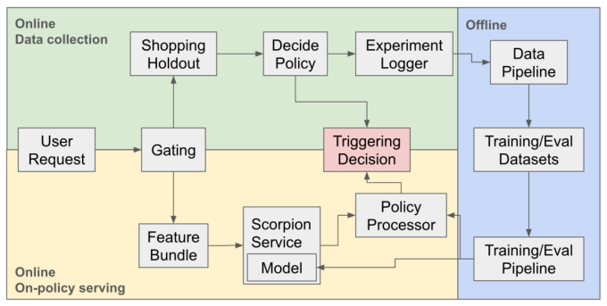

# Deep-learning Causal Retrieval Optimization for Efficient e-commerce Distribution in Pinterest (Pinterest 电商分发的高效深度因果召回优化)

- **会议/期刊**: KDD 2026
- **作者与机构**: Junpeng Hou, XianXing Zhang, Sai Xiao 等，Pinterest, Inc.
- **推荐链路定位**: 召回（早期召回阶段的候选生成器触发门控）
- **研究方向**: 去偏公平与工业架构 / 强化学习与动态探索推荐
- **论文原文**: [https://arxiv.org/abs/2607.14161v2](https://arxiv.org/abs/2607.14161v2)
- **开源代码**: 暂未开源

## TL;DR (1分钟核心速览)

Pinterest 的购物内容"何时触发"长期靠静态规则，均匀曝光虽提升购物行为却压低非购物互动。本文把早期召回的购物候选生成器（CG）触发建模为**因果决策**：用多任务深度模型联合预测多事件结果与 uplift，以 Switch-DR 伪结果 + 结果头一致性正则训练；配合 50/50 随机 Shopping Holdout 与 $O(n)$ 线性离线回放选阈值。线上在购物会话持平前提下将触发率削减最高 85%，总会话 +0.26%、Pin 收藏 +1.10%，并节省大量基础设施成本。

## Background & Motivation (背景与核心矛盾)

- **主流范式**: 早期召回通常对所有请求无条件触发全部候选生成器，或依赖人工静态规则/相关性打分门控；近期工业界开始用因果 uplift 模型处理推送与触发决策（Meta 通知、YouTube Online Matching 等）。
- **前人局限**: ① 静态规则无法刻画"购物内容对谁有益"的异质性，日志显示均匀触发使购物 repin/long-click 提升约 30%，却让整体 repin 下降 2.65%；② 纯相关性模型只学 $p(m|y,r)$，无法区分"触发带来的增量"与"用户本来就会发生的自然行为"，且早期召回阶段下游排序/混排的系统性效应使离线 A/B 估计严重失真。
- **核心洞察 (Key Insight)**: 触发决策本质是**请求级二值干预**，可在召回前完成，天然缓解请求间干扰；只要在随机 Holdout 上获得 50/50 反事实覆盖，就能用回放把"阈值—指标"曲线在离线精确插值出来。
- **本文切入点**: 把"何时触发"从规则问题转为可学习、可审计、可部署的因果策略优化，并显式**解耦模型学习与策略选择**（模型学信号，回放选阈值）。

## Method (核心方法设计)

### 1. 整体框架 (Overall Architecture)

请求 $r=(r_u,r_c,r_q)$进入轻量多任务网络（DCNv2 特征交叉 + MMoE 12 专家，约 170M 参数），对每个业务指标$m_h$输出结果头$\mu^{(0)},\mu^{(1)}$、倾向头$e$与 uplift 头$\tau$；训练用随机 Holdout 日志上的 DR 损失；上线时模型与远程召回 RPC 并行调用（峰值 100k QPS），按离线回放选出的阈值$\delta_c$ 决定是否触发购物 CG。

<figure class="paper-figure" markdown="span">
  <figcaption>图1：整个系统的概览，包括服务、日志记录和模型训练/评估。</figcaption>
</figure>

### 2. 关键设计拆解 (Key Designs)

1. **Switch-DR 提升学习（把因果估计塞进多任务网络）**：痛点在于直接对 uplift 做回归方差极大，稀疏区域连符号都不可靠。本文在结果头 BCE 损失之外，加入 DR 伪结果回归：
$$\psi_i=\mu_i^{(1)}-\mu_i^{(0)}+\frac{y_i r_{1,i}}{e_i}-\frac{(1-y_i)r_{0,i}}{1-e_i},\quad \mathcal{L}_{DR}=\frac{1}{N}\sum_i \omega_i^{DR}(\tau_i-\psi_i)^2$$
其中 $\omega_i^{DR}=\mathbb{I}(|\cdot|\le\lambda_{SW})$做 Switch-DR 截断（$\lambda_{SW}=0.01$）。直觉：只要结果头或倾向头之一正确，DR 信号即无偏（单稳健），截断则砍掉极端逆倾向权重带来的梯度爆炸。

2. **结果头一致性正则（低方差锚点）**：uplift 头与两个结果头之差容易各自漂移，尤其在反事实覆盖稀疏区。加入
$$\mathcal{L}_{reg}=\frac{1}{N}\sum_i\left(\tau_i-(\mu_i^{(1)}-\mu_i^{(0)})\right)^2$$
强制 $\tau$与结果头差值对齐，实现头间统计强度共享，改善外推稳定性。总损失为$\mathcal{L}_{tot}=\lambda_{out}\mathcal{L}_{out}+\lambda_{prop}\mathcal{L}_{prop}+\lambda_{reg}\mathcal{L}_{reg}+\lambda_{DR}\mathcal{L}_{DR}$，多指标时按事件权重$\omega_h$ 加权（稀疏事件如 LC、SLF 上权 10 倍）。

3. **SV 与 DP 双策略 + 线性回放**：DP 策略按 $\Delta_m(r)>\delta_c$触发，因果解释干净但方差高；SV 策略只用$p(m|y=1,r)$，牺牲因果性换稳定性，作为生产主策略，DP 仅作诊断。回放算法将评估表按分数排序后单次扫描，对每个阈值累加"策略决策与日志决策一致"的样本指标，复杂度$O(n_e)$，可在不假设指标关于阈值线性/凸的前提下插值出完整权衡曲线。

## Experimental Setup & Evaluation Protocol (实验设置与评估协议)

- **数据集与预处理**: Pinterest Closeup 场景，随机 Shopping Holdout 日志，训练 14 天 / 评估 1 天；按国家、用户与 Pin 兴趣采样，使购物曝光占比从 1% 提升至约 10%。

| 数据集 | #Users | #Items | #Interactions | 稀疏度/密度 | 特征/场景说明 |
| :--- | :---: | :---: | :---: | :---: | :--- |
| Closeup Holdout (train) | 未披露 | 未披露 | 5M 采样用于特征统计 | 购物事件极稀疏 | 用户/上下文/查询三组特征，10 类事件标签 |
| Closeup Holdout (eval) | 未披露 | 未披露 | 1 天日志 | 同上 | 50/50 随机触发分配 |

- **数据划分与防穿越 (Splitting Strategy)**: 按时间切分（14 天训练 / 1 天评估），且训练评估均来自随机 Holdout，倾向恒为 0.5，避免倾向估计误差。
- **排名评测协议 (Ranking Protocol)**: 非传统 Full-Ranking，而是**逐头分类指标**：ROC AUC、PR AUC、Reverse PR AUC（翻转标签）及 P@K / R@K 与其反向版本；策略层用离线回放评估触发率与业务指标曲线。
- **对比基线与超参设置**: 基线为 $\mathcal{L}_{score}$ 训练的 3 层 DCNv2 + MMoE(12 experts)，隐层 [256,64,32]；对比 0.75/1.25 epoch、5 倍大模型、DR+大模型；8×A100、FuseAdam、lr=0.001、batch=8192。

## Key Experimental Results (实验关键数据)

### 1. 主实验对比 (Main Results)

SLF 头的决策对齐指标（相对基线变化，%）：

| 模型 | P@10 | P@20 | P@50 | P@100 | R-P@10 | R-P@20 | R-P@50 |
| :--- | :---: | :---: | :---: | :---: | :---: | :---: | :---: |
| Larger (5×) | -12.50 | -12.50 | +2.78 | -8.00 | +50.00 | +50.00 | -7.14 |
| DR loss | -12.50 | -6.25 | +5.56 | -5.33 | +50.00 | +25.00 | -14.29 |
| **DR + Larger** | **+12.50** | **+18.75** | **+22.22** | **+1.33** | **-50.00** | **-75.00** | **-57.14** |

线上 A/B（最优组，触发率约降 40%）：

| 目标指标 | Volume | Propensity |
| :--- | :---: | :---: |
| Success Curation (全站) | **+0.26%** | nss |
| Mid funnel (全站) | **+0.46%** | +0.21% |
| Shopping lower funnel (全站) | nss | nss |
| Session > 5 min (全站) | **+0.46%** | nss |
| Repins (Closeup 面) | **+1.10%** | +0.43% |

### 2. 消融实验 (Ablation Study)

| 配置 | 关键观察 |
| :--- | :--- |
| Baseline (SV, SLF) | 触发率指数下降，SLF 线性衰减，mid funnel 缓慢回升 |
| DR loss (SV, SLF) | 小阈值区 mid funnel 大幅提升且 SLF 持平，随后才出现权衡 |
| Baseline (DP, SLF) | 临界点 $\delta_c=0$ 附近行为符合预期，但线上一致性差 |
| DR loss (DP, SLF) | $\delta_c=0$ 处 mid funnel 出现尖锐非对称峰，SLF 窄平台 |
| 去掉 $r_c$或$r_q$ 特征组 | 触发率曲线偏差小且相当 |
| 去掉 $r_u$ 特征组 | 偏差显著变大，说明个性化由用户侧意图主导 |

### 3. 关键实验发现 (Key Findings)

1. **容量本身有害，DR 才是把容量导向正确方向的关键**：单纯放大 5 倍模型使 P@10 下降 12.5%、R-P@10 上升 50%（更爱误触发），而 DR+大模型将 P@10 提升 12.5%、R-P@10 下降 50%，说明 DR 目标把额外容量用于分离"有/无增量购物价值"的请求。
2. **离线回放与线上高度一致，但保真度分层**：触发率线上 -77.4% vs 离线 -78.5%，TP Imp -19.3% vs -18.1%；策略直接控制的指标近乎精确，中漏斗/会话级指标只能作趋势估计——这为上线前选阈值提供了可信依据。
3. **策略对生态漂移鲁棒**：不同训练日期（2025-02 vs 2025-10）与不同损失的模型，触发率—阈值曲线几乎重合（如 $\delta_c=0.05$ 时 -78.5%/-79.6%/-80.9%），说明模型捕捉的是演化缓慢的内在购物意图，而非短期系统波动。

## Highlights & Limitations (亮点、对比与审稿批判)

- **与代表作对比 (vs. Prior Work)**: 相比 Meta 通知 uplift（预算约束下的发送率控制）与 YouTube Online Matching（contextual bandit 探索），本文的差异在于把决策放在**召回前**以结构性规避请求间干扰，并给出 $O(n)$ 回放算法；相比 Ma 等的 off-policy 两阶段生成器优化，本文不联合优化下游排序，而是显式解耦模型与策略以换取可审计性。
- **可迁移亮点**: ① "模型学信号 + 回放选阈值"的解耦范式可直接迁移到任何早期召回门控（如多模态 CG、跨域 CG 的开关）；② Reverse 指标（R-PR AUC、R-P@K）是监控"过度触发/误曝光"的廉价而有效的工程手段。
- **审稿级局限批判**: ① 反事实数据仅来自购物合格流量上的小比例 Holdout，覆盖稀疏，DP 策略方差问题未被真正解决，作者自己也承认 DP 线上一致性差；② 回放假设无干扰且 Holdout 与未来流量同分布，长期反馈回路（触发率月环比缓慢下漂）仅被观察未被建模，缺少不确定性量化与 conformal 过滤等正式保障。

## Rating (四维评分)

- **方法创新性 (Novelty)**: ⭐⭐⭐⭐ （因果 uplift + 多任务 + 线性回放的组合在召回门控场景属首次工业级打通，单点算子多为已有技术的稳健整合）
- **评估协议与实验扎实度 (Protocol & Experiments)**: ⭐⭐⭐⭐⭐ （随机 Holdout、正反向双指标、离线回放与线上逐阈值对齐验证，工业论文中罕见的完整闭环）
- **写作与数学规范度 (Clarity & Rigor)**: ⭐⭐⭐⭐ （损失与回放算法表述清晰，但部分符号（如 $\omega_i$与$\omega_i^{DR}$）复用略密，缺少复杂度与方差的理论分析）
- **工业落地与复现价值 (Industrial & Practical Value)**: ⭐⭐⭐⭐⭐ （100k QPS 并行部署零延迟回退、触发率降 85% 且节省近 50 万美元，配方对中小平台也给出了数据效率替代方案）

