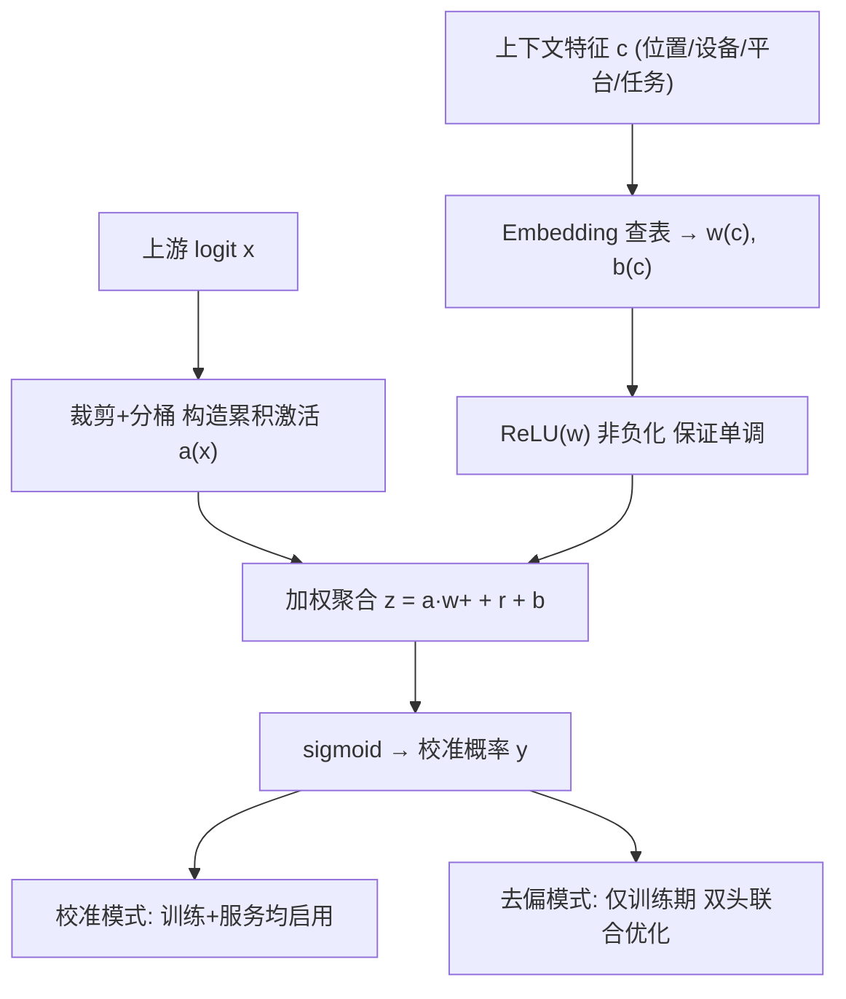
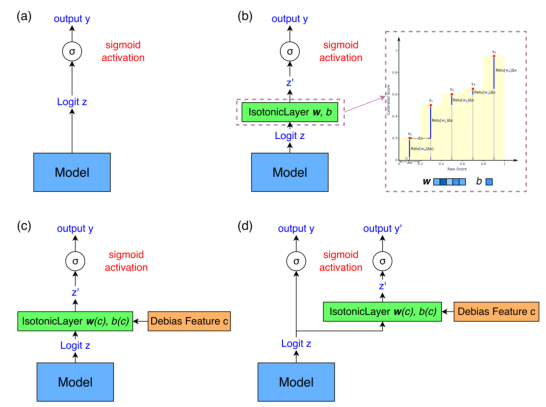

# Isotonic Layer: A Unified Framework for Recommendation Calibration and Debiasing (保序层：推荐校准与去偏的统一框架)

- **会议/期刊**: KDD 2026
- **作者与机构**: Hailing Cheng, Yafang Yang, Hemeng Tao, Fengyu Zhang（LinkedIn Inc.）
- **推荐链路定位**: 精排（多任务排序 + 校准/去偏头）
- **研究方向**: 去偏公平与工业架构 / CTR 预估与特征交叉
- **论文原文**: [论文原文链接](https://arxiv.org/abs/2603.06589v2)
- **开源代码**: [开源代码仓库链接](https://github.com/hailingc/Isotonic-Layer)

## TL;DR (1分钟核心速览)

工业推荐中「校准」与「去偏」长期被当作两个独立问题，各自维护后处理管线、倾向性估计与分片模型农场，工程成本极高。本文提出 Isotonic Layer：把保序回归的分段线性桶权重用 ReLU 约束为非负，并将该权重向量参数化为上下文特征（位置、设备、平台、任务）的嵌入，从而在标准 BCE 训练下端到端学出任意粒度的单调校准函数。同一层既做后处理校准（训练/服务均启用），又做位置去偏（仅训练期启用双头，服务期丢弃校准头）。LinkedIn 生产 A/B 上，去偏模型带来订阅周活 +0.63%、日独立职业互动 +0.14%，校准任务 Share AUC +1.5%、Comment AUC +1.9%。

## Background & Motivation (背景与核心矛盾)

- **主流范式**: 校准侧依赖 Platt Scaling 或后处理 Isotonic Regression（PAVA）；去偏侧依赖 Position-as-Feature（PAF）、IPS 重加权、解耦表征或 AutoDebias 等元学习方案；多任务侧则按任务/分片维护独立模型农场。
- **前人局限**: ① 经典保序回归非可微、产生阶梯映射，无法嵌入端到端梯度训练，且只能全局拟合；② PAF/Position Dropout 存在训练-推理分布错配（训练随机 mask、推理固定哨兵值），IPS 则依赖随机日志与倾向性估计方差；③ 现有方法把模型输出视为同质分数，无法刻画 Click 与 Skip 之间方向相反、强度不同的任务异质偏差。
- **核心洞察 (Key Insight)**: 校准与去偏本质是同一个「学到的单调变换」——只要把保序层的桶权重做成上下文条件嵌入，换一个 embedding 查表就得到该子群体的专属校准曲线，无需任何额外预处理或倾向性建模。
- **本文切入点**: 用 ReLU 保证桶权重非负从而构造性保证单调性，再用上下文嵌入参数化该权重，把碎片化校准基础设施压缩为一个即插即用层。

## Method (核心方法设计)

### 1. 整体框架 (Overall Architecture)

输入标量分数 $x$（通常是上游 logit）先裁剪到 $[-17, 8]$ 并按宽度 $\Delta_b=0.05$ 分桶（约 125 桶），构造累积激活向量 $\mathbf{a}(\tilde{x})$；桶权重经 ReLU 非负化后与激活向量内积加偏置，再过 sigmoid 得到校准概率。权重向量并非全局共享，而是由上下文特征（平台、位置、设备、任务 ID）的嵌入查表产生，因此同一层可实例化为全局校准、上下文校准或双头去偏三种形态。训练用标准 BCE 端到端优化；去偏形态下校准头只在训练期存在，其梯度回传共享表征以剥离曝光偏差，服务期仅保留推理头。

<figure class="paper-figure" markdown="span">
  <figcaption>图1：Isotonic Layer 在排序与校准中的示例用例。(a) 未进行单调校准的标准预测模型。(b) 对模型输出应用全局保序校准，带有可学习的桶权重 w 和偏置 b。(c) 通过学习嵌入实现上下文条件保序校准，其中上下文特征 c 被映射为上下文条件保序嵌入 (w_c, b_c)。(d) 双塔架构，联合优化相关性与上下文感知保序校准以进行去偏。</figcaption>
</figure>

### 2. 关键设计拆解 (Key Designs)

1. **可微保序层（Differentiable Piecewise Isotonic Fitting）**：痛点是非参数保序回归不可微、阶梯输出损伤排序分辨率。核心算子为累积激活加权和
   $$z(x)=\sum_{j=0}^{N-1} a_j(\tilde{x})\,w_j^{+}+r+b,\quad w^{+}=\mathrm{ReLU}(w),\ y=\sigma(z)$$
   其中 $a_j$ 对 $j<i$ 取满桶宽 $\Delta_b$、对 $j=i$ 取桶内小数部分、对 $j>i$ 取 0。由于 $x_1\le x_2 \Rightarrow \mathbf{a}(x_1)\le \mathbf{a}(x_2)$ 逐元素成立且 $w^+\ge 0$，单调性由构造保证而非软惩罚；同时输出对全部前缀桶权重耦合，形成全局结构正则，抑制稀疏区的局部反转噪声。去掉 ReLU 即退化为通用分段线性逼近器，可拟合任意连续形状。
2. **上下文条件保序嵌入（Context-Conditioned Isotonic Embedding）**：痛点是全局单曲线无法刻画位置/平台/广告主级别的偏差差异。做法是把桶权重整体替换为嵌入查表 $w^{+}(c)=\mathrm{ReLU}(E(c))\in\mathbb{R}^{N}$，得到
   $$y=\mathrm{IsotonicLayer}\big(x;\,w^{+}(c),\,b(c)\big)$$
   新增一个子群体的校准只需加一路 embedding，工程改动量为零；由于 ReLU 在嵌入之后施加，任意上下文粒度下单调性依然成立。这是相对 LiRank 中全局单任务版本与 DIPN 单调嵌入的本质推广。
3. **双头去偏与训练目标**：把观测交互分解为 $P(\text{event})=P(\text{relevance})\cdot P(\text{event}\mid\text{relevance},\text{position})$。每个任务 $s\in\{\text{Click},\text{Skip},\text{LongDwell}\}$ 配一个位置中性的 Inference Head 与一个以位置+设备为条件的 Isotonic Calibration Head，联合优化
   $$\mathcal{L}=\sum_s\Big[\alpha_s\,\mathrm{BCE}(y^{(s)},\hat{y}^{(s)}_{\text{inf}})+\beta_s\,\mathrm{BCE}(y^{(s)},\hat{y}^{(s)}_{\text{iso}})\Big]$$
   经验上 $\beta_s\in[0.7,0.8]$ 最优，且 $\alpha_s$ 必须保持非零以稳住下游价值函数的校准。服务期直接删除校准头，得到无位置偏的纯相关性打分，不存在 PAF 式的训练-推理协变量漂移。推理开销方面，保留校准头约增 5% CPU（125 桶 × 12 任务头），可用浅层 MLP 蒸馏，AUC 损失 < 0.1%。

## Experimental Setup & Evaluation Protocol (实验设置与评估协议)

- **数据集与场景**: 全部为 LinkedIn 生产数据，未使用公开基准。两个落地场景：① 下游会话模型（预测用户互动后经通知回访平台的概率），标签稀疏、高条件依赖；② Feed 多任务排序（Click / Skip / LongDwell），含位置与设备特征。

| 场景 | 任务 | 标签定义 | 稀疏性/特点 |
| :--- | :--- | :--- | :--- |
| 下游会话校准 | Share / Like / Comment | 互动是否触发 ≥1 次下游会话 | 深度转化标签，极稀疏、高方差 |
| Feed 去偏排序 | Click / Skip / LongDwell | 曝光后互动 | 位置偏差强，任务间偏差方向相反 |

- **数据划分与防穿越**: 采用时间切分的离线评估 + 线上 A/B 双轨；校准场景使用随机化会话数据在冻结基模型上做交替训练（表征学习与校准优化串行解耦），避免校准阶段反向污染表征。
- **排名评测协议**: 离线报告 Evaluation AUC 与 Normalized Entropy（NE），线上以大规模流量 A/B 的双侧 t 检验（$p<0.05$）为准；未采用采样排序，评估基于真实曝光日志的全量分布。
- **对比基线与超参**: 基线为生产 MTL 模型、Position Dropout（PAF 变体，$p_{\text{drop}}$ 在 $\{0.05,\dots,0.50\}$ 中搜索，最优 0.15，推理时位置置 $-1$）；另提及曾评估 Platt Scaling 与 12 个逐任务 Isotonic Regression 模型，线上均为负向或持平而未采纳。桶宽 $\Delta_b=0.05$，桶数 $N\approx125$。

## Key Experimental Results (实验关键数据)

### 1. 主实验对比 (Main Results)

**离线：位置去偏（相对生产基线的 ΔAUC / ΔNE）**

| 模型 | Like ΔAUC | Like ΔNE | Click ΔAUC | Click ΔNE |
| :--- | :---: | :---: | :---: | :---: |
| Baseline | - | - | - | - |
| Position Dropout ($p$=0.15) | −0.34% | +0.21% | +0.16% | +0.08% |
| **Isotonic Head** | **+0.81%** | **−0.51%** | **+1.00%** | **−1.31%** |
| Inference Head（线上部署） | +0.10% | +0.21% | +0.01% | +0.06% |

**离线：下游会话校准（Evaluation AUC 相对提升）**

| 模型 | Share | Like | Comment |
| :--- | :---: | :---: | :---: |
| Baseline | - | - | - |
| **Isotonic Layer** | **+1.5%** | +0.0% | **+1.9%** |

**线上 A/B（相对对照组的显著提升，$p<0.05$）**

| 场景 | 指标类别 | 相对提升 |
| :--- | :--- | :---: |
| 校准模型 | 用户互动（日活互动） | +0.17% |
| 校准模型 | 内容质量（知识寻求会话） | +0.20% |
| 校准模型 | 生态健康（顶层业务指标） | +0.36% |
| 去偏模型（推理头） | 订阅周活用户 | **+0.63%** |
| 去偏模型（推理头） | 日独立职业互动 | +0.14% |
| 去偏模型（推理头） | 职位会话 | +0.14% |
| 去偏模型（推理头） | 总宏会话 | +0.06% |
| Position Dropout | 全部顶层指标 | ≈0（不显著） |

### 2. 消融实验 (Ablation Study)

原文未设标准组件消融表，但提供了等价的功能性对照：

| 配置 | 关键结果 | 说明 |
| :--- | :--- | :--- |
| 全局单任务 Isotonic（LiRank 版） | 仅全局校准，无上下文/多任务 | 本文的退化特例 |
| 逐任务 Isotonic Regression ×12 | 线上负向或持平 | 阶梯映射 + 管线碎片化 |
| Platt Scaling | 线上负向或持平 | 参数化过刚，无法拟合非线性畸变 |
| Position Dropout | 离线最优 +0.16% AUC，线上不显著 | 训练-推理分布错配 |
| 双头（$\beta_s\in[0.7,0.8]$） | 最优 | $\beta_s$ 过低去偏不足，过高损伤排序稳定性 |
| 保留校准头推理 | +5% CPU | 可蒸馏为 MLP，AUC 损失 < 0.1% |

### 3. 关键实验发现 (Key Findings)

1. **NE 回退是去偏成功的信号而非失败**：Isotonic Head 的 Click NE 下降 1.31%，作者论证推理头只建模 $P(\text{relevance})$ 而 NE 是对位置混淆标签计算的，顶部位置系统性低估、底部高估属数学必然；与之对照，Position Dropout 的 NE 反而上升 0.08%，说明它并未真正剥离位置效应。
2. **偏差具有任务异质性与方向性**：Click 在顶部位置呈强正偏，Skip 呈反向趋势，O/E 比在顶部 >1、底部 <1，证明单一静态倾向性分数无法刻画这种非线性，必须走任务条件 + 位置条件的保序曲线。
3. **离线最优 ≠ 线上有效**：Position Dropout 经系统调参取得离线最优（$p_{\text{drop}}=0.15$，Click +0.16% AUC），但线上所有配置均无显著提升；而 Isotonic 方案推理头离线增益仅 +0.01%~+0.10%，却换来订阅周活 +0.63% 的显著线上收益，凸显 PAF 范式协变量漂移的致命性。

## Highlights, Limitations & Rating (亮点、对比与审稿评价)

- **与代表作对比 (vs. Prior Work)**: 相比经典 Isotonic Regression，本文把不可微的 PAVA 投影换成可微分段线性累积和，可端到端训练且无阶梯分辨率损失；相比 LiRank 中的全局单任务版本与 DIPN 的单调嵌入，本文引入上下文条件嵌入与双头去偏，把适用范围从「分数级校准」扩展到「任务×位置×平台」的任意粒度；相比 PAF/IPS，本文不做重加权、不需随机日志，从结构上而非分布上解耦偏差。
- **可迁移亮点**: ① 「非负权重 + 累积激活」这一构造性单调技巧可直接用于任何需要序约束的打分模块（质量分、时效性、价格敏感度）；② 训练期挂校准头、服务期摘除的 train/serve 非对称设计，是工业去偏中规避推理分布漂移的通用范式。
- **审稿级局限批判**: ① 全部实验基于 LinkedIn 内部数据与匿名化指标，缺乏公开基准复现，AUC 增益幅度（+0.01%~+1.0%）与线上指标（+0.06%~+0.63%）均较小，统计显著但效应量有限；② 桶数 $N$、裁剪边界 $[-17,8]$、损失权重 $\beta_s$ 均为经验设定，缺少敏感性分析，且上下文嵌入在长尾子群体（如小广告主）上的稀疏性未讨论；③ 单调性假设本身可能过强——某些特征与效用并非单调关系，此时需去掉 ReLU 但也就失去了保序保证。
- **四维评分**: 创新性 ⭐⭐⭐⭐ | 实验扎实度 ⭐⭐⭐ | 方法清晰度 ⭐⭐⭐⭐⭐ | 落地价值 ⭐⭐⭐⭐⭐

