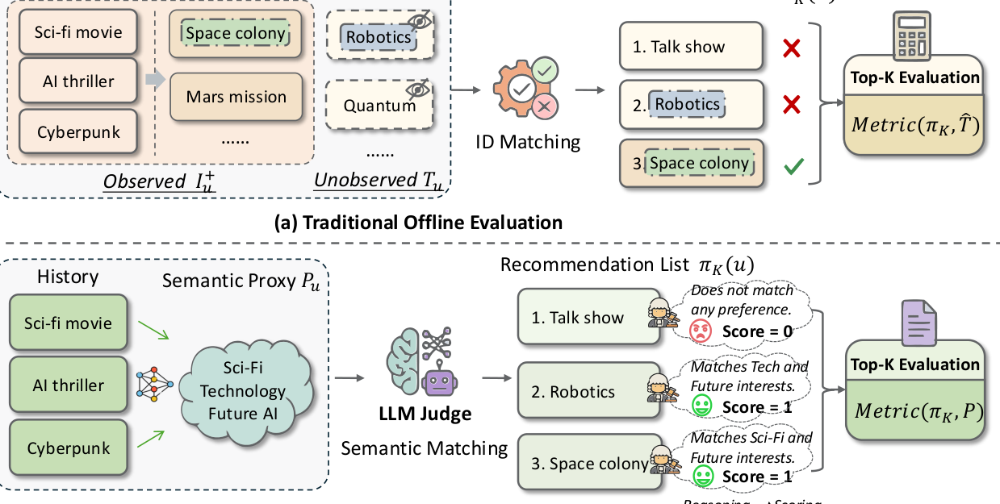
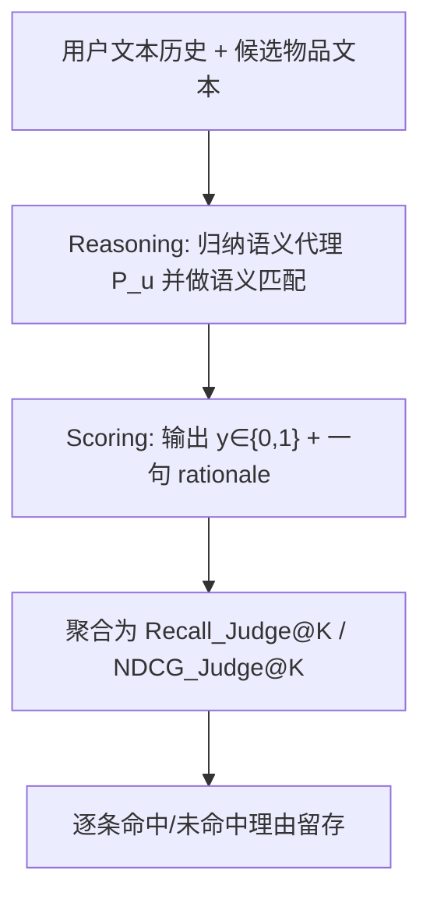

# LLM-as-a-Judge for Reliable and Explainable Offline Evaluation in Top-K Recommendation (面向可靠可解释 Top-K 推荐离线评测的 LLM 评审框架)

- **会议/期刊**: KDD 2026 (Research Track, V.2)
- **作者与机构**: Yue Que, Junyi Zhou, Xiaokun Zhang, Chen Ma (City University of Hong Kong)；Haiming Jin (SJTU)；Qiao Xiang (Xiamen University)
- **推荐链路定位**: 离线评测（服务于召回/排序全链路的模型选型与上线决策）
- **研究方向**: 去偏公平与工业评测 / 大语言模型推荐
- **论文原文**: [https://arxiv.org/abs/2606.22961v1](https://arxiv.org/abs/2606.22961v1)
- **开源代码**: [Zenodo 仓库](https://doi.org/10.5281/zenodo.20283783)

## TL;DR (1分钟核心速览)

传统 Top-K 离线评测把 MNAR 的 holdout 反馈当作真实偏好代理，并强制 ID 匹配，导致模型排序被系统性扭曲且完全黑盒。本文提出 LLM-as-a-Judge 框架：用 LLM 从用户文本历史归纳"语义偏好代理"，在语义空间做柔性匹配，并以 reasoning-then-scoring 输出逐条打分与理由，再聚合为 Recall/NDCG。在 Kuairec 与 Coat 的无偏测试集上，Judge 与无偏真值的 Pearson 一致性达 62%–88%，较常规测试提升 47%–151%，且跨 4B–671B 骨干稳定。

## Background & Motivation (背景与核心矛盾)

- **主流范式**: 离线评测在 holdout 反馈 $\hat{T}_u$ 上计算 Recall@K / NDCG@K，本质是"推荐列表 $\pi_K(u)$ 与测试集做严格 ID 交集"。
- **前人局限**: ① 可靠性——用户历史采集受曝光控制与浏览行为双重偏置（MNAR），$\hat{T}_u$ 只是真实偏好 $\mathcal{T}_u$ 的有偏子集，ID 匹配无法覆盖未观测兴趣，且把"未曝光"误判为"不喜欢"（假阴性）；② 可解释性——Top-K 指标只给数字，无法说明某模型为何胜出、某次命中/未命中缘于何种偏好。
- **核心洞察**: 理想评测应匹配"真实偏好空间"而非"反馈集合"。LLM 具备世界知识与推理能力，可从文本历史中推断出超越 MNAR 的潜在意图，从而构造更接近 $\mathcal{T}_u$ 的语义代理 $\mathcal{P}_u$，使 $\text{Metric}(\pi_K,\mathcal{P}) \to \text{Metric}(\pi_K,\mathcal{T})$。
- **本文切入点**: 用语义匹配替代 ID 匹配解决可靠性，用"先推理后打分"解决可解释性，二者封装在同一次 LLM 查询中。

<figure class="paper-figure" markdown="span">
  <figcaption>图 1：Top-K 推荐中传统离线评估与 LLM-as-a-Judge 评估的概览对比。</figcaption>
</figure>

## Method (核心方法设计)

### 1. 整体框架 (Overall Architecture)

输入为用户文本历史（标题/属性/描述）与推荐模型产出的 Top-K 列表；Judge 先在 reasoning 步从历史中归纳高层兴趣形成语义代理 $\mathcal{P}_u$，再对每个候选做语义匹配并引用证据；scoring 步在推理结论条件下输出二值相关性 $y_{u,i_r}\in\{0,1\}$ 与一句 rationale；最后把逐点判定按标准 Top-K 公式聚合为全局指标，并保留每条理由用于误差诊断。整个流程对任意推荐模型黑盒可用，只需替换 prompt 中的任务定义块即可迁移到新场景。

### 2. 关键设计拆解 (Key Designs)

1. **语义代理替代 holdout 代理（可靠性核心）**：痛点是用 ID 交集度量偏好必然漏掉未曝光兴趣。本文令 LLM 从 $\mathcal{I}^+_u$ 的文本中抽象出偏好画像 $\mathcal{P}_u$，判定改为语义蕴含而非 ID 相等，因此"用户看过科幻片→推荐太空殖民地纪录片"这类跨品类但意图一致的候选可被正确判为命中，直接缓解 MNAR 假阴性。其有效性直觉在于：语义空间中的偏好是低维、可泛化的，而 ID 空间中的偏好是稀疏、被曝光策略截断的。

2. **Reasoning-then-Scoring + Reject-by-Default（可解释性核心）**：LLM 直接打分会退化为"发散联想 + 过度认可"。本文强制先写证据链再给分，并设定默认拒绝策略——除非证据无可辩驳地支持完美匹配，否则判 0。该保守先验抑制了 LLM 幻觉导致的假阳性膨胀，使打分分布更接近真实相关性；同时每条判定附带单句理由，构成可审计的评测证据。

3. **指标适配与推理开销**：由于不再有 holdout 集合，$|\mathcal{T}_u|$ 不可得，Recall 改为以 K 归一化：
$$\text{Recall}_{\text{Judge}}@K=\frac{1}{|\mathcal{U}|}\sum_{u}\frac{1}{K}\sum_{r=1}^{K}y_{u,i_r}$$
NDCG 则直接把 $y_{u,i_r}$ 当作 DCG 中的相关性信号，iDCG 按命中数重排至顶部计算。全流程无需训练、无需负采样，成本为 $O(|\mathcal{U}|\cdot K)$ 次 LLM 调用（默认骨干 Qwen3-30B-A3B，temperature=0 保证确定性）。

## Experimental Setup & Evaluation Protocol (实验设置与评估协议)

- **数据集与预处理**: 仅选用同时具备"MNAR 训练反馈 + 无偏测试集 + 文本侧信息"的数据集；Yahoo!R3 因只有 ID 被排除。

| 数据集 | #Users | #Items | #Interactions | 稀疏度/密度 | 特征/场景说明 |
| :--- | :---: | :---: | :---: | :---: | :--- |
| Kuairec | 7.1k | 10.7k | 12.5M | 密度约 16.5% | 短视频；无偏测试子集 1.4k 用户 × 3.3k 物品全曝光 |
| Coat | 290 | 300 | 6.5k | 密度约 7.5% | 服装购物；每用户对 16 个随机曝光物品全部评分 |

- **数据划分与防穿越**: MNAR 反馈按 **7:3 比例划分** 训练/验证；无偏测试集独立采集（Kuairec 全曝光子集、Coat 随机曝光 16 物品），不参与训练。
- **排名评测协议**: 采用 **Full-Ranking 全库未交互排序** 生成 Top-K 列表；无偏测试数据二值化（Kuairec：观看≥2 次为正；Coat：评分>3 为正）。Kuairec 取 $K\in\{20,50,100\}$，Coat 取 $K\in\{3,5,10\}$。
- **对比基线与超参**: 9 个协同过滤模型构成排序列表——MF、NeuMF、NGCF、LR-GCCF、LightGCN、SimGCL、MGCCF、GTN、CAGED；以"常规测试（验证集）"为下界、"无偏测试"为真值上界。可靠性用 Pearson / Spearman / Kendall-$\tau$ / MAE 度量，显著性用双侧 t 检验 $p<0.05$；可解释性由 3 名人工标注者按 Coherence / Faithfulness / Persuasiveness 三维度打分（Fleiss' $\kappa>0.75$）。

## Key Experimental Results (实验关键数据)

### 1. 主实验对比 (Main Results)

与无偏真值的排序一致性（节选核心列，Gain 为相对常规测试的提升）：

| 数据集 | 指标 | 常规测试 | LLM Judge | Gain |
| :--- | :--- | :---: | :---: | :---: |
| Kuairec | Recall@20 Pearson | 35.56% | **87.62%*** | +52.07% |
| Kuairec | Recall@100 Spearman | 16.67% | **79.42%*** | +62.75% |
| Kuairec | NDCG@50 Pearson | −2.88% | **70.79%*** | +73.66% |
| Kuairec | NDCG@100 Kendall | 21.43% | **64.29%*** | +42.86% |
| Coat | Recall@3 Pearson | 38.15% | **87.41%*** | +49.25% |
| Coat | Recall@10 Pearson | −8.91% | **76.20%*** | +85.11% |
| Coat | NDCG@3 Pearson | −77.57% | **73.86%*** | +151.43% |
| Coat | NDCG@5 Pearson | −48.31% | **85.61%*** | +133.93% |
| Coat | NDCG@10 Spearman | −45.24% | **83.33%*** | +128.57% |

分数级一致性（图 3 回归统计）：Judge 的斜率 $k$ 普遍逼近理想值 1（如 Coat NDCG@5 达 $k=0.99$），标准差 $\sigma$ 与 MAE $\bar{d}$ 均显著低于常规测试（如 Kuairec Recall@20：$\bar{d}$ 由 0.23 降至 0.12）。

### 2. 消融实验 (Ablation Study)

Coat 数据集上的输入配置消融：

| 变体 | Recall@5 Pearson | Recall@5 Spearman | Recall@5 Kendall | NDCG@5 Pearson | NDCG@5 Spearman | NDCG@5 Kendall |
| :--- | :---: | :---: | :---: | :---: | :---: | :---: |
| rewrite（改写 prompt） | 88.36 | 57.14 | 42.86 | 82.29 | 71.82 | 53.58 |
| w/o-RJ（去默认拒绝） | **90.74** | **61.90** | **50.00** | 36.33 | 38.10 | 28.57 |
| w/o-RS（去先推理） | 70.37 | 39.62 | 30.88 | 64.06 | 64.29 | 42.86 |
| L=0.6（保留 60% 历史） | 82.85 | 66.67 | 50.00 | 75.28 | 57.14 | 28.57 |
| L=0.3（保留 30% 历史） | 76.91 | 60.81 | 54.29 | 51.93 | 54.76 | 35.71 |
| L=0.1（保留 10% 历史） | 22.80 | 43.11 | 37.06 | −34.62 | −33.33 | −21.43 |
| Full（完整框架） | 85.70 | 52.41 | 40.01 | **85.61** | **76.19** | **57.14** |

### 3. 关键实验发现 (Key Findings)

1. **常规测试在 NDCG 上会给出方向性错误结论**：Coat 上常规测试与无偏真值呈强负相关（NDCG@3 Pearson = −77.57%），意味着按 holdout 选模型可能选出真实更差的模型；Judge 将其翻转为 +73.86%，这是本文最有说服力的动机证据。
2. **默认拒绝策略是"排序质量"而非"召回数量"的守门人**：w/o-RJ 在 Recall@5 上反而略升（90.74 vs 85.70），但 NDCG@5 Pearson 从 85.61 暴跌至 36.33——说明去掉保守先验后 LLM 过度认可模糊候选，虽增加命中数却引入大量位置噪声，破坏排序保真度。
3. **历史稀疏容忍度存在明确断崖**：保留 ≥30% 历史时多数指标仍可用（NDCG@5 Pearson 51.93），但降至 10% 时全面崩溃（−34.62），对应 Coat 中仅 1–2 条历史的冷启动场景——此时连传统 holdout 评测本身也失效，说明该框架的适用边界是"有最低限度行为证据"的用户。

## Highlights, Limitations & Rating (亮点、对比与审稿评价)

- **与代表作对比 (vs. Prior Work)**: 与倾向加权类去偏方法（如 SNIPS/IPS 系列）相比，本文不建模曝光概率、不依赖 propensities，而是绕开 ID 匹配直接换掉"代理"本身，因此能处理倾向加权无法触及的假阴性问题；与 Fabbri 等的 profile-based LLM judge 相比，本文不要求结构化用户画像，仅用原始文本历史，场景适应性更强；与纯 LLM 打分相比，本文的 reject-by-default 与 reasoning-then-scoring 是可复用的工程约束。
- **可迁移亮点**: ① "先推理后打分 + 默认拒绝"这一 prompt 结构可直接迁移到任何 LLM 相关性标注任务（如检索段落相关性、生成式推荐的质量评估）；② 用"模型排序列表一致性"而非绝对分数来验证评测器可靠性，是评测类工作值得借鉴的实验设计范式。
- **审稿级局限批判**: ① 成本与延迟——每用户每 K 条候选均需一次 LLM 调用，全库级评测（数万用户 × K=100）开销远超传统指标，论文仅在附录给出 runtime，缺少与 IPS 类方法的成本-精度权衡曲线；② 评测效度依赖 LLM 与人类偏好的一致性，而人工验证仅 100 条/组、3 名标注者、两个数据集，且 Kuairec 上 Mismatch 组三维度均低于 76%，说明"拒绝"理由的质量弱于"命中"理由，在噪声文本场景下可解释性并不均衡；③ 二值相关性假设丢失了分级相关性信息，对 NDCG 这类增益敏感指标可能低估细粒度差异。
- **四维评分**: 创新性 ⭐⭐⭐⭐ | 实验扎实度 ⭐⭐⭐⭐ | 方法清晰度 ⭐⭐⭐⭐⭐ | 落地价值 ⭐⭐⭐⭐

