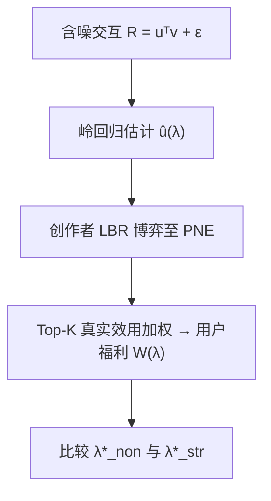

# Lower Bias, Higher Welfare: How Creator Competition Reshapes Bias-Variance Tradeoff in Recommendation Platforms? (低偏差，高福利：创作者竞争如何重塑推荐平台中的偏差-方差权衡？)

- **会议/期刊**: KDD 2026
- **作者与机构**: Kang Wang, Renzhe Xu (通讯), Bo Li — 上海财经大学理论计算机科学研究院 / 清华大学经济管理学院
- **推荐链路定位**: 召回（用户表征估计阶段的正则化策略设计）
- **研究方向**: 去偏公平与工业架构 / 协同过滤
- **论文原文**: [https://arxiv.org/abs/2511.20289v2](https://arxiv.org/abs/2511.20289v2)
- **开源代码**: [https://github.com/wangkng/C3BV](https://github.com/wangkng/C3BV)

## TL;DR (1分钟核心速览)

传统推荐将内容视为静态输入，平台按经典偏差-方差权衡选择正则强度 $\lambda$。本文提出 C³BV 博弈框架，将创作者建模为对平台激励做出策略性响应的理性 Agent，证明在策略环境下最优正则$\lambda^*_{str}$严格小于非策略基线$\lambda^*_{non}$——即平台应主动降低偏差。在 MovieLens-100k 与 Instant-Video 上，策略最优$\lambda$ 从非策略的 0.8/0.5 降至 0.2–0.4，用户福利显著提升，且结论在四种奖励机制、Top-1/Top-5 下均稳健。

## Background & Motivation (背景与核心矛盾)

- **主流范式**: 平台用带 $\ell_2$正则的最小二乘估计用户表征$\hat{u}_i(\lambda)$，通过$\lambda$ 控制偏差-方差权衡；内容特征被视为外生静态输入。
- **前人局限**: (1) 经典分析假设内容生成独立于推荐算法，忽略了创作者会策略性改写内容以博取曝光，形成"算法设计→创作者策略→内容分布"的动态反馈环；(2) 已有竞争性偏差-方差研究（如 Iyer & Ke 2024）采用"市场参与者"视角，各厂商自选权衡参数，而现代推荐平台是"市场设计者"——平台集中决定用户建模的正则强度，创作者再据此竞争，二者结构本质不同。
- **核心洞察**: 强正则具有"同质化效应 (homogenizing effect)"，会把估计嵌入拉向趋势内容区。非策略下趋势偏好用户"欢迎"该效应（抗噪保分类），但策略下创作者在均衡处会把内容对齐到被偏置的估计 $\hat{u}$，此时同质化偏差被直接放大为推荐错配，恒为有害。
- **本文切入点**: 用可解析的 PReNT 博弈实例刻画 $\lambda^*_{non}$与$\lambda^*_{str}$的增长率差异，证明前者随内容规模线性增长$\Theta(N_T)$、后者仅次线性$O(N_T^{0.5+\alpha})$，从而在真实大平台规模下必有$\lambda^*_{str}<\lambda^*_{non}$。

## Method (核心方法设计)

### 1. 整体框架 (Overall Architecture)

C³BV 博弈实例由元组 $(\lambda,\boldsymbol{u},\boldsymbol{v},\boldsymbol{\epsilon},K,\sigma,RM,\boldsymbol{r})$定义：平台基于含噪观测$R_{ij}=u_i^\top v_j+\epsilon_{ij}$与已知内容嵌入，用闭式岭回归估计用户特征；创作者在单位球面$\mathcal{S}^{d-1}_{\geq 0}$上选择策略$s_j$最大化期望奖励；平台以 Top-$K$真实效用加权和度量用户福利，并在"非策略（内容固定）"与"策略（创作者达纯纳什均衡 PNE）"两种设定下分别求最优$\lambda$，比较二者以刻画竞争对权衡的重塑。

### 2. 关键设计拆解 (Key Designs)

1. **PReNT 博弈与双设定最优 $\lambda$定义**：为获得可解析结论，构造单用户、$N_T$个趋势内容与$N_N$个小众内容（$N_T>N_N$，两方向正交）的实例。非策略最优$\lambda^*_{non}=\arg\max_\lambda \mathbb{E}_\epsilon[W(\boldsymbol{v};G(\lambda,\boldsymbol{v},\epsilon))]$，策略最优$\lambda^*_{str}=\arg\max_\lambda \mathbb{E}_\epsilon[W(s^{PNE}(G(\lambda,\boldsymbol{v},\epsilon));G)]$。关键在于把$\lambda$ 从统计超参升格为影响博弈均衡的"政策杠杆"。

2. **增长率分离定理（核心增量）**：命题 4.3 证明任意 PNE 下估计嵌入必与至少 $K$个创作者策略重合，即创作者向$\hat{u}$收敛；定理 4.1 给出趋势偏好用户下$\lambda^*_{non}$的下界$\lambda^{*L}_{non}=\frac{N_TN_N(\theta_N-\theta_T+2\bar{E})}{N_T(\theta_T-\bar{E})-N_N(\theta_N+\bar{E})}$（噪声足够大时），随规模呈$\Theta(N_T)$线性增长；定理 4.4 证明策略下存在有限上界且$\lambda^{*U}_{str}=O(N_T^{0.5+\alpha})$。二者增长率之差即为"低偏差更优"的数学根源——大平台上界差距被规模放大。

3. **训练目标、负采样与推理效率**：本文非端到端训练模型，而是以岭回归闭式解 $\hat{u}_i(\lambda)=(\sum_j v_jv_j^\top+\lambda I)^{-1}(\sum_j R_{ij}v_j)$为估计器，无负采样环节；策略均衡用 Local Better Response (LBR) 迭代近似（合成$T=800$、真实数据$T=1500$步），福利在最终策略剖面评估。计算开销集中于每步对$n$个创作者重解闭式估计与排序，$d=10/16$ 维下可忽略，但 LBR 收敛步数随创作者数增长是潜在瓶颈。

## Experimental Setup & Evaluation Protocol (实验设置与评估协议)

- **数据集与预处理**:

| 数据集 | #Users | #Items | #Interactions | 稀疏度/密度 | 特征/场景说明 |
| :--- | :---: | :---: | :---: | :---: | :--- |
| Synthetic (Trend/Niche Market) | 400 | 10 creators | — | — | $d=10$，$N_T=9,N_N=1$，$\sigma_e=0.5$ |
| MovieLens-100k | 943 | 1,682 | 100,000 | 6.3% | NMF $d=16$ 得真值嵌入，抽 10 内容为创作者 |
| Instant-Video (Amazon) | 5,130 | 1,685 | 37,126 | 0.43% | `5-core` 过滤，NMF $d=16$，$\sigma_e=0.3$ |

- **数据划分与防穿越 (Splitting Strategy)**: 非传统训练/测试划分；用**全量交互矩阵**做 NMF 得"真值"嵌入，再注入独立高斯噪声 $\mathcal{N}(0,\sigma_e^2)$ 模拟观测，属**仿真式全观测设定**（作者声明可扩展至部分观测）。
- **排名评测协议 (Ranking Protocol)**: 非 Recall/NDCG 类检索指标，而是**用户福利 $W=\sum_i\sum_{k=1}^K r_k\sigma(s_{j^{(k)}},u_i)$**，按估计分数全库排序取 Top-$K$，注意力权重$r_k=1/\log_2(k+1)$；属全库排序下的效用度量。
- **对比基线与超参设置**: 非策略基线 vs. 四种奖励机制 `BRCM*`、`M3(expo.)`、`M3(enga.)`、`M3(0)`；$\lambda$网格扫描（合成$10^{-2}$–$10^3$，真实 0–2.0）；误差棒为 10 次独立噪声实现的 0.5/0.2 标准差。

## Key Experimental Results (实验关键数据)

### 1. 主实验对比 (Main Results)

下表汇总各设定下最优 $\lambda$（策略 vs. 非策略），核心结论为$\lambda^*_{str}<\lambda^*_{non}$：

| 数据集 / 设定 | 非策略 $\lambda^*_{non}$| 策略$\lambda^*_{str}$（各机制） | 结论 |
| :--- | :---: | :---: | :---: |
| Synthetic Trend / Top-1 | $\geq 10$ | 0.1 (M3-expo) ~ 1 (其余) | **str < non** |
| Synthetic Trend / Top-5 | $\geq 10$ | 0 (M3-0) ~ 1 (BRCM*) | **str < non** |
| Synthetic Niche / Top-1,5 | 趋 0 | 趋 0 | 二者接近 |
| MovieLens-100k / Top-1 | 0.8 | 0.2 (M3-0) ~ 0.4 (其余) | **str < non** |
| MovieLens-100k / Top-5 | 0.8 | 0.2 (全部机制) | **str < non** |
| Instant-Video / Top-1 | 0.4 | 0.2 ~ 0.3 | **str < non** |
| Instant-Video / Top-5 | 0.5 | 0.1 (M3-0) ~ 0.3 (M3-expo) | **str < non** |

### 2. 消融实验 (Ablation Study)

本文以"设定/机制"维度替代组件消融，考察结论稳健性：

| 变化维度 | 取值 | 对 $\lambda^*_{str}<\lambda^*_{non}$ 的影响 |
| :--- | :--- | :---: |
| 奖励机制 | BRCM*, M3(expo), M3(enga), M3(0) | 全部成立 |
| 推荐位 $K$ | Top-1 / Top-5 | 全部成立 |
| 用户偏好 | Trend / Niche | Trend 显著，Niche 二者均趋 0 |
| 噪声尺度 $\sigma_e$ | 0.3 / 0.5 | 结论不变 |
| 数据来源 | 合成 / 两个真实集 | 一致 |

### 3. 关键实验发现 (Key Findings)

1. **趋势市场是主战场**：合成 Trend Market 中非策略最优 $\lambda^*_{non}\geq 10$ 而策略最优仅 0.1–1，量级差达 10–100 倍；Niche Market 二者均趋 0，印证理论"小众偏好下两设定难区分"的二分结论。
2. **真实数据一致收敛**：MovieLens-100k 上 $\lambda$从 0.8 降至 0.2（降幅 75%），Instant-Video 从 0.5 降至 0.1–0.3，跨数据集、跨$K$、跨机制均复现，说明结论非合成设定伪影。
3. **机制无关性**：四种奖励机制（含曝光型与互动型）下 $\lambda^*_{str}$ 均显著低于基线，表明"弱正则更优"源于博弈结构本身而非特定奖励函数设计，对工业平台选型具普适指导意义。

## Highlights & Limitations (亮点、对比与审稿批判)

- **与代表作对比 (vs. Prior Work)**: 相较 Yao et al. (2023a,b) 的创作者竞争均衡分析，本文首次把**正则化强度**作为平台政策变量嵌入博弈；相较 Iyer & Ke (2024) 的"厂商自选权衡"视角，本文切换为"平台集中设计"视角，更贴合现代推荐系统架构，故前人结论不可直接套用。
- **可迁移亮点**: (1) 将超参 $\lambda$视为影响多智能体均衡的"政策杠杆"这一建模思路，可迁移至学习率、探索温度等其它训练超参的机制设计分析；(2) 增长率分离（$\Theta(N)$vs.$O(N^{0.5+\alpha})$）的证明范式可用于论证"规模放大某策略优势"的一般命题。
- **审稿级局限批判**: (1) 理论依赖强假设（单用户、两组正交内容、非负嵌入、内积匹配），多用户与深度打分器下仅有仿真验证，缺真实线上 A/B；(2) LBR 仅收敛到局部 Nash，且 $T$ 随创作者数增长，大规模平台（百万创作者）的可扩展性与收敛保证存疑。

## Rating (四维评分)

- **方法创新性 (Novelty)**: ⭐⭐⭐⭐ （将正则化升格为博弈政策杠杆，增长率分离定理给出清晰数学根源，视角新颖）
- **评估协议与实验扎实度 (Protocol & Experiments)**: ⭐⭐⭐ （合成+两真实集、四机制、双 $K$ 较全面，但缺线上 A/B 与深度模型验证，福利指标非标准检索指标）
- **写作与数学规范度 (Clarity & Rigor)**: ⭐⭐⭐⭐ （定理-直觉-实验三段式清晰，图 1 嵌入分布直观解释同质化效应，符号统一）
- **工业落地与复现价值 (Industrial & Practical Value)**: ⭐⭐⭐⭐ （代码开源，结论"策略环境降正则"可直接指导调参，但落地需扩展到真实深度推荐管线）

