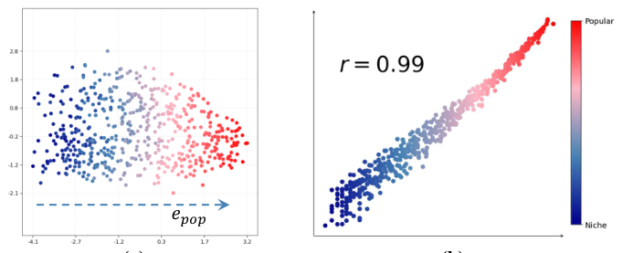
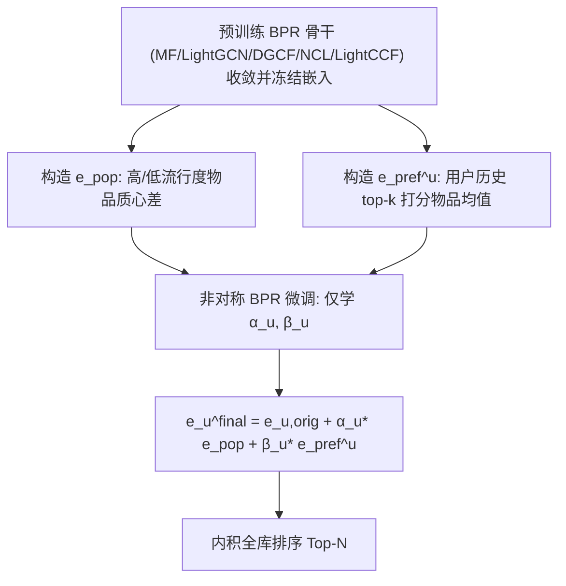

# Rethinking Popularity Bias in Collaborative Filtering via Analytical Vector Decomposition (从解析向量分解重新审视协同过滤中的流行度偏差)

- **会议/期刊**: KDD 2026 (First Cycle Accepted)
- **作者与机构**: Lingfeng Liu, Yixin Song, Dazhong Shen, Bing Yin, Hao Li, Yanyong Zhang, Chao Wang (USTC / NUAA / iFLYTEK)
- **推荐链路定位**: 精排（BPR 类 CF 模型的嵌入几何后校正）
- **研究方向**: 去偏公平与工业架构 / 协同过滤
- **论文原文**: [https://arxiv.org/abs/2512.10688v6](https://arxiv.org/abs/2512.10688v6)
- **开源代码**: [https://github.com/LingFeng-Liu-AI/DDC](https://github.com/LingFeng-Liu-AI/DDC)

## TL;DR (1分钟核心速览)

本文指出流行度偏差并非外部混淆因子，而是 BPR 成对排序优化在嵌入空间留下的**内在几何伪影**：物品嵌入沿一条主导“流行度方向” $e_{pop}$ 排列，投影幅度与交互频次近乎线性相关（Pearson $r=0.99$）。据此提出 DDC——冻结预训练嵌入，仅学习每用户两个标量 $\alpha_u,\beta_u$，让正样本更新只沿个性化偏好方向 $e_{pref}$、负样本更新只沿 $e_{pop}$ 反向校准。在 Amazon-Book/Yelp/Tmall 三数据集、5 个 BPR 骨干上，MRR@10 相对提升 6.0%–29.3%，同时 AvgPop@10 下降 21.4%–47.2%，训练 BPR 损失降至基线的 1.5%–1.8%。

## Background & Motivation (背景与核心矛盾)

- **主流范式**: 隐式反馈 CF（MF、LightGCN、DGCF、NCL、LightCCF）几乎统一用 BPR 损失训练，最终打分均为内积 $\hat y_{ui}=e_u^\top e_i$。
- **前人局限**: IPS 重加权、DICE/MACR 因果解耦、正则惩罚等宏观方法把流行度偏差当作**外部混淆因子**处理，只治症状；且 IPS/MACR 在本文实验中甚至低于原始 BPR（如 MF-IPS 在 Yelp 上 MRR@10 仅 0.0283 vs. BPR 0.0588），说明重加权假设本身不稳。
- **核心洞察 (Key Insight)**: 作者发现 BPR 的梯度期望 $\mathbb{E}[\Delta e_i]\propto Pop(i)\cdot\mathbb{E}_{u\in\mathcal{U}_i^+}[e_u]$——热门物品被大量多样用户拉动，其平均用户嵌入依大数定律收敛到**全局均值用户方向**，于是流行度被直接编码为隐空间主轴；冷门物品则被小众用户拉向各自特异方向。图 1 的二维投影与 $r=0.99$ 线性拟合定量证实了这一点。
- **本文切入点**: 既然偏差源于 BPR 让**同一个** $e_u$ 同时承担“表达偏好”与“校准流行度”两个冲突任务，就放松 $e_u^{pos}=e_u^{neg}$ 的约束，做方向解耦。

<figure class="paper-figure" markdown="span">
  <figcaption>图 1：BPR 类 CF 模型中流行度偏差的几何可视化与量化。(a) BPR 类 CF 模型物品嵌入的二维投影。嵌入沿主导流行度方向（e𝑝𝑜𝑝）呈结构化组织。(b) 物品嵌入在 e𝑝𝑜𝑝 上的投影幅度与其实际流行度呈近乎完美的线性相关（Pearson r=0.99），定量证实了该几何偏差。</figcaption>
</figure>

## Method (核心方法设计)

### 1. 整体框架 (Overall Architecture)

DDC 是一个**与模型无关的轻量微调阶段**：先正常训练任意 BPR 骨干至收敛并冻结其用户/物品嵌入 $e_{u,orig},e_i^*$；再离线构造两个方向——全局流行度方向 $e_{pop}$（高/低流行度物品质心之差）与每用户个性化偏好方向 $e_{pref}^u$（其历史中预训练打分 top-$k$ 物品嵌入的均值）；随后仅优化每用户两个标量 $(\alpha_u,\beta_u)$，把正/负项分别投影到偏好/流行度轴上重算 BPR；推理时用 $e_u^{final}=e_{u,orig}+\alpha_u^*e_{pop}+\beta_u^*e_{pref}^u$ 与冻结物品嵌入做内积排序，不增加任何维度。

### 2. 关键设计拆解 (Key Designs)

1. **流行度方向与偏好方向的解析构造**：痛点是没有显式“偏差向量”可扣。作者用 $\rho=5\%$ 头尾物品质心差定义 $e_{pop}=\frac{v_{diff}}{\|v_{diff}\|}$，$v_{diff}=\frac{1}{|\mathcal{I}_{head}|}\sum_{i\in head}e_i-\frac{1}{|\mathcal{I}_{tail}|}\sum_{i\in tail}e_i$；偏好方向取用户历史中预训练打分 top-$k$ 比例物品的嵌入均值并归一化。直觉：前者是 BPR 梯度期望的稳定吸引子，后者用**真实交互行为**而非模型推荐来锚定偏好，避免被偏差二次污染。

2. **非对称方向校正（核心创新）**：痛点在于标准 BPR 梯度 $\nabla_{e_u}\mathcal{L}=-w_{uij}(e_i-e_j)$ 中正项被热门物品“污染”、负项被全局流行度主导，二者混在同一更新里。DDC 改写为
$$\mathcal{L}_{DDC}=\sum_{(u,i,j)}-\ln\sigma\big((e_{u,orig}+\beta_u e_{pref}^u)^\top e_i^*-(e_{u,orig}+\alpha_u e_{pop})^\top e_j^*\big)$$
即正项只许沿 $e_{pref}$ 动、负项只许沿 $e_{pop}$ 动。直觉：$\beta_u$ 的梯度只依赖正样本对齐，$\alpha_u$ 的梯度只依赖负样本校准，两个子问题彻底解耦，优化景观从“折中妥协”变为“各司其职”，故能跳出 BPR 的次优局部极小。

3. **训练目标、负采样与推理效率**：损失即上式（含 L2 正则），负采样沿用骨干原有策略（每正样本 1 个均匀负样本），**无需难负采样**；可学习参数仅 $2|\mathcal{U}|$ 个标量，微调收敛极快（Yelp 上 LightGCN 损失从 1.5055 降至 0.0267）。推理时 $e_u^{final}$ 可离线预计算，在线开销与原始内积检索完全一致，无额外延迟。

## Experimental Setup & Evaluation Protocol (实验设置与评估协议)

- **数据集与预处理**: 均采用 `10-core` 过滤：

| 数据集 | #Users | #Items | #Interactions | 稀疏度 | 场景说明 |
| :--- | :---: | :---: | :---: | :---: | :--- |
| Amazon-Book | 139,090 | 113,176 | 3,344,074 | 99.979% | 图书电商，长尾显著 |
| Yelp | 135,868 | 68,825 | 3,857,030 | 99.959% | 本地生活 POI 评论 |
| Tmall | 125,554 | 58,059 | 2,064,290 | 99.972% | 电商行为 |

- **数据划分与防穿越 (Splitting Strategy)**: 采用 RecBole 默认的 `比例划分`（训练/验证/测试），以验证集 MRR@10 早停（50 轮不升即停），取验证最优模型测测试集。
- **排名评测协议 (Ranking Protocol)**: 采用无偏 `Full-Ranking`（全库未交互物品排序），指标 Recall@10 / NDCG@10 / MRR@10 / MAP@10，另加 AvgPop@10 度量推荐物品平均流行度。
- **对比基线与超参设置**: 骨干 5 个（MF、LightGCN、DGCF、NCL、LightCCF）；去偏基线 7 个（IPS、DICE、MACR、PC、PAAC、DCCL、TPAB），统一在 RecBole 框架、batch=8192、$d=64$ 下网格搜索调参；DDC 主实验统一取 $k=30\%$，未做逐数据集调参。

## Key Experimental Results (实验关键数据)

### 1. 主实验对比 (Main Results)

与 SOTA 去偏方法对比（节选 MRR@10 / NDCG@10，加粗为最优）：

| Method | Amazon MRR | Amazon NDCG | Yelp MRR | Yelp NDCG | Tmall MRR | Tmall NDCG |
| :--- | :---: | :---: | :---: | :---: | :---: | :---: |
| MF (BPR) | 0.0557 | 0.0444 | 0.0588 | 0.0410 | 0.0599 | 0.0490 |
| MF-IPS | 0.0358 | 0.0294 | 0.0283 | 0.0194 | 0.0413 | 0.0300 |
| MF-DICE | 0.0492 | 0.0386 | 0.0510 | 0.0345 | 0.0586 | 0.0481 |
| MF-MACR | 0.0505 | 0.0405 | 0.0451 | 0.0313 | 0.0563 | 0.0457 |
| MF-TPAB | 0.0565 | 0.0450 | 0.0580 | 0.0406 | 0.0602 | 0.0490 |
| **MF-DDC** | **0.0660** | **0.0520** | **0.0760** | **0.0502** | **0.0677** | **0.0552** |
| Improv. | +16.8% | +15.6% | +29.3% | +22.4% | +12.5% | +12.7% |
| LightGCN | 0.0709 | 0.0563 | 0.0766 | 0.0534 | 0.0670 | 0.0558 |
| LightGCN-PAAC | 0.0794 | 0.0630 | 0.0781 | 0.0534 | 0.0707 | 0.0592 |
| LightGCN-TPAB | 0.0777 | 0.0615 | 0.0782 | 0.0544 | 0.0674 | 0.0560 |
| **LightGCN-DDC** | **0.0814** | **0.0640** | **0.0860** | **0.0578** | **0.0737** | **0.0605** |
| Improv. | +2.5% | +1.6% | +10.0% | +6.3% | +4.2% | +2.2% |

跨骨干泛化（MRR@10 相对提升）：MF +13.0%~+29.3%、LightGCN +10.0%~+14.8%、DGCF +13.2%~+18.6%、NCL +8.3%~+13.3%、LightCCF +6.0%~+11.4%。

### 2. 消融实验 (Ablation Study)

Tmall + MF 骨干，非对称更新规则与最终嵌入组合（`pos-term_neg-term`，a=$\alpha_u e_{pop}$，b=$\beta_u e_{pref}$）：

| 变体 | MRR@10 | NDCG@10 | MAP@10 |
| :--- | :---: | :---: | :---: |
| MF (BPR Baseline) | 0.0599 | 0.0490 | 0.0323 |
| DDC (a_a) 对称流行度 | 0.0590 | 0.0482 | 0.0317 |
| DDC (b_b) 对称偏好 | 0.0645 | 0.0528 | 0.0349 |
| DDC (ab_ab) 双校正混合 | 0.0644 | 0.0527 | 0.0349 |
| DDC (a_b) 反向错配 | 0.0417 | 0.0323 | 0.0225 |
| **DDC (b_a) 本文** | **0.0677** | **0.0552** | **0.0366** |
| w/o $\alpha_u^*e_{pop}$ | 0.0672 | 0.0548 | 0.0363 |
| w/o $\beta_u^*e_{pref}$ | 0.0591 | 0.0486 | 0.0318 |
| DDC (full, Eq.14) | 0.0677 | 0.0552 | 0.0366 |

### 3. 关键实验发现 (Key Findings)

1. **非对称是刚需，不是锦上添花**：`b_a` 比次优的 `ab_a`（0.0674）与对称 `b_b`（0.0645）都高，而错配 `a_b` 直接崩到 0.0417（低于 BPR 基线 30%），证明“正项沿偏好、负项沿流行度”这一分工不可交换——把流行度校正加到正项会压制真实偏好信号。
2. **精度与去偏同向而非权衡**：Tmall 上 LightCCF-DDC 在 MRR@10 提升 6.0% 的同时 AvgPop@10 从 1565.37 降至 826.54（-47.2%），LightGCN-DDC 降 39.1%；说明 DDC 不是用新颖性换相关性，而是把模型从流行度驱动的局部极小中解放出来。
3. **收敛速度揭示几何根源**：Yelp 上 LightGCN 基线 929 轮收敛于损失 1.5055，DDC 微调后降至 0.0267（约 1.8%）；Amazon 上 MF 从 1.2922 降至 0.0191（1.5%）。损失骤降对应 MRR@10 快速超越基线峰值，直接佐证 BPR 原解确为几何偏差造成的次优驻点。

## Highlights, Limitations & Rating (亮点、对比与审稿评价)

- **与代表作对比 (vs. Prior Work)**: 与 IPS/DICE/MACR 等宏观重加权或因果解耦方法相比，DDC 不假设外部混淆结构、不引入复杂训练管线，而是直接在嵌入几何层面动刀；与 SGL/SimGCL 等对比学习“追求均匀性”的间接去偏相比，DDC 是**定向**校正单一流行度主轴，参数仅 $2|\mathcal{U}|$ 个标量，且可插拔于任意已收敛 BPR 模型。
- **可迁移亮点**: (1) “冻结骨干 + 每用户少量标量沿预定义方向微调”是一种极低成本的后处理范式，可迁移到时序去偏、位置去偏等其它已知偏差轴；(2) 用头尾质心差构造偏差方向的做法简单可复用，无需因果图或倾向分估计。
- **审稿级局限批判**: (1) $e_{pref}^u$ 依赖预训练模型打分选 top-$k$，若骨干偏差极重则偏好方向本身被污染，$k$ 的敏感性（MF 最优 0.5、LightGCN 最优 0.3）说明该超参需逐场景调，削弱“免调参”卖点；(2) 实验仅在三个中等规模公开集、$d=64$ 下验证，缺少工业级千万物品全库检索的延迟/内存实测与线上 A/B，且未讨论多方向偏差（如位置偏差与流行度耦合）共存时的可分解性。
- **四维评分**: 创新性 ⭐⭐⭐⭐ | 实验扎实度 ⭐⭐⭐⭐ | 方法清晰度 ⭐⭐⭐⭐⭐ | 落地价值 ⭐⭐⭐⭐

