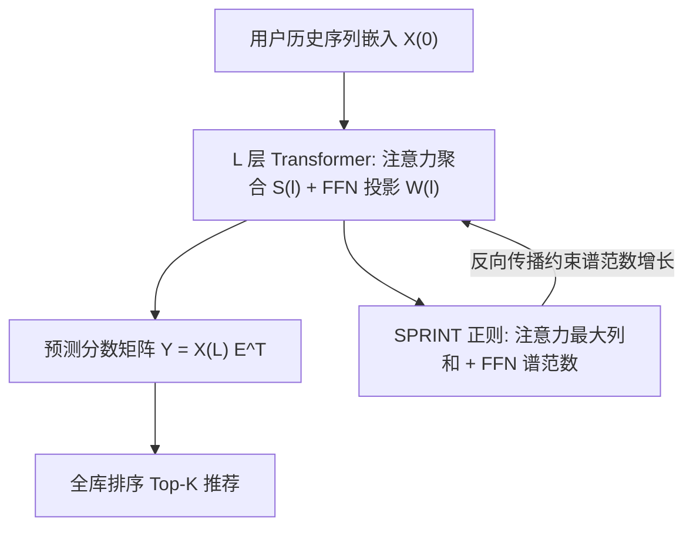

# The Pitfall of Scaling Up: Uncovering and Mitigating Popularity Bias Amplification in Scaling Transformer-based Recommenders (规模化的陷阱：揭示并缓解 Transformer 序列推荐规模化中的流行度偏差放大)

- **会议/期刊**: KDD 2026
- **作者与机构**: Weiqin Yang, Yue Pan, Chongming Gao, Sheng Zhou, Xiang Wang, Can Wang, Jiawei Chen（浙江大学 / 中国科学技术大学）
- **推荐链路定位**: 精排（序列推荐打分）
- **研究方向**: 去偏公平与工业架构 / 序列推荐
- **论文原文**: [https://arxiv.org/abs/2606.21911v1](https://arxiv.org/abs/2606.21911v1)
- **开源代码**: [https://github.com/Tiny-Snow/GenRec](https://github.com/Tiny-Snow/GenRec)

## TL;DR (1分钟核心速览)

本文揭示 Transformer 序列推荐"规模化陷阱"：模型变大准确率上升，但流行度偏差同步放大，长尾公平性在深度超过 8 层后持续恶化。作者从理论上证明注意力聚合与 FFN 投影的堆叠会协同引发**预测分数矩阵的谱坍缩**（最大奇异值占比在 ML-1M 上达 99.9%），而主奇异分量正是流行度的载体。据此提出 SPRINT：约束注意力矩阵最大列和 + FFN 权重谱范数。在 6 个数据集、SASRec++/HSTU 双骨干上，NDCG/HR@5 平均 +15.70%，Fair-0.8 平均 +7.12%，且训练开销仅约 3%。

## Background & Motivation (背景与核心矛盾)

- **主流范式**: 受 Scaling Law 驱动，序列推荐正沿 Transformer 深度/宽度/嵌入维度激进扩容（SASRec++、HSTU 等），工业界已验证扩容带来准确率增益。
- **前人局限**: ① 现有去偏方法（重加权 R2Rec/D2LR、因果解耦 MOJITO/TPAB、谱正则 LogDet/ReSN）几乎都面向静态协同过滤，依赖静态用户嵌入，无法适配序列推荐中动态演化的用户偏好；② 它们把模型当黑盒，未触及 Transformer 架构本身在深层堆叠下**内生**放大偏差的机制。
- **核心洞察 (Key Insight)**: 由 Lemma 3.1，物品流行度主要编码在预测分数矩阵 $\hat{Y}$的主奇异分量中，其强度由谱范数$\sigma_1(\hat{Y})$决定。实验发现深度增加时$\sigma_1^2/\sum_k\sigma_k^2$ 单调上升（谱坍缩），主分量对推荐结果的影响被不成比例放大——这正是偏差放大的直接通道。
- **本文切入点**: 不做全局后处理去偏，而是**逐层约束引发谱坍缩的两个架构源头**（注意力聚合、FFN 投影），从根上给预测谱范数套上上界。

## Method (核心方法设计)

### 1. 整体框架 (Overall Architecture)

SPRINT 是一个即插即用的训练期正则框架，不改变任何推理结构。输入为用户历史序列嵌入 $X^{(0)}$，经$L$层 Transformer 得到$X^{(L)}$，与物品嵌入内积得$\hat{Y}=X^{(L)}E^\top$。关键观察是把$L$层输出重写为$X^{(L)}=(S^{(L)}\cdots S^{(1)})X^{(0)}(W^{(1)}\cdots W^{(L)})$：左侧注意力连乘与右侧 FFN 权重连乘分别对应两条谱范数增长通道。SPRINT 在每层对$S^{(\ell)}$的最大列和与$W^{(\ell)}$ 的谱范数施加正则，与推荐损失联合优化，从而在训练中抑制谱坍缩、在推理时保持原有打分与全库排序流程不变。

### 2. 关键设计拆解 (Key Designs)

1. **注意力正则（约束最大列和，抑制流行度优先聚合）**：痛点在于流行物品占据超过 75% 的注意力权重，且各层注意力主奇异向量高度对齐（余弦相似度 > 0.8），由 Theorem 3.2 连乘后谱范数随深度**指数增长**。直接算 $\|S^{(\ell)}\|_2$需$O(|U|\bar n^3)$的 SVD 且注意力随输入动态变化不可行，故利用行归一化性质$\|S\|_2\le\sqrt{\|S\|_1\|S\|_\infty}=\sqrt{\|S\|_1}$，再用 logsumexp 平滑 max 得到可微代理：
$$\widetilde{\|S^{(\ell)}\|_1}=\tfrac{1}{\tau}\log\sum_{u,t}\exp\big(\tau\cdot\|S^{(\ell)}_{u,t}\|_1\big),\ \tau=1$$
列和直接刻画每个物品在聚合中的总影响力，约束它即阻止少数热门物品主导聚合；复杂度降至 $O(|U|\bar n^2)$。作者特别指出不用 Frobenius 范数，因为$\|S\|_F^2=\sum_k\sigma_k^2$ 会连带压制长尾奇异分量。

2. **FFN 正则（约束谱范数，抑制低秩化）**：由 Lemma 3.3，梯度下降下奇异值导数 $\frac{d}{dt}\sigma_k\propto L\cdot(\sigma_k^2)^{1-1/L}$随深度$L$单调增大，导致$\sigma_1$相对其余奇异值增长更快、表征趋于极端低秩。故对每层权重施加$\|W^{(1)}\cdots W^{(L)}\|_2\le\prod_\ell\|W^{(\ell)}\|_2$的上界约束，$\|W^{(\ell)}\|_2$用单步幂迭代以$O(d^2)$ 估计，多层线性可进一步松弛为逐矩阵约束。

3. **训练目标与开销**：总损失
$$\mathcal{L}_{\text{SPRINT}}=\mathcal{L}_{\text{rec}}+\lambda_{\text{attn}}\sum_{\ell=1}^{L}\log\widetilde{\|S^{(\ell)}\|_1}+\lambda_{\text{ffn}}\sum_{\ell=1}^{L}\log\|W^{(\ell)}\|_2$$
取对数把连乘上界转为逐层求和，便于梯度检查点。Theorem 4.1 证明该目标对 $\|\hat{Y}\|_2$构成严格上界，从而由 Lemma 3.1 保证偏差缓解。额外复杂度$O(L|U|\bar n^2+Ld^2)$，实测仅约 3% 训练时间；推理零开销，负采样沿用骨干原有策略。

## Experimental Setup & Evaluation Protocol (实验设置与评估协议)

- **数据集与预处理**: 6 个公开数据集，预处理严格沿用 SASRec 系列惯例（`5-core` 过滤 + 按时间排序）：

| 数据集 | 来源 | 规模/稀疏度特征 | 场景说明 |
| :--- | :---: | :---: | :--- |
| ML-1M | MovieLens | 中等规模，Top-20% 物品占 62.6% 交互 | 电影，长尾显著 |
| ML-20M | MovieLens | 大规模、极偏分布 | 用于 0.34B 参数规模化实验 |
| Beauty | Amazon | 稀疏 | 美妆 |
| Toy | Amazon | 稀疏 | 玩具 |
| Electronic | Amazon | 稀疏、极短序列 | 电子 |
| Clothing | Amazon | 极稀疏 | 服饰 |
| Book | Amazon | 稀疏、长尾重 | 图书 |

- **数据划分与防穿越 (Splitting Strategy)**: 采用序列推荐标准的 `Leave-One-Out`（最后一项测试、倒数第二项验证），严格按时间顺序，无未来信息穿越。
- **排名评测协议 (Ranking Protocol)**: 无偏 `Full-Ranking`（对全库未交互物品排序），报告 NDCG@{5,10}、HR@{5,10}；公平性用 Fair-$\alpha$（Top-1 推荐中底部$\alpha$长尾物品曝光比例），主实验$\alpha=0.8$，ML-20M 因分布极偏改用 Fair-0.95。
- **对比基线与超参设置**: 4 类 8 个基线——谱正则 LogDet (NeurIPS'23)/ReSN (WSDM'25)、倾向重加权 R2Rec (WWW'25)/D2LR (SIGIR'25)、时序解耦 MOJITO (SIGIR'23)/TPAB (KDD'25)、分布鲁棒 DROS (SIGIR'23)。骨干为 SASRec++ 与 HSTU，主实验层数扩至 8、嵌入维度 256；规模化实验在 ML-20M 上从 0.05M 扩至 0.34B 非嵌入参数（12 层、1536 维，6912× 扩容）。

## Key Experimental Results (实验关键数据)

### 1. 主实验对比 (Main Results)

SASRec++ 骨干，NDCG@5 / Fair-0.8（节选 4 个代表性数据集，完整见原文 Table 1）：

| 方法 | ML-1M N@5 | ML-1M Fair | Beauty N@5 | Beauty Fair | Toy N@5 | Toy Fair | Book N@5 | Book Fair |
| :--- | :---: | :---: | :---: | :---: | :---: | :---: | :---: | :---: |
| SASRec++ | .0807 | .2227 | .0248 | .2694 | .0314 | .3741 | .0229 | .4128 |
| +DROS | .0830 | .2172 | .0251 | .2592 | .0282 | .3478 | .0228 | .4154 |
| +MOJITO | .0812 | .2188 | .0294 | .3202 | .0363 | .3803 | .0276 | .2375 |
| +R2Rec | .0771 | .1997 | .0252 | .3108 | .0294 | .3878 | .0264 | .3028 |
| +D2LR | .0829 | .2317 | .0246 | .3152 | .0288 | .3543 | .0245 | .4208 |
| +LogDet | .0849 | .1792 | .0272 | .1071 | .0322 | .2833 | .0249 | .1832 |
| +ReSN | .0739 | .1223 | .0281 | .1016 | .0343 | .1515 | .0278 | .3572 |
| **+SPRINT** | **.0925** | **.2534** | **.0355** | **.4127** | **.0421** | **.4836** | **.0347** | **.4953** |
| Improv.% | +8.97% | +2.17% | +21.09% | +9.25% | +15.81% | +9.58% | +24.67% | +7.45% |

HSTU 骨干上 SPRINT 同样全面领先（如 Toy N@5 从 .0310 提至 .0438，+36.98%；Electronic Fair 从 .0014 提至 .2150，+20.34%）。生成式推荐扩展（Table 2）：TIGER 在 Beauty 上 N@5 由 .0306→.0343、Fair 由 .1081→.1609；LETTER 在 Toy 上 Fair 由 .2162→.2671。

### 2. 消融实验 (Ablation Study)

| 配置 | 准确率 (NDCG@5) | 公平性 (Fair-0.8) | 说明 |
| :--- | :---: | :---: | :--- |
| SASRec++ 基线 | 最低 | 最低 | 无正则 |
| w/o attn 正则（仅 FFN） | 中等提升 | 中等提升 | 仅控低秩化 |
| w/o FFN 正则（仅 attn） | 中等提升 | 中等提升 | 仅控聚合放大 |
| **SPRINT 完整** | **最优** | **最优** | 二者协同 |

（原文 Table 7 给出完整数值；Figure 6 显示移除 6 个注意力块或 6 个 FFN 块均能缓解谱坍缩，验证两组件均需联合正则。）

### 3. 关键实验发现 (Key Findings)

1. **深度是偏差放大器而非准确率放大器**：层数从 2 增至 8 时，基线方法准确率饱和甚至下降、公平性持续恶化；SPRINT 在 8 层时仍保持 NDCG@5 与 Fair-0.8 双升（Figure 4），说明谱坍缩是扩容瓶颈而非容量不足。
2. **公平性提升并非以准确率为代价**：SPRINT 在 6 数据集上同时刷新准确率与公平性，Figure 5 显示其帕累托前沿严格优于所有基线——这与重加权类方法"压热门换公平"的此消彼长形成鲜明对比，根源在于它压制的是与流行度耦合的主奇异分量而非热门信号本身。
3. **正则强度存在明确最优区间且鲁棒**：$\lambda_{\text{attn}}$、$\lambda_{\text{ffn}}$ 在较宽范围内性能平稳（Figure 9），且训练开销仅约 3%（Figure 7），具备工业部署可行性；在 TIGER/LETTER 生成式骨干上同样稳定增益，说明谱坍缩是 Transformer 架构级通病而非某一骨干特例。

## Highlights & Limitations (亮点、对比与审稿批判)

- **与代表作对比 (vs. Prior Work)**: 与 ReSN/LogDet 的本质区别在于——后者在静态 CF 的用户/物品嵌入空间做全局谱惩罚，无法处理序列推荐中动态演化的用户表征，且不区分架构组件；SPRINT 定位到注意力与 FFN 两条具体谱增长通道做**逐层**约束。与 MOJITO/TPAB 的因果解耦相比，SPRINT 无需构造因果图，且直接作用于偏差放大的生成机制而非事后校正。
- **可迁移亮点**: ① 用"行归一化矩阵的 $\sqrt{\|S\|_1}$ 上界 + logsumexp 平滑"替代 SVD 估计谱范数，是处理动态输入矩阵谱约束的通用技巧，可迁移到任意注意力型推荐/检索模型；② 把多层连乘的谱上界取对数转为逐层求和，天然兼容梯度检查点与分布式训练。
- **审稿级局限批判**: ① 理论推导假设 FFN 恒等激活与注意力跨层奇异向量对齐（$\epsilon$-扰动），真实非线性与多头设置下界仅"至多差常数因子"，理论紧度有限；② 公平性仅在 Top-1 曝光比例上主评，未讨论用户侧公平（不同活跃度用户的效用差异）与多样性/新颖性等更细粒度生态指标；③ 规模化实验仅在 ML-20M 单数据集完成，0.34B 结论的跨域泛化性证据偏薄。

## Rating (四维评分)

- **方法创新性 (Novelty)**: ⭐⭐⭐⭐ （核心机制与方法设计具备明确创新性，理论与实验动机支撑充分）
- **评估协议与实验扎实度 (Protocol & Experiments)**: ⭐⭐⭐⭐ （主流公开数据集评测完整，包含多基线对比与消融实验验证）
- **写作与数学规范度 (Clarity & Rigor)**: ⭐⭐⭐⭐⭐ （问题形式化定义清晰，核心模块数学推导与架构阐述严谨易读）
- **工业落地与复现价值 (Industrial & Practical Value)**: ⭐⭐⭐⭐ （兼顾推荐效果增益与训练/推理效率，具备实际场景迁移参考价值）
