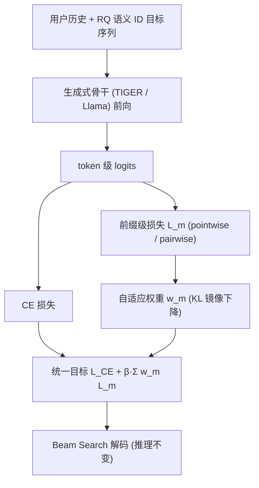

# APAO: Bridging the Training-Inference Gap in Generative Recommendation via Adaptive Prefix-Aware Optimization (自适应前缀感知优化：弥合生成式推荐的训练-推理鸿沟)

- **会议/期刊**: KDD 2026
- **作者与机构**: Yuanqing Yu, Yifan Wang, Weizhi Ma, Zhiqiang Guo, Min Zhang（清华大学 DCST / AIR、泉城实验室）
- **推荐链路定位**: 生成式端到端（语义 ID 自回归生成 + Beam Search 解码）
- **研究方向**: 生成式推荐与离散语义 ID / 序列推荐
- **论文原文**: [https://arxiv.org/abs/2603.02730v4](https://arxiv.org/abs/2603.02730v4)
- **开源代码**: [https://github.com/yuyq18/APAO](https://github.com/yuyq18/APAO)

## TL;DR (1分钟核心速览)

生成式推荐用 teacher-forcing 的 token 级交叉熵训练，却在推理时用 Beam Search 逐步剪枝，二者存在**前缀级不一致**：某物品即使全局得分很高，只要中间某步前缀跌出 Top-$K$ 就被永久丢弃。本文提出 APAO，在训练中引入前缀级 pointwise/pairwise 排序损失，并用 KL 正则的**自适应最差前缀加权**动态聚焦当前最脆弱的前缀。在 4 个 Amazon/Yelp 数据集、TIGER 与 Llama 两种骨干上，Beam=20 解码下 Recall@20 相对最强基线最高提升 **+13.27%**，且训练开销与 CE 持平；微信公众平台线上 A/B 提升 **+0.9% pCTR**。

## Background & Motivation (背景与核心矛盾)

- **主流范式**: 物品经 RQ-VAE/RQ-K-means 量化为 $T$个语义 token，模型以用户历史为条件自回归预测下一物品的 token 序列；训练用 token 级 CE，推理用 Beam Search 保留 Top-$K$ 前缀以兼顾相关性排序与效率（相比全库打分快数个数量级）。
- **前人局限**: ① CE 只优化**平均 token 似然**，允许后续 token 补偿前面低概率前缀，而 Beam Search 要求**每一步**前缀都进入 Top-$K$，单步失败即整条路径出局；② 现有偏好对齐方法（DPO/DMPO/S-DPO）只在**完整物品级**做排序优化，对中间解码步的累积误差无监督，模型从未因"掉出 beam"被惩罚。
- **核心洞察 (Key Insight)**: 形式化对比可见，全库排序的成功条件是 $\mathbb{I}_{\text{Full}}(y)=\mathbb{I}(\text{rank}_{\mathcal{Y}}(S(y|x))\le K)$，仅依赖最终累积分；而 Beam Search 的成功条件是链式交集$\mathbb{I}_{\text{Beam}}(y)=\prod_{t=1}^{T}\mathbb{I}(\text{rank}_{t}(S_t(y^{1:t}))\le K)$。二者差异正是**前缀级排名约束**，且该约束在标准训练目标中完全缺席。
- **本文切入点**: 不改推理管线（避免额外服务延迟），而在**训练侧**补上前缀级排序目标，使优化目标与 Beam Search 行为对齐。

## Method (核心方法设计)

### 1. 整体框架 (Overall Architecture)

模型保持原有生成式骨干（TIGER 编码器-解码器 / Llama 纯解码器）与 RQ 语义 ID 不变，仅在损失层做增量改造：对每个训练样本，除标准 CE 外，额外在**每个前缀长度 $m\in\{1,\dots,T\}$** 上计算前缀级损失$\mathcal{L}_m$（pointwise 或 pairwise），再以自适应权重$w_m$加权求和，与 CE 组成单阶段统一目标联合优化。权重$w_m$ 不是超参，而是通过 KL 正则的镜像下降在线更新，自动向当前损失最大的"最差前缀"倾斜。推理阶段完全沿用原 Beam Search，零额外开销。

### 2. 关键设计拆解 (Key Designs)

1. **前缀级 Pointwise / Pairwise 损失（把"逐步剪枝"写进损失）**：痛点在于 CE 对前缀无差别平均。Pointwise 变体对长度 $m$的前缀重算平均对数似然$\mathcal{L}_{\text{point}}(m)=-\frac{1}{m}\sum_{t=1}^{m}\log\frac{e^{z^t_{i,y^t_i}}}{\sum_{j\in V}e^{z^t_{i,j}}}$，等价于对不同解码位置重新分配优化权重；Pairwise 变体则显式建模相对排名，用前缀累积分$S^m_i=\sum_{t=1}^m s^t_i$构造多负样本 softmax 排序损失$\mathcal{L}_{\text{pair}}(m)=-\log\sigma\!\big(-\log\sum_{j\in\mathcal{N}}\exp(S^{m,-}_j-S^{m,+}_i)\big)$，负样本截断到同长度$m$ 以保证同深度可比。直觉：Beam Search 本质是排序，pairwise 直接优化"正前缀压过负前缀"的概率，比 pointwise 的分布克隆更贴近剪枝行为。

2. **自适应最差前缀优化（Adaptive Worst-Prefix）**：由链式条件可知整体解码被**最弱前缀**瓶颈化，理想目标是 hard-max $\mathcal{L}_{\text{worst}}=\max_m \mathcal{L}_m$，但直接取 mini-batch 瞬时最大损失会导致训练震荡。作者改为在概率单纯形上求解带 KL 正则的软加权问题$\mathbf{w}^{(\tau+1)}=\arg\max_{\mathbf{w}\in\triangle_T}\sum_m w_m\mathcal{L}^{(\tau+1)}_m-\frac{1}{\eta}\text{KL}(\mathbf{w}\|\mathbf{w}^{(\tau)})$，由 KKT 条件得闭式解$w^{(\tau+1)}_m=\frac{w^{(\tau)}_m\cdot\exp(\eta\mathcal{L}_m)}{\sum_j w^{(\tau)}_j\cdot\exp(\eta\mathcal{L}_j)}$。$\eta$ 控制权重漂移速度，越小越平滑；该式即"损失越大的前缀权重指数级放大"，且无需额外前向。

3. **训练目标、负采样与推理效率**：总损失 $\mathcal{L}_{\text{total}}=\mathcal{L}_{\text{CE}}+\beta\sum_{m=1}^{T}w_m\mathcal{L}_m$（pointwise 用$\mathcal{L}_{\text{point}}$，pairwise 用$\mathcal{L}_{\text{pair}}$），单阶段联合训练，无需 SFT→对齐的两阶段流程。负采样统一采用均匀随机负采样、负样本数固定 100（所有对比方法一致）。复杂度上 pointwise 与 CE 同为$O(B\cdot T\cdot(d^2+|V|d))$，因前缀损失直接复用 token logits、无需额外前向；pairwise 为$O(B\cdot(N+1)T\cdot(d^2+|V|d))$，与 S-DPO 同阶但**省去参考模型推理**，实测训练更快。

## Experimental Setup & Evaluation Protocol (实验设置与评估协议)

- **数据集与预处理**: 四个公开数据集，均做 `5-core` 过滤，用户历史截断至最近 20 项：

| 数据集 | #Users | #Items | #Interactions | 稀疏度/密度 | 特征/场景说明 |
| :--- | :---: | :---: | :---: | :---: | :--- |
| Office | 4,905 | 2,420 | 53,258 | 0.45% | Amazon 办公用品 |
| Grocery | 14,681 | 8,713 | 151,254 | 0.12% | Amazon 食品杂货 |
| Beauty | 22,363 | 12,101 | 198,502 | 0.07% | Amazon 美妆 |
| Yelp | 30,431 | 20,033 | 316,354 | 0.05% | Yelp 本地商户 |

- **数据划分与防穿越 (Splitting Strategy)**: `Leave-One-Out`（最后一项为测试、倒数第二项为验证），遵循 TIGER 系列协议。
- **排名评测协议 (Ranking Protocol)**: 采用 **Beam Search 解码（beam size $K=20$）** 生成候选并排序，报告 R@10/20 与 N@10/20；未采用全库 Full-Ranking 打分，故指标绝对值偏低但贴近真实部署。
- **对比基线与超参设置**: 基线为 CE、MSL、DPO、DMPO、S-DPO 五类损失改进方法；骨干为 TIGER（编码器-解码器）与 Llama（纯解码器），参数量均约 0.01B；语义 ID 由 Llama-3.1-8B-Instruct 提特征 + 4 级 RQ-K-means 量化。学习率 5e-4、AdamW、batch 1024、最多 200 epoch；$\beta\in\{0.05,\dots,0.4\}$，$\eta\in\{5\text{e-}6,\dots,5\text{e-}4\}$；显著性用单样本 t 检验（$p\le0.01$）。

## Key Experimental Results (实验关键数据)

### 1. 主实验对比 (Main Results)

TIGER 骨干（Beam=20），节选核心指标：

| 方法 | Office R@20 | Office N@20 | Beauty R@20 | Beauty N@20 | Yelp R@20 | Yelp N@20 |
| :--- | :---: | :---: | :---: | :---: | :---: | :---: |
| CE | 0.1013 | 0.0394 | 0.0928 | 0.0398 | 0.0585 | 0.0252 |
| MSL | 0.0975 | 0.0404 | 0.0873 | 0.0364 | 0.0586 | 0.0257 |
| CE→DPO | 0.0922 | 0.0365 | 0.0767 | 0.0312 | 0.0406 | 0.0174 |
| CE→DMPO | 0.0924 | 0.0353 | 0.0892 | 0.0375 | 0.0542 | 0.0223 |
| CE→S-DPO | 0.1078 | 0.0435 | 0.0929 | 0.0392 | 0.0581 | 0.0251 |
| **APAO-Pointwise** | **0.1105** | **0.0447** | 0.0940 | 0.0409 | **0.0614** | **0.0265** |
| **APAO-Pairwise** | 0.1095 | 0.0444 | **0.0964** | **0.0421** | 0.0623 | 0.0271 |
| Max Improv. | +2.50% | +2.76% | +3.77% | +5.78% | +6.31% | +5.45% |

Llama 骨干提升更显著：Office R@20 由 S-DPO 的 0.0783 升至 APAO-Pairwise 的 **0.0905**（+13.27%），Beauty R@20 由 0.0770 升至 **0.0835**（+8.44%），Grocery R@20 由 0.0985 升至 **0.1101**（+11.78%），全部 $p\le0.01$ 显著。

### 2. 消融实验 (Ablation Study)

Beauty + Llama 骨干（NDCG@10）：

| 配置 | Pointwise | Pairwise |
| :--- | :---: | :---: |
| 完整 APAO | **0.0300** | **0.0293** |
| w/o Adapt.W（退化为均匀加权） | 0.0286 | 0.0288 |
| w/o $\mathcal{L}_{\text{prefix}}$（仅 CE） | 0.0274 | 0.0274 |
| w/o $\mathcal{L}_{\text{CE}}$ | 0.0289 | 0.0289 |
| 去掉 Prefix 0 监督 | 0.0284 | 0.0283 |
| 去掉 Prefix 1 / 2 / 3 监督 | 0.0286 / 0.0288 / 0.0290 | 0.0286 / 0.0289 / 0.0291 |

### 3. 关键实验发现 (Key Findings)

1. **早期前缀监督价值最高**：去掉 Prefix 0 使 NDCG@10 从 0.0300 掉到 0.0284（降幅约 5.3%），而去掉 Prefix 3 仅降至 0.0290——说明 Beam Search 的瓶颈集中在解码早期，越早的前缀一旦被剪枝后续无法挽回，这与链式条件 $\prod_t\mathbb{I}(\cdot)$ 的理论预测一致。
2. **自适应加权优于固定策略**：均匀加权与指数衰减加权均不及自适应加权（0.0286/0.0288 vs. 0.0300/0.0293），验证了"动态聚焦最弱前缀"比静态先验更契合剪枝行为；且 $\beta\in[0.1,0.4]$、$\eta$ 在较宽范围内性能稳定，超参不敏感。
3. **前缀级 Recall 随深度递增**：在 Office/Beauty 上，相对最佳基线的 Recall@20 提升从前缀 0 的 3.78%/0.76% 单调增至完整物品（前缀 3）的 15.58%/8.44%，直接证明 APAO 是在**逐步挽救被剪枝的正确候选**，而非仅靠末端重排；同时 $K=20$的 APAO 即可匹敌基线$K=100$ 的效果，等效于以更小 beam 换更高质量。

## Highlights & Limitations (亮点、对比与审稿批判)

- **与代表作对比 (vs. Prior Work)**: 与 S-DPO/DMPO 的本质区别在于优化粒度——后者只在完整物品序列上做偏好排序，APAO 把监督下沉到**每个前缀深度**并自适应加权；与 MSL 的 token 掩码去噪相比，APAO 不改 softmax 归一化而是补排序约束；与推理侧改造（如更大 beam、重排）相比，APAO 零推理延迟增量。
- **可迁移亮点**: ① "训练目标对齐解码器剪枝行为"的思路可直接迁移到任何自回归检索/生成式召回（如语义 ID 检索、文档生成式检索）；② KL 正则镜像下降求闭式权重更新的技巧，可用于任意多任务/多粒度损失的动态加权。
- **审稿级局限批判**: ① 评测仅在 Beam Search 协议下进行，未报告 Full-Ranking 全库排序结果，与部分全库评测工作不可直接比较，且 beam size 固定为 20 的敏感性虽有分析但缺少与更大 $K$的公平对齐讨论；② pairwise 变体依赖 100 个均匀随机负样本，未探索 hard negative，负采样质量可能限制其上界；③ 线上仅在微信公众平台单一场景验证 pointwise 变体，pairwise 的工业可行性（训练成本约为 pointwise 的$N+1$ 倍）尚未验证。

## Rating (四维评分)

- **方法创新性 (Novelty)**: ⭐⭐⭐⭐ （首次系统刻画生成式推荐中 Beam Search 剪枝与 teacher-forcing 的前缀级不一致，并给出下界理论与闭式自适应加权，问题定义比算子本身更有价值）
- **评估协议与实验扎实度 (Protocol & Experiments)**: ⭐⭐⭐⭐ （4 数据集 × 2 骨干 × 5 基线 + 消融/分词器鲁棒性/beam 可扩展性/效率/线上 A/B 齐全，但缺 Full-Ranking 对照与 hard negative 探索）
- **写作与数学规范度 (Clarity & Rigor)**: ⭐⭐⭐⭐ （全库 vs. Beam 的成功条件对比推导清晰，KKT 闭式解与复杂度分析完整，符号统一）
- **工业落地与复现价值 (Industrial & Practical Value)**: ⭐⭐⭐⭐⭐ （pointwise 变体训练开销与 CE 持平、推理零改动，已在微信公众平台上线 +0.9% pCTR，代码与配置全开源）

