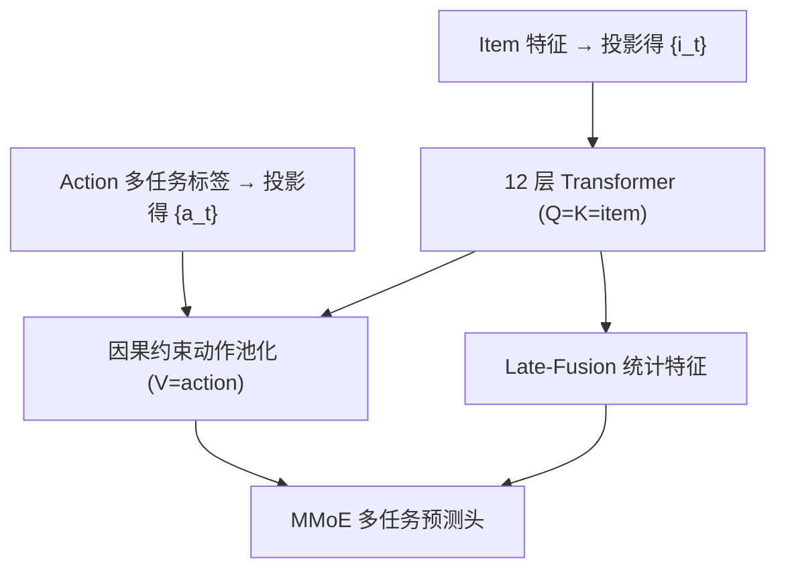
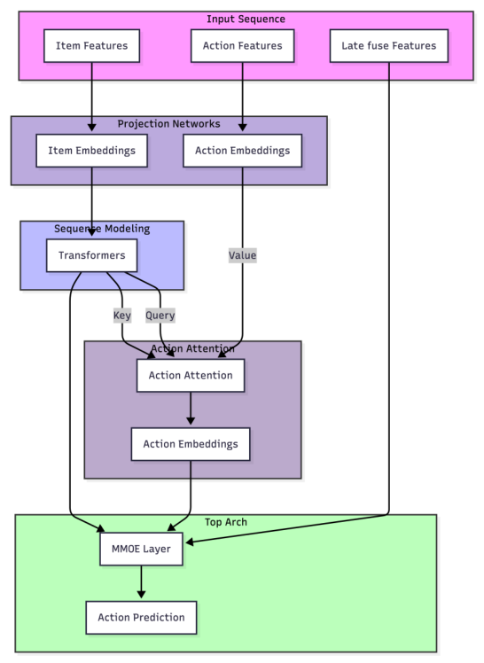

# Beyond Interleaving: Causal Attention Reformulations for Generative Recommender Systems (超越交错：生成式推荐的因果注意力重构)

- **会议/期刊**: KDD 2026 (submitted)
- **作者与机构**: Hailing Cheng (LinkedIn Inc.)
- **推荐链路定位**: 精排 (Ranker)
- **研究方向**: 生成式推荐 / 序列推荐
- **论文原文**: [arXiv:2603.10369v1](https://arxiv.org/abs/2603.10369v1)
- **开源代码**: 暂未开源

## TL;DR (1分钟核心速览)

以 HSTU 为代表的生成式推荐把 item 与 action token 交错成单序列 `[i0,a0,i1,a1,...]`，导致序列长度翻倍、注意力二次开销 4×、异构 token 语义纠缠与注意力噪声。本文从第一性原理证明交错自注意力本质是"以 item 为条件的相似度加权动作池化"的低效代理，提出 AttnLFA（晚期动作融合）与 AttnMVP（混合 Value 早期融合）显式编码 $i_n\to a_n$ 因果。在 LinkedIn 大规模产品推荐日志上，Eval Loss 相对降低 0.29%/0.80%，三项任务 NE 全面下降，训练时间分别缩短 22.8%/12.3%。

## Background & Motivation (背景与核心矛盾)

- **主流范式**: 生成式推荐（HSTU、LAC 等）将用户行为建模为 token 生成，把 item 与 action 交错为单一序列，依赖因果自注意力隐式恢复 item-action 对应关系。
- **前人局限**: ① **语义异构**——item 空间近乎无界、action 词表仅数十，二者非可组合关系，交错迫使 Transformer 学习无数据支撑的人为对齐；② **因果稀释与结构歧义**——$a_n$ 对全前缀注意力稀释了对 $i_n$ 的直接依赖，$i_n$ 又因 RoPE/RAB 局部性偏置对 $a_{n-1}$ 产生虚假依赖；③ **计算低效**——长度 $N\to 2N$，注意力开销约 4×。
- **核心洞察 (Key Insight)**: 交错机制的成功源于自注意力充当了"结构化池化算子"——若目标 item 与历史 item 语义相似，其动作分布应相似；但该关联仅被间接、高开销地学到。作者进一步指出早期融合方案（Huang et al. 2025）需切分 context/candidate 段、注入 dummy action 造成分布失配，LAC 的 $(a_{n-1},i_n)$ 配对则是外生 item 序列的结构性伪影而非有效因果转移。
- **本文切入点**: 放弃 next-token 交错范式，将推荐重构为 **item 条件化的动作池化任务**，用严格因果掩码显式编码 $P(a_n\mid i_n,\mathcal{H}_{<n})$。

## Method (核心方法设计)

### 1. 整体框架 (Overall Architecture)

模型维持 item 与 action 两条独立表征流。Item 特征经投影得 $\{i_t\}$，action 多任务标签（click/dwell/like/share/comment 等 10+ 监督信号）经独立投影得 $\{a_t\}$。Item 流经 12 层 Transformer 得到上下文表征；在末端以 item 表征为 Query/Key、action 表征为 Value 做严格因果约束的注意力池化，得到动作聚合表征，与 late-fusion 统计特征拼接后送入 MMoE 预测头输出多任务打分。AttnMVP 则将 action 信号提前注入每层 Transformer 的 Value 流。全流程序列长度由 $2N$ 降为 $N$。

<figure class="paper-figure" markdown="span">
  <figcaption>图 5：基于注意力的动作后融合（AttnLFA）。物品嵌入经过一系列 Transformer 块（为清晰起见标记为“Transformers”）变换以生成潜在序列表示。这些表示同时作为后续注意力机制的 Query 和 Key。在最后阶段，动作嵌入通过因果约束的注意力池化操作作为 Value 整合，并以序列上下文为条件。得到的聚合动作表示随后被送入预测头以产生最终输出。</figcaption>
</figure>

### 2. 关键设计拆解 (Key Designs)

1. **AttnLFA：晚期动作融合 + 查询移位严格因果**：痛点在于自定义因果掩码不被 FlashAttention kernel 高效支持。做法是保持 item 流标准自注意力，末端以 $Q=K=H^{(L)}_{\text{item}}$、$V=\{a_t\}$ 做池化，并通过 **query-shifting**（query 序列相对 key 左移一位 + `is_causal` 标志 + 输出左侧零填充）实现"$i_n$ 只能看 $\{0,\dots,n-1\}$、禁止看自身"的严格因果，$i_0$ 自然得空表征。直觉：相似 item 诱导相似动作分布，池化权重即语义相似度，避免 label leakage 的同时保留 FlashAttention 吞吐。

2. **AttnMVP：混合 Value 早期融合**：痛点在于 AttnLFA 仅在末端注入动作，item 表征在 12 层中始终是"内容语义"而非"偏好语义"。做法是在每层构造混合 Value：
$$\mathbf{V}^{(\ell)}_t = \mathbf{H}^{(\ell-1)}_t + \lambda\, \mathbf{a}_t,\quad Q^{(\ell)}=K^{(\ell)}=\mathbf{H}^{(\ell-1)},\ \lambda=1$$
动作信号在严格因果约束下逐层注入 item 表征，使其从"狗 vs 猫"演化为"偏好的狗 vs 厌恶的猫"，个性化端到端涌现而无需手工画像特征。$\lambda\in[0.5,1.0]$ 敏感性分析稳定。

3. **训练目标、负采样与推理效率**：多任务二分类，总损失为各任务 BCE 之和 $\mathcal{L}=\sum_{k}\text{BCE}(y_k,\hat y_k)$，无显式负采样（全库候选由排序系统给定）。因序列减半，训练时间降 22.8%（AttnLFA）/12.3%（AttnMVP），推理侧注意力 FLOPs 约降 4×。

## Experimental Setup & Evaluation Protocol (实验设置与评估协议)

- **数据集与预处理**: 来自某大型职业社交网络的产品推荐日志，用户交互序列最长 1024 事件、覆盖过去 12 个月；item 侧含文本/作者/类型嵌入，viewer 侧含设备类型等上下文特征。原文未披露精确用户/物品规模统计。

| 数据集 | #Users | #Items | #Interactions | 稀疏度/密度 | 特征/场景说明 |
| :--- | :---: | :---: | :---: | :---: | :--- |
| LinkedIn 产品推荐日志 | 未披露 | 未披露（近乎无界） | 每序列 ≤1024 | 未披露 | 10+ 动作标签，12 个月窗口 |

- **数据划分与防穿越 (Splitting Strategy)**: **全局时间戳切分**——训练窗口之后紧邻的时间段作评估；每条评估序列再切为 context 段（训练截止前）与 candidate 段（截止后），评估时施加 **timestamp-based label masking**，loss 与指标仅在 candidate item 上计算。
- **排名评测协议 (Ranking Protocol)**: 工业排序场景，报告多任务 **Eval BCE Loss** 与 **Normalized Entropy (NE)**（越低越好），非 Full-Ranking 召回指标；context 段交错基线用标准因果掩码、AttnLFA 用严格因果掩码，candidate 段内候选 item 互不可见。
- **对比基线与超参设置**: 主基线为强交错式生成推荐 ranker（HSTU 类，12 层）；所有模型共享相同特征集、嵌入层、Transformer 块与投影头，统一 RoPE 位置编码，单 epoch 训练，保证受控对比。任务含 Long Dwell（$\mathbb{1}(\text{dwell}>\tau)$）、Contribution（任一非点击互动）、Like。

## Key Experimental Results (实验关键数据)

### 1. 主实验对比 (Main Results)

| Model | Eval Loss | LongDwell NE | Contribution NE | Like NE | Train Time |
| :--- | :---: | :---: | :---: | :---: | :---: |
| Baseline (Interleaved) | – | – | – | – | – |
| **AttnLFA** | **-0.29%** | **-0.06%** | **-0.49%** | **-0.47%** | **-22.8%** |
| **AttnMVP** | **-0.80%** | **-0.41%** | **-1.1%** | **-1.1%** | **-12.3%** |

（表中为相对基线的变化率，负值代表更优；其余 9 项任务趋势一致，原文省略。）

### 2. 消融实验 (Ablation Study)

| 变体 | Eval Loss | LongDwell NE | Contribution NE | Like NE | Train Time |
| :--- | :---: | :---: | :---: | :---: | :---: |
| AttnMVP (full) | -0.80% | -0.41% | -1.1% | -1.1% | -12.3% |
| AttnMVP – LFA（去末端动作池化） | -0.78% | -0.40% | -1.0% | -1.0% | -13.02% |

### 3. 关键实验发现 (Key Findings)

1. **早期融合是增益主引擎**：AttnMVP 相对 AttnLFA 将 Eval Loss 降幅从 0.29% 扩至 0.80%、NE 降幅从 0.06–0.49% 扩至 0.41–1.1%；而移除末端 LFA 池化仅损失 0.02% Loss 与 0.1% NE，说明绝大部分收益来自"动作信号在 Transformer 层内因果注入 item 表征"，而非末端池化本身。
2. **因果显式化同时改善精度与效率**：两种架构在全部 12 项任务上 NE 一致下降，且训练时间分别缩短 22.8%/12.3%，验证"序列减半 + 消除异构 token 纠缠"并非精度-效率权衡，而是双赢。
3. **动作中心双流并非更优**：探索性 AttnDHN 需将学习率减半才稳定、每层等效双倍更新，且 action 词表仅数十而 item 空间无界，导致动作中心表征表达力弱、噪声大，未能稳定超越 AttnMVP——反证"以 item 为中心、action 为条件信号"的非对称设计才是正确归纳偏置。

## Highlights, Limitations & Rating (亮点、对比与审稿评价)

- **与代表作对比 (vs. Prior Work)**: 相较 HSTU 类交错范式，本文不靠隐式注意力"事后恢复"因果，而是结构上强制 $i_n\to a_n$ 单向依赖，序列减半；相较 Huang et al. (2025) 早期融合需切分 context/candidate 段并注入 dummy action（分布失配、无法端到端训练长历史），AttnMVP 在单一序列内端到端完成早期融合；相较 LAC 的 $(a_{n-1},i_n)$ 配对，本文指出其为外生序列的结构性伪影，不予采用。
- **可迁移亮点**: ① **query-shifting + `is_causal`** 技巧可在不写自定义掩码的前提下实现"禁止自注意力"的严格因果，兼容 FlashAttention 高吞吐；② **混合 Value 加法融合**（$\mathbf{V}=\mathbf{H}+\lambda\mathbf{a}$）是极轻量的条件信号注入范式，可迁移到任意"主实体流 + 辅助信号流"的序列建模。
- **审稿级局限批判**: ① 实验仅来自单一社交网络内部日志，无公开数据集复现，且仅报告相对变化率、缺少绝对 NE/Loss 与置信区间，统计显著性未检验；② 增益幅度较小（Loss 0.29–0.80%），且 AttnMVP 训练提速（12.3%）反而低于 AttnLFA（22.8%），效率-精度权衡的边界未充分刻画；③ AttnDHN 仅作探索性讨论、未给出完整数据，削弱了"双流不可行"结论的说服力。
- **四维评分**: 创新性 ⭐⭐⭐⭐ | 实验扎实度 ⭐⭐⭐ | 方法清晰度 ⭐⭐⭐⭐⭐ | 落地价值 ⭐⭐⭐⭐

