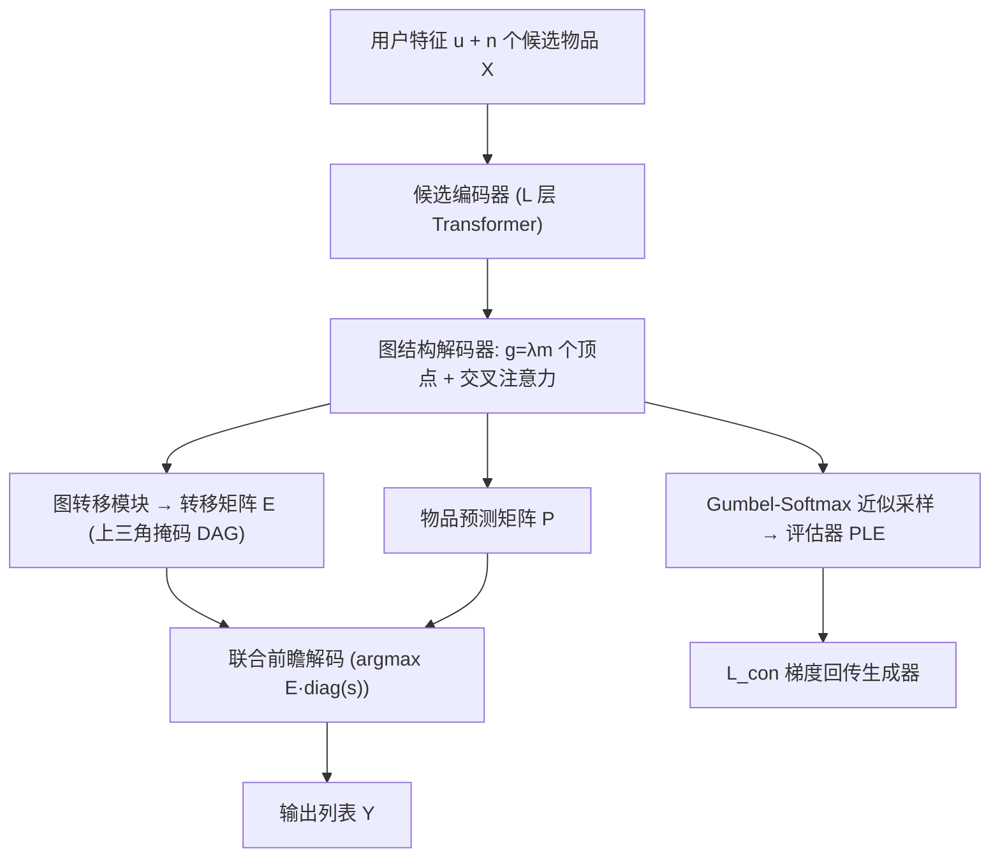

# Breaking the Likelihood Trap: Consistent Generative Recommendation with Graph-structured Model (打破似然陷阱：一致性图结构生成式推荐)

- **会议/期刊**: KDD 2026
- **作者与机构**: Qiya Yang, Xiaoxi Liang (PKU, 共同一作) / Zeping Xiao, Ying Cao, Yingjie Deng, Yuxin Ren, Yalong Wang, Yongqi Liu (快手)
- **推荐链路定位**: 重排 (Reranking, 生成式端到端)
- **研究方向**: 生成式推荐与离散语义 ID / 多任务学习与列表级重排
- **论文原文**: [https://arxiv.org/abs/2510.10127v3](https://arxiv.org/abs/2510.10127v3)
- **开源代码**: 暂未开源

## TL;DR (1分钟核心速览)

生成式重排把重排建模为整列表序列生成，但标准 MLE 训练使模型反复推荐高频热门物品，形成"似然陷阱"——高似然序列同质化、用户效用低。本文提出 CONGRATS：将非自回归解码器的隐状态组织为有向无环图（顶点数 $g=\lambda m$），用可学习转移矩阵显式建模物品依赖以扩大解码空间；再用 Gumbel-Softmax 把评估器（PLE 多任务模型）的梯度回传进生成器，实现偏好一致性训练。快手 60 候选/6 曝光设定下 Recall@6 从 65.05% 提升至 72.84%（+7.79pt），线上 5 天 A/B 中 Views +0.78%、Watch Time +0.11%。

## Background & Motivation (背景与核心矛盾)

- **主流范式**: 重排普遍采用 Generator–Evaluator 框架，生成器产出候选列表、评估器打列表级效用分择优曝光；生成器已从打分排序（PRM）、自回归（Seq2Slate）演进到非自回归并行匹配（NAR4Rec），后者因实时性成为工业主流。
- **前人局限**: ① NAR 解码空间小且确定性强，每个位置独立取最高概率物品，导致列表高度同质、热门物品反复出现；② 纯似然训练（MLE）把概率质量过度分配给高频物品，与"多样性 + 用户留存"目标错位。
- **核心洞察 (Key Insight)**: NLP 中的"高概率≠高质量"在推荐中同样成立，但推荐候选集远小于词表，直接套用 Nucleus Sampling 会滑向长尾导致相关性崩塌（relevance collapse），RLHF 类方法又训练不稳——因此必须从**解码结构**与**训练目标**两端同时破局。
- **本文切入点**: 用图结构解码器把线性链扩成多路径 DAG 以扩大探索空间，同时把评估器接入训练回路做可微偏好对齐。

## Method (核心方法设计)

### 1. 整体框架 (Overall Architecture)

沿用 NAR4Rec 的编码器–解码器匹配架构：候选编码器用 $L$层 Transformer 把$n$个候选（拼接用户特征）编码为$\mathbf{H}_x$；图结构解码器以$g=\lambda m$个可学习顶点嵌入为输入，经自注意力与双向交叉注意力得到顶点隐状态$\mathbf{H}_v$，再由图转移模块生成转移矩阵$\mathbf{E}$与物品预测矩阵$\mathbf{P}$，联合解码出长度为$m$的列表。训练时生成损失$\mathcal{L}_{gen}$与评估器一致性损失$\mathcal{L}_{con}$ 联合优化；推理时用联合前瞻搜索一次性输出序列，保持非自回归的实时性。

### 2. 关键设计拆解 (Key Designs)

1. **图结构解码器（Graph-structured Decoder）**：痛点是非自回归解码只有 $m$个位置、每位置独立取 argmax，探索空间被锁死在线性链上。本文将位置嵌入扩展为$g=\lambda m$个"顶点"，把解码隐状态组织成 DAG，并从上三角掩码的自注意力式转移矩阵中采样路径$\tau=\{\pi_1,\dots,\pi_m\}$，满足$1=\pi_1<\pi_2<\cdots<\pi_m=g$：
$$P_\theta(\tau|X)=\prod_{t=1}^{m-1}\mathbf{E}_{\pi_t,\pi_{t+1}},\quad \mathbf{E}=\mathrm{Softmax}\!\left(\frac{\mathbf{Q}_e\mathbf{K}_e^\top}{\sqrt{d}}\right)$$
直觉：中间顶点充当"缓冲位"，让相互冲突的物品被分配到不同顶点，既扩大可行路径数（多样性），又通过转移概率显式刻画物品间依赖（准确性）。

2. **一致性可微训练（Consistent Differentiable Training）**：痛点在于采样是离散不可导的，评估器的效用信号无法回传生成器。本文用 Gumbel-Softmax 重参数化 $\mathbf{P}'=\mathrm{Softmax}((\mathbf{H}_x\mathbf{H}_v^\top+\mathbf{r})/T)$近似硬采样，把生成样本送入 PLE 评估器，并对所有生成样本赋伪标签$y=1$，使交叉熵退化为最大化评估器打分的对数似然：
$$\mathcal{L}_{con}=-\sum_{k=1}^{K}\sum_{s=1}^{N}\log \hat{y}_{s,k}$$
直觉：这相当于把评估器当作可微的"人类偏好代理"，直接以列表级效用（shows/clicks/next-slides 三目标）而非逐 token 似然来塑造生成分布，从目标层面绕开似然陷阱。

3. **训练目标、负采样与推理效率**：总损失 $\mathcal{L}_{total}=\mathcal{L}_{con}+\alpha\mathcal{L}_{gen}$，其中$\mathcal{L}_{gen}=-\log\sum_{\tau\in\Gamma}P_\theta(Y,\tau|X)$对所有合法路径做动态规划边缘化（无需负采样，候选集内全 softmax）。推理采用联合前瞻：预计算每顶点最优物品概率$s_u=\max_i \mathbf{P}_{i,u}$，构造加权转移$\tilde{\mathbf{E}}=\mathbf{E}\cdot\mathrm{diag}(s)$ 后逐位 argmax，避免"先选路径再选物品"的局部次优。Avito 上训练/推理耗时 0.125s/0.045s，与 NAR4Rec（0.122s/0.043s）几乎持平。

## Experimental Setup & Evaluation Protocol (实验设置与评估协议)

- **数据集与预处理**:

| 数据集 | #Requests | #Users | #Items/Ads | Seq. Len. | 特征/场景说明 |
| :--- | :---: | :---: | :---: | :---: | :--- |
| Kuaishou | 230.5M | 3.2M | 98.5M | 6 | 短视频，60 候选 / 6 曝光，含 ID/年龄/性别 |
| Avito | 53.6M | 1.3M | 23.6M | 5 | 搜索页广告，$n=m=5$ |

- **数据划分与防穿越 (Splitting Strategy)**: Avito 采用**全局时间戳切分**（前 21 天训练、后 7 天测试）；Kuaishou 为平台静态历史日志，按真实请求样本组织。
- **排名评测协议 (Ranking Protocol)**: Kuaishou 为候选集内 **Full-Ranking**（60 候选中选 6，报 Recall@6/@10）；Avito 因 $n=m=5$ 采用列表内逐位 CTR 预测，报 AUC 与 NDCG。无负采样训练（候选集内 softmax）。
- **对比基线与超参设置**: 一阶段基线 DNN / DCN / PRM，两阶段基线 Edge-Rerank / PIER / Seq2Slate / NAR4Rec；$L=3$、$\lambda=4$（24 顶点）、Gumbel 温度$T=0.3$、$\alpha=0.5$、$K=3$目标；Adam，lr$10^{-3}$，batch 1024/256。

## Key Experimental Results (实验关键数据)

### 1. 主实验对比 (Main Results)

**Kuaishou（Recall）**

| Method | Recall@6 | Recall@10 |
| :--- | :---: | :---: |
| DNN | 59.47% | 65.65% |
| DCN | 60.22% | 67.95% |
| PRM | 63.17% | 72.25% |
| PIER | 64.95% | 72.44% |
| NAR4Rec | 65.05% | 73.16% |
| **CONGRATS** | **72.84%** | **81.83%** |
| Improv. vs NAR4Rec | **+7.79pt (+12.0%)** | **+8.67pt (+11.9%)** |

**Avito（AUC / NDCG）**

| Method | AUC | NDCG |
| :--- | :---: | :---: |
| DCN | 0.6623 | 0.7004 |
| PRM | 0.6881 | 0.7380 |
| PIER | 0.7109 | 0.7401 |
| Seq2Slate | 0.7134 | 0.7225 |
| NAR4Rec | 0.7234 | 0.7409 |
| **CONGRATS** | **0.7541** | **0.7553** |
| Improv. vs NAR4Rec | **+4.2%** | **+1.9%** |

**线上 A/B（5 天、5% 流量，基线 NAR4Rec）**: Views **+0.780%**、Effective Views +1.301%、Long Views +2.180%、Complete Views +3.016%、Likes +0.515%（快手平台 >0.2% Views / >0.5% Likes 即视为高度显著）。

### 2. 消融实验 (Ablation Study)

| 配置 | Views | Watch Time | Recall@6 | Recall@10 |
| :--- | :---: | :---: | :---: | :---: |
| 仅 $\mathcal{L}_{gen}$ | +0.979% | **-0.150%** | – | – |
| 完整 $\mathcal{L}_{total}$ | +0.780% | **+0.109%** | – | – |
| Vanilla Decoder（NAR4Rec 解码器） | +0.310% | -0.075% | 68.41% | 75.20% |
| **图结构解码器（Ours）** | **+0.780%** | **+0.109%** | **72.84%** | **81.83%** |

**跨列表多样性（Kuaishou）**: CONGRATS 的 Diversity Score 0.85（NAR4Rec 0.74）、Repetition Rate 23.25%（NAR4Rec 33.43%）、Item Coverage 72.57%（NAR4Rec 64.33%）、Distinct-2 65.52%（NAR4Rec 仅 11.80%）。

### 3. 关键实验发现 (Key Findings)

1. **图结构解码器是精度增益主引擎**：在相同一致性训练下，仅换回 vanilla 解码器 Recall@6 从 72.84% 掉到 68.41%（-4.43pt），说明扩大 DAG 探索空间不仅提升多样性，还通过顶点缓冲缓解了冲突物品的误预测。
2. **一致性损失修正的是"点击诱饵"偏差**：仅用 $\mathcal{L}_{gen}$时 Views 涨 +0.979% 但 Watch Time 跌 -0.150%，加入$\mathcal{L}_{con}$ 后 Views 略降为 +0.780% 而 Watch Time 转正 +0.109%——证明评估器梯度确实把优化方向从"骗点击"拉回"留存"。
3. **多样性提升有实证支撑似然陷阱存在**：NAR4Rec 的 Distinct-2 仅 11.80% 而 CONGRATS 达 65.52%，重复率从 33.43% 降至 23.25%，直接量化了 MLE 训练下局部模式反复复现的现象；图尺寸因子 $\lambda$在 6 处 Recall@6 达峰，$\lambda=4$已取得强性能且线上延迟仅 20.27ms（$\lambda=12$ 时 21.27ms），扩展几乎零成本。

## Highlights & Limitations (亮点、对比与审稿批判)

- **与代表作对比 (vs. Prior Work)**: 相比 NAR4Rec，本文不改并行匹配主干而只改"解码拓扑 + 训练目标"，工程侵入性极低却拿到 +7.79pt；相比 Seq2Slate 类自回归生成，保持同等推理延迟（0.045s vs 0.194s）却精度更高；相比 NLP 的 Nucleus Sampling / Contrastive Search，本文明确指出小候选集下采样会引发 relevance collapse，转而用可微评估器对齐，这是推荐场景特有的解法。
- **可迁移亮点**: ① "顶点数 $g=\lambda m$的 DAG 解码 + 上三角掩码转移矩阵"可直接移植到任何非自回归列表生成模型以扩容探索空间；② Gumbel-Softmax + 伪标签$y=1$ 把任意已部署的精排/评估模型变成可微奖励代理，是低成本 RLHF 替代方案。
- **审稿级局限批判**: ① 一致性训练依赖评估器质量，若评估器本身有偏（如位置偏差、流行度偏差），生成器会被"一致地"带偏，论文未做评估器鲁棒性分析；② 离线仅两个数据集且 Kuaishou 为私有日志、Avito 仅 5 候选，缺少公开大规模重排基准（如 ML-1M 列表级设定）与显著性检验报告；③ 图转移矩阵为 $g\times g$，当$\lambda$或$m$增大时显存与计算呈平方增长，论文仅验证$m\le 6$ 的小列表场景。

## Rating (四维评分)

- **方法创新性 (Novelty)**: ⭐⭐⭐⭐ （首次系统识别推荐中的似然陷阱，DAG 解码 + 可微评估器对齐的组合思路清晰且非拼凑）
- **评估协议与实验扎实度 (Protocol & Experiments)**: ⭐⭐⭐⭐ （离线双数据集 + 5 天线上 A/B + 多样性/延迟/消融齐全，但缺公开基准与显著性检验）
- **写作与数学规范度 (Clarity & Rigor)**: ⭐⭐⭐⭐ （路径边缘化与联合前瞻推导完整、算法伪代码清晰，转移矩阵复杂度分析略简）
- **工业落地与复现价值 (Industrial & Practical Value)**: ⭐⭐⭐⭐⭐ （30 亿 DAU 平台验证、延迟与 NAR4Rec 持平、改造成本低，唯代码未开源）
