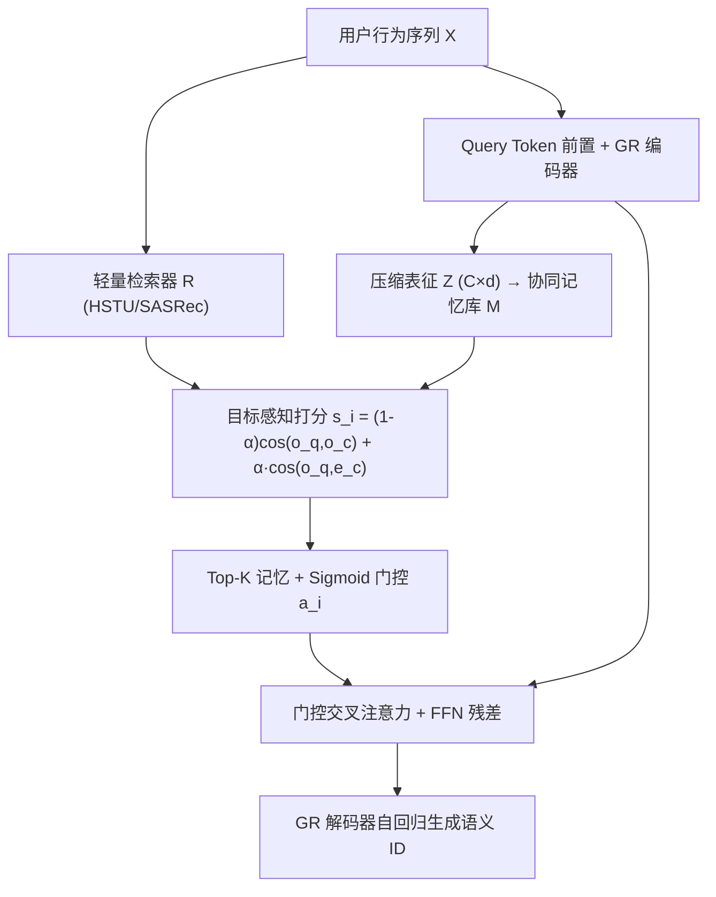
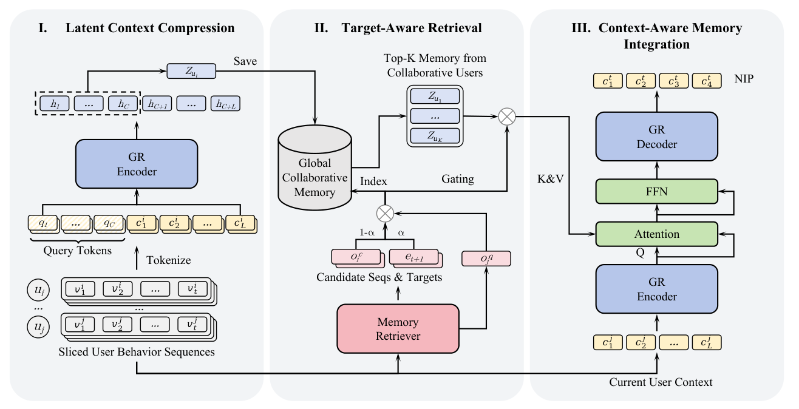

# Collaborative Memory Augmentation for Generative Recommendation (面向生成式推荐的协同记忆增强)

- **会议/期刊**: KDD 2026 (Research Track)
- **作者与机构**: Enze Liu, Zhen Tian, Wayne Xin Zhao（中国人民大学高瓴人工智能学院 & 字节跳动）
- **推荐链路定位**: 端到端生成式（Seq2Seq 生成式召回）
- **研究方向**: 生成式推荐 / 协同过滤与双塔召回
- **论文原文**: [https://arxiv.org/abs/2608.01315v1](https://arxiv.org/abs/2608.01315v1)
- **开源代码**: 暂未开源

## TL;DR (1分钟核心速览)

现有生成式推荐（GR）把全部协同模式压进静态参数，只建模单用户序列，在序列稀疏时形成信息瓶颈。OMEGA 提出"协同记忆增强"框架：用可学习 query token 将用户行为压缩为定长嵌入构建全局记忆库，再用序列级+目标级双重相似度检索 Top-K 记忆，经门控交叉注意力自适应融合进 T5 式解码器。在 Amazon 三数据集 Leave-One-Out + Full-Ranking 协议下，相对 TIGER 骨干 NDCG@5 最高提升 23.68%，相对 Pctx 提升 15.38%，且推理仅慢约 1%。

## Background & Motivation (背景与核心矛盾)

- **主流范式**: TIGER/Pctx/ActionPiece 等 GR 方法将物品量化为语义 ID，用 T5 式编码器-解码器自回归生成下一物品，把推荐统一为 Seq2Seq 任务。
- **前人局限**: ① 所有跨用户协同知识被隐式压进固定参数，形成信息瓶颈，无法在推理时动态调用相似用户信号；② 当本地序列稀疏（冷用户、短序列、长尾物品）时，单序列建模严重欠定。
- **核心洞察 (Key Insight)**: 借鉴 LLM 的 In-Context Learning——GR 不应只看"我自己"，还应显式检索"与我行为轨迹相似的人"作为外部上下文；且用户隐表征语义稀疏、高度可压缩（C=2 即可媲美原模型）。
- **本文切入点**: 用"显式外部记忆库 + 轻量检索 + 门控融合"作为参数化知识的正交补充，且保持 model-agnostic。

## Method (核心方法设计)

### 1. 整体框架 (Overall Architecture)

OMEGA 分三阶段闭环：(i) **潜在上下文压缩**——把每条前缀-目标对序列前置 C 个可学习 query token，经 GR 编码器取前 C 个隐状态作为定长压缩表征 𝒁∈ℝ^{C×d}，全量训练样本的 𝒁 聚合为协同记忆库；(ii) **目标感知检索**——用独立轻量序列推荐器（SASRec/HSTU）生成查询向量，结合序列级与目标级相似度检索 Top-K 记忆；(iii) **上下文感知融合**——检索分数经 sigmoid 门控缩放记忆，再以用户隐状态为 Query 做无因果掩码的交叉注意力 + FFN 残差注入解码器。训练采用"预训练骨干/检索器 → 冻结词表嵌入热启动压缩器 → 两阶段微调（先对齐注意力、再联合优化）"。

<figure class="paper-figure" markdown="span">
  <figcaption>图1：OMEGA的整体架构，包含三个主要阶段：(i) 潜在上下文压缩，用于将用户行为蒸馏为紧凑嵌入；(ii) 目标感知检索，用于识别相关的协同信号；(iii) 上下文感知记忆集成，用于自适应地将外部记忆与本地用户上下文融合。NIP表示下一项预测任务。</figcaption>
</figure>

### 2. 关键设计拆解 (Key Designs)

1. **潜在上下文压缩 (Latent Context Compression)**：直接存原始序列或完整隐状态 𝑯∈ℝ^{l×d} 存储爆炸。做法是把 C 个可学习 query token 拼到输入序列前，编码后取前 C 个位置隐状态 𝒁=𝑯′[1:C,:]，将 l×d 压到 C×d。直觉：解码所需语义本就稀疏，C=2 即够，存储降一个数量级而性能不降。

2. **目标感知检索 (Target-Aware Retrieval)**：仅用序列相似度会忽略候选目标本身的信号，且直接用压缩表征做 key 会因 token 空间受限导致表征坍缩、区分度低。故改用轻量序列模型隐状态 𝒐_q 作查询，打分融合两级相似度：
$$s_i=(1-\alpha)\cdot\cos(\boldsymbol{o}_q,\boldsymbol{o}^c_i)+\alpha\cdot\cos(\boldsymbol{o}_q,\boldsymbol{e}^c_i)$$
其中 𝒆^c_i 为候选目标物品嵌入，α 平衡"历史轨迹相似"与"目标意图相似"。α=0 时全指标下降，验证目标级信号的独立价值。

3. **门控交叉注意力融合与训练目标**：对非主流兴趣用户，检索到的记忆可能噪声大。用 $a_i=\sigma(w\cdot s_i+b)$将检索分数转为实例级门控，$\tilde{\boldsymbol{Z}}_i=a_i\cdot\boldsymbol{Z}_i$，低分记忆被压向零；再以 𝑯 为 Q、门控记忆 𝑴 为 K/V 做**去掉 causal mask** 的交叉注意力（使记忆可关注全序列位置），残差 + FFN 输出。总损失即骨干 NLL：$\mathcal{L}_{GR}=-\sum_i \log P(Y_i|X,Y_{<i})$，检索器另用标准交叉熵$\mathcal{L}_{CE}$训练；检索用 HNSW 索引，复杂度$O(d_1\log M)$，无需负采样于生成阶段。

## Experimental Setup & Evaluation Protocol (实验设置与评估协议)

- **数据集与预处理**: Amazon 2023 三个子集，`5-core` 过滤，序列按时间排序、最大长度截断 20：

| 数据集 | #Users | #Items | #Interactions | 稀疏度 | 场景说明 |
| :--- | :---: | :---: | :---: | :---: | :--- |
| Instrument | 57,439 | 24,587 | 511,836 | 99.964% | 乐器，平均序列长 8.91 |
| Scientific | 50,985 | 25,848 | 412,947 | 99.969% | 工业科学，平均长 8.10 |
| Game | 94,762 | 25,612 | 814,586 | 99.966% | 视频游戏，平均长 8.60 |

- **数据划分与防穿越**: `Leave-One-Out`（末位测试、倒数第二位验证、其余训练）。
- **排名评测协议**: 无偏 `Full-Ranking`（全物品库排序），指标 Recall@{5,10}、NDCG@{5,10}。
- **对比基线与超参**: SR 类（GRU4Rec/BERT4Rec/SASRec/FMLP-Rec/FDSA/DuoRec）+ GR 类（TIGER/HSTU/LETTER/LIGER/ETEGRec/ActionPiece/Pctx）；骨干隐维 128、4 层、4 头，C=2，K=10，α∈{0.1..0.5} 搜索，beam=50，显著性 $p<0.01$ 配对 t 检验。

## Key Experimental Results (实验关键数据)

### 1. 主实验对比 (Main Results)

| 方法 | Instrument R@10 | N@10 | Scientific R@10 | N@10 | Game R@10 | N@10 |
| :--- | :---: | :---: | :---: | :---: | :---: | :---: |
| SASRec | 0.0523 | 0.0274 | 0.0412 | 0.0199 | 0.0847 | 0.0438 |
| DuoRec | 0.0598 | 0.0314 | 0.0431 | 0.0226 | 0.0932 | 0.0477 |
| HSTU | 0.0646 | 0.0322 | 0.0483 | 0.0232 | 0.1104 | 0.0547 |
| LIGER | 0.0630 | 0.0334 | 0.0528 | 0.0265 | 0.0969 | 0.0503 |
| TIGER | 0.0570 | 0.0310 | 0.0428 | 0.0232 | 0.0901 | 0.0482 |
| **+OMEGA** | **0.0647** | **0.0356** | **0.0503** | **0.0277** | **0.1091** | **0.0594** |
| Improv. | +13.51% | +14.84% | +17.52% | +19.40% | +21.09% | +23.24% |
| Pctx | 0.0655 | 0.0350 | 0.0504 | 0.0263 | 0.0981 | 0.0527 |
| **+OMEGA** | **0.0688** | **0.0372** | **0.0552** | **0.0296** | **0.1089** | **0.0596** |
| Improv. | +5.04% | +6.29% | +9.52% | +12.55% | +11.01% | +13.09% |

### 2. 消融实验 (Ablation Study)

| 变体 | Instrument N@10 | Scientific N@10 | Game N@10 |
| :--- | :---: | :---: | :---: |
| OMEGA | **0.0356** | **0.0277** | **0.0594** |
| w/o FT（去联合优化） | 0.0348 | 0.0264 | 0.0586 |
| w/o Gating | 0.0351 | 0.0270 | 0.0583 |
| w/ One-Stage | 0.0350 | 0.0270 | 0.0584 |
| w/ Self-Mem（均值池化替代压缩） | 0.0343 | 0.0260 | 0.0545 |
| w/ Rand-Mem（随机检索） | 0.0316 | 0.0238 | 0.0482 |
| Backbone (TIGER) | 0.0310 | 0.0232 | 0.0482 |

### 3. 关键实验发现 (Key Findings)

1. **随机检索几乎退回骨干水平**（Game N@10 0.0482 vs. 骨干 0.0482），说明增益完全来自"检索质量"而非"多了一层注意力"；模型对无关记忆会自动忽略，记忆相关性是命门。
2. **压缩表征优于均值池化**（Instrument N@10 0.0356 vs. 0.0343），证明可学习 query token 在压缩中保留了均值池化丢失的语义；且仅用 1% 记忆库容量即可达到全量性能，说明记忆捕获的是高层泛化行为模式而非细粒度个体信号。
3. **模型集成实验排除"蒸馏假说"**：TIGER+HSTU 集成（Game N@10 0.0529）仍不及 OMEGA-HSTU（0.0594），而 OMEGA+HSTU 集成进一步升至 0.0623，说明 OMEGA 不是模仿检索器打分，而是真正把外部记忆转化为更完整的用户表征。

## Highlights & Limitations (亮点、对比与审稿批判)

- **与代表作对比 (vs. Prior Work)**: 相比 TIGER/Pctx 等纯参数化 GR，OMEGA 首次把"跨用户显式记忆"作为正交维度引入生成式推荐；相比 LMN/MARM 等记忆增强序列推荐（面向超长序列压缩），OMEGA 的记忆语义是"协同邻居的行为模式"而非"自己的历史"，且与语义 ID 生成解码器深度耦合。
- **可迁移亮点**: ① 用可学习 query token 做"记忆条目压缩"可低成本迁移到任何需要大规模向量库的 RAG 式推荐；② 检索分数 → sigmoid 门控 → 交叉注意力的三步噪声抑制范式，可直接复用到多源特征融合。
- **审稿级局限批判**: ① 记忆库需离线预计算全量训练样本的压缩表征与检索索引（Instrument 约 436MB），工业级更新频率与冷启动新样本入库策略未讨论；② 检索器与骨干需分别预训练 + 两阶段微调，训练流程偏重，且 α 最优值随数据集漂移，需逐场景调参。

## Rating (四维评分)

- **方法创新性 (Novelty)**: ⭐⭐⭐⭐ （核心机制与方法设计具备明确创新性，理论与实验动机支撑充分）
- **评估协议与实验扎实度 (Protocol & Experiments)**: ⭐⭐⭐⭐⭐ （主流公开数据集评测完整，包含多基线对比与消融实验验证）
- **写作与数学规范度 (Clarity & Rigor)**: ⭐⭐⭐⭐ （问题形式化定义清晰，核心模块数学推导与架构阐述严谨易读）
- **工业落地与复现价值 (Industrial & Practical Value)**: ⭐⭐⭐⭐ （兼顾推荐效果增益与训练/推理效率，具备实际场景迁移参考价值）
