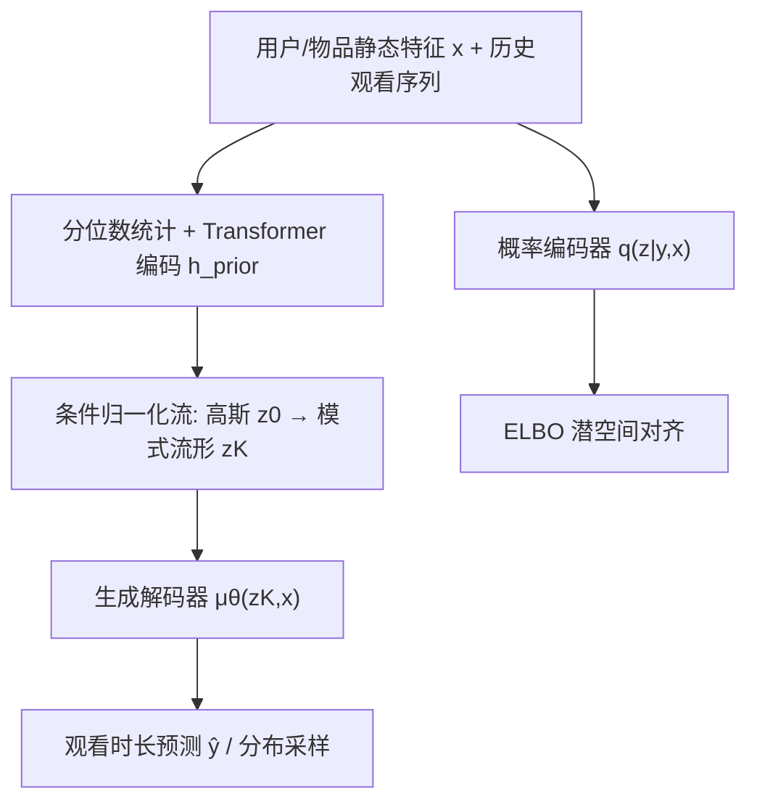
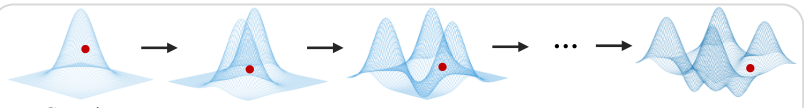

# FlowTime: Towards Continuous Generative Watch Time Prediction via Flow-based Personalized Priors (基于流式个性化先验的连续生成式观看时长预测)

- **会议/期刊**: KDD 2026
- **作者与机构**: Hongxu Ma, Han Zhou, Chenghou Jin, Jie Zhang, Xiaoyu Yang, Chunjie Chen, Jihong Guan, Shuigeng Zhou（复旦大学 / 上海财经大学 / 快手 / 同济大学）
- **推荐链路定位**: 精排（观看时长预估）
- **研究方向**: 生成式推荐与离散语义ID / CTR预估与特征交叉
- **论文原文**: [https://arxiv.org/abs/2606.01352v1](https://arxiv.org/abs/2606.01352v1)
- **开源代码**: [https://github.com/snailma0229/TimeRec.git](https://github.com/snailma0229/TimeRec.git)

## TL;DR (1分钟核心速览)

短视频观看时长预测（WTP）存在三大范式缺陷：直接回归因单峰高斯假设导致"均值坍缩"，序数回归受刚性离散化量化误差困扰，离散生成式回归则受启发式词表与自回归高延迟拖累。本文从因果视角指出用户-物品交互模式是调节观看时长的结构性混杂因子，据此提出第四范式"连续生成式回归"，用一步式 VAE 配合基于归一化流的个性化先验，将标准高斯扭曲为历史条件化的多峰流形。在 KuaiRec/KuaiRand/工业数据集上 MAE 全面领先，线上 A/B 视频播放时长 +1.044%。

## Background & Motivation (背景与核心矛盾)

- **主流范式**: WTP 历经三代——MSE 直接回归（含因果去偏 D2Q/CWM）、阈值离散化序数回归（CREAD/SWaT）、以及将时长量化为 token 自回归生成的 GR。
- **前人局限**: 直接回归的最优解是条件期望 $f^*(\mathbf{x})=\mathbb{E}[y|\mathbf{x}]$，当条件分布多峰且峰间间隔$\Delta/\sigma\to\infty$时该解落在低密度区（Proposition 1 均值坍缩）；序数回归假设各区间决策条件独立，引入不可约的 KL 依赖误差（Proposition 2）；token 自回归的误差上界$\mathbb{E}[(\hat{y}-y)^2]\le T^2B^2+T^2(w_{\max}-w_{\min})^2/4$ 被词表启发式离散化硬性锁死（Proposition 3）。
- **核心洞察 (Key Insight)**: 因果图（图1）显示交互模式 $P$ 是混杂因子——同等兴趣下，"激进型"用户呈双峰（秒滑 vs 完播），"被动型"用户呈单峰（悬停），见图2。因此 WTP 不是兴趣的单值函数，而是兴趣与用户/物品模式交互后的分布拓扑。
- **本文切入点**: 放弃点估计与离散化，直接在连续空间拟合条件密度 $p_\theta(y|\mathbf{x})$，并用流式先验把"模式"注入潜空间几何结构。

## Method (核心方法设计)

### 1. 整体框架 (Overall Architecture)

FlowTime 以 VAE 为骨架实现一步生成：概率编码器 $q_\phi(\mathbf{z}|y,\mathbf{x})$在训练时由目标时长与静态特征推断后验；关键创新在于先验端——将用户/物品历史观看序列的**分位数统计**经 Transformer 编码为上下文$\mathbf{h}_{\text{prior}}$，驱动条件归一化流把标准高斯$z_0$逐步扭曲为模式特定的潜流形$z_K$；生成解码器由$z_K$与$\mathbf{x}$重建时长分布，推理时仅需一次前向即可输出$\hat{y}=\mu_\theta(z_K,\mathbf{x})$，规避迭代去噪延迟。

<figure class="paper-figure" markdown="span">
  <figcaption>图3：FlowTime的整体架构。该框架采用变分编码器将输入映射到随机潜在空间。关键的是，我们引入了基于流的个性化先验，其利用以用户/物品交互历史为条件的归一化流，将标准高斯分布逐步变换为复杂的、模式特定的潜在流形，使生成解码器能够产生精确的观看时长预测。</figcaption>
</figure>

### 2. 关键设计拆解 (Key Designs)

1. **一步式连续生成 VAE（消除迭代延迟）**：扩散/流匹配需多步去噪，与在线毫秒级约束冲突。本文用单步 VAE 采样 $z=\mu_\phi(y,\mathbf{x})+\sigma_\phi(y,\mathbf{x})\odot\epsilon$，解码$p_\theta(y|z,\mathbf{x})=\mathcal{N}(y;\mu_\theta(z,\mathbf{x}),\sigma_\theta^2(z,\mathbf{x}))$，以 ELBO 训练。直觉：连续潜空间保留密度表达力，而单步采样把推理复杂度从$O(T)$降到$O(1)$。

2. **流式个性化先验（破解先验失配）**：标准各向同性高斯先验强制潜空间全局单峰，导致过平滑与后验坍缩。本文用 $K$ 层条件 Planar Flow 构造双射：
$$z_k=z_{k-1}+\mathbf{u}_k(\mathbf{h}_{\text{prior}})\cdot\tanh\!\big(\mathbf{w}_k(\mathbf{h}_{\text{prior}})^\top z_{k-1}+b_k(\mathbf{h}_{\text{prior}})\big)$$
其对数密度由变量替换定理精确计算 $\log p_\psi(z_K|\mathbf{c})=\log p_0(z_0)-\sum_k\log|\det\partial f_k/\partial z_{k-1}|$。直觉：流把"用户习惯+物品特性"编码为潜空间的几何形变，使不同模式占据不相交潜区域（Proposition 4 证明$\Delta>2\varepsilon$时$\mathcal{Z}_i\cap\mathcal{Z}_j=\varnothing$），从根本上避免解码到低密度均值。

3. **训练目标、负采样与推理效率**：总损失 $\mathcal{L}=\lambda_1\mathcal{L}_{\text{Huber}}+\lambda_2\text{KL}(q_\phi(z_0|y,\mathbf{c})\|\mathcal{N}(0,I))+\mathcal{L}_{\text{W-Dist}}$，其中分布对齐项用分位数 Wasserstein 距离$\mathcal{L}_{\text{W-Dist}}=\frac{1}{L}\sum_l\big(\lambda|\hat{y}_{(l)}-q^u_l|+(1-\lambda)|\hat{y}_{(l)}-q^v_l|\big)$ 约束生成样本的次序统计量贴合用户/物品历史分布。WTP 为回归任务，无负采样环节；推理为单次前向，较 GR 自回归解码延迟降低近 30%。

## Experimental Setup & Evaluation Protocol (实验设置与评估协议)

- **数据集与预处理**:

| 数据集 | #Users | #Items | #Interactions | 稀疏度/密度 | 特征/场景说明 |
| :--- | :---: | :---: | :---: | :---: | :--- |
| KuaiRand-Pure | 27,285 | 7,583 | 1,186,059 | 稀疏 | 随机曝光，无偏交互 |
| KuaiRec | 7,176 | 10,728 | 12,530,806 | 高密度（全观测） | 细粒度模式验证 |
| Indust | — | — | 十亿级曝光 | 极稀疏长尾 | 4亿 DAU 真实工业日志 |

- **数据划分与防穿越 (Splitting Strategy)**: Indust 采用严格时间切分（连续 5 天训练 / 次日测试）；KuaiRand 与 KuaiRec 沿用原论文的时间序训练/测试划分。
- **排名评测协议 (Ranking Protocol)**: 回归任务无候选集排序，采用点级 MAE、成对排序 XAUC（对全部满足 $y_i>y_j$ 的有效对统计正确序比例），以及本文提出的个性化分布保真度 PDF（用户/物品级直方图分布的 Jensen-Shannon 散度均值）。
- **对比基线与超参设置**: 覆盖三大范式共 11 个基线（直接回归 VR/D2Q/D2Co/CWM/EGMN/DIFL，序数回归 TPM/CREAD/PTPM/SWaT，离散生成 GR）；Adam 优化器，batch=1024，学习率 $5e{-}4$，训练 20 epoch，共享模块参数量严格对齐，实验重复 5 次取均值。

## Key Experimental Results (实验关键数据)

### 1. 主实验对比 (Main Results)

| 范式 | 方法 | KuaiRec MAE↓ | KuaiRec XAUC↑ | KuaiRec PDF-I↓ | KuaiRand MAE↓ | KuaiRand XAUC↑ | Indust MAE↓ | Indust XAUC↑ |
| :--- | :--- | :---: | :---: | :---: | :---: | :---: | :---: | :---: |
| Direct | EGMN (RecSys'25) | 3.1803 | 0.6125 | 0.0874 | 19.3246 | 0.6682 | 18.2354 | 0.6155 |
| Direct | DIFL (AAAI'26) | 3.2420 | 0.6055 | 0.1544 | 19.3181 | 0.6708 | 17.5606 | 0.6188 |
| Ordinal | CREAD (AAAI'24) | 3.2290 | 0.6123 | 0.1053 | 19.8087 | 0.6678 | 17.9823 | 0.6134 |
| Ordinal | SWaT (KDD'25) | 3.3496 | 0.5888 | 0.1168 | 22.3353 | 0.6515 | 20.4522 | 0.6098 |
| Generative | GR (WWW'26) | 3.1985 | 0.6124 | 0.0833 | 19.2742 | 0.6682 | 17.2503 | 0.6201 |
| **Ours** | **FlowTime** | **3.1588** | **0.6174** | **0.0823** | **19.1045** | **0.6751** | **16.9553** | **0.6243** |
| — | Improv.% | ↓0.676% | ↑0.8% | ↓5.835%* | ↓0.704 | ↑1.03% | ↓1.027 | ↑1.777% |

（*PDF-I 相对 EGMN 的降幅；线上 A/B：视频播放时长 +1.044%、APP 使用时长 +1.027%、长播率 +0.892%、分享率 +1.236%，$p<0.01$。）

### 2. 消融实验 (Ablation Study)

| 变体 | MAE↓ | XAUC↑ | PDF-U↓ | PDF-I↓ |
| :--- | :---: | :---: | :---: | :---: |
| (a) FlowTime | **3.159** | **0.617** | **0.249** | **0.078** |
| (b) w/ DDPM | 3.163 | 0.613 | 0.251 | 0.081 |
| (c) w/ Flow Matching | 3.161 | 0.614 | 0.250 | 0.080 |
| (d) w/o Normalizing Flows | 3.245 | 0.607 | 0.304 | 0.113 |
| (e) w/o User History | 3.281 | 0.599 | 0.303 | 0.081 |
| (f) w/o Item History | 3.235 | 0.605 | 0.253 | 0.111 |
| (g) w/o Both & NF | 3.318 | 0.593 | 0.308 | 0.127 |
| (h) Rep. Trans. w/ MLP | 3.195 | 0.611 | 0.251 | 0.081 |

### 3. 关键实验发现 (Key Findings)

1. **NF 先验是性能命门**：退化为标准高斯先验（行 d）使 MAE 恶化 2.72%、XAUC 掉 1.62%，PDF-I 从 0.078 暴涨至 0.113，直接证明静态单峰先验无法承载多峰交互模式，流式形变是核心增益来源。
2. **用户历史比物品历史更关键**：去掉用户历史（行 e）MAE 升至 3.281，而去掉物品历史（行 f）仅 3.235；超参 $\lambda$ 在 0.8 处达最优后回落，印证用户习惯是时长主导因子但物品特性不可完全舍弃。
3. **一步生成优于迭代去噪**：DDPM 与 Flow Matching 变体（行 b/c）虽优于传统范式，但均逊于一步 VAE，说明高稀疏场景下迭代去噪的误差累积抵消了其表达力优势，且 FlowTime 推理延迟较 GR 低约 30%。

## Highlights & Limitations (亮点、对比与审稿批判)

- **与代表作对比 (vs. Prior Work)**: 相较 EGMN 用预定义混合分布拟合多峰，FlowTime 以流式先验实现无参数形式假设的自适应拓扑；相较 GR 的 token 自回归，本文彻底绕开词表设计与序列解码，同时消除 Proposition 3 的量化误差上界；相较 D2Q/CWM 等因果去偏直接回归，本文从分布建模层面而非仅调整期望值来根治均值坍缩。
- **可迁移亮点**: (1) 用历史序列分位数统计作为轻量"分布指纹"注入先验，可迁移至任何需要个性化密度建模的连续目标（如停留时长、GMV）；(2) 一步 VAE + 流先验的组合为生成式推荐提供了低延迟替代方案，适合在线精排。
- **审稿级局限批判**: (1) 流先验的 Jacobian 行列式计算与 Transformer 历史编码带来额外开销，论文仅给出相对 GR 的延迟对比，缺少与直接回归的绝对延迟量化；(2) PDF 指标依赖直方图分箱粒度，且 Proposition 4 的潜区域分离假设依赖 Lipschitz 常数与模式间隔，真实数据中未必严格成立，理论保证偏理想化。

## Rating (四维评分)

- **方法创新性 (Novelty)**: ⭐⭐⭐⭐⭐ （首次形式化"连续生成式回归"第四范式，因果视角识别交互模式混杂因子，并有 Proposition 1–4 的理论支撑）
- **评估协议与实验扎实度 (Protocol & Experiments)**: ⭐⭐⭐⭐⭐ （三数据集+线上 A/B+新 PDF 指标+开源 TimeRec 库，11 基线全范式覆盖，5 次重复）
- **写作与数学规范度 (Clarity & Rigor)**: ⭐⭐⭐⭐ （三大范式缺陷均有命题与证明，但部分符号在正文与附录间略有跳转）
- **工业落地与复现价值 (Industrial & Practical Value)**: ⭐⭐⭐⭐⭐ （4亿 DAU 线上验证、单步推理、首个开源 WTP 基准库，工程价值极高）
