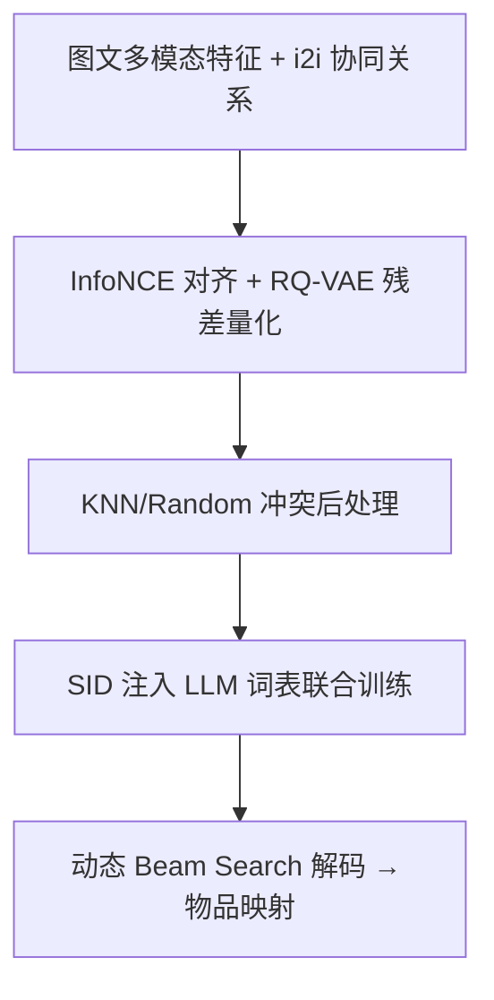
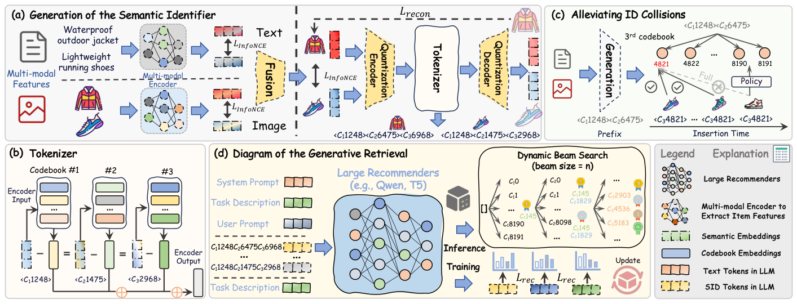

# FORGE: Forming Semantic Identifiers for Generative Retrieval in Industrial Datasets (面向工业数据集的生成式检索语义标识符构建基准)

- **会议/期刊**: KDD 2026
- **作者与机构**: Kairui Fu, Tao Zhang, Shuwen Xiao 等（浙江大学 & 阿里巴巴淘天集团）
- **推荐链路定位**: 召回（生成式端到端检索）
- **研究方向**: 生成式推荐与离散语义 ID / 冷启动与长尾
- **论文原文**: [https://arxiv.org/abs/2509.20904v3](https://arxiv.org/abs/2509.20904v3)
- **开源代码**: [https://github.com/selous123/al_sid](https://github.com/selous123/al_sid)

## TL;DR (1分钟核心速览)

生成式检索（GR）中语义 ID（SID）是地基，但现有工作对"如何构建更好的 SID"缺乏系统研究，且评估 SID 质量必须完整训练 GR，代价极高。本文提出 FORGE 基准，从多模态特征、量化编码、ID 冲突后处理三个维度系统消融 SID 构建策略，并提出 Embedding HitRate 与 Gini 系数两个免训练代理指标。在淘宝 AL-GR（140 亿交互、2.51 亿物品）与 Amazon 上，最优配置（sideinfo+i2i+Random-5）相对 base 在 HR@20 上提升 25%–35%，线上 A/B 交易量绝对提升 0.35%。

## Background & Motivation (背景与核心矛盾)

- **主流范式**: 单标识符（随机哈希分配唯一 ID）需管理十亿级词表，训练只能采样负例，造成离线训练与在线全库打分不一致；SID 用多级码字（如 3×8192）紧凑编码指数级物品空间，且多模态语义可让相似物品共享知识。
- **前人局限**: ① SID 构建策略（特征来源、量化器、冲突处理）缺乏系统对比，研究者难以选型；② SID 质量评估依赖完整 GR 训练，大模型下枚举成本不可接受。
- **核心洞察 (Key Insight)**: SID 的"码本利用率/分布公平性"与下游检索性能强相关，而"特征保真度"类指标反而与性能脱钩——这暗示冲突与长尾才是 SID 质量的主要瓶颈。
- **本文切入点**: 把 SID 构建拆成可独立消融的三段流水线，并用免训练代理指标替代昂贵 GR 训练评估。

## Method (核心方法设计)

### 1. 整体框架 (Overall Architecture)

FORGE 将 SID 构建定义为「特征提取 → 量化编码 → 冲突后处理」三段式：先用 CN-CLIP 融合图文特征并经 InfoNCE 对齐协同关系，再用 RQ-VAE 残差量化生成多级码字，最后用 KNN/Random 策略打散碰撞 SID；构建好的 SID 注入 LLM 词表，与推荐模型联合训练，推理时用动态 beam search 解码候选 SID 并映射回物品。

<figure class="paper-figure" markdown="span">
  <figcaption>图2：GRs 概览。(a) SIDs 的生成过程。左图：文本/图像编码器的训练。右图：条目分词示意图。(b) 分词器的详细工作流程。(c) 语义标识符的冲突后处理。(d) 生成式检索的训练与动态推理过程。</figcaption>
</figure>

### 2. 关键设计拆解 (Key Designs)

1. **多模态 + 协同对齐的特征提取**：仅用图文特征缺乏行为信号，本文在 CN-CLIP 融合特征 $H_i$ 上叠加 InfoNCE，正样本取自 i2i 共现表、负样本取自 in-batch，使高频共现物品表征更近。直觉是让 SID 同时携带"内容语义"与"协同语义"，缓解冷启动物品语义漂移。
2. **RQ-VAE 残差量化与冲突后处理**：第 $l$级码字取残差最近邻$c_l=\arg\min_{c}\|h_l-q^l_c\|$，$h_l=h_{l-1}-q^{l-1}_{c_{l-1}}$。碰撞时 KNN 策略按候选 SID 关联分依次试探直至物品数$<\sigma$；Random 策略则对末级码字按前缀出现顺序循环递增分配，牺牲末级语义换取码本利用率。关键发现是末级残差信息量有限，公平性比语义一致性更重要。
3. **训练目标与动态推理**：损失为逐码字交叉熵 $\mathcal{L}_{rec}=-\sum_{i=1}^{m}\log P_{\theta,\tau}(c_i\mid x,c_{<i})$，SID token 与模型联合训练、无需负采样。推理采用动态 beam：首步 300、次步 600、末步 1200，使第二步计算量降低 75% 而最终候选数不变。

## Experimental Setup & Evaluation Protocol (实验设置与评估协议)

- **数据集与预处理**:

| 数据集 | #Users | #Items | #Interactions | 稀疏度 | 特征/场景说明 |
| :--- | :---: | :---: | :---: | :---: | :--- |
| Amazon-Clothing | 2.52M | 715K | 12.5M | 99.98% | 图文，学术基准 |
| AL-GR (淘宝) | 131M | 251M | 14B | 99.99% | 图文+query，推荐&搜索 |

- **数据划分与防穿越 (Splitting Strategy)**: AL-GR 按时间切分为 S1/S2/S3 三阶段（4+3+3 天训练），每阶段后取次日 10 万样本评估，属严格 `全局时间戳切分`；序列截断至长度 100。
- **排名评测协议 (Ranking Protocol)**: 物品级 `Full-Ranking` 近似——beam 生成 1200 个候选 SID 映射回物品后计算 HR@K（K=20/100/500/1000），非采样负例排序。
- **对比基线与超参设置**: 默认 RQ-VAE + Qwen2.5-0.5B，3×8192 码本；泛化实验覆盖 T5-base、Qwen2.5-3B、2×32768 结构及搜索任务。

## Key Experimental Results (实验关键数据)

### 1. 主实验对比 (Main Results)

AL-GR Stage S1 上 SID 配置消融（base = 有限 i2i + KNN-25）：

| 方法 | HR@20 | HR@100 | HR@500 | HR@1000 |
| :--- | :---: | :---: | :---: | :---: |
| base | 3.61% | 9.67% | 20.82% | 25.09% |
| +KNN-5 | 4.18% (+15.8%) | 10.81% (+11.8%) | 22.14% (+6.3%) | 25.30% (+0.8%) |
| +Random-5 | 4.67% (+29.4%) | 11.79% (+21.9%) | 23.65% (+13.6%) | 26.30% (+4.8%) |
| +i2i | 3.79% (+5.0%) | 10.04% (+3.8%) | 21.71% (+4.3%) | 26.97% (+7.5%) |
| +sideinfo | 3.81% (+5.5%) | 10.00% (+3.4%) | 21.69% (+4.2%) | 26.88% (+7.1%) |
| **Final** | **4.89% (+35.5%)** | **12.31% (+27.3%)** | **24.79% (+19.1%)** | **29.01% (+15.6%)** |

编码器对比（S1）：Random 1.08%/4.82%、Multiple-VQ 2.87%/23.84%、RQ-Kmeans 3.42%/26.11%、OPQ 3.57%/26.64%、RQ-VAE(Final) **4.89%/29.01%**（HR@20/HR@1000）。

### 2. 消融实验 (Ablation Study)

| 配置 | HR@20 | HR@1000 | 说明 |
| :--- | :---: | :---: | :--- |
| text-only | 3.01% | 21.01% | 仅文本模态 |
| image-only | 3.06% | 22.03% | 仅图像模态 |
| i2i-only | 4.63% | 23.15% | 仅协同关系 |
| **Final（三模态融合）** | **4.89%** | **29.01%** | 互补增益显著 |
| noco（无冲突处理） | 2.96% | 22.27% | 碰撞严重损害性能 |
| merge（人为合并 SID） | 3.00% | 24.22% | 公平性下降即掉点 |

### 3. 关键实验发现 (Key Findings)

1. **冲突后处理是最大单点收益来源**：Random-5 在 S1 的 HR@20 上带来 +29.4%，远超 i2i/sideinfo 的 +5% 量级；反向实验 merge 掉点 16.9%，证明码本利用率与检索精度强正相关，且末级残差语义价值有限。
2. **三模态缺一不可**：text-only/image-only 的 HR@1000 仅 21%–22%，而三模态融合达 29.01%，说明内容语义与协同语义互补而非替代。
3. **代理指标可替代训练评估**：Embedding HitRate 与 Gini 系数在三种配置排序（Final > base > RQ-Kmeans > Multiple-VQ）上与真实 HR 完全一致，而 Feature Fidelity 等指标与性能脱钩（Multiple-VQ 保真度最高却检索最差）。

## Highlights & Limitations (亮点、对比与审稿批判)

- **与代表作对比 (vs. Prior Work)**: TIGER/LC-Rec 类工作直接沿用 RQ-VAE 默认配置，未讨论冲突与公平性；OneRec 用 RQ-Kmeans 追求码本效率但忽略后处理。FORGE 首次把"后处理公平性"提到与编码器选型同等重要的位置，并给出工业级验证。
- **可迁移亮点**: ① Random 末级打散策略可低成本移植到任意 RQ-VAE 系 SID 流水线；② Gini 系数作为免训练 SID 质量探针，适合大规模配置搜索时做前置筛选。
- **审稿级局限批判**: ① 代理指标仅在本文配置族内验证相关性，跨数据集/跨量化器的普适性证据不足；② 动态 beam 的 300/600/1200 分档为经验设定，缺少对延迟-召回权衡的敏感性分析；③ 线上收益 0.35% 交易量提升幅度较小，未报告置信区间与实验周期长度。

## Rating (四维评分)

- **方法创新性 (Novelty)**: ⭐⭐⭐ （单点算子创新有限，主要贡献是系统化基准与两个代理指标，属工程洞察型工作）
- **评估协议与实验扎实度 (Protocol & Experiments)**: ⭐⭐⭐⭐⭐ （140 亿交互工业数据 + 三阶段时间切分 + 跨模型/跨任务/跨结构泛化 + 7 天线上 A/B，扎实度罕见）
- **写作与数学规范度 (Clarity & Rigor)**: ⭐⭐⭐⭐ （流水线拆解清晰、公式简洁，但部分消融缺少方差与显著性检验）
- **工业落地与复现价值 (Industrial & Practical Value)**: ⭐⭐⭐⭐⭐ （代码与 AL-GR 数据集全开源，策略已在淘宝全量部署，复现与迁移门槛极低）

