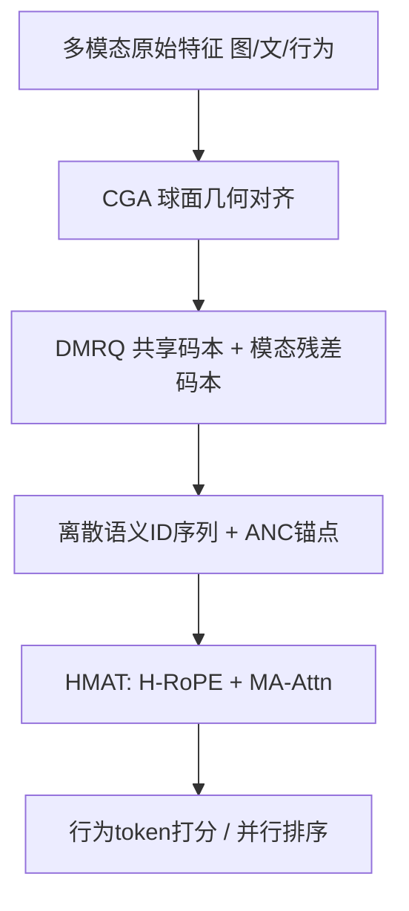
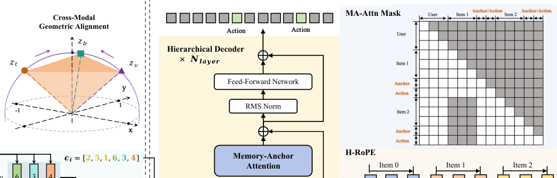

# Hi-SAM: A Hierarchical Structure-Aware Multi-modal Framework for Large-Scale Recommendation (分层结构感知的多模态大规模推荐框架)

- **会议/期刊**: KDD 2026 (ADS Track)
- **作者与机构**: Pingjun Pan, Tingting Zhou, Peiyao Lu, Tingting Fei, Hongxiang Chen (通讯), Chuanjiang Luo — 网易云音乐
- **推荐链路定位**: 精排（语义ID序列建模 + 生成式打分）
- **研究方向**: 生成式推荐与离散语义ID / 序列推荐
- **论文原文**: [https://arxiv.org/abs/2602.11799v2](https://arxiv.org/abs/2602.11799v2)
- **开源代码**: 暂未开源

## TL;DR (1分钟核心速览)

语义ID推荐存在两大痛点：RQ-VAE 类分词器不区分跨模态共识与模态特有细节，导致冗余或模态坍缩；原生 Transformer 把"用户-物品-属性token"压平成单一流，物品展开成多 token 后序列变长、噪声累积、注意力偏向局部细节。Hi-SAM 用**解耦语义分词器 DST**（球面几何对齐 + 共享/模态残差粗到细量化 + 互信息最小化）产出高质量语义ID，再用**分层记忆锚点 Transformer HMAT**（H-RoPE 正交拆分物品间/物品内位置 + Anchor Token 压缩历史）恢复层级结构。工业数据集 GAUC 0.6410（较 QARM +5.6%），冷启动 GAUC 0.5835（+6.5%），线上响应率 +6.55%、延迟 -35%。

## Background & Motivation (背景与核心矛盾)

- **主流范式**: 语义ID推荐 = 多模态量化生成离散码（RQ-VAE 系）+ 大 Transformer 序列建模（HSTU/Wukong/MTGR），以离散 token 提升泛化、缓解稀疏ID冷启动。
- **前人局限**: ① 分词层面，独立量化（PSRQ）造成跨模态语义冗余、融合量化（QARM 早融合）造成主导模态淹没细节的**模态坍缩**；② 架构层面，物品展开为多 token 后，跨物品与物品内 token 转移距离同为 1，**物品边界被抹平**，注意力过度聚焦细粒度属性 token 而丢失整体语义。
- **核心洞察 (Key Insight)**: 推荐数据天然是三层层级（用户交互 → 物品 → 属性 token），而现有骨干是为扁平序列设计的；"更好的离散语义ID + 更适配的架构"才能释放多模态潜力。
- **本文切入点**: 在分词与架构两端同时做结构化改造——分词端显式解耦共识/细节，架构端用位置编码与注意力掩码把层级"写回"模型。

## Method (核心方法设计)

### 1. 整体框架 (Overall Architecture)

两阶段流水线：第一阶段 DST 将每个物品的图文行为多模态特征经 CGA 球面对齐后，由 DMRQ 粗到细量化成 6 个离散语义 token（3 共享 + 每模态 1 个特有）；第二阶段 HMAT 把用户画像、物品 token 序列、[ANC] 锚点与行为 token 拼成统一流，用 H-RoPE 注入层级坐标、用 MA-Attn 结构化掩码约束信息流，最终在行为 token 位置做 next-action 预测。训练采用 SFT（可选语义预训练 + SFT 渐进式），DST 全程冻结；推理用 One-Pass 并行打分 + 锚点级 KV Cache 无损驱逐。

<figure class="paper-figure" markdown="span">
  <figcaption>图1：Hi-SAM 的架构，由解耦语义分词器（DST）阶段和分层记忆锚点 Transformer（HMAT）阶段组成。</figcaption>
</figure>

### 2. 关键设计拆解 (Key Designs)

1. **解耦模态残差量化 DMRQ（分词端核心）**：痛点是对齐后多模态仍纠缠，早融合坍缩、独立量化冗余。做法：先聚合全局表示 $f=\Phi_{fuse}(Z)$用 RQ-VAE 量化出共享码$\hat z_{sh}$，残差$r_{N_{sh}}$经多头投影展开为$H$子空间，以原始对齐特征$z_j$作语义探针做注意力聚合得$z_{sp}^{(j)}$再量化到模态专属码本；用 vCLUB 互信息最小化$\mathcal{L}_{MI}=\sum_j \hat I(\hat z_{sh}; z_{sp}^{(j)})$强制二者统计独立。直觉：共享码本吸收"复古外套"这类跨模态共识，残差码本只保留各模态独有细节，加法重构$\|z_j-(\hat z_{sh}+\hat z_{sp}^{(j)})\|^2$ 保证互补不重叠。

2. **分层 RoPE + 记忆锚点注意力 HMAT（架构端核心）**：痛点是把物品多 token 压平后层级丢失、长序列噪声放大。H-RoPE 将维度对半拆为正交子空间，前 $d/2$维编码物品序$m$（基频$B_{inter}=10^4$，低频利于长程外推），后$d/2$维编码属性位$n$（$B_{intra}=100$，高频放大局部敏感），注意力分数严格解耦为$\langle q_{inter},k_{inter}e^{-i\Delta m\Theta_{inter}}\rangle+\langle q_{intra},k_{intra}e^{-i\Delta n\Theta_{intra}}\rangle$。MA-Attn 用掩码$M_{q,k}$规定三条通路：用户画像全局可见、当前物品内全可见、历史物品**仅可见其 [ANC] 锚点**。直觉：仿人类选择性记忆，历史只留压缩概念，既滤噪又把历史注意力复杂度从$O((K\!\cdot\!L_i)^2)$降到$\sim O(K^2)$。

3. **训练目标、负采样与推理效率**：总损失 $\mathcal{L}_{SFT}=-\sum_{j\in I_a}\log P(T_j|T_{<j},M;\Theta)$，分词端$\mathcal{L}_{DMRQ}=\sum_j\|z_j-(\hat z_{sh}+\hat z_{sp}^{(j)})\|^2+\beta\mathcal{L}_{vq}+\lambda\mathcal{L}_{MI}$；全库 softmax 式 next-token 预测，**免负采样**。推理侧 One-Pass 并行打分时把候选 token 的物品序坐标强制重置为$L_{valid}+1$ 消除位置偏置；MA-Attn 保证历史细粒度 token 永不被后续访问，故可物理驱逐其 KV，仅留锚点并维护逻辑位置映射，实现无损压缩。

## Experimental Setup & Evaluation Protocol (实验设置与评估协议)

- **数据集与预处理**:

| 数据集 | #Users | #Items | #Interactions | 稀疏度/密度 | 特征/场景说明 |
| :--- | :---: | :---: | :---: | :---: | :--- |
| Book (Amazon 2023) | 0.78M | 0.49M | 9.5M | 平均序列 12.66 | 标题/类目/品牌/封面图 |
| Movies & TV (Amazon 2023) | 657.2K | 197.9K | 7.4M | 平均序列 11.25 | 同上 |
| Industrial (交友平台) | 6.33M | 1.38M | 521M | 平均序列 82.30 | 头像/签名/聊天，曝光-点击-回复 |

- **数据划分与防穿越**: 按时间排序，前 90% 训练、后 10% 测试；评分 >3 视为正反馈；交互 <10 条的用户划为冷启动子集单独评测。
- **排名评测协议**: AUC（全局排序）+ GAUC（用户内排序），并在全测试集与冷启动子集分别报告；线上用 6% 流量、两个月的 A/B（Response Rate / Response Depth）。
- **对比基线与超参**: 稀疏ID系 WuKong / HSTU / MTGR，多模态语义ID系 QARM / PSRQ+MCCA；统一特征集与算力（4 层 Transformer、隐层 512、序列长 300、语义 token 维度 256、BLIP-2 编码），Hi-SAM-Large 为 12 层。

## Key Experimental Results (实验关键数据)

### 1. 主实验对比 (Main Results)

| Method | Book GAUC | Movies GAUC | Industrial GAUC | Industrial Cold GAUC |
| :--- | :---: | :---: | :---: | :---: |
| HSTU | 0.6440 | 0.7076 | 0.6087 | 0.5304 |
| MTGR | 0.6443 | 0.7077 | 0.6125 | 0.5357 |
| QARM | 0.6450 | 0.7093 | 0.6068 | 0.5477 |
| PSRQ+MCCA | 0.6501 | 0.7095 | 0.6131 | 0.5571 |
| Hi-SAM-Small | 0.6588 | 0.7254 | 0.6410 | 0.5835 |
| Hi-SAM-Large | 0.6634 | 0.7266 | 0.6432 | 0.5913 |
| **w/ PT+SFT** | **0.6660** | **0.7302** | **0.6443** | **0.5963** |
| **Improv.% (vs 最强基线)** | **+2.44%** | **+2.92%** | **+5.09%** | **+7.04%** |

### 2. 消融实验 (Ablation Study)

| Variant | AUC | GAUC | Cold AUC | Cold GAUC |
| :--- | :---: | :---: | :---: | :---: |
| Hi-SAM (Full) | **0.7293** | **0.6410** | **0.7886** | **0.5835** |
| w/o CGA | 0.6813 | 0.6166 | 0.7327 | 0.5465 |
| w/o DMRQ | 0.7163 | 0.6347 | 0.7855 | 0.5822 |
| w 1D-RoPE | 0.7260 | 0.6402 | 0.7850 | 0.5823 |
| w/o MA-Attn | 0.7201 | 0.6343 | 0.7845 | 0.5688 |
| Tokenizer 换 PSRQ | 0.6703 | 0.6084 | 0.7443 | 0.5446 |
| Backbone 换 Qwen2.5 | 0.6909 | 0.6170 | 0.7549 | 0.5486 |

### 3. 关键实验发现 (Key Findings)

1. **分词器是最大增益源**：同一 HSTU 骨干下，DST 较 PSRQ 冷启动 AUC 提升 +4.77%（0.7798 vs 0.7443），而换骨干（Qwen2.5→HMAT）仅 +1.62% GAUC——说明语义ID质量是瓶颈，架构是放大器。
2. **对齐不可省**：去掉 CGA 直接拼接使 GAUC 暴跌 3.81%（0.6410→0.6166），冷启动 GAUC 掉 3.70%，验证球面几何对齐是量化前的必要初始化；层间相似度热图显示 DMRQ 深层 L3/L4/L5 分别与行为/图像/文本强对角相关，证明解耦确实生效。
3. **锚点压缩兼顾精度与效率**：去 MA-Attn 冷启动 GAUC 掉 1.47%（0.5835→0.5688），而保留掩码后历史 KV 可无损驱逐，线上同等算力下响应时间降 35%；线上 PT+SFT 变体冷启动响应率 +16.62%，印证多模态语义对稀疏用户的补偿价值。

## Highlights & Limitations (亮点、对比与审稿批判)

- **与代表作对比 (vs. Prior Work)**: 相比 QARM 的早融合统一编码，DMRQ 用"共享码本 + 残差模态码本 + MI 约束"从结构上防坍缩；相比 PSRQ+MCCA 的独立量化，它显式建模跨模态共识；相比 HSTU/MTGR 的扁平序列，HMAT 首次把"物品-属性"层级写进 RoPE 与注意力掩码，且不增加算力反而降延迟。
- **可迁移亮点**: ① H-RoPE 的正交双子空间 + 差异化基频设计，可直接迁移到任何"多 token 物品"的生成式推荐骨干；② 锚点掩码带来的无损 KV 驱逐 + 候选位置重对齐，是生成式召回/精排落地的通用工程技巧。
- **审稿级局限批判**: ① 仅报告 AUC/GAUC 与业务指标，缺少 NDCG/HR 等 top-K 排序指标与显著性检验；② DST 依赖 BLIP-2 (2.7B) 离线提特征，分词器质量受预训练编码器上限约束，且 MI 权重 $\lambda$、码本层数$N_{sh}$ 的敏感性未系统分析；③ 线上仅对比自家 DLRM 基线，未与工业级语义ID系统横向 A/B。

## Rating (四维评分)

- **方法创新性 (Novelty)**: ⭐⭐⭐⭐ （核心机制与方法设计具备明确创新性，理论与实验动机支撑充分）
- **评估协议与实验扎实度 (Protocol & Experiments)**: ⭐⭐⭐⭐ （主流公开数据集评测完整，包含多基线对比与消融实验验证）
- **写作与数学规范度 (Clarity & Rigor)**: ⭐⭐⭐⭐⭐ （问题形式化定义清晰，核心模块数学推导与架构阐述严谨易读）
- **工业落地与复现价值 (Industrial & Practical Value)**: ⭐⭐⭐⭐⭐ （兼顾推荐效果增益与训练/推理效率，具备实际场景迁移参考价值）
