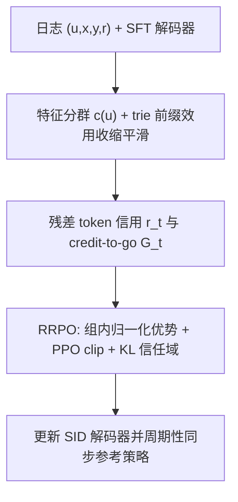
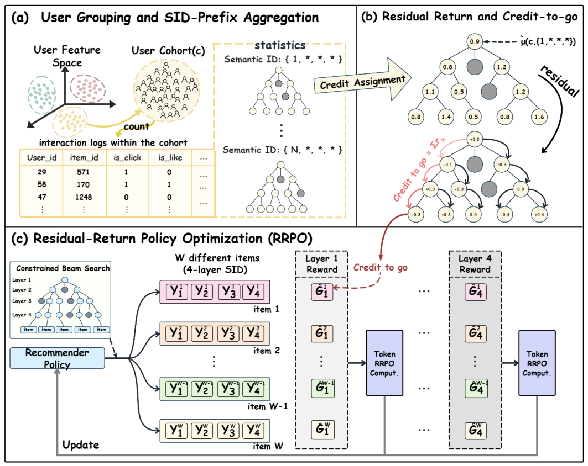

# Hierarchical Residual Policy Optimization for Generative Recommendations (面向生成式推荐的分层残差策略优化)

- **会议/期刊**: KDD 2026 (Research Track)
- **作者与机构**: Kaifeng Guo, Jingtong Gao, Xiangyu Zhao (CityU HK)；Yiming Yang, Fukang Yang, Yukang Liang, Peng Jiang, Qingpeng Cai (快手)
- **推荐链路定位**: 端到端生成式（SID 自回归解码的后训练阶段）
- **研究方向**: 生成式推荐与离散语义ID / 强化学习与动态探索推荐
- **论文原文**: [arXiv:2608.00750v1](https://arxiv.org/abs/2608.00750v1)
- **开源代码**: [KDD2026-HRPO](https://github.com/Applied-Machine-Learning-Lab/KDD2026-HRPO)

## TL;DR (1分钟核心速览)

SID 生成式推荐器用 next-token 模仿日志轨迹，与下游效用错位；而日志反馈只在完整 SID 路径生成后（即曝光物品）才被观测，现有后训练方法（DPO/GRPO/SPRec）把同一终端奖励广播到所有 token，导致信用稀疏、高方差且层间不可比。HRPO 先用特征分群平滑出 SID 前缀效用，再沿 trie 做残差分解得到 token 级 credit-to-go，最后用 RRPO（clip + 组内归一化优势 + KL 信任域）保守更新。KuaiSim 会话级 Total reward 从 8.137 提升至 10.528（+29.4%），线上 IAA 三流量段 Target Cost 全正。

## Background & Motivation (背景与核心矛盾)

- **主流范式**: TIGER 类方法用 RQ-VAE/trie 把物品编码为定长 SID，SFT 最大化日志 SID 轨迹的 next-token 似然，再做 DPO/GRPO 类偏好后训练。
- **前人局限**: ① 大量物品共享早期 SID 前缀、仅在深层分叉，把终端奖励均匀广播到全路径会在共享前缀上产生**无区分甚至冲突的梯度**；② 前缀条件信用在不同深度上量纲与方差差异巨大，直接喂给 PPO 式更新会**不稳定**。
- **核心洞察 (Key Insight)**: 日志虽只给终端物品反馈，但 SID trie 天然提供粗到细的层级结构——前缀效用可被聚合估计，物品级结果可**望远镜式分解**为逐层边际增益，从而把稀疏终端信号"致密化"为位置对齐的 token 信号。
- **本文切入点**: 用"分群平滑前缀效用 → 残差信用 → credit-to-go → 保守 token 级 PPO"四步，把 item-level outcome 转成 layer-aware 的 token 级学习信号。

## Method (核心方法设计)

### 1. 整体框架 (Overall Architecture)

输入为日志记录 $(u_i,x_i,y_i,r_i)$（$y_i=\phi(v_i)$为 SID 路径，$r_i=\sum_m w_m b_{i,m}$为多目标标量化效用）与一个 SFT 初始化的 SID 解码器。HRPO 分三阶段闭环：(a) 用固定特征映射$c(u)=g(u)$把用户分群，在 SID trie 上聚合各前缀的效用统计并做收缩平滑，得到任意前缀可查询的$\hat\mu(c,y_{1:t})$；(b) 沿路径做残差分解得 token 信用$\hat r_t$，累加为 credit-to-go$\hat G_t$；(c) 以冻结参考策略$\pi_{\theta_{old}}$采样候选 SID 集合，用 RRPO 的 clip + 组内位置归一化优势 + KL 信任域更新策略，周期性同步$\theta_{old}\leftarrow\theta$。

<figure class="paper-figure" markdown="span">
  <figcaption>图 2：HRPO 概览。</figcaption>
</figure>

### 2. 关键设计拆解 (Key Designs)

1. **分群前缀效用与收缩平滑（解决 SID 前缀稀疏）**：长尾前缀曝光极少，逐用户估计不可定义、逐前缀均值高方差。将用户按活跃度/付费档/地域等稳定特征分群 $c(u)=g(u)$，沿 trie 累加$n(c,y_{1:t})$、$s(c,y_{1:t})$，再向全局均值做伪计数收缩：
$$\hat\mu(c,y_{1:t})=\frac{s(c,y_{1:t})+\alpha\,\mu_{glob}}{n(c,y_{1:t})+\alpha},\quad \mu_{glob}=\tfrac{1}{|\mathcal D|}\textstyle\sum r(b)$$
直觉：$\alpha$ 控制方差-偏差权衡，既保留前缀间区分度又不让稀有前缀的噪声污染信用。

2. **残差信用与 credit-to-go（解决延迟归因与量纲不可比）**：把 $\hat\mu(c,y_{1:t})$视为 trie 节点价值，token$y_t$的信用取父子边际增益$\hat r_t=\hat\mu(c,y_{1:t})-\hat\mu(c,y_{1:t-1})$（$\hat\mu(c,\epsilon)\triangleq\mu_{glob}$），并累加为
$$\hat G_t(c,y)=\sum_{k=t}^{L}\hat r_k=\hat\mu(c,y_{1:L})-\hat\mu(c,y_{1:t-1})$$
望远镜求和保证信用是终端分数的精确分解；$\hat G_t$表示"超出当前前缀基线的剩余效用"，因此**同一位置$t$ 的不同候选天然可比**，可直接做组内归一化。

3. **RRPO 保守优化与训练目标**：对每个 context 用 $\pi_{\theta_{old}}$采样$W$条 trie 合法候选，位置级组内标准化得$A_t^{(w)}=(\hat G_t^{(w)}-\overline{\hat G_t})/(\text{Std}+\varepsilon)$，配合 PPO clip 与 KL 信任域：
$$\max_\theta \frac{1}{W}\sum_{w}\sum_{t}\min\big(\rho_{w,t}A_t^{(w)},\ \bar\rho_{w,t}A_t^{(w)}\big)-\beta_{KL}\,\mathrm{KL}_{TR}(\theta)$$
其中 $\mathrm{KL}_{TR}$对$\pi_{\theta_{old}}$整条路径做序列级约束。**无需行为策略概率**（$\theta_{old}$ 是内部参考策略而非日志行为策略），免负采样、免 reward model；推理仍为 beam=50 的约束解码，与 SFT 完全同构，无额外线上开销。

## Experimental Setup & Evaluation Protocol (实验设置与评估协议)

- **数据集与预处理**: KuaiRand-Pure，按 user-day 会话化，30 天日志：

| 数据集 | #Users | #Items | #Interactions | 稀疏度/密度 | 特征/场景说明 |
| :--- | :---: | :---: | :---: | :---: | :--- |
| KuaiRand-Pure (sessionized) | 19,574 | 5,659 | 1,341,250 | 密度 0.0121 | 303,472 会话；人均 68.5 交互；会话均长 4.42 |

- **数据划分与防穿越 (Splitting Strategy)**: 按时间跨度 2022-04-09~05-08 的会话流构造训练/评估日志；评估在 **KuaiSim 模拟器**中做整会话 rollout（step-wise 反馈与状态转移），而非静态日志打分。
- **排名评测协议 (Ranking Protocol)**: 非传统 Full-Ranking，而是**会话级模拟器回报**——EpisodeLen（会话长度）、Avg. reward（每请求平均点击）、Total reward（会话累计点击）、Coverage（曝光物品去重数）、Click/Long 率；另设 EpisodeLen=1 的**单步评估**隔离即时效用。
- **对比基线与超参设置**: 三类基线——打分式（DT/GRU4Rec/SASRec/TIGER）、SID 后训练（SFT/DPO/S-DPO/SPRec/GRPO）、模拟器交互 RL（TD3/DDPG/A2C/HAC/interactive DT）。共享 3 层 Transformer（$d=128$、4 头、历史长 50），SID 深度$L=4$、每层词表 32；HRPO 取$W=18$、$\epsilon_{clip}=0.2$、$\beta_{KL}=0.1$、$\alpha=100$，每 20 步同步参考策略。

## Key Experimental Results (实验关键数据)

### 1. 主实验对比 (Main Results)

会话级 rollout（离线训练，Table 2）：

| Method | EpisodeLen | Avg. reward | Total reward | Coverage | Click | Long |
| :--- | :---: | :---: | :---: | :---: | :---: | :---: |
| Random | 11.16 | 0.1898 | 2.1170 | 100% | 18.97% | 12.32% |
| SASRec | 12.09 | 0.3351 | 4.0530 | 72% | 33.51% | 26.75% |
| TIGER | 13.85 | 0.5442 | 7.5370 | 70% | 54.42% | 46.78% |
| SFT | 14.02 | 0.5642 | 7.9110 | 60% | 56.41% | 49.80% |
| DPO | 13.99 | 0.5610 | 7.8490 | 58% | 56.10% | 49.49% |
| SPRec | 14.14 | 0.5753 | 8.1370 | 57% | 57.52% | 51.29% |
| GRPO | 14.07 | 0.5690 | 8.0060 | 58% | 56.90% | 50.49% |
| **HRPO** | **15.33** | **0.6869** | **10.5280** | 56% | **68.69%** | **63.04%** |
| Improv. (vs SPRec) | +8.4% | +19.4% | **+29.4%** | −1pt | +11.2pt | +11.8pt |

单步评估（EpisodeLen=1，Table 3）：HRPO Avg. reward **0.5480** vs GRPO 0.4620（+18.6%）、SFT 0.4510（+21.5%），Coverage 降至 15%（更集中押注高效用物品）。模拟器交互 RL 对比（Table 4）：HRPO Total reward **10.746**、Coverage **57%**，而 TD3/DDPG/HAC 的 Coverage 仅 3%–10%（近邻动作实现导致模式坍缩）。

### 2. 消融实验 (Ablation Study)

| Variant | EpisodeLen | Avg. reward | Total reward | One-step Avg. |
| :--- | :---: | :---: | :---: | :---: |
| HRPO (full) | **15.33** | **0.6869** | **10.5280** | **0.5480** |
| w/o cohorting | 14.72 | 0.6338 | 9.3310 | 0.4280 |
| w/o residual credit | 15.13 | 0.6696 | 10.1320 | 0.4880 |
| w/o credit-to-go | 15.14 | 0.6522 | 9.8720 | 0.4670 |
| w/o KL | 15.10 | 0.6657 | 10.0490 | 0.4930 |

### 3. 关键实验发现 (Key Findings)

1. **分群平滑是最大瓶颈项**：去掉 cohorting 后 Total reward 掉 1.197（−11.4%）、单步奖励从 0.548 崩到 0.428（−21.9%），远超其他消融——说明在曝光受限日志下，前缀效用估计的稳定性比信用分解结构本身更关键。
2. **残差与 credit-to-go 分工明确**：去残差主要伤单步（0.548→0.488，−10.9%），去 credit-to-go 主要伤会话（10.528→9.872，−6.2%），印证前者负责"层内归因"、后者负责"跨层非短视"；二者叠加才使 EpisodeLen 从 15.13/15.14 抬到 15.33。
3. **保守性带来线上"零副作用"增益**：超参扫描显示 $W\approx18$、$\beta_{KL}\approx0.1$、中等$\epsilon_{clip}$ 为最优区；线上 A/B 中 Short-Drama/Mini-Game 的 Exposure 分别 −0.117%/−0.132%、Cost 基本持平，而 Target Cost 分别 +0.168%/+0.186%，Fiction 段 Exposure +0.750%、Target Cost **+3.490%**——增益来自既有流量分布内的效用提升，而非放量或抬价。

## Highlights & Limitations (亮点、对比与审稿批判)

- **与代表作对比 (vs. Prior Work)**: 与 GRPO/SPRec 的本质区别在于**信用粒度**——它们把整条 SID 路径当单一动作、广播终端奖励；HRPO 在 trie 上做残差分解，使每个 token 拿到"超出父前缀基线的剩余效用"。与 TIGER 的区别在于训练目标：TIGER 是纯 next-token 模仿，HRPO 是 outcome-driven 的 token 级策略改进。与模拟器交互 RL（TD3/HAC）相比，HRPO 不依赖在线交互即可获得同量级甚至更优回报，且 Coverage 高一个数量级。
- **可迁移亮点**: ① "前缀效用望远镜分解 + 组内位置归一化"可直接搬到任何层级化动作空间（类目树召回、多级广告出价、trie 约束解码）；② 用内部冻结参考策略替代行为策略概率，使离线 PPO 类方法摆脱对日志 propension score 的依赖。
- **审稿级局限批判**: ① 前缀效用依赖**固定人工特征分群** $g(u)$，跨业务迁移需重新设计分组，且分组粒度对长尾估计敏感（论文仅给敏感性附录）；② 离线主结论建立在 KuaiSim 模拟器上，模拟器与真实分布的偏差可能放大相对优势；线上仅报告 Target Cost 相对变化，缺少置信区间与更长周期的留存/生态指标，且离线实验限于 0.005B–0.2B 小模型区间，缩放律证据在附录。

## Rating (四维评分)

- **方法创新性 (Novelty)**: ⭐⭐⭐⭐ （核心机制与方法设计具备明确创新性，理论与实验动机支撑充分）
- **评估协议与实验扎实度 (Protocol & Experiments)**: ⭐⭐⭐⭐ （主流公开数据集评测完整，包含多基线对比与消融实验验证）
- **写作与数学规范度 (Clarity & Rigor)**: ⭐⭐⭐⭐⭐ （问题形式化定义清晰，核心模块数学推导与架构阐述严谨易读）
- **工业落地与复现价值 (Industrial & Practical Value)**: ⭐⭐⭐⭐⭐ （兼顾推荐效果增益与训练/推理效率，具备实际场景迁移参考价值）
