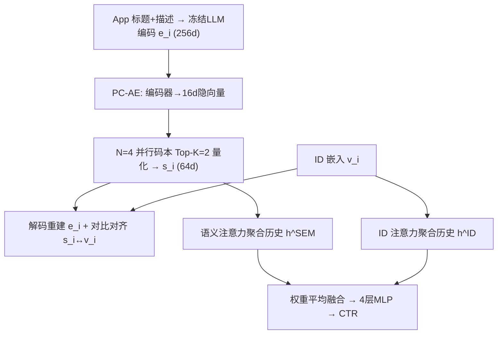
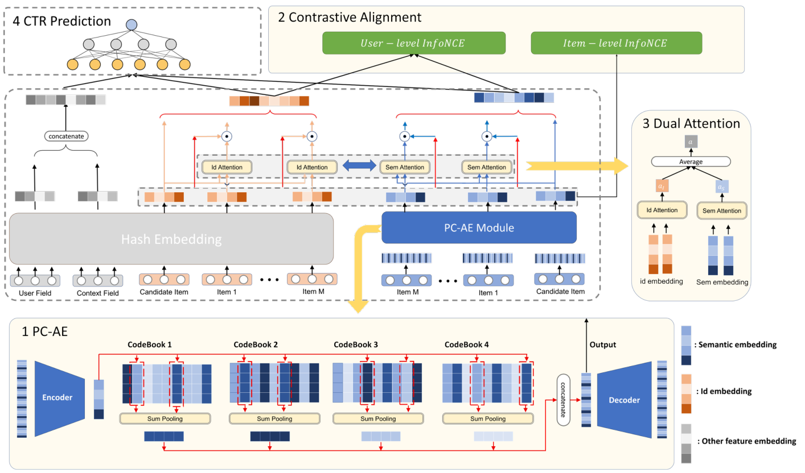

# PCR-CA: Parallel Codebook Representations with Contrastive Alignment for Multiple-Category App Recommendation (并行码本表征与对比对齐的多类别应用推荐)

- **会议/期刊**: KDD 2026 (Oral)
- **作者与机构**: Bin Tan, Wangyao Ge, Yidi Wang, Xin Liu, Jeff Burtoft, Hao Fan, Hui Wang — Microsoft
- **推荐链路定位**: 精排 (CTR 预估)
- **研究方向**: 生成式推荐与离散语义ID / 多模态推荐
- **论文原文**: [https://arxiv.org/abs/2508.18166v5](https://arxiv.org/abs/2508.18166v5)
- **开源代码**: 暂未开源（公司政策与隐私限制）

## TL;DR (1分钟核心速览)

应用商店中大量 App 天然横跨多个类别（如《黑手党》同时是犯罪、FPS、动作），传统单标签类目与 RQ-VAE 的"粗到细"层级量化都无法刻画这种重叠语义；同时头部 100 个 App 占据 63.6% 点击，长尾严重稀疏。本文提出 PCR-CA：用 **N 个并行独立码本**做 VQ-AE 离散语义编码，配合**物品级 + 用户级 InfoNCE 对比对齐**打通语义空间与 ID 协同空间，再用**双流注意力**分别聚合 ID 与语义历史。在微软商店 3.4 亿交互日志上，全库 AUC 相对强基线提升 +0.76%，长尾桶提升 +2.15%，线上 A/B 的 CTR +10.52%、CVR +16.30%。

## Background & Motivation (背景与核心矛盾)

- **主流范式**: 工业 CTR 模型把类目当作固定 categorical 特征，或将多模态内容（文本/图像）直接拼接进 ID 特征（Wide&Deep、DeepFM、MMDIN、MIM）；近期 DST/CoST/SaviorRec 转向用 VQ / RQ-VAE 把内容压缩为离散码以降低噪声与存储。
- **前人局限一（语义层面）**: RQ-VAE 采用残差堆叠，隐含"先粗类、后细节"的层级归纳偏置——这对音频/图像自然，但 App 的类别是**平铺重叠**的，不存在清晰层级，残差码被迫把次要语义塞进残差项而丢失。
- **前人局限二（协同层面）**: 高维原始文本嵌入（256/768 维）直接拼接会引入噪声与延迟，MV-DNN 这类朴素融合甚至低于纯 ID 基线；且长尾 App 正样本极少，语义码与 ID 嵌入若不对齐，模型会退化为只信 ID。
- **核心洞察 (Key Insight)**: 一个 App 的多个语义侧面（玩法、画风、功能）应当由**多个互不干扰的码本各自独立编码**，而非共享一条残差链；同时语义码必须被显式"拉近"到协同 ID 空间，才能在长尾上真正生效。
- **本文切入点**: 并行码本 + 双层对比对齐 + 双流注意力，三者以极低线上开销完成端到端联合训练。

## Method (核心方法设计)

### 1. 整体框架 (Overall Architecture)

输入为 App 的标题+描述文本，经冻结的 LLM 文本编码器得到 256 维向量 $\mathbf{e}_i$；PC-AE 将其压缩为 16 维隐向量后，在$N=4$个并行码本上各取 Top-$K$（$K=2$）最近码字，拼接成 64 维离散语义嵌入$\mathbf{s}_i$，并由解码器重建$\mathbf{e}_i$。语义嵌入与 ID 嵌入$\mathbf{v}_i$ 通过物品级/用户级 InfoNCE 对齐；双流注意力分别以 ID 与语义视角聚合用户历史，平均融合后送入 4 层 MLP 输出点击概率。训练分三阶段：100 epoch 纯自编码预热 → 100 epoch 加入码本 → 1 epoch 与 CTR 任务端到端联合训练（防过拟合）。

<figure class="paper-figure" markdown="span">
  <figcaption>图3：PCR-CA框架概览，包含四个组件：（1）PC-AE；（2）对比对齐模块；（3）双重注意力；（4）CTR预测网络。</figcaption>
</figure>

### 2. 关键设计拆解 (Key Designs)

1. **并行码本量化 (Parallel Codebook VQ-AE)**：痛点在于 RQ-VAE 的残差链强制语义分层，多类别 App 的次要侧面被压进残差而失真。本文改为 $N$个**独立**码本各自对同一隐向量做 Top-$K$检索并求和：$\mathbf{q}_i^{(j)}=\sum_{k\in \mathrm{TopK}(\mathbf{z}_{enc,i},\mathbf{C}^{(j)})}\mathbf{c}_k^{(j)}$，再拼接$\mathbf{s}_i=[\mathbf{q}_i^{(1)}\|\cdots\|\mathbf{q}_i^{(N)}]$。每个码本可自由专精一个语义侧面（如"玩法"码本同时激活 FPS 与 Action 两个码），$K=2$ 允许单码本内表达复合子侧面，从而摆脱层级约束。

2. **双层对比对齐 (Item/User-level Contrastive Alignment)**：痛点在于离散语义空间与协同 ID 空间彼此割裂，长尾物品的语义码无法被协同信号"认领"。物品级以 $(\mathbf{s}_i,\mathbf{v}_i)$为正对，并额外把**7 天内被同一用户共同安装**或 **24 小时内共同点击**的物品对也视为正对（窗口经 {7,14,30} 天网格搜索确定），负样本为 batch 内其余物品：$\mathcal{L}_{item}^{(i)}=-\log\frac{\sum_{j\in\mathcal{P}(i)}\exp(\mathrm{sim}(\mathbf{s}_i,\mathbf{v}_j)/\tau)}{\sum_{j\in\mathcal{P}(i)\cup\mathcal{N}(i)}\exp(\mathrm{sim}(\mathbf{s}_i,\mathbf{v}_j)/\tau)}$。用户级则对齐"历史 ID 均值"与"历史语义均值"两个用户表征。直觉是：把协同知识反向注入内容空间，使新 App 的语义码天然落在相似老 App 的 ID 邻域内，等效于"零交互也能被推荐"。

3. **双流注意力与训练目标**：ID 流与语义流各训一个 target-attention（输入 $(\mathbf{v}_{i_j},\mathbf{v}_c,\mathbf{v}_{i_j}\circ\mathbf{v}_c)$），权重做 bagging 式平均$g(a,b)=(a+b)/2$而非 MoE 门控——在稀疏的 App 场景下降低方差比提升拟合容量更有效。总损失$\mathcal{L}=\mathcal{L}_{CTR}+\lambda_{rec}\mathcal{L}_{recon}+\lambda_{vq}\sum_j\mathcal{L}_{vq}^{(j)}+\lambda_{align}\mathcal{L}_{align}$，其中$\lambda_{align}=0.01$（对齐损失绝对值比 CTR 损失大约两个数量级）、$\lambda_{vq}=0.25$、$\tau=0.07$。负采样为 in-batch 方式，无需额外负采样器；推理时每物品仅需存 4 个整数码索引，打分吞吐从 15 万/秒降至 12 万/秒。

## Experimental Setup & Evaluation Protocol (实验设置与评估协议)

- **数据集与预处理**: 微软商店真实曝光/点击日志，覆盖约 8 万 App，正样本率 6.148%，用户历史截断至最近 50 次交互。

| 数据集 | #Users | #Items | #Interactions | 稀疏度/密度 | 特征/场景说明 |
| :--- | :---: | :---: | :---: | :---: | :--- |
| Microsoft Store (Train) | 未披露 | 80,686 | 340M | 正样本率 6.148% | 曝光+点击/安装日志，文本特征 |
| Microsoft Store (Valid) | 未披露 | — | 10M | 同上 | 按时间切分的最后 1000 万条 |

- **数据划分与防穿越 (Splitting Strategy)**: **全局时间戳切分**——验证集取时间上最后 1000 万条样本，天然包含训练期未见过的新 App 与新用户，模拟真实冷启动。
- **排名评测协议 (Ranking Protocol)**: 报告 AUC（ROC 曲线下面积），并按 App 流行度排名分桶（[0,50)、[50,100)、…、[500,+∞)）分别评估；显著性采用配对 t 检验，除 [0,50) 桶外均在 $p<0.01$ 下显著，标准误均小于 0.01%。
- **对比基线与超参设置**: 基线含线上生产模型 Base（纯 ID + 历史注意力）、MV-DNN（原始文本拼接）、MMDIN、MIM、SaviorRec（RQ-VAE + 对比对齐，复现）。所有模型 ID 嵌入统一 16 维、内容特征统一 256 维 LLM 文本嵌入、预测网络统一 4 层 MLP；PCR-CA 取 $N=4$、码本大小 32、$K=2$，Adam 学习率 1e-3，12 台参数服务器训练。

## Key Experimental Results (实验关键数据)

### 1. 主实验对比 (Main Results)

| Model | All | [0,50) | [100,200) | [300,400) | [400,500) | [500,+∞) |
| :--- | :---: | :---: | :---: | :---: | :---: | :---: |
| Base | 84.326% | **81.167%** | 83.023% | 79.378% | 79.351% | 74.829% |
| MV-DNN | 83.799% | 81.094% | 82.641% | 79.470% | 78.559% | 73.939% |
| MMDIN | 84.810% | 80.121% | 82.837% | 79.699% | 80.394% | 75.146% |
| MIM | 84.512% | 80.703% | 83.206% | 80.431% | 80.973% | 76.689% |
| SaviorRec | 84.926% | 80.657% | 83.372% | 80.176% | 81.179% | 76.204% |
| **PCR-CA** | **85.086%** | 81.069% | **83.499%** | **80.691%** | **81.505%** | **76.977%** |
| Improv. vs Base | +0.760% | -0.098% | +0.476% | +1.313% | +2.154% | +2.148% |

线上 A/B（微软商店首页推荐位，50% 流量，四大市场，2 周）：CTR **+10.52%**（95% CI [0.34%, 0.78%]，p=0.03%）、CVR **+16.30%**（p=0.29%）、HER **+1.97%**（p=0.04%）。

### 2. 消融实验 (Ablation Study)

| 变体 | AUC (All) | 相对 PCR-CA |
| :--- | :---: | :---: |
| w/o 对比对齐 | 84.936% | -0.15% |
| w/o 码本（原始内容直拼） | 84.337% | -0.75% |
| 单码本 (64-d VQ) | 84.600% | -0.49% |
| $K=1$（每码本单码） | 84.782% | -0.30% |
| 残差量化 RQ-VAE | 84.828% | -0.26% |
| 仅 ID 注意力 | 85.042% | -0.044% |
| 余弦相似度注意力 | 84.509% | -0.577% |
| MoE 门控注意力 | 84.631% | -0.455% |
| 单注意力混合双特征 | 85.054% | -0.032% |
| 多头注意力 | 85.119% | +0.033% |

### 3. 关键实验发现 (Key Findings)

1. **并行结构优于层级结构，且差距随长尾加深而放大**：RQ-VAE 复现得 84.828%，比并行码本低 0.26%，而单码本比并行低 0.49%——说明"多侧面独立编码"而非"压缩容量"才是增益来源；同时 $K=1$掉 0.30%，证明单码本内允许多码（$K=2$）对复合子侧面（如同时是 FPS 又是 Action）是必要的。
2. **量化本身即是去噪，而非仅为省存储**：去掉码本直接拼 256 维原始文本嵌入，AUC 暴跌 0.75%（84.337%），甚至低于纯 ID 的 Base（84.326% 附近），印证了高维内容特征在 App 场景下噪声大于信息；而对比对齐移除仅掉 0.15%，说明"先量化去噪、再对齐"的顺序不可颠倒。
3. **头部让位、长尾收割的收益结构**：头部 [0,50) 桶仅微降 0.098%（头部 App 交互充足、语义冗余），但 [400,500) 与 [500,+∞) 桶分别提升 +2.154% 与 +2.148%；推荐列表中长期尾部 App 占比从 12.4% 升至 16.0%，且 AUC 同步上升说明这些长尾曝光是相关的而非盲目多样化。此外多头注意力虽 +0.033%，但参数量约 10 倍（~10k vs ~1k），推理开销不划算，故未采用。

## Highlights & Limitations (亮点、对比与审稿批判)

- **与代表作对比 (vs. Prior Work)**: 与 SaviorRec 的本质区别在于量化拓扑——SaviorRec 沿用 RQ-VAE 残差链 + 单向对比，本文改为并行独立码本 + 用户/物品双层对齐；与 MMDIN/MIM 的区别在于不做原始多模态特征的高维融合，而是先离散压缩再对齐，因而在长尾桶上优势显著（76.977% vs 76.689%/76.204%）。
- **可迁移亮点**: (1) "并行码本 + 共现正样本扩展"的对齐范式可直接迁移到短视频/电商的语义 ID 生成，尤其适合类别天然重叠的域；(2) 三阶段码本预热（全库自编码 → 加码本 → 单 epoch 联合）是防止头部物品主导码本初始化的实用工程技巧。
- **审稿级局限批判**: (1) 全部实验基于微软商店私有数据，无公开基准、无开源代码，可复现性受限，且未验证跨应用商店（Google Play / App Store）的泛化性；(2) 各组件（VQ-AE、InfoNCE、双流注意力）均为标准算子，创新主要在任务特化集成；同时刻意排除图像特征以规避 click-bait，可能损失部分品类的视觉信号，线上 A/B 也仅 2 周、未观测长期留存。

## Rating (四维评分)

- **方法创新性 (Novelty)**: ⭐⭐⭐⭐ （并行码本替代残差层级是针对多类别语义的精准手术，虽组件标准但组合动机清晰、有 t-SNE 与消融双重佐证）
- **评估协议与实验扎实度 (Protocol & Experiments)**: ⭐⭐⭐⭐ （3.4 亿真实交互 + 时间切分 + 七档流行度分桶 + 配对 t 检验 + 线上 A/B 完整，唯缺公开数据集复现）
- **写作与数学规范度 (Clarity & Rigor)**: ⭐⭐⭐⭐ （公式简洁、超参与窗口选择均有网格搜索依据，三阶段训练流程交代清楚；部分符号如 $\alpha_j$ 在双流融合处的下标复用略含混）
- **工业落地与复现价值 (Industrial & Practical Value)**: ⭐⭐⭐⭐ （已全量部署微软商店，每物品仅存 4 个整数码、吞吐 12 万/秒、新 App 22ms 完成编码，工程价值极高；但代码与数据未开源，复现门槛高）
