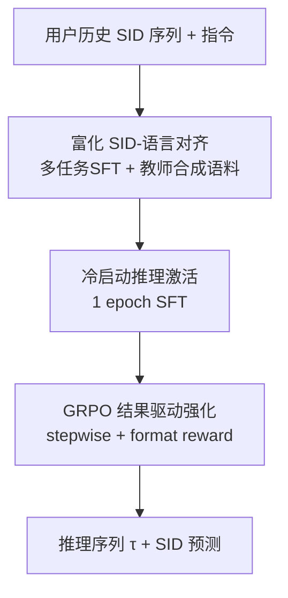
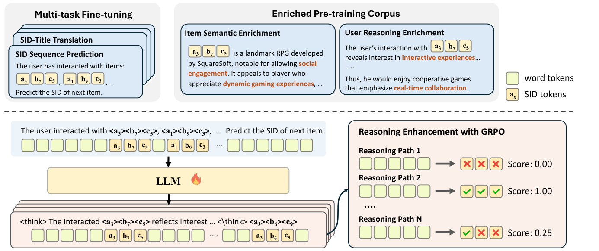

# Reasoning over Semantic IDs Enhances Generative Recommendation (语义ID上的推理增强生成式推荐)

- **会议/期刊**: KDD 2026
- **作者与机构**: Yingzhi He, Yan Sun, Junfei Tan, Yuxin Chen, Xiaoyu Kong, Chunxu Shen, Xiang Wang, An Zhang, Tat-Seng Chua（NUS / USTC / 腾讯）
- **推荐链路定位**: 端到端生成式（SID 自回归生成）
- **研究方向**: 生成式推荐与离散语义ID / 大语言模型推荐
- **论文原文**: [https://arxiv.org/abs/2603.23183v2](https://arxiv.org/abs/2603.23183v2)
- **开源代码**: [https://github.com/HappyPointer/SIDReasoner](https://github.com/HappyPointer/SIDReasoner)

## TL;DR (1分钟核心速览)

SID 生成式推荐中，itemic token 对 LLM 天然无语义，且推荐推理质量难以评估导致高质量推理监督稀缺。本文提出 SIDReasoner：先用强教师模型合成"物品语义富化 + 用户推理富化"语料做多任务 SID-语言对齐，再用 GRPO 以推荐结果奖励驱动模型自探索推理轨迹，无需显式推理标注。在 Games/Office/Industrial 三数据集 Full-Ranking 协议下，Recall@10 相对最强基线 R2ec 提升约 10.7%/10.9%/14.8%，并展现跨域泛化与可解释性。

## Background & Motivation (背景与核心矛盾)

- **主流范式**: 将物品经 RQ-VAE 量化为短 SID 序列，把推荐建模为 SID token 自回归生成，并把 SID 词表并入 LLM 词表，使模型"用语言推理、用 SID 推荐"。
- **前人局限**: ① 纯文本描述物品的推理方法解码低效且存在 item grounding 难题；② SID 推理范式严重依赖工业级大规模预训练才能对齐，学术规模下 SID token 语义空洞，直接 SFT 激活推理几乎无效（表 3 中 S1 仅 R@10=0.0414）。
- **核心洞察 (Key Insight)**: 推荐推理的监督信号稀缺且难以直接评估，但"推理能力"本身可从通用 LLM 迁移——只要 SID-语言对齐足够强，通用推理即可泛化到推荐任务；而推理质量可用最终推荐结果作为可验证奖励间接评估。
- **本文切入点**: 以"强化对齐 + 结果驱动 RL"替代"海量推荐推理标注"，数据高效地激发 SID 推理。

## Method (核心方法设计)

### 1. 整体框架 (Overall Architecture)

输入为用户历史交互的 SID 扁平序列与指令 prompt，模型先生成语言推理序列 $\tau$，再自回归生成下一物品的 $L$ 个 SID token。训练分三阶段闭环：① 富化 SID-语言对齐（多任务 SFT + 教师合成语料预训练），把 itemic token 锚定到语义与行为语境；② 冷启动推理激活（1 epoch SFT）强制"先推理后推荐"格式；③ GRPO 强化学习，以推荐命中与格式合法性为奖励，让模型自探索高效推理路径。推理时单次前向解码即可输出推理+推荐。

<figure class="paper-figure" markdown="span">
  <figcaption>图1：我们提出的SIDReasoner整体框架示意图。</figcaption>
</figure>

### 2. 关键设计拆解 (Key Designs)

1. **富化 SID-语言对齐（Enriched Alignment）**：痛点是对齐语料格式单一、SID 与词 token 关联重复贫乏。做法是用 GPT-4o-mini 教师从两视角合成语料：item-centric（将物品元数据扩写为含 SID 的结构化段落）与 user-centric（推断交互动机、生成混合 SID-语言的推理描述），并与多任务目标（SID↔标题双向翻译、SID/文本双表征的物品预测）及通用推理数据混合训练。直觉：让 SID token 在多样语义与行为语境中反复出现，从而"继承"LLM 的世界知识与推理能力。

2. **GRPO 结果驱动推理强化**：痛点是推荐推理无显式标注、无法直接监督。定义奖励 $R_\theta(\tau,y)=R_{sr}(y,i_{T+1})+\lambda R_f(y)$，其中步进式规则奖励按最长正确前缀 $m$ 平滑给分：
$$R_{sr}(y,i_{T+1})=\frac{1}{2^{L-m}}$$
格式奖励 $R_f$ 校验生成 SID 是否映射到真实目录物品。对每个上下文采样 $K$ 条轨迹做组内归一化优势 $\hat{A}_k$，用带 clip 与 KL 正则的 GRPO 目标更新。直觉：无需"正确推理长什么样"，只需"哪种推理导致正确推荐"，即可把概率质量推向有效轨迹。

3. **训练目标、负采样与推理效率**：总目标为三阶段串联（对齐 SFT 交叉熵 → 激活 SFT → GRPO 代理目标），全程无负采样（生成式全库解码，天然免负采样）；GRPO rollout 数 16、KL 系数 $1\times10^{-3}$、batch 256、学习率 $5\times10^{-7}$、$\lambda=0.1$。推理开销为一次自回归解码（推理序列 + $L$ 个 SID token），显著低于逐物品文本生成。

## Experimental Setup & Evaluation Protocol (实验设置与评估协议)

- **数据集与预处理**: Amazon 三域，均做 `5-core` 过滤，滑窗截断历史长度 10：

| 数据集 | #Users | #Items | #Interactions | 稀疏度/密度 | 特征/场景说明 |
| :--- | :---: | :---: | :---: | :---: | :--- |
| Games | — | 3,858 | 61,417 | 训练 49,133 | 语义丰富、LLM 世界知识覆盖强 |
| Office | — | 3,459 | 48,656 | 训练 38,924 | 办公用品，中等语义 |
| Industrial | — | 3,686 | 45,325 | 训练 36,259 | 工业品，LLM 领域知识弱 |

- **数据划分与防穿越 (Splitting Strategy)**: 按用户时间戳 `8:1:1` 比例划分，最近交互留作验证/测试，严格时间感知防穿越。
- **排名评测协议 (Ranking Protocol)**: 无偏 `Full-Ranking`（全物品集排序，非采样负例），指标 Recall@{5,10}、NDCG@{5,10}。
- **对比基线与超参设置**: 基线含判别式（Caser/GRU4Rec/SASRec）、生成式（TIGER/HSTU/LETTER/LCRec）、推理式（ReaRec/R²ec）；骨干 Qwen3-1.7B 全参微调，SID 词表随机初始化追加。

## Key Experimental Results (实验关键数据)

### 1. 主实验对比 (Main Results)

| 模型 | Games R@10 | Games N@10 | Office R@10 | Office N@10 | Industrial R@10 | Industrial N@10 |
| :--- | :---: | :---: | :---: | :---: | :---: | :---: |
| SASRec | 0.0723 | 0.0416 | 0.1167 | 0.0871 | 0.0964 | 0.0697 |
| TIGER | 0.0763 | 0.0402 | 0.1429 | 0.1121 | 0.1325 | 0.0924 |
| HSTU | 0.0746 | 0.0462 | 0.1323 | 0.1107 | 0.1138 | 0.0940 |
| LETTER | 0.0709 | 0.0378 | 0.1520 | 0.1139 | 0.1389 | 0.0950 |
| LCRec | 0.0876 | 0.0412 | 0.1487 | 0.0867 | 0.1330 | 0.0687 |
| ReaRec | 0.0843 | 0.0470 | 0.1385 | 0.1057 | 0.1205 | 0.0870 |
| R²ec | 0.0931 | 0.0525 | 0.1486 | 0.1004 | 0.1253 | 0.0774 |
| **SIDReasoner** | **0.1031** | **0.0563** | **0.1648** | **0.1208** | **0.1438** | **0.1010** |
| Improv.% (vs 最强基线) | +10.7% | +7.2% | +8.4% | +6.1% | +3.5% | +6.3% |

### 2. 消融实验 (Ablation Study)

| 配置 | Games R@10 | Games N@10 | Office R@10 | Office N@10 |
| :--- | :---: | :---: | :---: | :---: |
| S1 多任务对齐 | 0.0414 | 0.0206 | 0.0388 | 0.0201 |
| S1 + RL | 0.0741 | 0.0355 | 0.1539 | 0.0970 |
| S2 = S1 + 富化对齐 | 0.0632 | 0.0320 | 0.0619 | 0.0363 |
| S2 + RL | 0.0957 | 0.0470 | 0.1607 | 0.1178 |
| S3 = S2 + 通用推理数据 | 0.0806 | 0.0450 | 0.1231 | 0.0883 |
| **S3 + RL (完整)** | **0.1031** | **0.0563** | **0.1648** | **0.1208** |

教师模型消融（Games R@10）：Metadata 0.0703 < Qwen3-8B 0.0727 < Qwen3-32B 0.0858 < GPT-4o-mini 0.1031。

### 3. 关键实验发现 (Key Findings)

1. **对齐是 RL 生效的前提**：无对齐直接激活推理（S1）R@10 仅 0.0414，而富化对齐后 RL 收敛至 0.1031，提升 149%；且 Best-of-N 上界与 RL 后收敛性能高度一致，说明对齐质量决定推理天花板。
2. **推理收益与 LLM 领域知识强相关**：Games（语义丰富）相对 R²ec 提升 10.7%，而 Industrial（LLM 知识弱）仅 3.5%，同一趋势在 R²ec 上复现，证明推理效果取决于可调用的语义知识量。
3. **RL 让推理"变短变准"**：训练中平均推理长度先降后稳而 Recall@10 持续上升，说明教师生成的冗余推理被 RL 剪除；同时混入通用推理数据使 GSM8K 从 0.0060 恢复至 0.5430，有效缓解灾难性遗忘。

## Highlights, Limitations & Rating (亮点、对比与审稿评价)

- **与代表作对比 (vs. Prior Work)**: 相比 TIGER/LCRec 仅做 SID 生成、无推理，本文引入显式推理链；相比 R²ec 依赖文本物品与人工推理标注，本文以 SID 为输出空间并用结果奖励免标注激发推理；相比 ReaRec 的隐式推理，本文推理显式可读、可解释。
- **可迁移亮点**: ① "强教师合成混合 SID-语言语料"可迁移到任意新 token 词表注入场景；② 用"最长正确前缀平滑奖励 + 格式合法性奖励"做生成式推荐的 RL 奖励设计，可直接复用到其他 SID 生成模型。
- **审稿级局限批判**: ① 骨干仅 1.7B、数据为学术规模，未验证 scaling 后收益是否持续；② 推理序列增加解码长度，在线延迟与吞吐未量化；③ 富化语料依赖 GPT-4o-mini，存在教师偏差与复现成本。
- **四维评分**: 创新性 ⭐⭐⭐⭐ | 实验扎实度 ⭐⭐⭐⭐ | 方法清晰度 ⭐⭐⭐⭐⭐ | 落地价值 ⭐⭐⭐⭐

