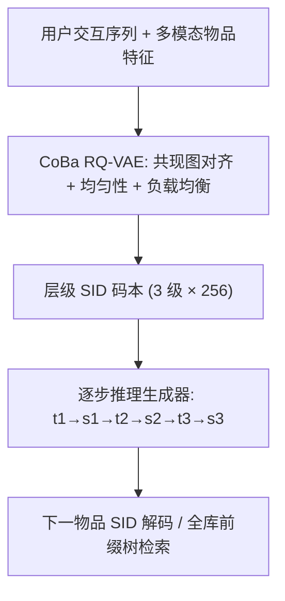
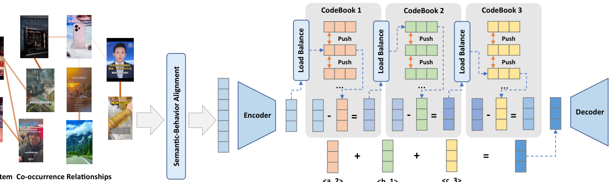
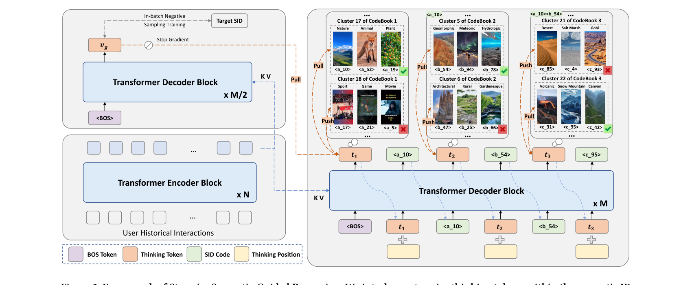

# S$^2$GR: Stepwise Semantic-Guided Reasoning in Latent Space for Generative Recommendation (潜空间逐步语义引导推理的生成式推荐)

- **会议/期刊**: KDD 2026
- **作者与机构**: Zihao Guo, Jian Wang, Ruxin Zhou, Youhua Liu, Jiawei Guo, Jun Zhao, Xiaoxiao Xu, Yongqi Liu, Kaiqiao Zhan（快手科技）
- **推荐链路定位**: 端到端生成式召回
- **研究方向**: 生成式推荐 / 序列推荐
- **论文原文**: [论文原文链接](https://arxiv.org/abs/2601.18664v3)
- **开源代码**: 暂未开源

## TL;DR (1分钟核心速览)

现有生成式推荐（GR）直接从交互序列生成 SID，未激活深层推理；已有的推理增强方法把"思考"全部堆在生成之前，导致各层 SID 码计算资源分配不均、且推理向量缺乏可验证语义。本文提出 S$^2$GR：在每一级 SID 码生成前插入一个"思考 token"，用码本聚类得到的粗粒度语义中心做对比监督，使推理路径物理可解释；同时用协同共现增强 + 均匀性 + 负载均衡优化 RQ-VAE 码本。在 Amazon Beauty 与快手工业数据集上，HR@10 分别相对提升 7.83% 与 13.21%，NDCG@10 提升 8.72% 与 54.17%，线上 A/B 总使用时长 +0.092%。

## Background & Motivation (背景与核心矛盾)

- **主流范式**: TIGER 类方法用 RQ-VAE 将物品压成 3 级 SID 码，再用 Transformer 自回归逐码生成下一物品；ReaRec/LARES 等在序列推荐中做隐式多步推理，STREAM-Rec/GPR 把推理链引入 GR。
- **前人局限**: ① 推理与生成严格串行分离——思考块全部前置，多码生成阶段"算力饥饿"，早期码语义漂移还会沿自回归链累积误差；② 推理向量无物理语义、推理路径无监督信号，可验证性缺失。
- **核心洞察 (Key Insight)**: SID 由残差量化产生，天然具备"粗→细"层级语义（电子→手机→iPhone 17），因此推理步不应前置而应与每一级码生成**交错**，且每步思考应对应该层的粗粒度类别分布。
- **本文切入点**: 把"思考"拆成 L 个逐步 token，每个 token 用该层码本 K-means 聚类中心做对比学习监督，使推理路径既均衡又可信。

## Method (核心方法设计)

### 1. 整体框架 (Overall Architecture)

两阶段：先训练 CoBa RQ-VAE 得到高质量层级 SID 码本（协同共现对齐 + 码本内均匀性 + MoE 式负载均衡），再训练 T5 式编解码生成器，在每级 SID 码前插入思考 token $t_l$，由码本聚类中心对比损失、初始 token 的全局物品语义 InfoNCE 与正则项共同监督，最终损失为 $\mathcal{L}=\mathcal{L}_{Rec}+\mathcal{L}_{Think}$。

<figure class="paper-figure" markdown="span">
  <figcaption>图 2：协同与平衡 RQ-VAE 的框架。我们首先基于用户的历史交互构建物品共现图，其中颜色强度表示共现频率。然后通过邻域聚合用共现信息丰富原始物品表示。在残差量化训练期间，我们引入码本内分布均匀性约束以防止码本表示崩溃。此外，在激活码字时，我们根据历史动态调整每个码字的选择概率。</figcaption>
</figure>
<figure class="paper-figure" markdown="span">
  <figcaption>图 3：逐步语义引导推理的框架。我们在语义 ID 生成过程中交错插入逐步思考 token，这些 token 表示粗粒度类别语义，引导后续 SID 代码从与该思考 token 相关联的语义簇中抽取。每个思考 token 由通过码本聚类获得的粗粒度语义监督，而初始思考 token 还被额外正则化以整合整体物品语义，确保推理路径的可靠性。</figcaption>
</figure>

### 2. 关键设计拆解 (Key Designs)

1. **CoBa RQ-VAE 码本优化（打好层级语义地基）**：痛点是用纯多模态特征量化导致 SID 与推荐目标错位、码本坍缩。做法：用交互共现图做轻量传播 $H^{(k)}=(1-\alpha)\hat{A}H^{(k-1)}+\alpha X$ 并指数加权融合多跳表示（免预训练 CF，省算力）；加码本内成对距离均匀损失 $\mathcal{L}_{uniform}=\log\big(1+\sum_{(i,j)\in P}\exp(-\mu D_{ij})\big)$ 只惩罚过近码字；再用 MoE 式频率修正 $\hat{d}_k=d_k\odot(1-f_k)$ 动态压低高频码字选择概率。直觉：让码本"用满、用匀、带行为语义"。
2. **逐步语义引导推理（核心创新）**：痛点见上。做法：每级先出思考 token 再出码，$t_l=\text{Decoder}(\tilde{h}_{l-1},H_{enc})+p_l$，$s_l=\text{Decoder}((\tilde{h}_{l-1},t_l),H_{enc})$，层级位置嵌入 $p_l$ 区分思考位与码位；监督用码本第 $l$ 层 K-means 中心 $c_k$ 做对比损失 $\mathcal{L}_{Align}^{(l)}=-\frac{1}{B}\sum_i\log\frac{\exp(\text{Sim}(t_l^i,c_{s_l^i})/\tau)}{\sum_k\exp(\text{Sim}(t_l^i,c_k)/\tau)}$。直觉：思考 token 被"钉"在真实粗粒度类别上，成为可验证的语义锚点。
3. **初始思考 token 全局正则与训练/推理**：$t_1$ 是推理链起点，用轻量解码器生成整体兴趣向量 $v_g$，以 in-batch 负采样 InfoNCE 对齐目标物品各级码嵌入均值 $\bar{v}$，再加 $\mathcal{L}_{Reg}=1-\text{Sim}(t_1,\text{sg}(v_g))$ 注入全局语义，抑制早期码漂移。总损失 $\mathcal{L}=\mathcal{L}_{Rec}+\sum_l\mathcal{L}_{Align}^{(l)}+\mathcal{L}_{InfoNCE}+\lambda\mathcal{L}_{Reg}$；推理沿用 SID 前缀树约束解码，开销与 TIGER 同阶（仅多 L 个 token 步）。

## Experimental Setup & Evaluation Protocol (实验设置与评估协议)

- **数据集与预处理**:

| 数据集 | #Users | #Items | #Interactions | 稀疏度 | 特征/场景说明 |
| :--- | :---: | :---: | :---: | :---: | :--- |
| Amazon Beauty | 22,363 | 12,101 | 198,502 | 99.92% | Qwen3-Embedding-4B 编码标题+描述 |
| Industrial (快手) | 37,500 | 1,086,872 | 3,778,562 | 99.99% | 采样活跃用户连续 2 天长播视频，多模态大模型抽帧嵌入 |

- **数据划分与防穿越**: 序列推荐标准 `Leave-One-Out` 式下一物品预测；测试时过滤交互序列长度 < 10 的用户；共现图仅用训练前历史构建，显式防信息泄漏。
- **排名评测协议**: 采用 `Full-Ranking`（全库未交互物品排序，经 SID 前缀树合法化解码），指标 HR@K / NDCG@K（Beauty 取 K=5/10，工业集取 K=10/100）。
- **对比基线与超参**: Caser、GRU4Rec、SASRec、BERT4Rec、ReaRec、TIGER；SID 为 3 级 × 码本 256，T5 架构 4 层编码 + 4 层解码（与 TIGER 对齐）。

## Key Experimental Results (实验关键数据)

### 1. 主实验对比 (Main Results)

| Method | Beauty HR@10 | Beauty NDCG@10 | Ind. HR@10 | Ind. HR@100 | Ind. NDCG@10 | Ind. NDCG@100 |
| :--- | :---: | :---: | :---: | :---: | :---: | :---: |
| Caser | 0.0514 | 0.0251 | 0.0038 | 0.0178 | 0.0020 | 0.0046 |
| GRU4Rec | 0.0634 | 0.0314 | 0.0056 | 0.0251 | 0.0027 | 0.0065 |
| SASRec | 0.0688 | 0.0340 | 0.0088 | 0.0378 | 0.0046 | 0.0102 |
| BERT4Rec | 0.0627 | 0.0329 | 0.0067 | 0.0280 | 0.0032 | 0.0072 |
| ReaRec | 0.0723 | 0.0368 | 0.0102 | 0.0354 | 0.0059 | 0.0105 |
| TIGER | 0.0728 | 0.0390 | 0.0139 | 0.0560 | 0.0072 | 0.0154 |
| **S$^2$GR** | **0.0785** | **0.0424** | **0.0196** | **0.0634** | **0.0111** | **0.0195** |
| Improv. | ↑7.83% | ↑8.72% | ↑41.01% | ↑13.21% | ↑54.17% | ↑26.62% |

### 2. 消融实验 (Ablation Study)

| 变体 | Beauty HR@10 | Beauty NDCG@10 | Ind. HR@10 | Ind. NDCG@10 |
| :--- | :---: | :---: | :---: | :---: |
| S$^2$GR (Full) | **0.0785** | **0.0424** | **0.0196** | **0.0111** |
| w/o CoBa RQ-VAE | 0.0764 | 0.0414 | 0.0155 | 0.0081 |
| w/o Reason | 0.0736 | 0.0406 | 0.0167 | 0.0093 |
| w/o $\mathcal{L}_{Think}$ | 0.0740 | 0.0402 | 0.0178 | 0.0100 |

码本质量对比：CoBa RQ-VAE 在工业集 CUR 4.95% / ICR 76.25%，优于 RQ-VAE（4.61% / 71.23%）与 RQ-Kmeans（4.11% / 63.56%）。

### 3. 关键实验发现 (Key Findings)

1. **推理机制是工业集最大增益源**：去掉逐步思考（w/o Reason）使工业 HR@10 从 0.0196 掉到 0.0167（-14.8%），而仅去掉思考监督（w/o $\mathcal{L}_{Think}$）掉到 0.0178——说明"有监督的思考"比"单纯加深计算"更关键，无监督思考 token 会退化为无语义隐状态。
2. **码本优化对大规模物品空间更敏感**：w/o CoBa RQ-VAE 在工业集 NDCG@10 从 0.0111 跌至 0.0081（-27%），远大于 Beauty 的跌幅，印证百万级物品下码本利用率与层级语义是生成质量瓶颈。
3. **推理收益呈"两端大、中间小"**：工业集上短序列（<20）HR@10 相对提升 +50.0%、长序列（>40）+40.4%，中等长度仅 +19.7%——短序列靠推理补全隐兴趣，长序列靠推理去噪提纯；且模型规模 2x→8x 全程稳定领先 TIGER，收益非参数堆叠所致。

## Highlights, Limitations & Rating (亮点、对比与审稿评价)

- **与代表作对比 (vs. Prior Work)**: 相比 TIGER 的"直接生成"，本文把推理嵌入每一级码生成，解决多码算力失衡；相比 STREAM-Rec/GPR 的"前置推理链"，本文的思考 token 有码本聚类这一可验证监督锚点，而非无约束隐向量；相比 ReaRec 的序列推荐隐推理，本文与 SID 层级结构严格对齐。
- **可迁移亮点**: ① 用码本 K-means 聚类中心作为"免费"层级监督信号，可迁移到任何层级量化生成任务；② MoE 式频率修正 $\hat{d}_k=d_k(1-f_k)$ 是极轻量的码本负载均衡技巧，几乎零成本。
- **审稿级局限批判**: ① 仅 1 个公开数据集（Beauty）+ 1 个私有工业集，泛化性证据偏薄，且工业集不可复现；② 每级多生成一个思考 token，序列长度翻倍，长序列场景推理延迟与显存开销未量化；③ 聚类数 K 呈倒 U 型敏感（过多导致"过度思考"），需逐数据集调参。
- **四维评分**: 创新性 ⭐⭐⭐⭐ | 实验扎实度 ⭐⭐⭐⭐ | 方法清晰度 ⭐⭐⭐⭐⭐ | 落地价值 ⭐⭐⭐⭐⭐

