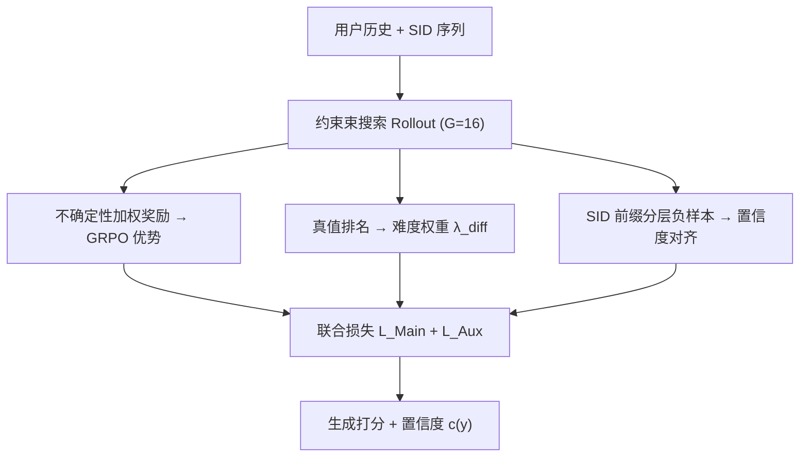
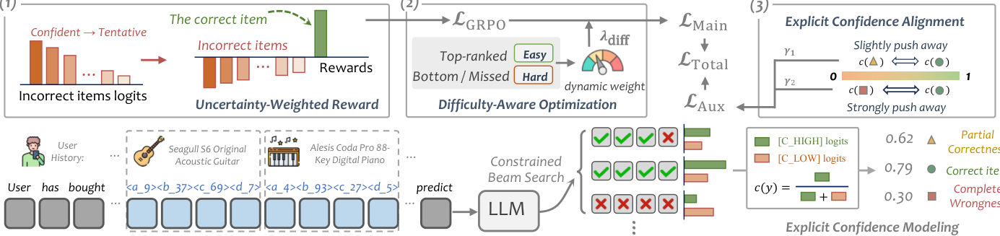

# Uncertainty-aware Generative Recommendation (不确定性感知的生成式推荐)

- **会议/期刊**: KDD 2026
- **作者与机构**: Chenxiao Fan, Chongming Gao, Yaxin Gong, Haoyan Liu, Fuli Feng, Xiangnan He (中国科学技术大学)
- **推荐链路定位**: 端到端生成式（SID 自回归生成 + 偏好对齐）
- **研究方向**: 生成式推荐与离散语义ID / 大语言模型推荐
- **论文原文**: [论文原文链接](https://arxiv.org/abs/2602.11719v2)
- **开源代码**: [开源代码仓库链接](https://github.com/cxfann/UGR)

## TL;DR (1分钟核心速览)

现有生成式推荐的偏好优化只看"对/错"二元结果，忽视模型内在生成置信度与样本难度差异，作者称之为**不确定性盲 (uncertainty blindness)**，导致训练不稳定甚至劣于 SFT。UGR 提出三机制协同：置信度加权奖励（惩罚"自信幻觉"）、难度感知梯度重加权（防早熟收敛）、显式置信度 token 对齐（外化风险信号）。在 Office/Industrial/Yelp 三数据集上以 Qwen3-8B + 4 层 SID 为骨干，HR@10 相对最强基线 MiniOneRec 提升约 8.0%/9.2%/12.6%，并首次实现置信度驱动的用户级拒答与物品级截断。

## Background & Motivation (背景与核心矛盾)

- **主流范式**: 生成式推荐将物品序列化为 SID，用 LLM 自回归解码，并以 GRPO/DPO 类偏好优化对齐排序目标（TIGER、MiniOneRec、ReRe）。
- **前人局限**: ① 二元/排名奖励对所有错误施加统一惩罚，无法区分"高概率错排的自信幻觉"与"概率平坦的试探性探索"；② 所有样本等权优化，简单样本被过度拟合、困难样本欠拟合，导致早熟收敛。
- **核心洞察 (Key Insight)**: 推荐中的不确定性不同于事实问答——用户兴趣本身随机，绝对校准无意义，但**置信度的相对排序**与生成质量强相关；且 SID 定长结构使 logit 跨序列可比，为不确定性度量提供天然基础。
- **本文切入点**: 把不确定性从"被忽视的副产品"升级为偏好优化闭环中的高价值信号，同时驱动奖励、梯度预算与显式输出。

## Method (核心方法设计)

### 1. 整体框架 (Overall Architecture)

给定用户历史，模型在约束束搜索（rollout 束宽 $G=16$）下生成候选集 $\mathcal{G}$；同一候选集同时服务三条通路：用累积 logit 强度构造不确定性加权奖励并经 GRPO 组内归一化得优势 $\hat{A}_{i,t}$；用真值在候选中的排名构造实例难度权重 $\lambda_{\text{diff}}$ 调制主损失；用 SID 前缀层级构造"部分正确/完全错误"负样本对，对置信度 token 做成对排序对齐。两损失直接相加联合反传，共享参数同步更新生成能力与风险感知。

<figure class="paper-figure" markdown="span">
  <figcaption>图2：所提出的UGR框架概览。给定用户历史，模型通过约束束搜索生成候选集。这些候选有效驱动三个协同机制：（1）不确定性加权奖励基于logit强度惩罚自信的幻觉；（2）难度感知优化基于排序难度自适应地重新加权梯度预算；（3）显式置信度对齐将内部确定性外化为可量化的风险信号。</figcaption>
</figure>

### 2. 关键设计拆解 (Key Designs)

1. **不确定性加权奖励 (UW-Reward)**：痛点是从"位置感知"到"分布感知"的跨越——排名奖励对所有同排名错误同罚，抹平概率景观。UGR 以序列累积 logit 强度 $s(y)=\sum_t \log P(y_t|y_{<t},x)$ 构造连续奖励，对错误集 $\mathcal{N}$ 做 softmax 归一化惩罚：
$$r(y_i)=\begin{cases}1.0, & y_i=y^*\\ -\dfrac{\exp(s(y_i))}{\sum_{y_j\in\mathcal{N}}\exp(s(y_j))}, & y_i\in\mathcal{N}\end{cases}$$
直觉：模型越"确信地错"，负奖励幅度越大，从而把梯度预算从自信幻觉上撤走，保留对试探性错误的宽容度。

2. **难度感知优化动态 (Difficulty-aware)**：痛点是样本间难度失衡导致候选坍缩。以真值在束内排名（未命中则取 $G-1$）作轻量难度代理，构造 $\lambda_{\text{diff}}(x)=\alpha+(1-\alpha)\cdot\frac{\text{rank}(y^*)}{G-1}$，并令 $\mathcal{L}_{\text{Main}}=\lambda_{\text{diff}}\cdot\mathcal{L}_{\text{GRPO}}$。$\alpha=0$ 时简单样本梯度被压至近零，迫使模型持续在困难样本上探索，抑制"过度自信陷阱"。

3. **显式置信度对齐与总损失**：扩展词表加入 `[C_HIGH]/[C_LOW]`，用 Append-and-Query 前向得 $c(y)=\frac{P(\text{HIGH})}{P(\text{HIGH})+P(\text{LOW})}$；按 SID 前缀将负样本分为部分正确 $\mathcal{N}_{\text{partial}}$ 与完全错误 $\mathcal{N}_{\text{wrong}}$，以 logistic margin 排序损失对齐，且 $\gamma_2>\gamma_1$ 强制 $c(y^*)>c(y_{\text{partial}})>c(y_{\text{wrong}})$。总目标 $\mathcal{L}_{\text{Total}}=\frac{1}{|\mathcal{B}|}\sum_x(\mathcal{L}_{\text{Main}}+\mathcal{L}_{\text{Aux}})$，无需额外全局超参。训练负样本来自束搜索候选（非均匀采样），推理用 beam=10，开销与标准 GRPO 同阶。

## Experimental Setup & Evaluation Protocol (实验设置与评估协议)

- **数据集与预处理**: Amazon Office / Industrial 与 Yelp，按时间序 8:1:1 划分。

| 数据集 | #Users | #Items | #Interactions | 稀疏度/密度 | 特征/场景说明 |
| :--- | :---: | :---: | :---: | :---: | :--- |
| Office | 中规模 | 中规模 | 中规模 | 高稀疏 | Amazon 办公用品，SID 4 层 |
| Industrial | 中规模 | 中规模 | 中规模 | 高稀疏 | Amazon 工业科学品 |
| Yelp | 中规模 | 中规模 | 中规模 | 极高稀疏 | 本地生活 POI 评论 |

（原文统计表置于附录 A，正文未给具体数值，此处按原文描述概括。）

- **数据划分与防穿越 (Splitting Strategy)**: 严格按交互时间序 8:1:1 切分，验证/测试均在未来时段，无穿越。
- **排名评测协议 (Ranking Protocol)**: 生成式全库解码排序（beam=10 生成 top-K 列表），指标 HR@{1,5,10} 与 NDCG@{5,10}；非采样负例排序。
- **对比基线与超参设置**: 骨干 Qwen3-8B，SID 4 层；SFT 至多 10 epoch 早停 + 偏好优化 2 epoch；rollout 束宽 $G=16$；基线含 SASRec、BIGRec、SPRec、TIGER、MiniOneRec、ReaRec、R²ec。

## Key Experimental Results (实验关键数据)

### 1. 主实验对比 (Main Results)

| Method | Office HR@10 | Office NG@10 | Industrial HR@10 | Industrial NG@10 | Yelp HR@10 | Yelp NG@10 |
| :--- | :---: | :---: | :---: | :---: | :---: | :---: |
| SASRec | 0.1028 | 0.0572 | 0.0894 | 0.0551 | 0.0441 | 0.0213 |
| BIGRec | 0.1198 | 0.0944 | 0.1143 | 0.0710 | 0.0119 | 0.0073 |
| SPRec | 0.1013 | 0.0828 | 0.1244 | 0.0780 | 0.0113 | 0.0087 |
| TIGER | 0.1361 | 0.1015 | 0.1217 | 0.0828 | 0.0460 | 0.0223 |
| MiniOneRec | 0.1479 | 0.1137 | 0.1276 | 0.0980 | 0.0420 | 0.0226 |
| ReaRec | 0.1380 | 0.1060 | 0.1148 | 0.0823 | 0.0470 | 0.0232 |
| R²ec | 0.1364 | 0.0873 | 0.1274 | 0.0761 | 0.0464 | 0.0227 |
| **UGR** | **0.1598** | **0.1231** | **0.1393** | **0.1033** | **0.0473** | **0.0250** |
| Improv.% (vs 最强基线) | +8.0% | +8.3% | +9.2% | +5.4% | +0.6% | +7.8% |

### 2. 消融实验 (Ablation Study)

| 变体 | Office HR@10 | Office NG@10 | Industrial HR@10 | Yelp HR@10 | Yelp NG@10 |
| :--- | :---: | :---: | :---: | :---: | :---: |
| (a) Only SFT | 0.1563 | 0.1213 | 0.1378 | 0.0423 | 0.0217 |
| (b1) + GRPO (0/1 Reward) | 0.1485 | 0.1120 | 0.1303 | 0.0405 | 0.0220 |
| (b2) + GRPO (Rank Reward) | 0.1468 | 0.1135 | 0.1321 | 0.0423 | 0.0219 |
| (b3) + GRPO (UW-Reward) | 0.1522 | 0.1193 | 0.1338 | 0.0424 | 0.0222 |
| (c) + Difficulty-Aware | 0.1579 | 0.1223 | 0.1349 | 0.0454 | 0.0239 |
| (d) **UGR (Full)** | **0.1598** | **0.1231** | **0.1393** | **0.0473** | **0.0250** |

### 3. 关键实验发现 (Key Findings)

1. **标准偏好优化反而劣于 SFT**：Office 上 (b1) 0/1 奖励 HR@10 仅 0.1485、(b2) 排名奖励 0.1468，均低于 SFT 的 0.1563——证实"不确定性盲"下粗粒度奖励引入噪声信号；仅引入 UW-Reward (b3) 即回升至 0.1522，说明区分错误严重性是有效优化的前提。
2. **难度感知是超越 SFT 的关键**：在 (b3) 基础上加难度权重 (c) 使 Office HR@10 升至 0.1579、Yelp 从 0.0424 跃至 0.0454；训练动态图（图 3/4）显示 $\alpha=1.0$ 均匀加权出现"先升后崩"且每次 rollout 有效候选数从 16 持续侵蚀至 13 左右，而 $\alpha=0$ 维持近饱和搜索空间，将多样性转化为 top-1 精度。
3. **置信度对齐兼具正则与风控价值**：完整 UGR 在 Industrial 上 HR@10 达 0.1393（较 (c) +3.3%）；置信度重排使 Office NDCG@1 从 0.0904 升至 0.0933；用户级拒答在 50% 过滤率下 NDCG@10 单调上升，物品级截断同步提升 Precision，验证置信度是可靠的风险信号而非仅校准副产品。

## Highlights, Limitations & Rating (亮点、对比与审稿评价)

- **与代表作对比 (vs. Prior Work)**: 相较 MiniOneRec/ReRe 的 GRPO 二元或排名奖励，UGR 将奖励从"位置感知"升级为"分布感知"；相较 FLAME 的逐步奖励塑形，UGR 不依赖过程标注而用 logit 强度自监督；相较通用 LLM 置信度校准工作（追求绝对校准），UGR 针对推荐稀疏性改用相对排序置信度，更契合任务本质。
- **可迁移亮点**: ① "真值束内排名作难度代理"是零额外标注的通用样本重加权技巧，可迁移至任意 beam-rollout 的 RLHF 推荐；② 用 SID 前缀层级自动构造分级负样本对，可复用于任何树状语义 ID 的对比/对齐损失设计。
- **审稿级局限批判**: ① 实验仅在中等规模三数据集、单一 Qwen3-8B 骨干上验证，8×A100 + 束搜索 rollout 的在线推理与训练成本未量化，工业落地存疑；② 置信度仅二值 token（HIGH/LOW），粒度较粗，且 $\gamma_1,\gamma_2$ 虽不敏感但仍需调参，缺少与 DPO 等其他对齐范式的对比验证。
- **四维评分**: 创新性 ⭐⭐⭐⭐ | 实验扎实度 ⭐⭐⭐⭐ | 方法清晰度 ⭐⭐⭐⭐⭐ | 落地价值 ⭐⭐⭐⭐

