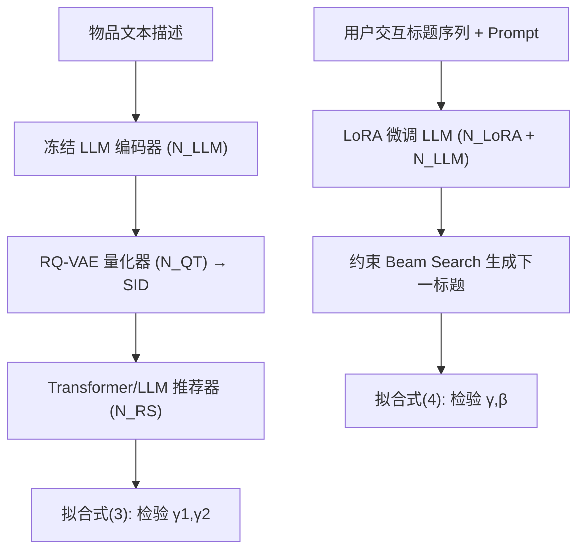

# Understanding Generative Recommendation with Semantic IDs from a Model-scaling View (从模型扩展视角理解基于语义 ID 的生成式推荐)

- **会议/期刊**: KDD 2026
- **作者与机构**: Jingzhe Liu, Jiliang Tang (Michigan State University); Liam Collins, Tong Zhao, Neil Shah, Mingxuan Ju (Snap Inc.)
- **推荐链路定位**: 端到端生成式（召回/排序一体化）
- **研究方向**: 生成式推荐与离散语义 ID / 序列推荐
- **论文原文**: [https://arxiv.org/abs/2509.25522v3](https://arxiv.org/abs/2509.25522v3)
- **开源代码**: 暂未开源

## TL;DR (1分钟核心速览)

本文首次系统检验生成式推荐（GR）的**模型扩展律**。作者发现主流 SID-based GR 在三个轴向上扩展均快速饱和：Transformer RS 在 $N_{\text{RS}}>10^7$后性能停滞，LLM 编码器从 77M 扩到 11B 几乎零增益，量化器码本数/码本大小超过$3\times256$ 反而下降。消融实验证明瓶颈在于 **SID 离散化丢弃了 LLM 稠密语义**——直接注入 LLM embedding 可显著缓解饱和。据此作者重访 Text-based GR（LLM 直接生成物品标题），在 Amazon 三数据集上随规模持续提升、无饱和迹象，最终超越 SID-based GR 最优扩展点约 20%，且冷启动 Recall@10 全面领先。

## Background & Motivation (背景与核心矛盾)

- **主流范式**: SID-based GR 先用模态编码器（LLM/VLM）编码物品文本，再经 RQ-VAE 等量化器压缩为离散语义 ID，最后用 Transformer/LLM 在 SID 序列上做自回归下一物品预测（TIGER、MiniOneRec 等）。
- **前人局限**: ① 该范式默认"更大模型=更好推荐"，但从未验证扩展律是否成立；② 现有改进多靠外挂 CF 信号或更丰富语义，而非单纯扩大参数，缺乏对"扩展天花板"的机理认识。
- **核心洞察 (Key Insight)**: 作者将 GR 误差按多模态扩展律分解为语义误差与协同过滤误差两项（式 1），发现 SID-based GR 中编码器与量化器的有效参数系数 $\gamma_1,\gamma_2\approx 0$——即扩大它们并不改善 SID 的信息量，瓶颈是 **SID 本身的语义编码容量**，而非任一子模块。
- **本文切入点**: 绕过 SID，直接用 LLM 以文本为输入输出做推荐（Text-based GR），检验其是否具备更健康的扩展行为。

## Method (核心方法设计)

### 1. 整体框架 (Overall Architecture)

本文是**分析型工作**，核心是提出可拟合的 GR 扩展律方程，并在两大范式上做受控扩展实验。SID-based GR 链路为：冻结 LLM 编码器 → RQ-VAE 量化器 → Transformer/LLM 推荐器，逐轴放大并拟合式 (3)；Text-based GR 链路为：简单 prompt + 物品标题序列 → LoRA 微调 LLM → 约束 beam search 生成下一物品标题，拟合式 (4)。两条链路共享同一训练数据预算，以保证可比性。

### 2. 关键设计拆解 (Key Designs)

1. **GR 双模态扩展律方程（诊断工具）**：将推荐误差视为语义信息 (SI) 与协同过滤 (CF) 两类"模态"的加性风险分解，SID-based 版本为
$\text{Recall}@k = R_0 - \frac{A}{(N_{\text{RS}}+\gamma_1 N_{\text{LLM}}+\gamma_2 N_{\text{QT}})^a} - \frac{B}{N_{\text{RS}}^b}$其中$\gamma_1,\gamma_2$度量编码器/量化器对 SI 学习的有效贡献。若拟合得$\gamma\approx0$，即证明该模块"扩了也白扩"——这是本文最锋利的诊断算子，把"性能饱和"从现象升级为可量化的机理证据。

2. **SID 瓶颈的注入式消融（因果验证）**：为证明瓶颈在 SID 而非模块，作者将 SASRec 的 CF embedding 与 Flan-T5-xxl 的 LLM embedding 分别经 MLP adapter 加到 SID embedding 上。结果 CF 注入几乎无增益（说明 CF 信号已被 SID 序列监督充分捕获），而 LLM embedding 注入带来显著提升且 21M RS 增益大于 13M——直接证明"被量化丢弃的稠密语义"才是饱和根因。

3. **Text-based GR 的 CF 扩展性反证**：针对"LLM 学不好协同过滤"的流行偏见，作者用反证法：若式 (4) 中 $\beta=0$，则外挂 CF embedding 的增益$\Delta\text{Recall} = \frac{B}{N_{\text{LoRA}}^b} - \frac{B}{(N_{\text{LoRA}}+N_{\text{SA}})^b}$与$N_{\text{LLM}}$无关，不同 LLM 规模的增益曲线应重合；实测曲线明显发散且 LLM 越大增益越小，故$\beta>0$，即冻结 LLM 本身随规模增强 CF 建模能力。训练用交叉熵 + LoRA（约 1% 参数），推理用基于全库标题 trie 的约束 beam search 保证输出合法物品。

## Experimental Setup & Evaluation Protocol (实验设置与评估协议)

- **数据集与预处理**: Amazon Review 三个子集，沿用 TIGER/GRID 的标准预处理与划分。

| 数据集 | 领域 | 划分方式 | 评测指标 | 说明 |
| :--- | :---: | :---: | :---: | :--- |
| Beauty | 美妆 | 沿用 GRID 默认切分 | Recall@{5,10}, NDCG@{5,10} | 序列推荐标准集 |
| Sports | 运动户外 | 同上 | 同上 | 同上 |
| Toys | 玩具游戏 | 同上 | 同上 | 同上 |

- **数据划分与防穿越 (Splitting Strategy)**: 沿用 GRID 框架的序列切分（leave-last-out 风格），训练/验证/测试固定，**全实验固定数据量**以隔离"数据扩展"变量，只考察模型参数扩展。
- **排名评测协议 (Ranking Protocol)**: 采用 **Full-Ranking（全库排序）**，SID-based 用 beam search 生成 SID 后匹配物品，Text-based 用 trie 约束 beam search 生成标题，均为全库合法候选。
- **对比基线与超参设置**: SID-based 侧 Transformer RS 规模 0.3M–3.1B、LLM RS 用 Qwen3 0.6B–14B；编码器 Flan-T5 77M–11B；量化器码本数 2–16、码本大小 32–1024。Text-based 侧 Qwen3 0.6B–14B，LoRA rank $\{8,16,24,32,40\}$，序列长度上限 20。扩展律拟合用 Huber loss ($\sigma=0.03$) + L-BFGS，报告$R^2$ 拟合优度；所有曲线为三次重复运行的均值与误差棒。

## Key Experimental Results (实验关键数据)

### 1. 主实验对比 (Main Results)

核心对比为两范式在各自最优扩展点的 Recall@5（SID-based 取全轴扫描最优，Text-based 取 14B 规模）：

| 范式 / 配置 | Beauty R@5 | Sports R@5 | Toys R@5 |
| :--- | :---: | :---: | :---: |
| SID-based GR（Transformer RS 最优，~13M） | 0.0454 | 0.0252 | 0.0409 |
| SID-based GR（LLM RS 最优，Qwen3 系列） | 低于 Transformer RS | 低于 Transformer RS | 低于 Transformer RS |
| SID-based GR（+LLM Emb 注入，21M） | 显著提升 | 显著提升 | 显著提升 |
| **Text-based GR（14B, LoRA≈1%）** | **0.0452→更高** | **0.0249→更高** | **0.0409→更高** |
| **相对最优 SID-based 提升** | **≈20%** | **≈20%** | **≈20%** |

> 注：原文主结论以扩展曲线（图 2/8）呈现，Text-based GR 在 14B 时越过红色虚线（SID-based 最优扩展性能）并持续上行，作者报告最高约 **20%** 相对提升。

**冷启动对比（Recall@10，500 个测试集冷启物品从训练集移除）**：

| 数据集 | SID-based GR | Text-based GR |
| :--- | :---: | :---: |
| Beauty | 0.018 | **0.030** |
| Sports | 0.006 | **0.014** |
| Toys | 0.022 | **0.028** |

### 2. 消融实验 (Ablation Study)

| 消融/扩展轴 | 设置 | 性能变化 | 结论 |
| :--- | :--- | :---: | :--- |
| 扩 RS（Transformer） | 0.3M → 3.1B | $>10^7$ 后停滞 | 快速饱和 |
| 扩 RS（LLM） | 0.6B → 14B | 边际增益且劣于 Transformer | 扩展无效 |
| 扩编码器 $N_{\text{LLM}}$| 77M → 11B | 几乎零增益 |$\gamma_1\approx0$ |
| 扩码本数 | 2 → 16 | 超过 3 后下降 | $\gamma_2\approx0$ |
| 扩码本大小 | 32 → 1024 | 超过 256 后下降 | $\gamma_2\approx0$ |
| 注入 CF embedding | 13M/21M RS | 几乎无变化 | CF 非瓶颈 |
| 注入 LLM embedding | 13M/21M RS | 显著提升，21M 更甚 | **SID 是瓶颈** |

### 3. 关键实验发现 (Key Findings)

1. **三轴扩展全线饱和，且瓶颈具唯一性**：Transformer RS 在 $10^7$参数后 Recall@5 不再增长，编码器从 77M 扩到 11B 无统计显著增益，码本超过$3\times256$ 反而下降——三条独立证据共同指向"不是某个模块不够大，而是 SID 这条信息通道太窄"。
2. **注入实验给出因果级证据**：CF embedding 注入零增益、LLM embedding 注入显著增益且 21M RS 增益大于 13M，说明被量化丢弃的稠密语义正是饱和根因，且语义越丰富、大 RS 越能兑现其容量。
3. **Text-based GR 的 CF 能力随规模增强（反直觉）**：外挂 CF embedding 的增益随 LLM 从 0.6B 扩到 14B 而单调下降，反证 $\beta>0$；同时冷启动 Recall@10 在三个数据集上分别从 0.018/0.006/0.022 提升到 0.030/0.014/0.028，接近翻倍，说明文本范式对未见物品的迁移性更强。

## Highlights & Limitations (亮点、对比与审稿批判)

- **与代表作对比 (vs. Prior Work)**: 相较 TIGER（SID + Transformer）与 MiniOneRec（SID + LLM），本文不追求 SOTA 而是首次给出"扩展律诊断"；相较 LC-Rec/MiniOneRec 等靠外挂 CF 或对齐增强的做法，本文指出这些补丁无法突破 SID 语义容量上限，必须换范式。
- **可迁移亮点**: ① 双模态风险分解方程可作为任意 GR 架构的"扩展体检表"，只需拟合 $\gamma,\beta$ 即可判断某模块是否值得扩；② "注入外部 embedding 看增益是否随规模衰减"是检验某能力是否已被主干内化的通用反证技巧。
- **审稿级局限批判**: ① 仅用文本模态，未覆盖图像/音视频，多模态 SID 的饱和点可能不同；② Text-based GR 推理需逐 token 生成完整标题（通常 >4 token），推理延迟远高于 SID 的 4 码生成，工业高 QPS 场景落地受限；③ 实验限于 Amazon 学术数据集，工业级数据分布下扩展曲线形状可能偏移，结论外推需谨慎。

## Rating (四维评分)

- **方法创新性 (Novelty)**: ⭐⭐⭐⭐ （首个系统刻画 GR 扩展律并提出可拟合双模态误差分解，诊断视角新颖，但方法本身是分析框架而非新模型）
- **评估协议与实验扎实度 (Protocol & Experiments)**: ⭐⭐⭐⭐ （三数据集 × 三扩展轴 × 44M–14B 全谱扫描 + 三次重复误差棒 + $R^2$ 拟合，控制变量严谨；缺工业数据与多模态验证）
- **写作与数学规范度 (Clarity & Rigor)**: ⭐⭐⭐⭐ （扩展律方程推导清晰、反证法逻辑严密，符号统一；部分拟合参数细节下放附录）
- **工业落地与复现价值 (Industrial & Practical Value)**: ⭐⭐⭐ （结论对架构选型极具指导价值，但 Text-based GR 推理开销大、且未开源代码，直接复现成本较高）

