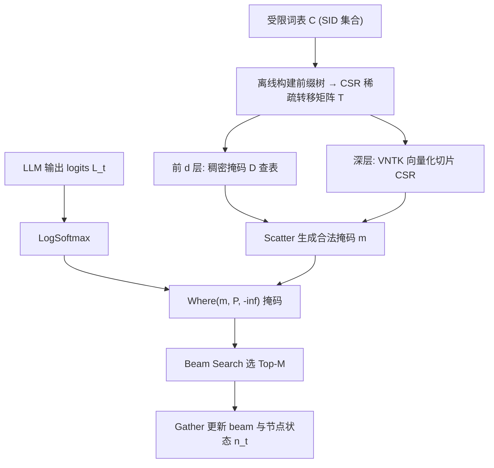
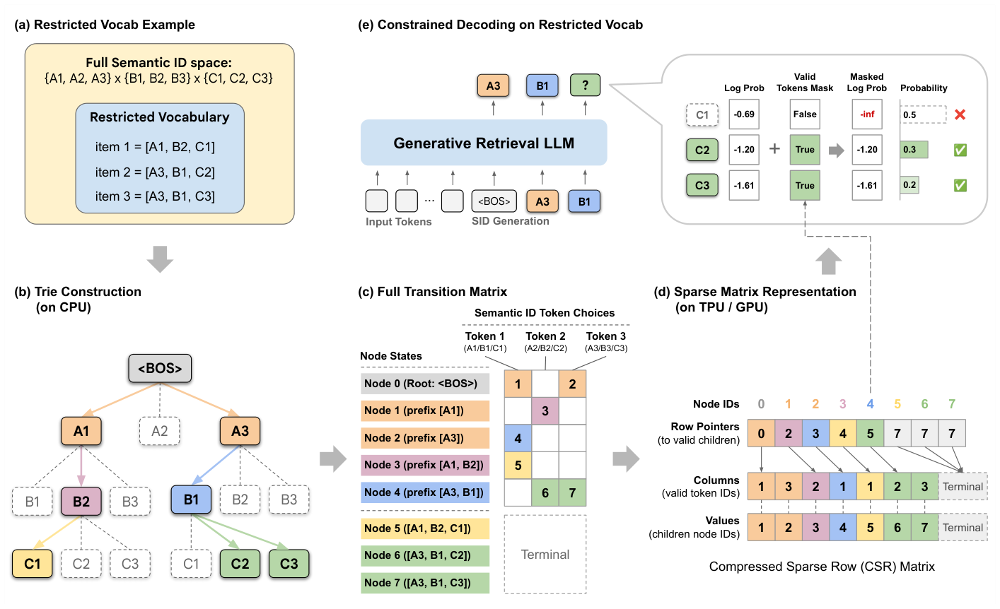

# Vectorizing the Trie: Efficient Constrained Decoding for LLM-based Generative Retrieval on Accelerators (向量化前缀树：面向加速器的生成式检索高效约束解码)

- **会议/期刊**: KDD 2026 (Camera-ready)
- **作者与机构**: Zhengyang Su, Isay Katsman, Yueqi Wang, Ruining He, Lukasz Heldt, Raghunandan Keshavan, Shao-Chuan Wang, Xinyang Yi, Mingyan Gao, Onkar Dalal, Lichan Hong, Ed H. Chi, Ningren Han (Google / Yale University)
- **推荐链路定位**: 端到端生成式召回
- **研究方向**: 生成式推荐与离散语义ID / 工业级全链路架构
- **论文原文**: [https://arxiv.org/abs/2602.22647v3](https://arxiv.org/abs/2602.22647v3)
- **开源代码**: [https://github.com/youtube/static-constraint-decoding](https://github.com/youtube/static-constraint-decoding)

## TL;DR (1分钟核心速览)

生成式检索（GR）用 LLM 自回归解码 Semantic ID 召回物品，但工业场景需按业务逻辑（新鲜度、品类、库存）限制输出空间，标准解码无法原生支持；而基于前缀树（Trie）的约束解码在 TPU/GPU 上因指针追逐导致严重延迟（CPU Trie 使推理时间翻倍）。本文提出 STATIC，将前缀树离线展平为静态 CSR 稀疏转移矩阵，把不规则树遍历转为全向量化稀疏算子，I/O 复杂度从 $O(\log|C|)$ 降至 $O(1)$。在 YouTube 20M 约束词表上每步仅增 0.033ms（占推理 0.25%），较 CPU Trie 加速 948×、较硬件二分基线加速 47–1033×，线上 A/B 中 7 日新鲜视频观看 +5.1%。

## Background & Motivation (背景与核心矛盾)

- **主流范式**: TIGER/PLUM/OneRec 等用 RQ-VAE 将物品量化为分层 Semantic ID，训练 Transformer 自回归逐 token 解码目标物品，绕过双塔 ANN 索引。
- **前人局限**: (1) 自回归模型会"幻觉"出下架、过期或违规物品的 SID，后置过滤浪费全部推理预算；(2) 现有 Trie 约束解码依赖指针追逐，随机非连续访存破坏 HBM 合并读取，且数据依赖控制流与 XLA/Inductor 静态图编译范式根本冲突。
- **核心洞察 (Key Insight)**: 约束词表在 SID 序列空间天然构成前缀树，而树遍历本质是稀疏状态转移——可用线性代数（GraphBLAS 思想）表达，从而复用编译器优化的稠密/稀疏算子。
- **本文切入点**: 把"图遍历问题"重铸为"向量化稀疏矩阵运算"，让约束检查完全留在加速器上、无主机-设备往返。

## Method (核心方法设计)

### 1. 整体框架 (Overall Architecture)

离线阶段：给定受限词表 $\mathcal{C}\subset\mathcal{V}^L$，在 CPU 上构建前缀树，将每个唯一前缀节点映射为状态整数 $s\in[S]$，展平为 CSR 稀疏转移矩阵 $\mathbf{T}\in\mathbb{Z}^{S\times|\mathcal{V}|}$（行指针 P、列索引 C、目标状态 V 三数组）。在线解码阶段：每步维护每条 beam 的当前节点向量 $\mathbf{n}_t\in\mathbb{Z}^{B\times M}$，前 $d$ 层（默认 $d=2$）用稠密布尔掩码张量 $\mathbf{D}$ 做 $O(1)$ 查表，深层用向量化节点转移核 VNTK 从 CSR 中切片取子节点，经 Scatter 生成稠密掩码，将非法 token 的 log-prob 置 $-\infty$ 后进入 beam search，并 Gather 更新节点状态。

<figure class="paper-figure" markdown="span">
  <figcaption>图 1：本图展示了完整的 STATIC 流程。图 1a 和 1b 给出了 V = {1, 2, 3}、𝐿= 3 且受限词表 C = {(1, 2, 1), (3, 1, 2), (3, 1, 3)} 情况下的前缀树构建。我们在语义 token 前加上字母 𝐴、𝐵、𝐶，分别表示第一、第二和第三层。图 1c 展示了相应的转移矩阵，并带有显式标签和颜色编码。图 1d 给出了完整转移矩阵的稀疏矩阵（CSR）表示。图 1e 展示了如何在解码时应用该稀疏矩阵来约束词表。</figcaption>
</figure>

### 2. 关键设计拆解 (Key Designs)

1. **CSR 展平的静态转移矩阵（消除指针追逐）**：痛点是指针树访存随机、无法合并读取。核心算子：对状态 $s$ 取 `row_start=P[s]`、`row_end=P[s+1]`，切片 `C[row_start:row_end]` 得合法 token、`V[row_start:row_end]` 得后继节点。由于约束词表极稀疏（常 ≤0.01% 合法路径），CSR 内存高效；且采用**堆叠 CSR 布局**把 token ID 与后继节点打包为 $(N_{edges},2)$ 张量，单次合并读取同时取回两者，随机访存减半。

2. **无分支向量化节点转移核 VNTK（适配静态图编译）**：痛点是各节点子节点数不一，动态分支在 XLA 触发重编译、在 GPU 引发 warp divergence。核心算子：对第 $\ell$ 层固定切片长度 $B_\ell=\max_{n\in N_\ell} b^\ell_n$（最大分支因子），用 `DynamicSlice` 取定长 $B_\ell$ 个候选，再用 `Range(B_ℓ) < N_child` 生成有效性掩码、`Where` 清洗越界项，最后 `Scatter` 投影为稠密布尔掩码。这样把"循环 N 次"的动态控制流变为"取定长 B 再掩码"的静态数据流，整个解码步保持单一静态计算图，算术单元满负荷。

3. **训练目标、负采样与推理效率**：本文是**推理期无损优化**，不改变训练目标（标准自回归交叉熵），也不涉及负采样。推理开销：每步仅 +0.033ms（3B 模型推理的 0.25%）；内存约 90MB/百万约束（20M 约束约 1.5GB HBM），可每芯片复制、免跨芯片通信。I/O 复杂度对约束集大小 $|C|$ 为 $O(1)$，对最大分支因子为渐近线性 $O(B)$。

## Experimental Setup & Evaluation Protocol (实验设置与评估协议)

- **数据集与预处理**:

| 数据集 | #Users | #Items | #Interactions | 稀疏度/密度 | 特征/场景说明 |
| :--- | :---: | :---: | :---: | :---: | :--- |
| YouTube 工业语料 | 十亿级 | 1亿–10亿 | — | — | SID: $L=8$, $\|\mathcal{V}\|=2048$；约束集为近 7 日 20M 新鲜视频 |
| Amazon Beauty | — | 1–2万 | — | — | SID: $L=4$, $\|\mathcal{V}\|=256$，RQ-VAE 量化 |
| Amazon Sports | — | 1–2万 | — | — | 同上 |
| Amazon Toys | — | 1–2万 | — | — | 同上 |

- **数据划分与防穿越 (Splitting Strategy)**: 冷启动实验按物品"年龄"（最老评论时间）将最新 2%/5% 物品划为冷启动集，过滤掉不含冷启动物品的训练序列，在含冷启动目标的测试序列上评估。
- **排名评测协议 (Ranking Protocol)**: 冷启动用 `Full-Ranking`（在完整物品语料上 beam search，$M=20$），报告 Recall@1；工业侧为线上 A/B 与延迟基准（100 次试验均值）。
- **对比基线与超参设置**: 延迟基线含 Unconstrained、CPU Trie、PPV Exact/Approximate、Hash Bitmap；冷启动基线含 Unconstrained、Constrained Random、Dense Retrieval（双塔，128 维，in-batch 对比损失）。工业模型为 3B 稠密 Gemini-based GR，batch=2/chip，beam $M=70$，TPU v6e；冷启动模型为 Gemma 1B，batch=16。

## Key Experimental Results (实验关键数据)

### 1. 主实验对比 (Main Results)

**表 1：YouTube 20M 约束词表下每解码步延迟开销**

| 方法 | 延迟 (ms) | 占推理时间 |
| :--- | :---: | :---: |
| Unconstrained | +0.0 | — |
| PPV Exact | +34.1 | 260% |
| CPU Trie | +31.3 | 239% |
| Hash Bitmap | +12.3 | 94.0% |
| PPV Approximate | +1.56 | 11.9% |
| **STATIC (Ours)** | **+0.033** | **0.25%** |

**表 2：线上 A/B（"近 7 日"新鲜度约束，Home Feed）**

| 指标 | 提升 | 95% 置信区间 |
| :--- | :---: | :---: |
| 7 日新鲜视频观看 | **+5.1%** | [5.0%, 5.2%] |
| 3 日新鲜视频观看 | **+2.9%** | [2.8%, 3.0%] |
| CTR | **+0.15%** | [0.01%, 0.29%] |
| 战略用户群满意度 | **+0.15%** | [0.03%, 0.27%] |

**表 3：Amazon 冷启动 Recall@1 (%)**

| 子数据集 | 方法 | 2% 冷启动 | 5% 冷启动 |
| :--- | :--- | :---: | :---: |
| Beauty | Unconstrained | 0.00 | 0.00 |
| | Const. Random | 0.42 | 0.17 |
| | Dense Retrieval | 0.88 | 0.63 |
| | **STATIC** | **4.29** | **1.60** |
| Sports | Unconstrained | 0.00 | 0.00 |
| | Const. Random | 0.27 | 0.11 |
| | Dense Retrieval | 0.85 | 0.36 |
| | **STATIC** | **1.24** | **1.17** |
| Toys | Unconstrained | 0.00 | 0.00 |
| | Const. Random | 0.42 | 0.17 |
| | Dense Retrieval | 0.49 | 0.44 |
| | **STATIC** | **4.39** | **2.25** |

### 2. 消融实验 (Ablation Study)

本文为系统级优化，无传统模块消融，但通过**配置维度扫描**验证各设计贡献：

| 配置维度 | 变化范围 | STATIC 延迟 (ms) | 对比基线表现 |
| :--- | :---: | :---: | :--- |
| 约束集大小 $\|C\|$ | $10^5\to10^8$ | 0.023→0.039（近恒定） | PPV Exact 6.4→38.7；CPU Trie 在 $10^8$ OOM |
| SID 词表 $\|\mathcal{V}\|$ | 256→32768 | 0.040→0.041（近恒定） | PPV Exact 6.0→578.7；Hash Bitmap 1.55→196.5 |
| 最大分支因子 $B$ | $2^1\to2^{18}$ | 渐近线性 $O(B)$ | — |
| 稠密层数 $d$ | $d=2$ vs 纯 CSR | 前两层 $O(1)$ 查表显著降延迟 | — |

### 3. 关键实验发现 (Key Findings)

1. **I/O 复杂度是分水岭**：STATIC 对 $|C|$ 从 $10^5$ 到 $10^8$ 延迟几乎不变（0.023→0.039ms），而 PPV Exact 因 $O(\log|C|)$ 二分从 6.4ms 涨到 38.7ms、CPU Trie 在 $10^8$ 直接 OOM——证明 $O(1)$ 合并读取在大词表下是数量级优势。
2. **混合稠密+稀疏策略是近恒定扩展的关键**：前 $d=2$ 层用稠密掩码吸收高分支，深层稀疏查找的最大分支因子因 $|\mathcal{V}|^\ell$ 指数增长而迅速超过 $|C|$ 保持很小，故对 $|\mathcal{V}|$ 从 256 到 32768 延迟稳定在 ~0.04ms，而 PPV Exact 暴涨 96×。
3. **约束解码本身即冷启动利器**：不重训模型、仅将解码限制在冷启动物品集，Beauty/Toys 的 2% 冷启动 Recall@1 从 0 跃至 4.29%/4.39%，约为 Dense Retrieval 的 5–9 倍——说明 GR 的冷启动瓶颈部分源于"模型不会生成未见 SID"，而非表征不足。

## Highlights, Limitations & Rating (亮点、对比与审稿评价)

- **与代表作对比 (vs. Prior Work)**: 相比 DISC-PPV 的扁平排序数组+并行二分（$O(\log|C|)$ I/O、且仅验 top-50 logits 为近似解），STATIC 用 CSR 稀疏矩阵实现精确且 $O(1)$ 的约束；相比 CPU Trie 的主机-设备往返（+31.3ms），STATIC 全程留在加速器；相比 FST，避免百万级 SID 词表下的状态爆炸（FST 需 4.96GB vs STATIC 1.5GB）与 XLA 不兼容。
- **可迁移亮点**: (1) "树/图结构 → 静态 CSR + 定长切片 + 掩码清洗"的无分支向量化范式，可迁移到任何需在加速器上做结构化约束的解码或检索场景；(2) 用约束解码提升冷启动，是一种零重训的推理期干预技巧。
- **审稿级局限批判**: (1) 稀疏转移矩阵目前为**离线构建**，实时库存/新鲜度变化需重建或重编译，动态更新尚未支持；(2) 冷启动实验仅在 1–2 万物品的 Amazon 子集、$L=4$ 小规模上验证，向工业十亿级语料的泛化性证据不足；内存随 $|C|$ 线性增长（~90MB/百万），十亿级约束需分片策略。
- **四维评分**: 创新性 ⭐⭐⭐⭐ | 实验扎实度 ⭐⭐⭐⭐⭐ | 方法清晰度 ⭐⭐⭐⭐⭐ | 落地价值 ⭐⭐⭐⭐⭐

