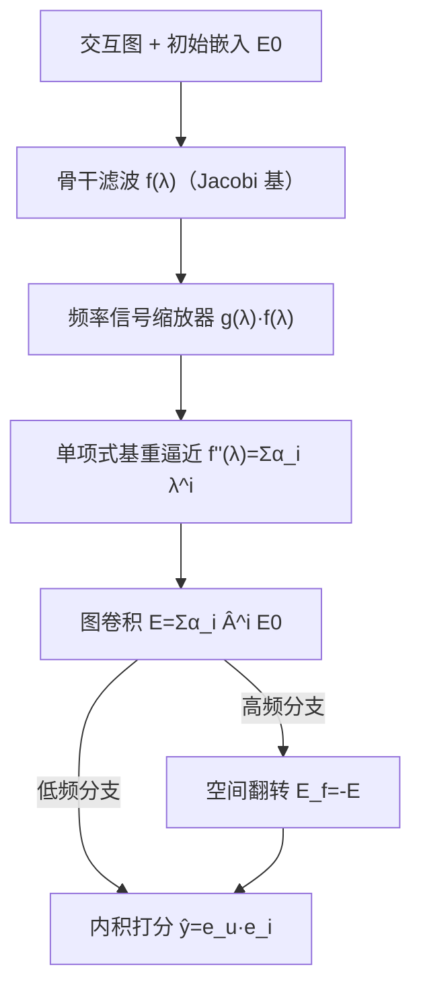

# How Do Graph Signals Affect Recommendation: Unveiling the Mystery of Low and High-Frequency Graph Signals (图信号如何影响推荐：揭开低频与高频图信号之谜)

- **会议/期刊**: KDD 2026
- **作者与机构**: Feng Liu, Hao Cang, Huanhuan Yuan, Jiaqing Fan, Yongjing Hao, Fuzhen Zhuang, Guanfeng Liu, Pengpeng Zhao（苏州大学、苏州科技大学、北京航空航天大学、麦考瑞大学）
- **推荐链路定位**: 召回（图协同过滤表征学习）
- **研究方向**: 图神经网络与知识图谱推荐 / 协同过滤与双塔召回
- **论文原文**: [https://arxiv.org/abs/2512.15744v1](https://arxiv.org/abs/2512.15744v1)
- **开源代码**: [https://github.com/mojosey/SimGCF](https://github.com/mojosey/SimGCF)

## TL;DR (1分钟核心速览)

谱图推荐长期被"低通滤波主导"的叙事垄断，而 JGCF 等工作又声称高频信号同样关键，二者矛盾悬而未决。本文从理论上证明：**同绝对值的低频 Low(I) 与高频 High(III) 滤波函数在推荐中等价**，二者都只是通过平滑用户-物品相似度起作用，关键在滤波波形而非频率高低；同时指出图嵌入信号 (GES) 因内积平方丢失负号，只能表达一半图信号特征。据此提出即插即用的**频率信号缩放器 (FSS)** 与**空间翻转 (SF)**，构成 SimGCF。在 4 个公开数据集、80/10/10 比例划分、全库排序协议下，SimGCF(I) 相对最强基线 JGCF 在 Gowalla Recall@20 上从 0.2172 提升至 0.2222（+2.3%），Amazon-Books 从 0.1144 提升至 0.1202（+5.1%）。

## Background & Motivation (背景与核心矛盾)

- **主流范式**: 基于图嵌入的谱图协同过滤（NGCF、LightGCN）用单项式基多项式逼近滤波函数 $f(\lambda)$，被普遍解读为"低通滤波器"，即低频图信号平滑相连节点相似度是推荐有效的根源。
- **前人局限**: 矛盾一，JGCF 用 Jacobi 基引入高频信号并报告增益，与"低通主导"假设直接冲突；矛盾二，现有工作默认"图嵌入信号 = 图信号"，却从未检验二者是否等价，导致高频信号在嵌入空间中的表达是否完整无人追问。
- **核心洞察 (Key Insight)**: 作者用同绝对值的 Low(I) 与 High(III) 波形做对照实验（图 1），发现四数据集 Recall@20 几乎重合；进一步推导发现，奇数阶多项式项在两种波形下完全相同，偶数阶项虽符号相反，但偶数阶项刻画的是 user-user / item-item 同类节点相似度，与 BPR 优化的 user-item 跨类相似度正交，故不冲突——**频率高低不是本质，波形（奇偶阶系数权重）才是**。
- **本文切入点**: 既然波形决定一切，就把波形变成可学习、可微调的对象（FSS）；既然 GES 丢负号，就用空间翻转把被隐藏的 High(III) 特征找回来（SF）。

## Method (核心方法设计)

### 1. 整体框架 (Overall Architecture)

SimGCF 以任意 GNN 滤波函数（默认 JGCF 的 Jacobi 基）为骨干，先经频率信号缩放器 $g(\lambda)$调制波形，再用单项式基重新逼近得到可学习系数$\alpha_i$，最后通过$\mathbf{E}=\sum_i \alpha_i \hat{\mathbf{A}}^i \mathbf{E}_0$完成图卷积。低频版本直接输出$\mathbf{E}_{\mathrm{I}}$；高频版本额外对嵌入做空间翻转$\mathbf{E}_{\mathrm{III}}^{f}=-\mathbf{E}_{\mathrm{III}}$，再与原始嵌入做内积恢复被平方抹掉的负号特征。两阶段训练：先预训练滤波系数（欧氏距离拟合），再以 BPR 训练推荐，推理时仅需一次多项式传播。

### 2. 关键设计拆解 (Key Designs)

1. **频率信号缩放器 FSS（把波形变成可调旋钮）**：原多项式滤波器的波形由固定超参决定，无法针对数据分布微调，而波形直接决定奇偶阶系数权重进而决定 user-item 相似度。作者用 Sigmoid 形缩放函数 $g(\lambda)=\frac{\mu}{1+e^{\alpha(\lambda+\beta)}}$提取待调频段（$\alpha<0$取低频、$\alpha>0$取高频，$\beta$控位置，$\mu$控幅度），与原滤波相乘得$f'(\lambda)=g(\lambda)\cdot f(\lambda)$，再用单项式基$f''(\lambda)=\sum_{i=0}^{n}\alpha_i\lambda^i$逼近，以$\mathcal{L}_{\text{filter}}=\|f'(X)-f''(X)\|^2$在$[-1,1]$ 采样点上预训练系数。直觉：相当于给原滤波器加了一个可学习的频段掩码，把 JGCF 中"有害的高频成分"压下去、有益成分提上来。
2. **空间翻转 SF（把被平方抹掉的负号找回来）**：GES 用 $\mathbf{S}_2=\mathbf{E}\mathbf{E}^{\top}$表达图信号，但$f(\lambda)<0$时$\mathbf{S}_2=(-\mathbf{X})(-\mathbf{X})^{\top}=\mathbf{X}\mathbf{X}^{\top}$，负号被平方消去，导致 High(III) 特征被隐藏（表 2 中 High(III) 翻转前 Recall@10 仅 0.0217，翻转后跃至 0.1362，与 Low(I) 的 0.1362 持平）。修复方式极简：$\mathbf{S}_2=-\mathbf{E}\mathbf{E}^{\top}=(-\mathbf{E})\mathbf{E}^{\top}=\mathbf{E}_f\mathbf{E}^{\top}$，即对嵌入做一次空间翻转再与原嵌入内积。
3. **训练目标、负采样与推理效率**：总损失 $\mathcal{L}=\mathcal{L}_{\text{bpr}}+w\|\mathbf{E}_0\|_2^2$，其中$\mathcal{L}_{\text{bpr}}=-\sum_{u}\sum_{i\in\mathcal{N}_u}\sum_{j\notin\mathcal{N}_u}\ln\sigma(\hat{y}_{ui}-\hat{y}_{uj})$，负样本为均匀随机采样。滤波系数预训练与推荐训练解耦，避免多目标干扰；每 epoch 耗时与 LightGCN 接近、优于 JGCF 与 NGCF（图 6），因为 LightGCN 本质是 SimGCF 在单项式基下的特例。

## Experimental Setup & Evaluation Protocol (实验设置与评估协议)

- **数据集与预处理**:

| 数据集 | #Users | #Items | #Interactions | 稀疏度 | 特征/场景说明 |
| :--- | :---: | :---: | :---: | :---: | :--- |
| Gowalla | 29,858 | 40,981 | 1,027,464 | 99.92% | LBS 签到社交图 |
| Amazon-Books | 52,642 | 91,598 | 2,984,108 | 99.94% | 电商图书评论 |
| Yelp2018 | 31,668 | 38,048 | 1,561,406 | 99.87% | 本地生活商户 |
| Alibaba-iFashion | 300,000 | 81,614 | 1,607,813 | 99.99% | 时尚电商，极稀疏 |

- **数据划分与防穿越 (Splitting Strategy)**: 随机 `80%/10%/10%` 比例划分（训练/验证/测试），非 Leave-One-Out、非全局时间戳切分。
- **排名评测协议 (Ranking Protocol)**: 采用无偏 `Full-Ranking` 全库未交互物品排序，指标为 Recall@{10,20} 与 NDCG@{10,20}；训练阶段负采样为均匀随机负样本。
- **对比基线与超参设置**: 基线覆盖 MF 类（BPR、NeuMF）、空域 GNN 类（NGCF、DGCF、LightGCN）、去噪类（GTN、RGCF）、对齐类（DirectAU）与谱图类（JGCF）；统一嵌入维度 $d=64$，batch size 4096（Amazon-Books 为 8192），Adam 优化，早停 5 epoch 以 Recall@20 为准，基于 RecBole 框架与 V100 复现。

## Key Experimental Results (实验关键数据)

### 1. 主实验对比 (Main Results)

| 数据集 | 指标 | LightGCN | GTN | DirectAU | JGCF* | SimGCF(I) | Improv.(vs JGCF*) |
| :--- | :--- | :---: | :---: | :---: | :---: | :---: | :---: |
| Gowalla | R@20 | 0.1983 | 0.2016 | 0.2014 | 0.2172 | **0.2222** | +2.30% |
| Gowalla | N@20 | 0.1175 | 0.1184 | 0.1170 | 0.1293 | **0.1321** | +2.17% |
| Amazon-Books | R@20 | 0.0953 | 0.0930 | 0.1053 | 0.1144 | **0.1202** | +5.07% |
| Amazon-Books | N@20 | 0.0615 | 0.0597 | 0.0689 | 0.0754 | **0.0801** | +6.23% |
| Yelp2018 | R@20 | 0.0913 | 0.0984 | 0.0907 | 0.1066 | **0.1075** | +0.84% |
| Yelp2018 | N@20 | 0.0569 | 0.0611 | 0.0553 | 0.0673 | **0.0682** | +1.34% |
| Alibaba-iFashion | R@20 | 0.0720 | 0.0625 | 0.0484 | 0.0823 | **0.0848** | +3.04% |
| Alibaba-iFashion | N@20 | 0.0316 | 0.0272 | 0.0207 | 0.0370 | **0.0380** | +2.70% |

注：JGCF* 为去除中频信号后的版本，以排除中频干扰、聚焦低频/高频对照；SimGCF(III) 与 SimGCF(I) 数值极为接近（如 Gowalla R@20 为 0.2183 vs 0.2222），实证了等价性结论。

### 2. 消融实验 (Ablation Study)

| 变体 | Gowalla R@20 | Amazon-Books R@20 | Yelp2018 R@20 | Alibaba R@20 |
| :--- | :---: | :---: | :---: | :---: |
| JGCF（原始混合） | 0.2172 | 0.1144 | 0.1066 | 0.0823 |
| JGCF(H)（仅高频） | 0.0383 | 0.0098 | 0.0494 | 0.0222 |
| JGCF(H)+SF（高频+空间翻转） | 0.1300 | 0.0404 | 0.0522 | 0.0639 |
| JGCF(L)（仅低频） | 0.2212 | 0.1167 | 0.1068 | 0.0834 |
| SimGCF(I)（低频+FSS） | **0.2222** | **0.1202** | **0.1075** | **0.0848** |
| SimGCF(III)（高频+FSS+SF） | 0.2183 | 0.1196 | 0.1082 | 0.0838 |

### 3. 关键实验发现 (Key Findings)

1. **原始 JGCF 中的高频成分实为"负资产"**：JGCF(H) 在 Gowalla 上 R@20 仅 0.0383，远低于 JGCF(L) 的 0.2212；而 JGCF 混合后为 0.2172，低于纯低频的 0.2212，说明未修复的高频信号确实拖累了模型，FSS 的价值之一正是把它压下去。
2. **空间翻转是高频分支的"生死开关"**：JGCF(H) 加 SF 后 Gowalla R@20 从 0.0383 跃至 0.1300（+239%），Amazon-Books 从 0.0098 升至 0.0404（+312%），定量印证了 GES 丢负号导致 High(III) 特征被隐藏的理论判断。
3. **等价性在端到端模型中复现**：SimGCF(I) 与 SimGCF(III) 在四个数据集上差距均在 0.5% 以内（Yelp2018 上 SimGCF(III) 甚至反超 0.1082 vs 0.1075），说明"低频/高频等价、波形为王"的结论不只在静态滤波实验中成立，在完整训练流程下同样稳健。

## Highlights & Limitations (亮点、对比与审稿批判)

- **与代表作对比 (vs. Prior Work)**: 与 LightGCN 相比，本文不改变传播骨架，而是把"低通即正义"的隐含假设替换为"波形可调"，且给出等价性证明；与 JGCF 相比，本文指出其高频增益实际来自未被正确表达的信号，并用 SF 显式修复，而非靠 Jacobi 基超参 $a,b$ 隐式调参；与 GC_CF/PGSP 等矩阵分解谱方法相比，本文保持图嵌入的可扩展性，无需特征值分解。
- **可迁移亮点**: 其一，FSS 作为即插即用模块可挂载到任意多项式基 GNN（作者明确声明不限于 Jacobi 基），工程改造成本极低；其二，"内积平方丢负号 → 空间翻转恢复"这一技巧可迁移到任何用 $\mathbf{E}\mathbf{E}^{\top}$ 表达图信号的对比学习或图池化场景。
- **审稿级局限批判**: 其一，等价性证明依赖"偶数阶项与 BPR 目标正交"的假设，该假设在引入额外对齐损失（如 DirectAU 的 uniformity 项）或列表级损失时是否仍成立未被讨论；其二，实验仅覆盖 80/10/10 随机划分与全库排序，缺少时间切分与冷启动划分下的验证，且 FSS 的 $\alpha,\beta,\mu$在四个数据集上最优值不一（$\alpha$ 在 -3 与 -1 间波动），超参敏感度较高，实际部署需逐场景调参。

## Rating (四维评分)

- **方法创新性 (Novelty)**: ⭐⭐⭐⭐ （等价性定理与 GES 丢负号的分析均有严格推导支撑，视角从"选频率"转向"调波形"，但 FSS 的 Sigmoid 形式本身较常规）
- **评估协议与实验扎实度 (Protocol & Experiments)**: ⭐⭐⭐⭐ （四数据集 + 全库排序 + 9 个基线 + 完整消融，但仅单一随机划分、缺时间切分与显著性检验）
- **写作与数学规范度 (Clarity & Rigor)**: ⭐⭐⭐⭐ （四象限滤波函数定义清晰、Corollary 1/2 证明链条完整，附录补充充分；符号略密，初读需对照图 2 理解）
- **工业落地与复现价值 (Industrial & Practical Value)**: ⭐⭐⭐⭐ （代码已开源，FSS 即插即用、每 epoch 耗时接近 LightGCN，预训练阶段开销可忽略，适合大规模图召回场景快速试装）
