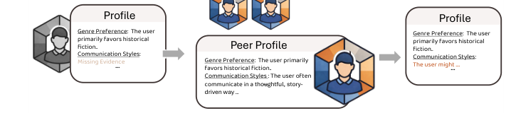
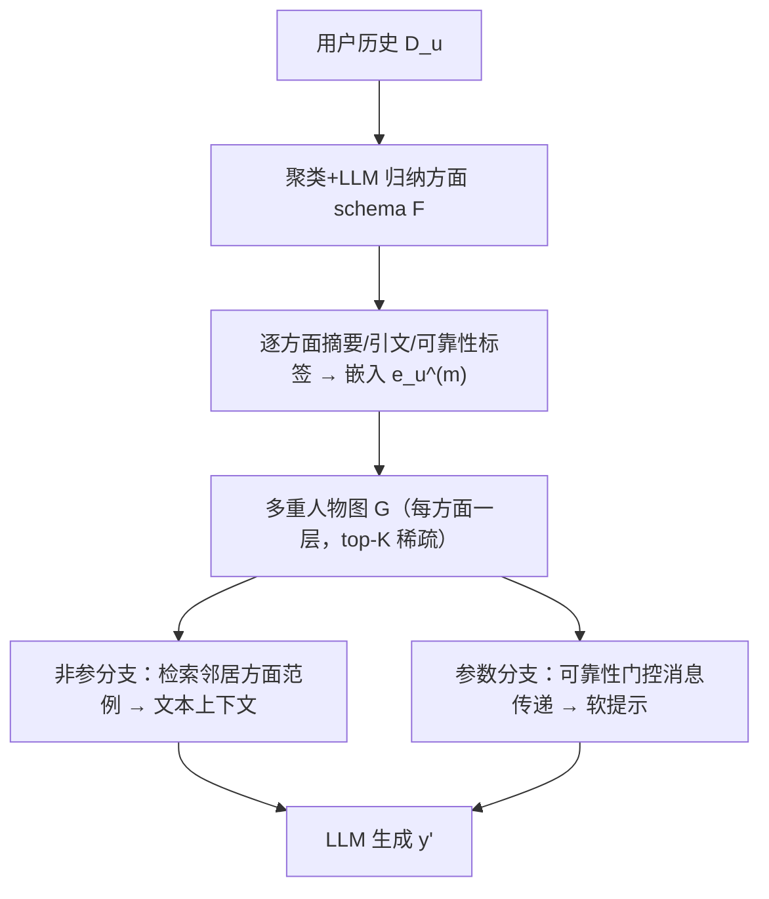
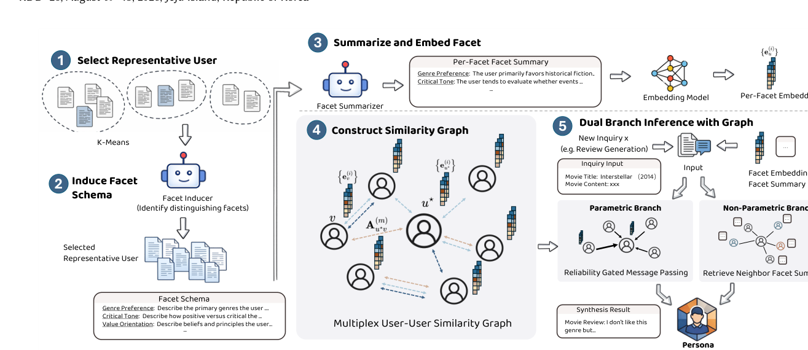

# CoPersona: Collaborative Persona Graphs for Robust LLM Personalization (协作式人物画像图用于鲁棒 LLM 个性化)

- **会议/期刊**: KDD 2026
- **作者与机构**: Yangtian Zhang, Leyao Wang, Hiren Madhu, Ngoc Bui, Walter Roznyatovskiy (Samsung), Rex Ying — Yale University
- **推荐链路定位**: 端到端生成式（个性化文本生成 / 评论生成）
- **研究方向**: 大语言模型推荐 (LLM4Rec) / 图神经网络与知识图谱推荐
- **论文原文**: [https://arxiv.org/abs/2607.01485v1](https://arxiv.org/abs/2607.01485v1)
- **开源代码**: 暂未开源（仅引用 `all-mpnet-base-v2` 编码器）

## TL;DR (1分钟核心速览)

真实用户历史稀疏且偏斜，导致"方面覆盖偏差 (Facet Coverage Bias)"：测试请求落在弱观测方面时，检索式个性化只能从主导方面外推、产生 over-transfer。CoPersona 先用 LLM 从人群数据归纳可解释方面 schema，把每个用户历史拆成方面级摘要与嵌入，构建"每方面一层"的多重用户–用户相似图，再以**非参邻居检索（文本空间）+ 可靠性门控消息传递（隐空间软提示）**双分支补全缺失方面。在 Amazon Reviews 2023 六个类目、Qwen2.5-7B 上，Books 相对最强基线 DEP 提升 ROUGE-1 +3.3、METEOR +3.4、BLEU +3.1，LLM-as-Judge 的 Practical Details 提升 +1.24。

## Background & Motivation (背景与核心矛盾)

- **主流范式**: 记忆–检索管线（RAG/PAG/DPL/DEP）把用户历史片段或对比式画像拼进 prompt，或学习用户嵌入作软提示。
- **前人局限**: ① 历史在方面维度上分布极不均匀，某些方面（如语气、价值观）几乎无证据，形成"方面级冷启动"；② 现有跨用户方法（DPL/DEP）依赖**全局无结构相似度**做浅层邻居借用，无法说明"哪个方面相似、该迁移什么信号"，在稀疏偏斜历史下易负迁移。
- **核心洞察 (Key Insight)**: 非观测 ≠ 不存在。在**已观测方面**上对齐的用户，更可能在**未观测方面**上共享属性——因此相似度必须按方面分层建模，而非坍缩为单一标量。
- **本文切入点**: 把个性化重写为条件于多重人物图 $\mathcal{G}$的生成$P_\theta(y'|x',\mathcal{D}_u,\mathcal{G})$，实现"按方面定向借用"。

<figure class="paper-figure" markdown="span">
  <figcaption>图1：方面覆盖偏差与协作式人物画像补全。通过利用行为对齐的同伴，可以推断出互补的方面证据。</figcaption>
</figure>

## Method (核心方法设计)

### 1. 整体框架 (Overall Architecture)

三阶段闭环：(1) **方面解耦**——对每个用户拼接至多 $R$条历史得画像文本，句编码后 KMeans 聚类出代表性人物模式，用 LLM 对比各簇的关键词与证据包，归纳出$M$个正交方面（名称+定义+打分规范）；再逐用户逐方面让 LLM 产出摘要$s_u^{(m)}$、支撑引文$ev_u^{(m)}$与可靠性标签$r_u^{(m)}\in\{\text{none,weak,moderate,strong}\}$，编码为$\ell_2$归一化嵌入$e_u^{(m)}$（无证据时填中性占位文本，保证每人每方面都有良定义表示）。(2) **多重图构建**——每方面一层，层内按方面嵌入余弦相似度连边并 top-$K$ 稀疏化。(3) **双分支推理**——文本空间检索邻居方面范例拼入 prompt，隐空间做可靠性门控消息传递并投影为软提示 token，与 BM25 自历史检索结果共同条件化 LLM。

<figure class="paper-figure" markdown="span">
  <figcaption>图2：CoPersona概览。CoPersona通过以下方式对LLM进行个性化：(1) 挖掘代表性用户并归纳全局方面模式；(2) 按方面对每个用户进行总结，并构建多重用户–用户相似度图（每个方面一层）；(3) 执行双分支推理，将非参数化的方面级邻居检索与参数化的图推理（例如可靠性门控消息传递）相结合，以合成用于生成的个性化人物画像信号。</figcaption>
</figure>

### 2. 关键设计拆解 (Key Designs)

1. **可靠性门控的方面级连边（Reliability-Gated Facet Edges）**：痛点是无证据方面会污染相似度。做法是把可靠性标签乘进相似度：$\tilde{A}_{uv}^{(m)}=\omega(r_u^{(m)})\,\omega(r_v^{(m)})\,A_{uv}^{(m)}$，其中$A_{uv}^{(m)}=\cos(e_u^{(m)},e_v^{(m)})$，$\omega(\text{none})\le\cdots\le\omega(\text{strong})$。直觉：低证据方面的边被自动降权，邻居只能由"双方都说得清"的方面支撑，从源头抑制噪声借用。

2. **自–邻可靠性插值的消息传递（Self-vs-Neighbor Gate）**：痛点是非参检索受上下文长度与噪声限制，且无法在隐空间补全缺失方面。做法是把离散标签经单调函数 $f_\theta$映射为信任门$\gamma_u^{(m)}\in[0,1]$，在用户级共享邻居集$\mathcal{N}_u$ 上聚合后插值：
$$\mathbf{h}_u^{(m)}=\sigma\!\left(W\!\left(\gamma_u^{(m)}\mathbf{h}_u^{(0,m)}+(1-\gamma_u^{(m)})\tilde{\mathbf{h}}_u^{(m)}\right)\right),\quad \tilde{\mathbf{h}}_u^{(m)}=\mathrm{Agg}_{v\in\mathcal{N}_u}\mathbf{h}_v^{(0,m)}$$
当 $\gamma\approx1$时几乎只用自身嵌入，$\gamma\approx0$时几乎完全由同伴补全——把"该信自己还是信邻居"变成可学习的连续旋钮。层间再加跨方面自注意力捕捉方面间语义依赖，拼接得$\mathbf{h}_u=[\mathbf{h}_u^{(1)}\|\cdots\|\mathbf{h}_u^{(M)}]$。

3. **训练目标与推理效率**：软提示 $S_u=\mathrm{reshape}(W_p\mathbf{h}_u)\in\mathbb{R}^{L_p\times d_{\text{LLM}}}$，与 BM25 检索的自历史$\mathcal{H}_u(x')$、邻居范例上下文$C_u^{\text{peer}}$及查询拼接，最小化负对数似然$\mathcal{L}=-\sum_t\log P_{\text{LLM}}(y_t|y_{<t},S_u,C_u(x'),x')$；采用 LoRA + 软提示联合微调，**无负采样**（生成式 NLL 目标）。推理时软提示可缓存，邻居检索为图上的 top-$K$查表，开销主要在离线画像构建（每用户$M$ 次 LLM 摘要调用）。

## Experimental Setup & Evaluation Protocol (实验设置与评估协议)

- **数据集与预处理**: Amazon Reviews 2023，沿用 DEP 的 Books/Movies & TV/CDs & Vinyl 划分，并用 DPL 管线新构造三个更稀疏类目；刻意限制每用户评论数以维持稀疏性。

| 数据集 | #data | Profile Size | Output Length | Facet-biased 比例 |
| :--- | :---: | :---: | :---: | :---: |
| Books | 3173 | 4.84±22.55 | 1194.90±802.44 | 309 (97.48%) |
| Movies & TV | 1925 | 41.11±35.90 | 1704.61±1752.44 | 1925 (100.00%) |
| CDs & Vinyl | 1754 | 38.50±32.37 | 1600.04±1419.89 | 1548 (88.26%) |

- **数据划分与防穿越**: 直接沿用 DPL 提供的原始测试划分（用户级留出），未额外做时间戳切分。
- **排名评测协议**: 非排序任务，采用生成指标 ROUGE-1/L、METEOR、SacreBLEU、BERTScore（`led-base-16384`），外加 Qwen2.5-72B-Instruct-AWQ 的 LLM-as-Judge 三维打分（Authenticity / Practical Details / Human Likeness，仅 Books，受上下文窗口限制）。
- **对比基线与超参设置**: Non-Perso、RAG、PAG、DPL、DEP；基座 Qwen2.5-7B-Instruct（部分基线另报 32B），方面嵌入用 `all-mpnet-base-v2`，每层 top-5 邻居，解码温度 0.8。

## Key Experimental Results (实验关键数据)

### 1. 主实验对比 (Main Results)

| 模型 | 方法 | Books R-1 | Books MET. | Books BLEU | Books BS | M&TV R-1 | CDs R-1 |
| :--- | :--- | :---: | :---: | :---: | :---: | :---: | :---: |
| 32B | DPL | 0.3392 | 0.3003 | 7.7423 | 0.5156 | 0.2967 | 0.3119 |
| 7B | RAG | 0.3149 | 0.2101 | 3.6874 | 0.5083 | 0.2693 | 0.2796 |
| 7B | PAG | 0.3136 | 0.2378 | 4.6762 | 0.4992 | 0.2761 | 0.2882 |
| 7B | DPL | 0.3194 | 0.2459 | 5.6623 | 0.5050 | 0.2845 | 0.2952 |
| 7B | DEP | 0.3621 | 0.3009 | 12.3350 | 0.5496 | 0.3061 | 0.3143 |
| 7B | **CoPersona** | **0.3953** | **0.3349** | **15.4703** | **0.5729** | **0.3142** | **0.3216** |
| | Improv. vs DEP | +9.2% | +11.3% | +25.4% | +4.2% | +2.6% | +2.3% |

稀疏类目（7B）：Video Games R-1 0.2928 / BLEU 5.87，Sports & Outdoors R-1 0.3004 / BLEU 5.86，均显著高于 DEP（0.2655/4.66、0.2839/4.68）。LLM-as-Judge（Books）：Practical Details **8.39±0.91** vs DEP 7.15±1.39（+1.24），Human Likeness 7.69 vs 7.50。

### 2. 消融实验 (Ablation Study)

| 配置 (Books) | R-1 | R-L | MET. | BLEU |
| :--- | :---: | :---: | :---: | :---: |
| Full model | **0.3953** | **0.2254** | **0.3349** | **15.4703** |
| w/o 非参分支 | 0.3822 (-0.0131) | 0.2190 | 0.3149 | 13.3008 (-2.17) |
| w/o 参数分支 | 0.3673 (-0.0280) | 0.2067 | 0.2890 | 11.3355 (-4.13) |
| 换 Contriever 检索 | 0.3906 (-0.0047) | 0.2226 | 0.3337 | 15.2739 |
| 换 Recency 检索 | 0.4062 (+0.0109) | 0.2408 | 0.3520 | 16.6532 |

### 3. 关键实验发现 (Key Findings)

1. **参数分支是主力，非参分支是增益项**：去掉隐空间图推理损失 R-1 0.0280 / BLEU 4.13，是去掉文本检索分支（0.0131 / 2.17）的两倍以上——说明在方面覆盖偏差下，"隐空间去噪+补全"比"多塞几段邻居文本"更关键，二者互补而非冗余。
2. **偏差是普遍现象而非个例**：Movies & TV 100%、Books 97.48%、CDs 88.26% 的用户至少有一个方面支撑强度不超过 moderate，直接解释了为何全局相似度借用会系统性失效，也解释了 CoPersona 在越稀疏类目（Video Games/Sports）上 BLEU 相对增益越大。
3. **检索后端不是瓶颈，方面粒度才是**：把 BM25 换成稠密 Contriever 仅掉 0.0047 R-1，而简单的 recency 启发式反而涨到 0.4062——增益来自方面级图结构而非检索器；同时方面数从 3 增至 6 单调小幅提升、邻居数在 3 左右饱和，说明"细粒度结构 + 小邻域"即可捕获大部分协作收益。

## Highlights & Limitations (亮点、对比与审稿批判)

- **与代表作对比 (vs. Prior Work)**: DPL 用"目标用户 vs 相似同伴"的对比文本画像，DEP 学单一用户嵌入作软提示，二者都建立在**全局无结构相似度**上；CoPersona 把相似度拆成 $M$ 层方面图并显式门控可靠性，实现"定向迁移"而非" indiscriminate 聚合"。相较 RAG/PAG 的单用户历史检索，它引入了跨用户补全通道。
- **可迁移亮点**: ① "LLM 归纳方面 schema + 可靠性标签"这一数据驱动的画像解耦流程，可直接移植到跨域推荐或用户建模的特征工程；② 自–邻信任门 $\gamma$ 的插值形式，是把"置信度"注入图消息传递的轻量范式，适用于任何带缺失模态的图聚合。
- **审稿级局限批判**: ① 离线画像构建需对每用户每方面调用 LLM 摘要，$N\times M$次调用在百万级用户上成本不可忽视，论文未给出端到端延迟/成本分析；② 评估仅限评论生成这一任务，且 LLM-as-Judge 只在 Books 上做（受上下文窗口限制），缺少排序/推荐场景验证与人工评估；③ 方面数、邻居数、可靠性权重$\omega$ 的设定偏经验，跨域迁移时 schema 需重诱导。

## Rating (四维评分)

- **方法创新性 (Novelty)**: ⭐⭐⭐⭐ （把协同过滤的"方面级借用"形式化为多重图+可靠性门控，思路清晰但组件均为已知技术的组合创新）
- **评估协议与实验扎实度 (Protocol & Experiments)**: ⭐⭐⭐ （六数据集+双模型规模+LLM-as-Judge 较完整，但缺人工评估、缺排序任务、划分沿用旧工作未做时间切分）
- **写作与数学规范度 (Clarity & Rigor)**: ⭐⭐⭐⭐ （公式简洁、符号一致、方面 schema 示例表直观；门控函数 $f_\theta$与$\omega$ 细节被推入附录，正文略欠完整）
- **工业落地与复现价值 (Industrial & Practical Value)**: ⭐⭐⭐ （软提示可缓存、图检索为查表，推理友好；但画像构建的 LLM 调用成本与未开源代码削弱了直接复现性）
