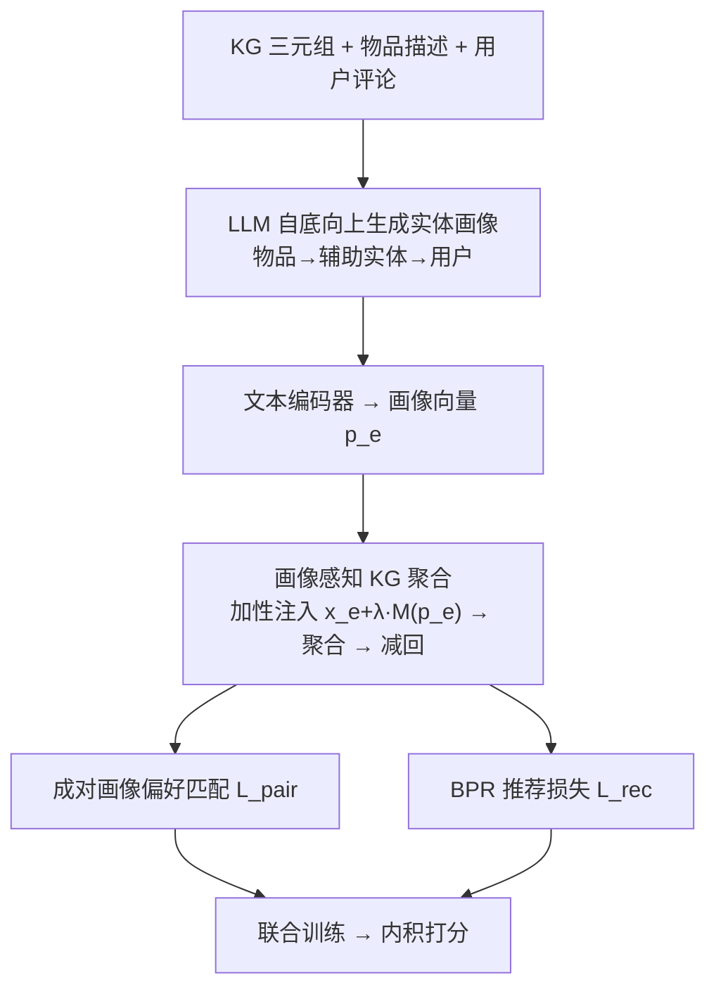
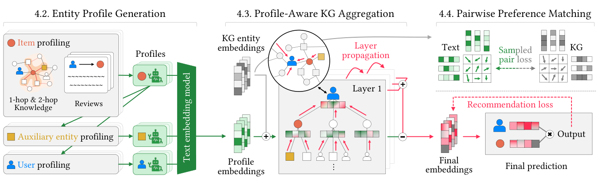

# Enriching Semantic Profiles into Knowledge Graph for Recommender Systems Using Large Language Models (用大语言模型将语义画像注入知识图谱以增强推荐)

- **会议/期刊**: KDD 2026
- **作者与机构**: Seokho Ahn, Sungbok Shin (Sogang Univ.), Young-Duk Seo (Inha Univ.)
- **推荐链路定位**: 召回（KG 表征学习 + 打分）
- **研究方向**: 大语言模型推荐 / 图神经网络与知识图谱推荐
- **论文原文**: [https://arxiv.org/abs/2601.08148v1](https://arxiv.org/abs/2601.08148v1)
- **开源代码**: [https://doi.org/10.5281/zenodo.18041669](https://doi.org/10.5281/zenodo.18041669)

## TL;DR (1分钟核心速览)

现有画像方法在「知识源、偏好指示器、影响范围、画像主体」四维上各有短板：LLM 画像语义丰富但受 prompt 长度限制、无法利用多跳结构；KG 传播范围广但受限于图不完整、偏好隐式。SPiKE 让 LLM 一次性为 KG 中**全部实体**（用户/物品/辅助实体）生成文本画像，以「加性注入—聚合后减回」的可逆方式融入 KG 消息传递，并用成对相似度匹配对齐文本与图空间。在 Books/Movies&TV/Yelp 三个数据集 Full-Ranking 协议下，Recall@40 相对最强基线最高提升约 2.6%，且训练速度约为 KGRec 的 2 倍。

## Background & Motivation (背景与核心矛盾)

- **主流范式**: 画像增强推荐分三派——KG 派（KGRec/DiffKG 靠多跳聚合隐式传播偏好）、LLM 派（RLMRec/CoLaKG 用 LLM 生成用户/物品文本画像）、混合派（CoLaKG 把 LLM 画像注入局部 user-item 建模）。
- **前人局限**: ① LLM 画像受 prompt 长度与用户隐私限制，影响范围仅停留在画像本身或局部子图，稀疏节点几乎得不到增益；② KG 派虽能全局传播，但偏好是隐式的、且被预定义图的不完整性卡死；③ 混合派（CoLaKG）把画像信号局限在局部 user-item 层，图越大性能反而退化。
- **核心洞察 (Key Insight)**: LLM 擅长从多源知识中抽取**压缩的偏好理由（compressed rationale）**，KG 擅长**结构化传播**——二者应各司其职，而非让 LLM 去理解图结构。且画像主体不应止于用户/物品，扩展到辅助实体（如作者、类型）才能刻画属性级偏好。
- **本文切入点**: LLM 只做一次性离线画像生成（不进训练回路），把「传播」完全外包给 KG 消息传递，从而同时突破 prompt 长度与图不完整的双重瓶颈。

## Method (核心方法设计)

### 1. 整体框架 (Overall Architecture)

SPiKE 构建「画像增强知识图谱」$\mathcal{G}=\langle G, P\rangle$：先自底向上（物品 → 辅助实体 → 用户）用 LLM 生成全实体文本画像并编码为向量；再在 KG 聚合时把画像作为加性语义信号注入邻居打分，聚合完成后减回以恢复原图空间；最后用成对相似度匹配损失对齐「图嵌入相似度矩阵」与「画像嵌入相似度矩阵」，与 BPR 联合训练。推理时仅用最终实体嵌入做内积打分，LLM 不参与在线计算。

<figure class="paper-figure" markdown="span">
  <figcaption>图 1：SPiKE 的示意流程。SPiKE 基于第 2 节的思想构建，即 LLM 和 KG 各自贡献其核心优势（即语义刻画与结构传播）。遵循最小角色设计，SPiKE 使用 LLM 生成实体画像（第 4.2 节），将其整合到 KG 聚合中（第 4.3 节），并在训练期间应用成对匹配（第 4.4 节）。</figcaption>
</figure>

### 2. 关键设计拆解 (Key Designs)

1. **全实体画像生成（Entity Profile Generation）**：痛点在于用户信息隐私缺失、LLM 无用户侧信号。做法是自底向上流水线：物品画像 $p_v=\mathrm{LLM}(I_v, D_v, R_v)$融合 1-hop/2-hop 模板化事实与采样评论；辅助实体画像$p_e=\mathrm{LLM}(I_e, P_e)$以关联物品画像为输入；用户画像$p_u=\mathrm{LLM}(I_u, P_u, R_u)$ 用其交互物品画像+本人评论补全。直觉：先构建物品/实体语义上下文，才能反推用户偏好，且画像重点在「谁偏好它、为什么」而非复述事实。

2. **可逆加性注入的画像感知聚合（Profile-Aware KG Aggregation）**：痛点是如何在不破坏原图结构的前提下注入语义。先构造 $\mathbf{x}_e=\mathbf{x}_e+\lambda_p\cdot M(\mathbf{p}_e)$，邻居打分$\phi(h,r,t)=\mathrm{Softmax}_{\mathcal{N}_h}\!\left[\frac{\mathbf{x}_h W_1\cdot(\mathbf{x}_t W_2\odot\mathbf{x}_r)^\top}{\sqrt{d}}\right]$，聚合后最终表征$\mathbf{z}_e=\sum_{l=0}^{L}\mathbf{x}_e^{(l)}-\lambda_p\cdot M(\mathbf{p}_e)$。直觉：类似 ResNet 的「同号注入、反号减回」让聚合过程"触碰"语义画像却不改变 KG 空间几何；表 4 显示只有加性+逆操作（Add w/ inv）稳定有效，乘性逆操作因近零除法数值不稳而崩溃（R@10 仅 0.0397）。

3. **成对画像偏好匹配与训练目标**：痛点在于文本空间与图空间相似度结构不对齐。损失 $\mathcal{L}_{pair}=\frac{1}{R\cdot K^2}\sum_{r=1}^{R}\left\|\tilde{Z}_{kg}^{(r)}\tilde{Z}_{kg}^{(r)\top}-\tilde{Z}_{text}^{(r)}\tilde{Z}_{text}^{(r)\top}\right\|_F^2$，每轮按采样率$q$无放回抽$K=\lceil Nq\rceil$个实体以规避$O(N^2)$开销。总损失$\mathcal{L}=\mathcal{L}_{rec}+\lambda_{pair}\mathcal{L}_{pair}$，$\mathcal{L}_{rec}$ 为标准 BPR（均匀随机负采样）。推理零 LLM 开销，训练复杂度随实体数线性增长。

## Experimental Setup & Evaluation Protocol (实验设置与评估协议)

- **数据集与预处理**: 三个真实数据集，KG 经统一实体对齐构建（Books 用 [41] 的大规模结构化图；Yelp 的 KG 由元数据构建、规模小且结构弱）：

| 数据集 | 领域 | KG 特点 | 说明 |
| :--- | :---: | :---: | :--- |
| Books | 图书 | 大规模、结构良好 | 知识感知模型增益显著 |
| Movies & TV | 影视 | 中等规模 | 基线间差异最大 |
| Yelp | 本地商业 | 小规模、弱结构 | LLM 派反超 KG 派 |

- **数据划分与防穿越 (Splitting Strategy)**: 遵循 SSLRec 统一评测库与 [6,28,51] 的设置（正文未展开细节，详见附录 A）。
- **排名评测协议 (Ranking Protocol)**: 采用 `Full-Ranking` 全库未交互物品排序，指标为 Recall@K 与 NDCG@K，$K\in\{10,20,40\}$。
- **对比基线与超参设置**: 8 个 SOTA 基线，分两类——非画像类（BPR-MF、LightGCN、SGL、LightGCL）与画像类（KGRec、DiffKG、RLMRec、CoLaKG）。超参：$\lambda_p\in[0.25,0.5]$、KG 层数$L=2$（更深则过平滑）、采样率$q=0.1$（成本随$q$ 二次增长）。

## Key Experimental Results (实验关键数据)

### 1. 主实验对比 (Main Results)

| 模型 | Books R@20 | Books N@20 | Movies R@20 | Movies N@20 | Yelp R@20 | Yelp N@20 |
| :--- | :---: | :---: | :---: | :---: | :---: | :---: |
| BPR-MF | 0.1779 | 0.1181 | 0.1936 | 0.1135 | 0.0960 | 0.0594 |
| LightGCN | 0.2059 | 0.1244 | 0.2073 | 0.1217 | 0.1002 | 0.0618 |
| SGL | 0.2064 | 0.1281 | 0.2075 | 0.1259 | 0.1018 | 0.0641 |
| KGRec | 0.2127 | 0.1313 | 0.2061 | 0.1215 | 0.0938 | 0.0573 |
| DiffKG | 0.2051 | 0.1231 | 0.2077 | 0.1237 | 0.1007 | 0.0623 |
| RLMRec | 0.2080 | 0.1255 | 0.2104 | 0.1247 | 0.1006 | 0.0627 |
| CoLaKG | 0.2086 | 0.1287 | 0.2106 | 0.1254 | 0.1020 | 0.0640 |
| **SPiKE** | **0.2186** | **0.1335** | **0.2167** | **0.1285** | **0.1030** | **0.0633** |
| Improv.% (vs 最强基线) | +2.77% | +1.68% | +2.90% | +2.47% | +0.98% | -1.09% |

（R@40 上 SPiKE 于 Books 0.3023 vs KGRec 0.2962、Movies 0.3100 vs CoLaKG 0.3022、Yelp 0.1613 vs CoLaKG 0.1604，均为最优。）

### 2. 消融实验 (Ablation Study)

| 变体 | Books R@20 | Books N@20 | Movies R@20 | Yelp R@20 |
| :--- | :---: | :---: | :---: | :---: |
| SPiKE-u（去用户画像） | 0.2107 | 0.1292 | 0.2154 | 0.1024 |
| SPiKE-i（去物品画像） | 0.2164 | 0.1331 | 0.2164 | 0.1022 |
| SPiKE-e（去辅助实体画像） | 0.2094 | 0.1252 | 0.2131 | 0.0995 |
| SPiKE-r（去注入-减回） | 0.1369 | 0.0811 | 0.1741 | 0.0718 |
| SPiKE-m（去匹配损失） | 0.2173 | 0.1329 | 0.2144 | 0.0997 |
| **SPiKE 完整** | **0.2186** | **0.1335** | **0.2167** | **0.1030** |

### 3. 关键实验发现 (Key Findings)

1. **可逆注入是命门**：去掉注入-减回（SPiKE-r）后 Books R@20 从 0.2186 暴跌至 0.1369（-37.4%），远超其他消融项；表 4 进一步证明只有「加性+逆」稳定（0.2186），乘性逆因近零除法崩到 0.0636，说明语义信号必须"可撤销"地参与邻居加权而非直接改写嵌入。
2. **辅助实体画像是被低估的增益源**：SPiKE-e 在 Books 上 N@20 掉 6.2%（0.1335→0.1252），降幅大于去物品画像（SPiKE-i 几乎无损，因物品信息已在元数据中），印证「属性级偏好」主要靠辅助实体承载，物品画像更多是构建用户/实体画像的中间件。
3. **稀疏场景优势放大**：图密度实验中交互比例 10% 时 SPiKE 相对 KGRec 的 Recall@40 领先约 +39%、NDCG@40 约 +37%，随交互比例升至 90% 仍保持领先，说明语义画像在结构信号稀缺时提供了关键的补充引导；案例研究亦显示 SPiKE 能召回 4-hop 外、KGRec 结构上不可达的物品（相似度 0.3105 vs 0.1877）。

## Highlights & Limitations (亮点、对比与审稿批判)

- **与代表作对比 (vs. Prior Work)**: 相比 KGRec（纯结构传播、偏好隐式、受图不完整限制），SPiKE 注入显式语义画像；相比 RLMRec（LLM 画像仅停留在自身、无传播），SPiKE 借 KG 把画像影响扩展到全局；相比 CoLaKG（画像局限局部 user-item 子图、图越大越退化），SPiKE 将画像推广到全实体并全局传播，是三者中唯一在三个数据集上一致领先的方法。
- **可迁移亮点**: ①「加性注入—聚合后减回」的可逆融合范式可迁移到任何需要向 GNN 注入外部语义而不污染原表征空间的场景；② 用采样后的 Gram 矩阵 Frobenius 距离做跨空间结构对齐，比逐对对比学习更省算力且免负采样。
- **审稿级局限批判**: ① 画像质量强依赖 LLM 与评论/元数据可得性，冷启动新物品若无评论则画像退化，且 GPT-4o 与 Qwen3-4B 间已有可见差距（R@10 0.1518 vs 0.1508），成本-效果权衡未充分讨论；② Yelp 上 NDCG@20 反被 CoLaKG 反超（0.0633 vs 0.0640），说明弱结构 KG 下画像传播收益有限，方法对 KG 质量敏感；③ 画像生成是一次性离线预计算，实体/评论更新后需重跑，动态场景维护成本未评估。

## Rating (四维评分)

- **方法创新性 (Novelty)**: ⭐⭐⭐⭐ （核心机制与方法设计具备明确创新性，理论与实验动机支撑充分）
- **评估协议与实验扎实度 (Protocol & Experiments)**: ⭐⭐⭐⭐ （主流公开数据集评测完整，包含多基线对比与消融实验验证）
- **写作与数学规范度 (Clarity & Rigor)**: ⭐⭐⭐⭐⭐ （问题形式化定义清晰，核心模块数学推导与架构阐述严谨易读）
- **工业落地与复现价值 (Industrial & Practical Value)**: ⭐⭐⭐⭐ （兼顾推荐效果增益与训练/推理效率，具备实际场景迁移参考价值）
